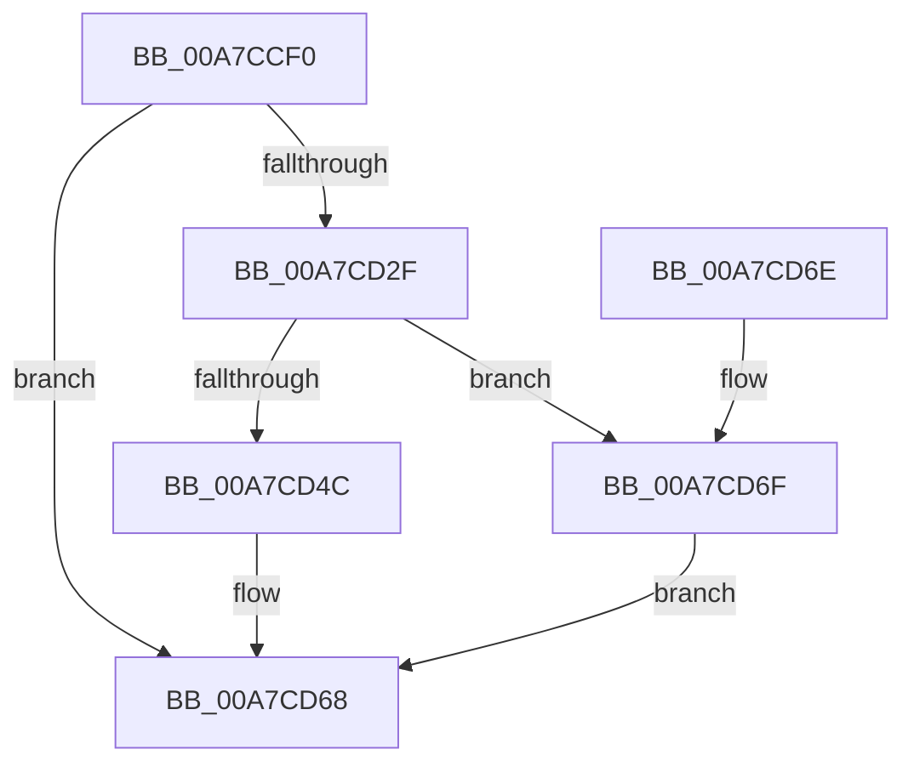

# NtRegisterThreadTerminatePort

- RVA: `0x00A7CCF0`–`0x00A7CD80` (길이 `144` bytes)
- VA: `0x0000000140A7CCF0`
- 실행 섹션: `PAGE`
- PDB 이름 있음: `예`; PDB Function 태그: `아니요`
- unwind 정보 RVA: `0x000B695C`
- 디코드: `35`개 명령, `144/144` bytes 표시
- 미해석 바이트: `0` (있으면 어셈블리에 `.byte`로 보존)

> 이 문서는 커널 이미지의 기계어와 PDB 기호를 분석해 생성했습니다. 4번과 5번은 함수 원형과 자료형을 바이너리 사용 방식에서 추정한 C 해석이며 원본 소스 복구 결과는 아닙니다.

## 1. Dependencies

- 직접 호출 지점: **3**; 고유 호출 대상: **3**
- 직접 호출자로 확인된 함수: **0**
- RIP 상대 이미지 참조: **1**

### Outgoing calls
- `0x00A7CD26` → [ObReferenceObjectByHandle](../86/ObReferenceObjectByHandle_function_00868DB0.md) (function, `0x00868DB0`)
- `0x00A7CD3F` → [ExAllocatePool2](../../poolcode/B8/ExAllocatePool2_function_00B820F0.md) (function, `0x00B820F0`)
- `0x00A7CD74` → [ObfDereferenceObject](../../text/2F/ObfDereferenceObject_function_002F9350.md) (function, `0x002F9350`)

### Direct callers
- 이 함수 시작 RVA로 연결되는 직접 call은 확인되지 않았습니다. 간접 호출은 완전히 역산할 수 없습니다.

### Static image references
- `0x00A7CD0F` → RVA `0x00FC6F70` (`ALMOSTRO`; read)

## 2. Other-region calls and transfers

- 다른 실행 섹션으로 향하는 call: **2**
  - `0x00A7CD3F` → [ExAllocatePool2](../../poolcode/B8/ExAllocatePool2_function_00B820F0.md) (`PAGE` → `POOLCODE`)
  - `0x00A7CD74` → [ObfDereferenceObject](../../text/2F/ObfDereferenceObject_function_002F9350.md) (`PAGE` → `.text`)
- 별도 외부 분기/꼬리 이동을 확인하지 못했습니다.

## 3. Assembly (complete function range)

```asm
00A7CCF0  4C 8B DC                        mov r11, rsp
00A7CCF3  53                              push rbx
00A7CCF4  48 83 EC 30                     sub rsp, 0x30
00A7CCF8  65 48 8B 1C 25 88 01 00 00      mov rbx, qword ptr gs:[0x188]
00A7CD01  49 8D 43 10                     lea rax, [r11 + 0x10]
00A7CD05  49 83 63 F0 00                  and qword ptr [r11 - 0x10], 0
00A7CD0A  BA 01 00 00 00                  mov edx, 1
00A7CD0F  4C 8B 05 5A A2 54 00            mov r8, qword ptr [rip + 0x54a25a]
00A7CD16  49 83 63 10 00                  and qword ptr [r11 + 0x10], 0
00A7CD1B  44 8A 8B 32 02 00 00            mov r9b, byte ptr [rbx + 0x232]
00A7CD22  49 89 43 E8                     mov qword ptr [r11 - 0x18], rax
00A7CD26  E8 85 C0 DE FF                  call 0x140868db0
00A7CD2B  85 C0                           test eax, eax
00A7CD2D  78 39                           js 0x140a7cd68
00A7CD2F  BA 10 00 00 00                  mov edx, 0x10
00A7CD34  B9 01 01 00 00                  mov ecx, 0x101
00A7CD39  41 B8 50 73 54 70               mov r8d, 0x70547350
00A7CD3F  E8 AC 53 10 00                  call 0x140b820f0
00A7CD44  48 8B C8                        mov rcx, rax
00A7CD47  48 85 C0                        test rax, rax
00A7CD4A  74 23                           je 0x140a7cd6f
00A7CD4C  48 8B 44 24 48                  mov rax, qword ptr [rsp + 0x48]
00A7CD51  48 89 41 08                     mov qword ptr [rcx + 8], rax
00A7CD55  48 8B 83 E8 04 00 00            mov rax, qword ptr [rbx + 0x4e8]
00A7CD5C  48 89 01                        mov qword ptr [rcx], rax
00A7CD5F  33 C0                           xor eax, eax
00A7CD61  48 89 8B E8 04 00 00            mov qword ptr [rbx + 0x4e8], rcx
00A7CD68  48 83 C4 30                     add rsp, 0x30
00A7CD6C  5B                              pop rbx
00A7CD6D  C3                              ret
00A7CD6E  CC                              int3
00A7CD6F  48 8B 4C 24 48                  mov rcx, qword ptr [rsp + 0x48]
00A7CD74  E8 D7 C5 87 FF                  call 0x1402f9350
00A7CD79  B8 9A 00 00 C0                  mov eax, 0xc000009a
00A7CD7E  EB E8                           jmp 0x140a7cd68
```

## 4. C-style interpretation (structured pseudocode)

```c
__int64 __fastcall NtRegisterThreadTerminatePort(void)
{
    __int64 result;
    __int64 v_rsp;
    unsigned __int64 v_stack_p10;
    unsigned __int64 v_stack_p48;

    v_rsp = (v_rsp) - (48);
    *(unsigned __int64 *)(v_rsp - 24) = v_rsp + 16;
    result = ObReferenceObjectByHandle(a1, 1, *(unsigned __int64 *)(v_rip + 5546586), *(unsigned __int8 *)(*(unsigned __int64 *)(gs_base + (0 + 392)) + 562));
    if (sign_flag) goto loc_00A7CD68;
    result = ExAllocatePool2(257, 16, (unsigned int)(0x70547350ULL), *(unsigned __int8 *)(*(unsigned __int64 *)(gs_base + (0 + 392)) + 562));
    if (result == 0) goto loc_00A7CD6F;
    *(unsigned __int64 *)(result + 8) = v_stack_p10;
    *(unsigned __int64 *)(result) = *(unsigned __int64 *)(*(unsigned __int64 *)(gs_base + (0 + 392)) + 1256);
    result = 0;
    *(unsigned __int64 *)(*(unsigned __int64 *)(gs_base + (0 + 392)) + 1256) = 0;
loc_00A7CD68:
    v_rsp = (v_rsp) + (48);
    return result;
loc_00A7CD6F:
    result = ObfDereferenceObject(v_stack_p48, 16, (unsigned int)(0x70547350ULL), *(unsigned __int8 *)(*(unsigned __int64 *)(gs_base + (0 + 392)) + 562));
    goto loc_00A7CD68;
}
```

## 5. (Beta) C Style

```c
void NtRegisterThreadTerminatePort(void)
{
    int64_t result;
    int64_t local_rsp;
    uint64_t v_stack_p10;
    uint64_t v_stack_p48;

    local_rsp = (local_rsp) - (48);
    *(uint64_t *)(local_rsp - 0x18) = local_rsp + 16;
    result = ObReferenceObjectByHandle(a1, 1, *(uint64_t *)(v_rip + 0x54A25A), *(uint8_t *)(*(uint64_t *)(gs_base + (0 + 0x188)) + 0x232));
    if (sign_flag) goto loc_00A7CD68;
    result = ExAllocatePool2(257, 16, (uint32_t)(0x70547350ULL), *(uint8_t *)(*(uint64_t *)(gs_base + (0 + 0x188)) + 0x232));
    if (result == 0) goto loc_00A7CD6F;
    *(uint64_t *)(result + 0x8) = v_stack_p10;
    *(uint64_t *)(result) = *(uint64_t *)(*(uint64_t *)(gs_base + (0 + 0x188)) + 0x4E8);
    result = 0;
    *(uint64_t *)(*(uint64_t *)(gs_base + (0 + 0x188)) + 0x4E8) = 0;
loc_00A7CD68:
    local_rsp = (local_rsp) + (48);
    return result;
loc_00A7CD6F:
    result = ObfDereferenceObject(v_stack_p48, 16, (uint32_t)(0x70547350ULL), *(uint8_t *)(*(uint64_t *)(gs_base + (0 + 0x188)) + 0x232));
    goto loc_00A7CD68;
}
```

## 6. Execution-region graph

[열기: 2D/3D 그래프와 함수 탐색 컨트롤 패널](../../../control-panel.html?section=page&rva=0x00A7CCF0&view=graph)

- 2D 그래프는 위에서 아래로 흐르고, 3D 그래프는 빈 공간을 드래그해 회전합니다. Shift+드래그는 이동, 휠은 확대·축소, 함수 노드 선택은 대상 보고서 이동입니다.

### Static fallback


