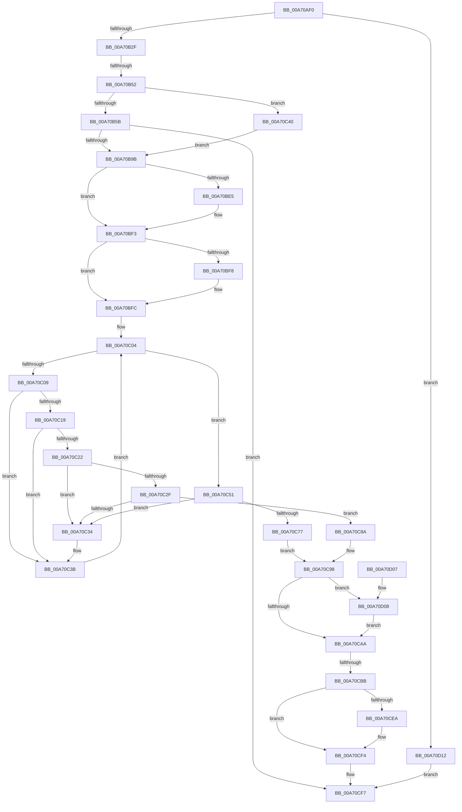

# NtReleaseKeyedEvent

- RVA: `0x00A70AF0`–`0x00A70D19` (길이 `553` bytes)
- VA: `0x0000000140A70AF0`
- 실행 섹션: `PAGE`
- PDB 이름 있음: `예`; PDB Function 태그: `예`
- unwind 정보 RVA: `0x000B5168`
- 디코드: `146`개 명령, `553/553` bytes 표시
- 미해석 바이트: `0` (있으면 어셈블리에 `.byte`로 보존)

> 이 문서는 커널 이미지의 기계어와 PDB 기호를 분석해 생성했습니다. 4번과 5번은 함수 원형과 자료형을 바이너리 사용 방식에서 추정한 C 해석이며 원본 소스 복구 결과는 아닙니다.

## 1. Dependencies

- 직접 호출 지점: **8**; 고유 호출 대상: **8**
- 직접 호출자로 확인된 함수: **0**
- RIP 상대 이미지 참조: **2**

### Outgoing calls
- `0x00A70B81` → [ObReferenceObjectByHandle](../86/ObReferenceObjectByHandle_function_00868DB0.md) (function, `0x00868DB0`)
- `0x00A70BD5` → [KeAbPreAcquire](../../text/21/KeAbPreAcquire_function_00210230.md) (function, `0x00210230`)
- `0x00A70BEE` → [ExfAcquirePushLockExclusiveEx](../../text/20/ExfAcquirePushLockExclusiveEx_function_0020FC90.md) (function, `0x0020FC90`)
- `0x00A70CAD` → [KeAbPostRelease](../../text/2E/KeAbPostRelease_function_002E1600.md) (function, `0x002E1600`)
- `0x00A70CCB` → [KeReleaseSemaphore](../../text/39/KeReleaseSemaphore_function_00397080.md) (function, `0x00397080`)
- `0x00A70CD3` → [KiLeaveCriticalRegionUnsafe](../../text/25/KiLeaveCriticalRegionUnsafe_function_0025F010.md) (function, `0x0025F010`)
- `0x00A70CEF` → [ObfDereferenceObject](../../text/2F/ObfDereferenceObject_function_002F9350.md) (function, `0x002F9350`)
- `0x00A70D0B` → [ExfTryToWakePushLock](../../text/26/ExfTryToWakePushLock_function_00265DD0.md) (function, `0x00265DD0`)

### Direct callers
- 이 함수 시작 RVA로 연결되는 직접 call은 확인되지 않았습니다. 간접 호출은 완전히 역산할 수 없습니다.

### Static image references
- `0x00A70B5B` → RVA `0x00FC52B0` (`ALMOSTRO`; read)
- `0x00A70C40` → RVA `0x00EFA130` (`.data`; read)

## 2. Other-region calls and transfers

- 다른 실행 섹션으로 향하는 call: **7**
  - `0x00A70BD5` → [KeAbPreAcquire](../../text/21/KeAbPreAcquire_function_00210230.md) (`PAGE` → `.text`)
  - `0x00A70BEE` → [ExfAcquirePushLockExclusiveEx](../../text/20/ExfAcquirePushLockExclusiveEx_function_0020FC90.md) (`PAGE` → `.text`)
  - `0x00A70CAD` → [KeAbPostRelease](../../text/2E/KeAbPostRelease_function_002E1600.md) (`PAGE` → `.text`)
  - `0x00A70CCB` → [KeReleaseSemaphore](../../text/39/KeReleaseSemaphore_function_00397080.md) (`PAGE` → `.text`)
  - `0x00A70CD3` → [KiLeaveCriticalRegionUnsafe](../../text/25/KiLeaveCriticalRegionUnsafe_function_0025F010.md) (`PAGE` → `.text`)
  - `0x00A70CEF` → [ObfDereferenceObject](../../text/2F/ObfDereferenceObject_function_002F9350.md) (`PAGE` → `.text`)
  - `0x00A70D0B` → [ExfTryToWakePushLock](../../text/26/ExfTryToWakePushLock_function_00265DD0.md) (`PAGE` → `.text`)
- call이 아닌 외부 분기/꼬리 이동: **2**
  - `0x00A70B4C` → [sub_00B4018A](../B4/Unknown_function_00B4018A.md) (`tail-transfer`)
  - `0x00A70CB5` → [sub_00B4018A + 0x4C](../B4/Unknown_function_00B4018A.md) (`tail-transfer`)

## 3. Assembly (complete function range)

```asm
00A70AF0  48 8B C4                        mov rax, rsp
00A70AF3  4C 89 48 20                     mov qword ptr [rax + 0x20], r9
00A70AF7  44 88 40 18                     mov byte ptr [rax + 0x18], r8b
00A70AFB  48 89 48 08                     mov qword ptr [rax + 8], rcx
00A70AFF  53                              push rbx
00A70B00  56                              push rsi
00A70B01  57                              push rdi
00A70B02  41 54                           push r12
00A70B04  41 55                           push r13
00A70B06  41 56                           push r14
00A70B08  41 57                           push r15
00A70B0A  48 83 EC 70                     sub rsp, 0x70
00A70B0E  4C 8B EA                        mov r13, rdx
00A70B11  4C 8B D1                        mov r10, rcx
00A70B14  33 DB                           xor ebx, ebx
00A70B16  44 8B E3                        mov r12d, ebx
00A70B19  48 89 58 90                     mov qword ptr [rax - 0x70], rbx
00A70B1D  48 89 5C 24 48                  mov qword ptr [rsp + 0x48], rbx
00A70B22  44 8D 73 01                     lea r14d, [rbx + 1]
00A70B26  41 84 D6                        test r14b, dl
00A70B29  0F 85 E3 01 00 00               jne 0x140a70d12
00A70B2F  65 48 8B 3C 25 88 01 00 00      mov rdi, qword ptr gs:[0x188]
00A70B38  8A 8F 32 02 00 00               mov cl, byte ptr [rdi + 0x232]
00A70B3E  88 8C 24 B8 00 00 00            mov byte ptr [rsp + 0xb8], cl
00A70B45  48 8B 40 20                     mov rax, qword ptr [rax + 0x20]
00A70B49  48 85 C0                        test rax, rax
00A70B4C  0F 85 38 F6 0C 00               jne 0x140b4018a
00A70B52  4D 85 D2                        test r10, r10
00A70B55  0F 84 E5 00 00 00               je 0x140a70c40
00A70B5B  4C 8B 05 4E 47 55 00            mov r8, qword ptr [rip + 0x55474e]
00A70B62  48 89 5C 24 40                  mov qword ptr [rsp + 0x40], rbx
00A70B67  48 89 5C 24 28                  mov qword ptr [rsp + 0x28], rbx
00A70B6C  48 8D 44 24 40                  lea rax, [rsp + 0x40]
00A70B71  48 89 44 24 20                  mov qword ptr [rsp + 0x20], rax
00A70B76  44 8A C9                        mov r9b, cl
00A70B79  BA 02 00 00 00                  mov edx, 2
00A70B7E  49 8B CA                        mov rcx, r10
00A70B81  E8 2A 82 DF FF                  call 0x140868db0
00A70B86  44 8B E0                        mov r12d, eax
00A70B89  48 8B 4C 24 40                  mov rcx, qword ptr [rsp + 0x40]
00A70B8E  48 89 4C 24 50                  mov qword ptr [rsp + 0x50], rcx
00A70B93  85 C0                           test eax, eax
00A70B95  0F 88 5C 01 00 00               js 0x140a70cf7
00A70B9B  83 8F A4 05 00 00 20            or dword ptr [rdi + 0x5a4], 0x20
00A70BA2  48 8B 87 B8 00 00 00            mov rax, qword ptr [rdi + 0xb8]
00A70BA9  48 89 44 24 60                  mov qword ptr [rsp + 0x60], rax
00A70BAE  49 8B C5                        mov rax, r13
00A70BB1  48 C1 E8 05                     shr rax, 5
00A70BB5  83 E0 3F                        and eax, 0x3f
00A70BB8  48 8D 04 40                     lea rax, [rax + rax*2]
00A70BBC  48 8D 34 C1                     lea rsi, [rcx + rax*8]
00A70BC0  48 8D 5E 08                     lea rbx, [rsi + 8]
00A70BC4  66 44 29 B7 E4 01 00 00         sub word ptr [rdi + 0x1e4], r14w
00A70BCC  90                              nop
00A70BCD  45 33 C0                        xor r8d, r8d
00A70BD0  33 D2                           xor edx, edx
00A70BD2  48 8B CE                        mov rcx, rsi
00A70BD5  E8 56 F6 79 FF                  call 0x140210230
00A70BDA  4C 8B F8                        mov r15, rax
00A70BDD  F0 48 0F BA 2E 00               lock bts qword ptr [rsi], 0
00A70BE3  73 0E                           jae 0x140a70bf3
00A70BE5  4C 8B C6                        mov r8, rsi
00A70BE8  48 8B D0                        mov rdx, rax
00A70BEB  48 8B CE                        mov rcx, rsi
00A70BEE  E8 9D F0 79 FF                  call 0x14020fc90
00A70BF3  4D 85 FF                        test r15, r15
00A70BF6  74 04                           je 0x140a70bfc
00A70BF8  45 88 77 0A                     mov byte ptr [r15 + 0xa], r14b
00A70BFC  48 8B 03                        mov rax, qword ptr [rbx]
00A70BFF  48 8B 4C 24 60                  mov rcx, qword ptr [rsp + 0x60]
00A70C04  48 3B C3                        cmp rax, rbx
00A70C07  74 48                           je 0x140a70c51
00A70C09  4C 8D B8 38 FB FF FF            lea r15, [rax - 0x4c8]
00A70C10  4D 39 AF E8 04 00 00            cmp qword ptr [r15 + 0x4e8], r13
00A70C17  75 22                           jne 0x140a70c3b
00A70C19  49 39 8F 20 02 00 00            cmp qword ptr [r15 + 0x220], rcx
00A70C20  75 19                           jne 0x140a70c3b
00A70C22  48 8B 10                        mov rdx, qword ptr [rax]
00A70C25  48 8B 48 08                     mov rcx, qword ptr [rax + 8]
00A70C29  48 39 42 08                     cmp qword ptr [rdx + 8], rax
00A70C2D  75 05                           jne 0x140a70c34
00A70C2F  48 39 01                        cmp qword ptr [rcx], rax
00A70C32  74 56                           je 0x140a70c8a
00A70C34  B9 03 00 00 00                  mov ecx, 3
00A70C39  CD 29                           int 0x29
00A70C3B  48 8B 00                        mov rax, qword ptr [rax]
00A70C3E  EB C4                           jmp 0x140a70c04
00A70C40  48 8B 0D E9 94 48 00            mov rcx, qword ptr [rip + 0x4894e9]
00A70C47  48 89 4C 24 50                  mov qword ptr [rsp + 0x50], rcx
00A70C4C  E9 4A FF FF FF                  jmp 0x140a70b9b
00A70C51  48 8B 87 E8 04 00 00            mov rax, qword ptr [rdi + 0x4e8]
00A70C58  48 89 44 24 48                  mov qword ptr [rsp + 0x48], rax
00A70C5D  4D 0B EE                        or r13, r14
00A70C60  4C 89 AF E8 04 00 00            mov qword ptr [rdi + 0x4e8], r13
00A70C67  48 8D 87 C8 04 00 00            lea rax, [rdi + 0x4c8]
00A70C6E  48 8B 0B                        mov rcx, qword ptr [rbx]
00A70C71  48 39 59 08                     cmp qword ptr [rcx + 8], rbx
00A70C75  75 BD                           jne 0x140a70c34
00A70C77  48 89 08                        mov qword ptr [rax], rcx
00A70C7A  48 89 58 08                     mov qword ptr [rax + 8], rbx
00A70C7E  48 89 41 08                     mov qword ptr [rcx + 8], rax
00A70C82  48 89 03                        mov qword ptr [rbx], rax
00A70C85  45 33 FF                        xor r15d, r15d
00A70C88  EB 0E                           jmp 0x140a70c98
00A70C8A  48 89 11                        mov qword ptr [rcx], rdx
00A70C8D  48 89 4A 08                     mov qword ptr [rdx + 8], rcx
00A70C91  48 89 40 08                     mov qword ptr [rax + 8], rax
00A70C95  48 89 00                        mov qword ptr [rax], rax
00A70C98  48 83 CB FF                     or rbx, 0xffffffffffffffff
00A70C9C  48 8B C3                        mov rax, rbx
00A70C9F  F0 48 0F C1 06                  lock xadd qword ptr [rsi], rax
00A70CA4  24 06                           and al, 6
00A70CA6  3C 02                           cmp al, 2
00A70CA8  74 5E                           je 0x140a70d08
00A70CAA  48 8B CE                        mov rcx, rsi
00A70CAD  E8 4E 09 87 FF                  call 0x1402e1600
00A70CB2  4D 85 FF                        test r15, r15
00A70CB5  0F 84 1B F5 0C 00               je 0x140b401d6
00A70CBB  49 8D 8F 18 05 00 00            lea rcx, [r15 + 0x518]
00A70CC2  45 33 C9                        xor r9d, r9d
00A70CC5  45 8B C6                        mov r8d, r14d
00A70CC8  41 8B D6                        mov edx, r14d
00A70CCB  E8 B0 63 92 FF                  call 0x140397080
00A70CD0  48 8B CF                        mov rcx, rdi
00A70CD3  E8 38 E3 7E FF                  call 0x14025f010
00A70CD8  83 A7 A4 05 00 00 DF            and dword ptr [rdi + 0x5a4], 0xffffffdf
00A70CDF  48 83 BC 24 B0 00 00 00 00      cmp qword ptr [rsp + 0xb0], 0
00A70CE8  74 0A                           je 0x140a70cf4
00A70CEA  48 8B 4C 24 50                  mov rcx, qword ptr [rsp + 0x50]
00A70CEF  E8 5C 86 88 FF                  call 0x1402f9350
00A70CF4  41 8B C4                        mov eax, r12d
00A70CF7  48 83 C4 70                     add rsp, 0x70
00A70CFB  41 5F                           pop r15
00A70CFD  41 5E                           pop r14
00A70CFF  41 5D                           pop r13
00A70D01  41 5C                           pop r12
00A70D03  5F                              pop rdi
00A70D04  5E                              pop rsi
00A70D05  5B                              pop rbx
00A70D06  C3                              ret
00A70D07  CC                              int3
00A70D08  48 8B CE                        mov rcx, rsi
00A70D0B  E8 C0 50 7F FF                  call 0x140265dd0
00A70D10  EB 98                           jmp 0x140a70caa
00A70D12  B8 EF 00 00 C0                  mov eax, 0xc00000ef
00A70D17  EB DE                           jmp 0x140a70cf7
```

## 4. C-style interpretation (structured pseudocode)

```c
__int64 __fastcall NtReleaseKeyedEvent(__int64 a1, __int64 a2, unsigned __int8 a3, __int64 a4)
{
    __int64 result;
    __int64 v_r13;
    __int64 v_r15;
    __int64 v_rbx;
    __int64 v_rsp;
    unsigned __int64 v_stack_m48;
    unsigned __int64 v_stack_m58;
    unsigned __int64 v_stack_m60;
    unsigned __int64 v_stack_m68;
    unsigned __int64 v_stack_m80;
    unsigned __int64 v_stack_m88;
    unsigned __int8 v_stack_p10;
    unsigned __int64 v_stack_p8;

    *(unsigned __int64 *)(v_rsp + 32) = a4;
    *(unsigned __int8 *)(v_rsp + 24) = a3;
    *(unsigned __int64 *)(v_rsp + 8) = a1;
    v_rsp = (v_rsp) - (112);
    v_rbx = 0;
    *(unsigned __int64 *)(v_rsp - 112) = 0;
    v_stack_m60 = 0;
    if ((((unsigned __int8)(v_rbx + 1)) & ((unsigned __int8)(a2))) != 0) goto loc_00A70D12;
    v_stack_p10 = (unsigned __int8)(*(unsigned __int8 *)(*(unsigned __int64 *)(gs_base + (0 + 392)) + 562));
    if (a1 == 0) goto loc_00A70C40;
    v_stack_m68 = 0;
    v_stack_m80 = 0;
    v_stack_m88 = v_stack_m68;
    result = ObReferenceObjectByHandle(a1, 2, *(unsigned __int64 *)(v_rip + 5588814), (unsigned __int8)(*(unsigned __int8 *)(*(unsigned __int64 *)(gs_base + (0 + 392)) + 562)));
    v_stack_m58 = v_stack_m68;
    if (sign_flag) goto loc_00A70CF7;
loc_00A70B9B:
    v_stack_m48 = *(unsigned __int64 *)(*(unsigned __int64 *)(gs_base + (0 + 392)) + 184);
    result = (a2) >> (5);
    result = (unsigned int)((result) & (63));
    a3 = 0;
    a2 = 0;
    result = KeAbPreAcquire(v_stack_m68 + result + result * 2 * 8, a2, a3, (unsigned __int8)(*(unsigned __int8 *)(*(unsigned __int64 *)(gs_base + (0 + 392)) + 562)));
    if (!(condition_is_above_or_equal)) {
        a3 = v_stack_m68 + result + result * 2 * 8;
        a2 = result;
        a1 = v_stack_m68 + result + result * 2 * 8;
        result = ExfAcquirePushLockExclusiveEx(a1, a2, a3, (unsigned __int8)(*(unsigned __int8 *)(*(unsigned __int64 *)(gs_base + (0 + 392)) + 562)));
    }
    if (result != 0) {
        *(unsigned __int8 *)(result + 10) = (unsigned __int8)(v_rbx + 1);
    }
loc_00A70C04:
    if ((*(unsigned __int64 *)(v_stack_m68 + result + result * 2 * 8 + 8)) == (v_stack_m68 + result + result * 2 * 8 + 8)) goto loc_00A70C51;
    if ((*(unsigned __int64 *)(*(unsigned __int64 *)(v_stack_m68 + result + result * 2 * 8 + 8) - 1224 + 1256)) != a2) goto loc_00A70C3B;
    if ((*(unsigned __int64 *)(*(unsigned __int64 *)(v_stack_m68 + result + result * 2 * 8 + 8) - 1224 + 544)) != v_stack_m48) goto loc_00A70C3B;
    if ((*(unsigned __int64 *)(*(unsigned __int64 *)(*(unsigned __int64 *)(v_stack_m68 + result + result * 2 * 8 + 8)) + 8)) != (*(unsigned __int64 *)(v_stack_m68 + result + result * 2 * 8 + 8))) goto loc_00A70C34;
    if ((*(unsigned __int64 *)(*(unsigned __int64 *)(*(unsigned __int64 *)(v_stack_m68 + result + result * 2 * 8 + 8) + 8))) == (*(unsigned __int64 *)(v_stack_m68 + result + result * 2 * 8 + 8))) goto loc_00A70C8A;
loc_00A70C34:
loc_00A70C3B:
    goto loc_00A70C04;
loc_00A70C40:
    v_stack_m58 = *(unsigned __int64 *)(v_rip + 4756713);
    goto loc_00A70B9B;
loc_00A70C51:
    v_stack_m60 = *(unsigned __int64 *)(*(unsigned __int64 *)(gs_base + (0 + 392)) + 1256);
    v_r13 = (a2) | (v_rbx + 1);
    *(unsigned __int64 *)(*(unsigned __int64 *)(gs_base + (0 + 392)) + 1256) = v_r13;
    if ((*(unsigned __int64 *)(*(unsigned __int64 *)(v_stack_m68 + result + result * 2 * 8 + 8) + 8)) != (v_stack_m68 + result + result * 2 * 8 + 8)) goto loc_00A70C34;
    *(unsigned __int64 *)(*(unsigned __int64 *)(gs_base + (0 + 392)) + 1224) = *(unsigned __int64 *)(v_stack_m68 + result + result * 2 * 8 + 8);
    *(unsigned __int64 *)(*(unsigned __int64 *)(gs_base + (0 + 392)) + 1224 + 8) = v_stack_m68 + result + result * 2 * 8 + 8;
    *(unsigned __int64 *)(*(unsigned __int64 *)(v_stack_m68 + result + result * 2 * 8 + 8) + 8) = *(unsigned __int64 *)(gs_base + (0 + 392)) + 1224;
    *(unsigned __int64 *)(v_stack_m68 + result + result * 2 * 8 + 8) = *(unsigned __int64 *)(gs_base + (0 + 392)) + 1224;
    v_r15 = 0;
    goto loc_00A70C98;
loc_00A70C8A:
    *(unsigned __int64 *)(*(unsigned __int64 *)(v_stack_m68 + result + result * 2 * 8 + 8)) = *(unsigned __int64 *)(*(unsigned __int64 *)(v_stack_m68 + result + result * 2 * 8 + 8));
    *(unsigned __int64 *)(*(unsigned __int64 *)(*(unsigned __int64 *)(v_stack_m68 + result + result * 2 * 8 + 8)) + 8) = *(unsigned __int64 *)(v_stack_m68 + result + result * 2 * 8 + 8);
    *(unsigned __int64 *)(*(unsigned __int64 *)(gs_base + (0 + 392)) + 1224 + 8) = *(unsigned __int64 *)(gs_base + (0 + 392)) + 1224;
    *(unsigned __int64 *)(*(unsigned __int64 *)(gs_base + (0 + 392)) + 1224) = *(unsigned __int64 *)(gs_base + (0 + 392)) + 1224;
loc_00A70C98:
    v_rbx = (v_stack_m68 + result + result * 2 * 8 + 8) | (-1);
    result = (unsigned __int8)((v_rbx) & (6));
    if (((unsigned __int8)(result)) == 2) goto loc_00A70D08;
loc_00A70CAA:
    result = KeAbPostRelease(v_stack_m68 + result + result * 2 * 8, *(unsigned __int64 *)(*(unsigned __int64 *)(v_stack_m68 + result + result * 2 * 8 + 8)), a3, (unsigned __int8)(*(unsigned __int8 *)(*(unsigned __int64 *)(gs_base + (0 + 392)) + 562)));
    a4 = 0;
    result = KeReleaseSemaphore(v_r15 + 1304, (unsigned int)((unsigned int)(v_rbx + 1)), (unsigned int)((unsigned int)(v_rbx + 1)), a4);
    result = KiLeaveCriticalRegionUnsafe(*(unsigned __int64 *)(gs_base + (0 + 392)), (unsigned int)((unsigned int)(v_rbx + 1)), (unsigned int)((unsigned int)(v_rbx + 1)), a4);
    if (v_stack_p8 != 0) {
        a1 = v_stack_m58;
        result = ObfDereferenceObject(a1, (unsigned int)((unsigned int)(v_rbx + 1)), (unsigned int)((unsigned int)(v_rbx + 1)), a4);
    }
loc_00A70CF7:
    v_rsp = (v_rsp) + (112);
    return (unsigned int)((unsigned int)((unsigned int)((unsigned int)(result))));
loc_00A70D08:
    result = ExfTryToWakePushLock(v_stack_m68 + result + result * 2 * 8, (unsigned int)((unsigned int)(v_rbx + 1)), (unsigned int)((unsigned int)(v_rbx + 1)), a4);
    goto loc_00A70CAA;
loc_00A70D12:
    goto loc_00A70CF7;
}
```

## 5. (Beta) C Style

```c
int64_t NtReleaseKeyedEvent(int64_t Arg1, int64_t Arg2, uint8_t Arg3, int64_t Arg4)
{
    int64_t result;
    int64_t local_r13;
    int64_t local_r15;
    int64_t local_rbx;
    int64_t local_rsp;
    uint64_t v_stack_m48;
    uint64_t v_stack_m58;
    uint64_t v_stack_m60;
    uint64_t v_stack_m68;
    uint64_t v_stack_m80;
    uint64_t v_stack_m88;
    uint8_t v_stack_p10;
    uint64_t v_stack_p8;

    *(uint64_t *)(local_rsp + 0x20) = Arg4;
    *(uint8_t *)(local_rsp + 0x18) = Arg3;
    *(uint64_t *)(local_rsp + 0x8) = Arg1;
    local_rsp = (local_rsp) - (112);
    local_rbx = 0;
    *(uint64_t *)(local_rsp - 0x70) = 0;
    v_stack_m60 = 0;
    if ((((uint8_t)(local_rbx + 1)) & ((uint8_t)(Arg2))) != 0) goto loc_00A70D12;
    v_stack_p10 = (uint8_t)(*(uint8_t *)(*(uint64_t *)(gs_base + (0 + 0x188)) + 0x232));
    if (Arg1 == 0) goto loc_00A70C40;
    v_stack_m68 = 0;
    v_stack_m80 = 0;
    v_stack_m88 = v_stack_m68;
    result = ObReferenceObjectByHandle(Arg1, 2, *(uint64_t *)(v_rip + 0x55474E), (uint8_t)(*(uint8_t *)(*(uint64_t *)(gs_base + (0 + 0x188)) + 0x232)));
    v_stack_m58 = v_stack_m68;
    if (sign_flag) goto loc_00A70CF7;
loc_00A70B9B:
    v_stack_m48 = *(uint64_t *)(*(uint64_t *)(gs_base + (0 + 0x188)) + 0xB8);
    result = (Arg2) >> (5);
    result = (uint32_t)((result) & (63));
    Arg3 = 0;
    Arg2 = 0;
    result = KeAbPreAcquire(v_stack_m68 + result + result * 2 * 8, Arg2, Arg3, (uint8_t)(*(uint8_t *)(*(uint64_t *)(gs_base + (0 + 0x188)) + 0x232)));
    if (!(condition_is_above_or_equal)) {
        Arg3 = v_stack_m68 + result + result * 2 * 8;
        Arg2 = result;
        Arg1 = v_stack_m68 + result + result * 2 * 8;
        result = ExfAcquirePushLockExclusiveEx(Arg1, Arg2, Arg3, (uint8_t)(*(uint8_t *)(*(uint64_t *)(gs_base + (0 + 0x188)) + 0x232)));
    }
    if (result != 0) {
        *(uint8_t *)(result + 0xA) = (uint8_t)(local_rbx + 1);
    }
loc_00A70C04:
    if ((*(uint64_t *)(v_stack_m68 + result + result * 2 * 8 + 0x8)) == (v_stack_m68 + result + result * 2 * 8 + 8)) goto loc_00A70C51;
    if ((*(uint64_t *)(*(uint64_t *)(v_stack_m68 + result + result * 2 * 8 + 0x8) - 0x4C8 + 0x4E8)) != Arg2) goto loc_00A70C3B;
    if ((*(uint64_t *)(*(uint64_t *)(v_stack_m68 + result + result * 2 * 8 + 0x8) - 0x4C8 + 0x220)) != v_stack_m48) goto loc_00A70C3B;
    if ((*(uint64_t *)(*(uint64_t *)(*(uint64_t *)(v_stack_m68 + result + result * 2 * 8 + 0x8)) + 0x8)) != (*(uint64_t *)(v_stack_m68 + result + result * 2 * 8 + 0x8))) goto loc_00A70C34;
    if ((*(uint64_t *)(*(uint64_t *)(*(uint64_t *)(v_stack_m68 + result + result * 2 * 8 + 0x8) + 0x8))) == (*(uint64_t *)(v_stack_m68 + result + result * 2 * 8 + 0x8))) goto loc_00A70C8A;
loc_00A70C34:
loc_00A70C3B:
    goto loc_00A70C04;
loc_00A70C40:
    v_stack_m58 = *(uint64_t *)(v_rip + 0x4894E9);
    goto loc_00A70B9B;
loc_00A70C51:
    v_stack_m60 = *(uint64_t *)(*(uint64_t *)(gs_base + (0 + 0x188)) + 0x4E8);
    local_r13 = (Arg2) | (local_rbx + 1);
    *(uint64_t *)(*(uint64_t *)(gs_base + (0 + 0x188)) + 0x4E8) = local_r13;
    if ((*(uint64_t *)(*(uint64_t *)(v_stack_m68 + result + result * 2 * 8 + 0x8) + 0x8)) != (v_stack_m68 + result + result * 2 * 8 + 8)) goto loc_00A70C34;
    *(uint64_t *)(*(uint64_t *)(gs_base + (0 + 0x188)) + 0x4C8) = *(uint64_t *)(v_stack_m68 + result + result * 2 * 8 + 0x8);
    *(uint64_t *)(*(uint64_t *)(gs_base + (0 + 0x188)) + 0x4C8 + 0x8) = v_stack_m68 + result + result * 2 * 8 + 8;
    *(uint64_t *)(*(uint64_t *)(v_stack_m68 + result + result * 2 * 8 + 0x8) + 0x8) = *(uint64_t *)(gs_base + (0 + 0x188)) + 1224;
    *(uint64_t *)(v_stack_m68 + result + result * 2 * 8 + 0x8) = *(uint64_t *)(gs_base + (0 + 0x188)) + 1224;
    local_r15 = 0;
    goto loc_00A70C98;
loc_00A70C8A:
    *(uint64_t *)(*(uint64_t *)(v_stack_m68 + result + result * 2 * 8 + 0x8)) = *(uint64_t *)(*(uint64_t *)(v_stack_m68 + result + result * 2 * 8 + 0x8));
    *(uint64_t *)(*(uint64_t *)(*(uint64_t *)(v_stack_m68 + result + result * 2 * 8 + 0x8)) + 0x8) = *(uint64_t *)(v_stack_m68 + result + result * 2 * 8 + 0x8);
    *(uint64_t *)(*(uint64_t *)(gs_base + (0 + 0x188)) + 0x4C8 + 0x8) = *(uint64_t *)(gs_base + (0 + 0x188)) + 1224;
    *(uint64_t *)(*(uint64_t *)(gs_base + (0 + 0x188)) + 0x4C8) = *(uint64_t *)(gs_base + (0 + 0x188)) + 1224;
loc_00A70C98:
    local_rbx = (v_stack_m68 + result + result * 2 * 8 + 8) | (-1);
    result = (uint8_t)((local_rbx) & (6));
    if (((uint8_t)(result)) == 2) goto loc_00A70D08;
loc_00A70CAA:
    result = KeAbPostRelease(v_stack_m68 + result + result * 2 * 8, *(uint64_t *)(*(uint64_t *)(v_stack_m68 + result + result * 2 * 8 + 0x8)), Arg3, (uint8_t)(*(uint8_t *)(*(uint64_t *)(gs_base + (0 + 0x188)) + 0x232)));
    Arg4 = 0;
    result = KeReleaseSemaphore(local_r15 + 1304, (uint32_t)((uint32_t)(local_rbx + 1)), (uint32_t)((uint32_t)(local_rbx + 1)), Arg4);
    result = KiLeaveCriticalRegionUnsafe(*(uint64_t *)(gs_base + (0 + 0x188)), (uint32_t)((uint32_t)(local_rbx + 1)), (uint32_t)((uint32_t)(local_rbx + 1)), Arg4);
    if (v_stack_p8 != 0) {
        Arg1 = v_stack_m58;
        result = ObfDereferenceObject(Arg1, (uint32_t)((uint32_t)(local_rbx + 1)), (uint32_t)((uint32_t)(local_rbx + 1)), Arg4);
    }
loc_00A70CF7:
    local_rsp = (local_rsp) + (112);
    return (uint32_t)((uint32_t)((uint32_t)((uint32_t)(result))));
loc_00A70D08:
    result = ExfTryToWakePushLock(v_stack_m68 + result + result * 2 * 8, (uint32_t)((uint32_t)(local_rbx + 1)), (uint32_t)((uint32_t)(local_rbx + 1)), Arg4);
    goto loc_00A70CAA;
loc_00A70D12:
    goto loc_00A70CF7;
}
```

## 6. Execution-region graph

[열기: 2D/3D 그래프와 함수 탐색 컨트롤 패널](../../../control-panel.html?section=page&rva=0x00A70AF0&view=graph)

- 2D 그래프는 위에서 아래로 흐르고, 3D 그래프는 빈 공간을 드래그해 회전합니다. Shift+드래그는 이동, 휠은 확대·축소, 함수 노드 선택은 대상 보고서 이동입니다.

### Static fallback


