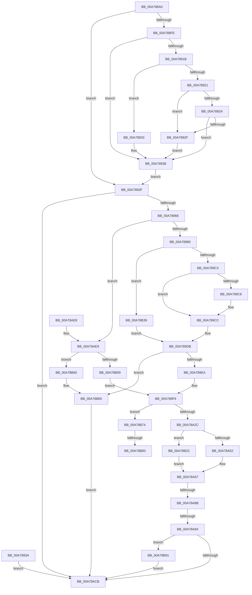

# NtSetEaFile

- RVA: `0x00A788A0`–`0x00A78BB8` (길이 `792` bytes)
- VA: `0x0000000140A788A0`
- 실행 섹션: `PAGE`
- PDB 이름 있음: `예`; PDB Function 태그: `예`
- unwind 정보 RVA: `0x000B607C`
- 디코드: `198`개 명령, `792/792` bytes 표시
- 미해석 바이트: `0` (있으면 어셈블리에 `.byte`로 보존)

> 이 문서는 커널 이미지의 기계어와 PDB 기호를 분석해 생성했습니다. 4번과 5번은 함수 원형과 자료형을 바이너리 사용 방식에서 추정한 C 해석이며 원본 소스 복구 결과는 아닙니다.

## 1. Dependencies

- 직접 호출 지점: **14**; 고유 호출 대상: **14**
- 직접 호출자로 확인된 함수: **0**
- RIP 상대 이미지 참조: **0**

### Outgoing calls
- `0x00A78933` → [ExRaiseDatatypeMisalignment](../89/ExRaiseDatatypeMisalignment_function_00899FD0.md) (function, `0x00899FD0`)
- `0x00A78955` → [IopReferenceFileObject](../../text/29/IopReferenceFileObject_function_0029D530.md) (function, `0x0029D530`)
- `0x00A789A9` → [KeAbPreAcquire](../../text/21/KeAbPreAcquire_function_00210230.md) (function, `0x00210230`)
- `0x00A789D4` → [ObfReferenceObject](../../text/20/ObfReferenceObject_function_0020FA20.md) (function, `0x0020FA20`)
- `0x00A789F9` → [IopResetEvent](../../text/29/IopResetEvent_function_0029D5F0.md) (function, `0x0029D5F0`)
- `0x00A78A01` → [IoGetRelatedDeviceObject](../../text/29/IoGetRelatedDeviceObject_function_0029B120.md) (function, `0x0029B120`)
- `0x00A78A14` → [IopAllocateIrpExReturn](../../text/20/IopAllocateIrpExReturn_function_00207720.md) (function, `0x00207720`)
- `0x00A78ABE` → [IopSynchronousServiceTail](../8E/IopSynchronousServiceTail_function_008EB440.md) (function, `0x008EB440`)
- `0x00A78AF7` → [ExAllocatePool2](../../poolcode/B8/ExAllocatePool2_function_00B820F0.md) (function, `0x00B820F0`)
- `0x00A78B13` → [KeInitializeEvent](../../text/40/KeInitializeEvent_function_0040DD10.md) (function, `0x0040DD10`)
- `0x00A78B54` → [IopWaitAndAcquireFileObjectLock](../8A/IopWaitAndAcquireFileObjectLock_function_008AE6D8.md) (function, `0x008AE6D8`)
- `0x00A78B68` → [ObfDereferenceObject](../../text/2F/ObfDereferenceObject_function_002F9350.md) (function, `0x002F9350`)
- `0x00A78B86` → [ExFreePoolWithTag](../../poolcode/B8/ExFreePoolWithTag_function_00B82870.md) (function, `0x00B82870`)
- `0x00A78BAE` → [IopSynchronousApiServiceTail](../8A/IopSynchronousApiServiceTail_function_008ACE3C.md) (function, `0x008ACE3C`)

### Direct callers
- 이 함수 시작 RVA로 연결되는 직접 call은 확인되지 않았습니다. 간접 호출은 완전히 역산할 수 없습니다.

### Static image references
- 디코드된 RIP-relative 메모리 참조가 없습니다.

## 2. Other-region calls and transfers

- 다른 실행 섹션으로 향하는 call: **10**
  - `0x00A78955` → [IopReferenceFileObject](../../text/29/IopReferenceFileObject_function_0029D530.md) (`PAGE` → `.text`)
  - `0x00A789A9` → [KeAbPreAcquire](../../text/21/KeAbPreAcquire_function_00210230.md) (`PAGE` → `.text`)
  - `0x00A789D4` → [ObfReferenceObject](../../text/20/ObfReferenceObject_function_0020FA20.md) (`PAGE` → `.text`)
  - `0x00A789F9` → [IopResetEvent](../../text/29/IopResetEvent_function_0029D5F0.md) (`PAGE` → `.text`)
  - `0x00A78A01` → [IoGetRelatedDeviceObject](../../text/29/IoGetRelatedDeviceObject_function_0029B120.md) (`PAGE` → `.text`)
  - `0x00A78A14` → [IopAllocateIrpExReturn](../../text/20/IopAllocateIrpExReturn_function_00207720.md) (`PAGE` → `.text`)
  - `0x00A78AF7` → [ExAllocatePool2](../../poolcode/B8/ExAllocatePool2_function_00B820F0.md) (`PAGE` → `POOLCODE`)
  - `0x00A78B13` → [KeInitializeEvent](../../text/40/KeInitializeEvent_function_0040DD10.md) (`PAGE` → `.text`)
  - `0x00A78B68` → [ObfDereferenceObject](../../text/2F/ObfDereferenceObject_function_002F9350.md) (`PAGE` → `.text`)
  - `0x00A78B86` → [ExFreePoolWithTag](../../poolcode/B8/ExFreePoolWithTag_function_00B82870.md) (`PAGE` → `POOLCODE`)
- call이 아닌 외부 분기/꼬리 이동: **4**
  - `0x00A78A85` → [sub_00B41AB2 + 0x14](../B4/Unknown_function_00B41AB2.md) (`tail-transfer`)
  - `0x00A78A8E` → [sub_00B41AB2 + 0xDD](../B4/Unknown_function_00B41AB2.md) (`tail-transfer`)
  - `0x00A78B7D` → [sub_00B41AB2](../B4/Unknown_function_00B41AB2.md) (`tail-transfer`)
  - `0x00A78B8C` → [sub_00B41AB2](../B4/Unknown_function_00B41AB2.md) (`tail-transfer`)

## 3. Assembly (complete function range)

```asm
00A788A0  48 8B C4                        mov rax, rsp
00A788A3  48 89 58 08                     mov qword ptr [rax + 8], rbx
00A788A7  48 89 70 10                     mov qword ptr [rax + 0x10], rsi
00A788AB  44 89 48 20                     mov dword ptr [rax + 0x20], r9d
00A788AF  57                              push rdi
00A788B0  41 54                           push r12
00A788B2  41 55                           push r13
00A788B4  41 56                           push r14
00A788B6  41 57                           push r15
00A788B8  48 81 EC 90 00 00 00            sub rsp, 0x90
00A788BF  41 8B D9                        mov ebx, r9d
00A788C2  4D 8B E0                        mov r12, r8
00A788C5  4C 8B EA                        mov r13, rdx
00A788C8  4C 8B D1                        mov r10, rcx
00A788CB  48 83 60 90 00                  and qword ptr [rax - 0x70], 0
00A788D0  45 33 FF                        xor r15d, r15d
00A788D3  4C 89 7C 24 60                  mov qword ptr [rsp + 0x60], r15
00A788D8  0F 57 C0                        xorps xmm0, xmm0
00A788DB  0F 11 40 C8                     movups xmmword ptr [rax - 0x38], xmm0
00A788DF  65 48 8B 04 25 88 01 00 00      mov rax, qword ptr gs:[0x188]
00A788E8  48 89 44 24 78                  mov qword ptr [rsp + 0x78], rax
00A788ED  40 8A B0 32 02 00 00            mov sil, byte ptr [rax + 0x232]
00A788F4  40 88 74 24 41                  mov byte ptr [rsp + 0x41], sil
00A788F9  40 84 F6                        test sil, sil
00A788FC  74 41                           je 0x140a7893f
00A788FE  48 BA 00 00 FF FF FF 7F 00 00   movabs rdx, 0x7fffffff0000
00A78908  48 8B CA                        mov rcx, rdx
00A7890B  4C 3B EA                        cmp r13, rdx
00A7890E  49 0F 42 CD                     cmovb rcx, r13
00A78912  8B 01                           mov eax, dword ptr [rcx]
00A78914  89 01                           mov dword ptr [rcx], eax
00A78916  45 85 C9                        test r9d, r9d
00A78919  74 1D                           je 0x140a78938
00A7891B  41 F6 C4 03                     test r12b, 3
00A7891F  75 12                           jne 0x140a78933
00A78921  49 8D 0C 18                     lea rcx, [r8 + rbx]
00A78925  48 3B CA                        cmp rcx, rdx
00A78928  77 05                           ja 0x140a7892f
00A7892A  49 3B C8                        cmp rcx, r8
00A7892D  73 09                           jae 0x140a78938
00A7892F  8A 02                           mov al, byte ptr [rdx]
00A78931  EB 05                           jmp 0x140a78938
00A78933  E8 98 16 E2 FF                  call 0x140899fd0
00A78938  EB 05                           jmp 0x140a7893f
00A7893A  E9 8C 01 00 00                  jmp 0x140a78acb
00A7893F  48 83 64 24 20 00               and qword ptr [rsp + 0x20], 0
00A78945  4C 8D 4C 24 48                  lea r9, [rsp + 0x48]
00A7894A  44 8A C6                        mov r8b, sil
00A7894D  BA 10 00 00 00                  mov edx, 0x10
00A78952  49 8B CA                        mov rcx, r10
00A78955  E8 D6 4B 82 FF                  call 0x14029d530
00A7895A  89 44 24 44                     mov dword ptr [rsp + 0x44], eax
00A7895E  85 C0                           test eax, eax
00A78960  0F 88 65 01 00 00               js 0x140a78acb
00A78966  4C 8B 74 24 48                  mov r14, qword ptr [rsp + 0x48]
00A7896B  49 8D 46 50                     lea rax, [r14 + 0x50]
00A7896F  48 89 44 24 58                  mov qword ptr [rsp + 0x58], rax
00A78974  8B 38                           mov edi, dword ptr [rax]
00A78976  40 F6 C7 02                     test dil, 2
00A7897A  0F 84 69 01 00 00               je 0x140a78ae9
00A78980  C1 EF 02                        shr edi, 2
00A78983  40 80 E7 01                     and dil, 1
00A78987  65 48 8B 04 25 88 01 00 00      mov rax, qword ptr gs:[0x188]
00A78990  66 FF 88 E4 01 00 00            dec word ptr [rax + 0x1e4]
00A78997  90                              nop
00A78998  48 8B 5C 24 48                  mov rbx, qword ptr [rsp + 0x48]
00A7899D  48 8D 8B 80 00 00 00            lea rcx, [rbx + 0x80]
00A789A4  45 33 C0                        xor r8d, r8d
00A789A7  33 D2                           xor edx, edx
00A789A9  E8 82 78 79 FF                  call 0x140210230
00A789AE  C6 44 24 40 00                  mov byte ptr [rsp + 0x40], 0
00A789B3  B9 01 00 00 00                  mov ecx, 1
00A789B8  87 4B 74                        xchg dword ptr [rbx + 0x74], ecx
00A789BB  85 C9                           test ecx, ecx
00A789BD  0F 85 76 01 00 00               jne 0x140a78b39
00A789C3  48 85 C0                        test rax, rax
00A789C6  74 04                           je 0x140a789cc
00A789C8  C6 40 0A 01                     mov byte ptr [rax + 0xa], 1
00A789CC  4C 8B 74 24 48                  mov r14, qword ptr [rsp + 0x48]
00A789D1  49 8B CE                        mov rcx, r14
00A789D4  E8 47 70 79 FF                  call 0x14020fa20
00A789D9  33 DB                           xor ebx, ebx
00A789DB  89 5C 24 44                     mov dword ptr [rsp + 0x44], ebx
00A789DF  80 7C 24 40 00                  cmp byte ptr [rsp + 0x40], 0
00A789E4  0F 85 7B 01 00 00               jne 0x140a78b65
00A789EA  C6 44 24 40 01                  mov byte ptr [rsp + 0x40], 1
00A789EF  8B 9C 24 D8 00 00 00            mov ebx, dword ptr [rsp + 0xd8]
00A789F6  49 8B CE                        mov rcx, r14
00A789F9  E8 F2 4B 82 FF                  call 0x14029d5f0
00A789FE  49 8B CE                        mov rcx, r14
00A78A01  E8 1A 27 82 FF                  call 0x14029b120
00A78A06  48 89 44 24 68                  mov qword ptr [rsp + 0x68], rax
00A78A0B  45 33 C0                        xor r8d, r8d
00A78A0E  8A 50 4C                        mov dl, byte ptr [rax + 0x4c]
00A78A11  48 8B C8                        mov rcx, rax
00A78A14  E8 07 ED 78 FF                  call 0x140207720
00A78A19  48 8B F0                        mov rsi, rax
00A78A1C  48 89 44 24 70                  mov qword ptr [rsp + 0x70], rax
00A78A21  33 D2                           xor edx, edx
00A78A23  48 85 C0                        test rax, rax
00A78A26  0F 84 48 01 00 00               je 0x140a78b74
00A78A2C  4C 89 B0 C0 00 00 00            mov qword ptr [rax + 0xc0], r14
00A78A33  48 8B 44 24 78                  mov rax, qword ptr [rsp + 0x78]
00A78A38  48 89 86 98 00 00 00            mov qword ptr [rsi + 0x98], rax
00A78A3F  40 8A 7C 24 41                  mov dil, byte ptr [rsp + 0x41]
00A78A44  40 88 7E 40                     mov byte ptr [rsi + 0x40], dil
00A78A48  38 54 24 40                     cmp byte ptr [rsp + 0x40], dl
00A78A4C  0F 84 D0 00 00 00               je 0x140a78b22
00A78A52  49 8B C5                        mov rax, r13
00A78A55  8B CA                           mov ecx, edx
00A78A57  48 89 4E 50                     mov qword ptr [rsi + 0x50], rcx
00A78A5B  48 89 46 48                     mov qword ptr [rsi + 0x48], rax
00A78A5F  48 89 56 58                     mov qword ptr [rsi + 0x58], rdx
00A78A63  48 8B 86 B8 00 00 00            mov rax, qword ptr [rsi + 0xb8]
00A78A6A  48 83 E8 48                     sub rax, 0x48
00A78A6E  48 89 44 24 58                  mov qword ptr [rsp + 0x58], rax
00A78A73  C6 00 08                        mov byte ptr [rax], 8
00A78A76  4C 89 70 30                     mov qword ptr [rax + 0x30], r14
00A78A7A  48 8B 4C 24 68                  mov rcx, qword ptr [rsp + 0x68]
00A78A7F  8B 49 30                        mov ecx, dword ptr [rcx + 0x30]
00A78A82  F6 C1 04                        test cl, 4
00A78A85  0F 85 3B 90 0C 00               jne 0x140b41ac6
00A78A8B  F6 C1 10                        test cl, 0x10
00A78A8E  0F 85 FB 90 0C 00               jne 0x140b41b8f
00A78A94  4C 89 66 70                     mov qword ptr [rsi + 0x70], r12
00A78A98  89 58 08                        mov dword ptr [rax + 8], ebx
00A78A9B  C7 44 24 30 02 00 00 00         mov dword ptr [rsp + 0x30], 2
00A78AA3  8A 5C 24 40                     mov bl, byte ptr [rsp + 0x40]
00A78AA7  88 5C 24 28                     mov byte ptr [rsp + 0x28], bl
00A78AAB  40 88 7C 24 20                  mov byte ptr [rsp + 0x20], dil
00A78AB0  45 33 C9                        xor r9d, r9d
00A78AB3  4D 8B C6                        mov r8, r14
00A78AB6  48 8B D6                        mov rdx, rsi
00A78AB9  48 8B 4C 24 68                  mov rcx, qword ptr [rsp + 0x68]
00A78ABE  E8 7D 29 E7 FF                  call 0x1408eb440
00A78AC3  84 DB                           test bl, bl
00A78AC5  0F 84 C6 00 00 00               je 0x140a78b91
00A78ACB  4C 8D 9C 24 90 00 00 00         lea r11, [rsp + 0x90]
00A78AD3  49 8B 5B 30                     mov rbx, qword ptr [r11 + 0x30]
00A78AD7  49 8B 73 38                     mov rsi, qword ptr [r11 + 0x38]
00A78ADB  49 8B E3                        mov rsp, r11
00A78ADE  41 5F                           pop r15
00A78AE0  41 5E                           pop r14
00A78AE2  41 5D                           pop r13
00A78AE4  41 5C                           pop r12
00A78AE6  5F                              pop rdi
00A78AE7  C3                              ret
00A78AE8  CC                              int3
00A78AE9  BA 18 00 00 00                  mov edx, 0x18
00A78AEE  8D 4A 28                        lea ecx, [rdx + 0x28]
00A78AF1  41 B8 49 6F 45 76               mov r8d, 0x76456f49
00A78AF7  E8 F4 95 10 00                  call 0x140b820f0
00A78AFC  4C 8B F8                        mov r15, rax
00A78AFF  48 89 44 24 60                  mov qword ptr [rsp + 0x60], rax
00A78B04  48 85 C0                        test rax, rax
00A78B07  74 57                           je 0x140a78b60
00A78B09  45 33 C0                        xor r8d, r8d
00A78B0C  41 8D 50 01                     lea edx, [r8 + 1]
00A78B10  48 8B C8                        mov rcx, rax
00A78B13  E8 F8 51 99 FF                  call 0x14040dd10
00A78B18  C6 44 24 40 00                  mov byte ptr [rsp + 0x40], 0
00A78B1D  E9 D4 FE FF FF                  jmp 0x140a789f6
00A78B22  C7 46 10 04 00 00 00            mov dword ptr [rsi + 0x10], 4
00A78B29  48 8D 84 24 80 00 00 00         lea rax, [rsp + 0x80]
00A78B31  49 8B CF                        mov rcx, r15
00A78B34  E9 1E FF FF FF                  jmp 0x140a78a57
00A78B39  48 8D 4C 24 40                  lea rcx, [rsp + 0x40]
00A78B3E  48 89 4C 24 20                  mov qword ptr [rsp + 0x20], rcx
00A78B43  4C 8B C8                        mov r9, rax
00A78B46  44 8A C7                        mov r8b, dil
00A78B49  40 8A D6                        mov dl, sil
00A78B4C  4C 8B 74 24 48                  mov r14, qword ptr [rsp + 0x48]
00A78B51  49 8B CE                        mov rcx, r14
00A78B54  E8 7F 5B E3 FF                  call 0x1408ae6d8
00A78B59  8B D8                           mov ebx, eax
00A78B5B  E9 7B FE FF FF                  jmp 0x140a789db
00A78B60  BB 9A 00 00 C0                  mov ebx, 0xc000009a
00A78B65  49 8B CE                        mov rcx, r14
00A78B68  E8 E3 07 88 FF                  call 0x1402f9350
00A78B6D  8B C3                           mov eax, ebx
00A78B6F  E9 57 FF FF FF                  jmp 0x140a78acb
00A78B74  48 8B 44 24 58                  mov rax, qword ptr [rsp + 0x58]
00A78B79  8B 00                           mov eax, dword ptr [rax]
00A78B7B  A8 02                           test al, 2
00A78B7D  0F 85 2F 8F 0C 00               jne 0x140b41ab2
00A78B83  49 8B CF                        mov rcx, r15
00A78B86  E8 E5 9C 10 00                  call 0x140b82870
00A78B8B  90                              nop
00A78B8C  E9 21 8F 0C 00                  jmp 0x140b41ab2
00A78B91  4C 89 6C 24 28                  mov qword ptr [rsp + 0x28], r13
00A78B96  48 8D 8C 24 80 00 00 00         lea rcx, [rsp + 0x80]
00A78B9E  48 89 4C 24 20                  mov qword ptr [rsp + 0x20], rcx
00A78BA3  44 8A CF                        mov r9b, dil
00A78BA6  4C 8B C6                        mov r8, rsi
00A78BA9  49 8B D7                        mov rdx, r15
00A78BAC  8B C8                           mov ecx, eax
00A78BAE  E8 89 42 E3 FF                  call 0x1408ace3c
00A78BB3  E9 13 FF FF FF                  jmp 0x140a78acb
```

## 4. C-style interpretation (structured pseudocode)

```c
__int64 __fastcall NtSetEaFile(__int64 a1, __int64 a2, __int64 a3, int a4)
{
    __int64 result;
    __int64 v_r15;
    __int64 v_rbx;
    __int64 v_rdi;
    __int64 v_rsp;
    unsigned __int64 v_stack_m10;
    unsigned __int64 v_stack_m28;
    unsigned __int64 v_stack_m30;
    unsigned __int64 v_stack_m38;
    unsigned __int64 v_stack_m40;
    unsigned __int64 v_stack_m48;
    unsigned __int64 v_stack_m50;
    unsigned __int64 v_stack_m58;
    unsigned __int64 v_stack_m60;
    unsigned __int64 v_stack_m68;
    unsigned __int64 v_stack_m70;
    unsigned int v_stack_m74;
    unsigned __int8 v_stack_m77;
    unsigned __int8 v_stack_m78;
    unsigned int v_stack_m88;
    unsigned __int8 v_stack_m90;
    unsigned __int64 v_stack_m98;
    unsigned int v_stack_p20;

    *(unsigned __int64 *)(v_rsp + 8) = v_rbx;
    *(unsigned __int64 *)(v_rsp + 16) = v_rsi;
    *(unsigned int *)(v_rsp + 32) = a4;
    v_rsp = (v_rsp) - (144);
    v_r15 = 0;
    v_stack_m58 = 0;
    *(unsigned __int64 *)(v_rsp - 56) = v_xmm0;
    v_stack_m40 = *(unsigned __int64 *)(gs_base + (0 + 392));
    v_stack_m77 = (unsigned __int8)(*(unsigned __int8 *)(*(unsigned __int64 *)(gs_base + (0 + 392)) + 562));
    if ((unsigned __int8)(*(unsigned __int8 *)(*(unsigned __int64 *)(gs_base + (0 + 392)) + 562)) == 0) goto loc_00A7893F;
    if (a2 < a2) { a2 = a2; }
    *(unsigned int *)(a2) = (unsigned int)((unsigned int)(*(unsigned int *)(a2)));
    if (a4 == 0) goto loc_00A78938;
    if ((((unsigned __int8)(a3)) & (3)) != 0) goto loc_00A78933;
    if ((a3 + (unsigned int)(a4) * 1) > a2) goto loc_00A7892F;
    if ((a3 + (unsigned int)(a4) * 1) >= a3) goto loc_00A78938;
loc_00A7892F:
    goto loc_00A78938;
loc_00A78933:
    result = ExRaiseDatatypeMisalignment(a3 + (unsigned int)(a4) * 1, a2, a3, a4);
loc_00A78938:
    goto loc_00A7893F;
loc_00A7893F:
    result = IopReferenceFileObject(a1, 16, (unsigned __int8)(*(unsigned __int8 *)(*(unsigned __int64 *)(gs_base + (0 + 392)) + 562)), v_stack_m70);
    v_stack_m74 = (unsigned int)(result);
    if (sign_flag) goto loc_00A78ACB;
    v_stack_m60 = v_stack_m70 + 80;
    if ((((unsigned __int8)((unsigned int)(*(unsigned int *)(v_stack_m70 + 80)))) & (2)) == 0) goto loc_00A78AE9;
    v_rdi = (unsigned int)(((unsigned int)(*(unsigned int *)(v_stack_m70 + 80))) >> (2));
    v_rdi = (unsigned __int8)((v_rdi) & (1));
    a3 = 0;
    a2 = 0;
    result = KeAbPreAcquire(v_stack_m70 + 128, a2, a3, v_stack_m70);
    v_stack_m78 = 0;
    if (1 != 0) goto loc_00A78B39;
    if (result != 0) {
        *(unsigned __int8 *)(result + 10) = 1;
    }
    result = ObfReferenceObject(v_stack_m70, a2, a3, v_stack_m70);
    v_rbx = 0;
loc_00A789DB:
    v_stack_m74 = 0;
    if (v_stack_m78 != 0) goto loc_00A78B65;
    v_stack_m78 = 1;
loc_00A789F6:
    result = IopResetEvent(v_stack_m70, a2, a3, v_stack_m70);
    result = IoGetRelatedDeviceObject(v_stack_m70, a2, a3, v_stack_m70);
    v_stack_m50 = result;
    a3 = 0;
    result = IopAllocateIrpExReturn(result, *(unsigned __int8 *)(result + 76), a3, v_stack_m70);
    v_stack_m48 = result;
    a2 = 0;
    if (result == 0) goto loc_00A78B74;
    *(unsigned __int64 *)(result + 192) = v_stack_m70;
    *(unsigned __int64 *)(result + 152) = v_stack_m40;
    *(unsigned __int8 *)(result + 64) = (unsigned __int8)(v_stack_m77);
    if (v_stack_m78 == 0) goto loc_00A78B22;
loc_00A78A57:
    *(unsigned __int64 *)(result + 80) = 0;
    *(unsigned __int64 *)(result + 72) = 0;
    *(unsigned __int64 *)(result + 88) = 0;
    result = (*(unsigned __int64 *)(result + 184)) - (72);
    v_stack_m60 = result;
    *(unsigned __int8 *)(result) = 8;
    *(unsigned __int64 *)(result + 48) = v_stack_m70;
    *(unsigned __int64 *)(result + 112) = 0;
    *(unsigned int *)(result + 8) = (unsigned int)((unsigned int)(v_stack_p20));
    v_stack_m88 = 2;
    v_stack_m90 = (unsigned __int8)(v_stack_m78);
    v_stack_m98 = (unsigned __int8)(v_stack_m77);
    a4 = 0;
    result = IopSynchronousServiceTail(v_stack_m50, result, v_stack_m70, a4);
    if ((unsigned __int8)(v_stack_m78) == 0) goto loc_00A78B91;
loc_00A78ACB:
    return result;
loc_00A78AE9:
    result = ExAllocatePool2(24 + 40, 24, (unsigned int)(0x76456F49ULL), a4);
    v_stack_m30 = result;
    if (result == 0) goto loc_00A78B60;
    a3 = 0;
    result = KeInitializeEvent(result, a3 + 1, a3, a4);
    v_stack_m50 = 0;
    goto loc_00A789F6;
loc_00A78B22:
    *(unsigned int *)(*(unsigned __int64 *)(v_stack_m28 + 56) + 16) = 4;
    goto loc_00A78A57;
loc_00A78B39:
    v_stack_m70 = v_stack_m50;
    result = IopWaitAndAcquireFileObjectLock(v_stack_m48, (unsigned __int8)(*(unsigned __int64 *)(v_stack_m28 + 56)), (unsigned __int8)(v_stack_m77), v_stack_m10);
    goto loc_00A789DB;
loc_00A78B60:
loc_00A78B65:
    result = ObfDereferenceObject(v_stack_m48, (unsigned __int8)(*(unsigned __int64 *)(v_stack_m28 + 56)), (unsigned __int8)(v_stack_m77), v_stack_m10);
    goto loc_00A78ACB;
loc_00A78B74:
    result = ExFreePoolWithTag(result, (unsigned __int8)(*(unsigned __int64 *)(v_stack_m28 + 56)), (unsigned __int8)(v_stack_m77), v_stack_m10);
loc_00A78B91:
    v_stack_m68 = 0;
    v_stack_m70 = v_stack_m10;
    result = IopSynchronousApiServiceTail((unsigned int)((unsigned int)(result)), result, *(unsigned __int64 *)(v_stack_m28 + 56), (unsigned __int8)(v_stack_m77));
    goto loc_00A78ACB;
}
```

## 5. (Beta) C Style

```c
int64_t NtSetEaFile(int64_t Arg1, int64_t Arg2, void *Arg3, int32_t Arg4)
{
    uint8_t *arg3 = (uint8_t *)Arg3;

    int64_t result;
    int64_t local_r15;
    int64_t local_rbx;
    int64_t local_rdi;
    int64_t local_rsp;
    uint64_t v_stack_m10;
    uint64_t v_stack_m28;
    uint64_t v_stack_m30;
    uint64_t v_stack_m38;
    uint64_t v_stack_m40;
    uint64_t v_stack_m48;
    uint64_t v_stack_m50;
    uint64_t v_stack_m58;
    uint64_t v_stack_m60;
    uint64_t v_stack_m68;
    uint64_t v_stack_m70;
    uint32_t v_stack_m74;
    uint8_t v_stack_m77;
    uint8_t v_stack_m78;
    uint32_t v_stack_m88;
    uint8_t v_stack_m90;
    uint64_t v_stack_m98;
    uint32_t v_stack_p20;

    *(uint64_t *)(local_rsp + 0x8) = local_rbx;
    *(uint64_t *)(local_rsp + 0x10) = local_rsi;
    *(uint32_t *)(local_rsp + 0x20) = Arg4;
    local_rsp = (local_rsp) - (144);
    local_r15 = 0;
    v_stack_m58 = 0;
    *(uint64_t *)(local_rsp - 0x38) = v_xmm0;
    v_stack_m40 = *(uint64_t *)(gs_base + (0 + 0x188));
    v_stack_m77 = (uint8_t)(*(uint8_t *)(*(uint64_t *)(gs_base + (0 + 0x188)) + 0x232));
    if ((uint8_t)(*(uint8_t *)(*(uint64_t *)(gs_base + (0 + 0x188)) + 0x232)) == 0) goto loc_00A7893F;
    if (Arg2 < Arg2) { Arg2 = Arg2; }
    *(uint32_t *)(Arg2) = (uint32_t)((uint32_t)(*(uint32_t *)(Arg2)));
    if (Arg4 == 0) goto loc_00A78938;
    if ((((uint8_t)(Arg3)) & (3)) != 0) goto loc_00A78933;
    if ((Arg3 + (uint32_t)(Arg4) * 1) > Arg2) goto loc_00A7892F;
    if ((Arg3 + (uint32_t)(Arg4) * 1) >= Arg3) goto loc_00A78938;
loc_00A7892F:
    goto loc_00A78938;
loc_00A78933:
    result = ExRaiseDatatypeMisalignment(Arg3 + (uint32_t)(Arg4) * 1, Arg2, Arg3, Arg4);
loc_00A78938:
    goto loc_00A7893F;
loc_00A7893F:
    result = IopReferenceFileObject(Arg1, 16, (uint8_t)(*(uint8_t *)(*(uint64_t *)(gs_base + (0 + 0x188)) + 0x232)), v_stack_m70);
    v_stack_m74 = (uint32_t)(result);
    if (sign_flag) goto loc_00A78ACB;
    v_stack_m60 = v_stack_m70 + 80;
    if ((((uint8_t)((uint32_t)(*(uint32_t *)(v_stack_m70 + 0x50)))) & (2)) == 0) goto loc_00A78AE9;
    local_rdi = (uint32_t)(((uint32_t)(*(uint32_t *)(v_stack_m70 + 0x50))) >> (2));
    local_rdi = (uint8_t)((local_rdi) & (1));
    Arg3 = 0;
    Arg2 = 0;
    result = KeAbPreAcquire(v_stack_m70 + 128, Arg2, Arg3, v_stack_m70);
    v_stack_m78 = 0;
    if (1 != 0) goto loc_00A78B39;
    if (result != 0) {
        *(uint8_t *)(result + 0xA) = 1;
    }
    result = ObfReferenceObject(v_stack_m70, Arg2, Arg3, v_stack_m70);
    local_rbx = 0;
loc_00A789DB:
    v_stack_m74 = 0;
    if (v_stack_m78 != 0) goto loc_00A78B65;
    v_stack_m78 = 1;
loc_00A789F6:
    result = IopResetEvent(v_stack_m70, Arg2, Arg3, v_stack_m70);
    result = IoGetRelatedDeviceObject(v_stack_m70, Arg2, Arg3, v_stack_m70);
    v_stack_m50 = result;
    Arg3 = 0;
    result = IopAllocateIrpExReturn(result, *(uint8_t *)(result + 0x4C), Arg3, v_stack_m70);
    v_stack_m48 = result;
    Arg2 = 0;
    if (result == 0) goto loc_00A78B74;
    *(uint64_t *)(result + 0xC0) = v_stack_m70;
    *(uint64_t *)(result + 0x98) = v_stack_m40;
    *(uint8_t *)(result + 0x40) = (uint8_t)(v_stack_m77);
    if (v_stack_m78 == 0) goto loc_00A78B22;
loc_00A78A57:
    *(uint64_t *)(result + 0x50) = 0;
    *(uint64_t *)(result + 0x48) = 0;
    *(uint64_t *)(result + 0x58) = 0;
    result = (*(uint64_t *)(result + 0xB8)) - (72);
    v_stack_m60 = result;
    *(uint8_t *)(result) = 8;
    *(uint64_t *)(result + 0x30) = v_stack_m70;
    *(uint64_t *)(result + 0x70) = 0;
    *(uint32_t *)(result + 0x8) = (uint32_t)((uint32_t)(v_stack_p20));
    v_stack_m88 = 2;
    v_stack_m90 = (uint8_t)(v_stack_m78);
    v_stack_m98 = (uint8_t)(v_stack_m77);
    Arg4 = 0;
    result = IopSynchronousServiceTail(v_stack_m50, result, v_stack_m70, Arg4);
    if ((uint8_t)(v_stack_m78) == 0) goto loc_00A78B91;
loc_00A78ACB:
    return result;
loc_00A78AE9:
    result = ExAllocatePool2(24 + 40, 24, (uint32_t)(0x76456F49ULL), Arg4);
    v_stack_m30 = result;
    if (result == 0) goto loc_00A78B60;
    Arg3 = 0;
    result = KeInitializeEvent(result, Arg3 + 1, Arg3, Arg4);
    v_stack_m50 = 0;
    goto loc_00A789F6;
loc_00A78B22:
    *(uint32_t *)(*(uint64_t *)(v_stack_m28 + 0x38) + 0x10) = 4;
    goto loc_00A78A57;
loc_00A78B39:
    v_stack_m70 = v_stack_m50;
    result = IopWaitAndAcquireFileObjectLock(v_stack_m48, (uint8_t)(*(uint64_t *)(v_stack_m28 + 0x38)), (uint8_t)(v_stack_m77), v_stack_m10);
    goto loc_00A789DB;
loc_00A78B60:
loc_00A78B65:
    result = ObfDereferenceObject(v_stack_m48, (uint8_t)(*(uint64_t *)(v_stack_m28 + 0x38)), (uint8_t)(v_stack_m77), v_stack_m10);
    goto loc_00A78ACB;
loc_00A78B74:
    result = ExFreePoolWithTag(result, (uint8_t)(*(uint64_t *)(v_stack_m28 + 0x38)), (uint8_t)(v_stack_m77), v_stack_m10);
loc_00A78B91:
    v_stack_m68 = 0;
    v_stack_m70 = v_stack_m10;
    result = IopSynchronousApiServiceTail((uint32_t)((uint32_t)(result)), result, *(uint64_t *)(v_stack_m28 + 0x38), (uint8_t)(v_stack_m77));
    goto loc_00A78ACB;
}
```

### 관측된 메모리 오프셋

구조체 형식이 확인되지 않은 접근은 인자 기준의 오프셋으로만 기록했습니다.

| 기준 인자 | 오프셋 표현 | 폭 (bit) | 접근 |
|---|---:|---:|---|
| `Arg3` | `+ 0x0 + rbx*1` | `64` | `R` |

## 6. Execution-region graph

[열기: 2D/3D 그래프와 함수 탐색 컨트롤 패널](../../../control-panel.html?section=page&rva=0x00A788A0&view=graph)

- 2D 그래프는 위에서 아래로 흐르고, 3D 그래프는 빈 공간을 드래그해 회전합니다. Shift+드래그는 이동, 휠은 확대·축소, 함수 노드 선택은 대상 보고서 이동입니다.

### Static fallback


