# NtWaitForKeyedEvent

- RVA: `0x00A71D50`–`0x00A720BD` (길이 `877` bytes)
- VA: `0x0000000140A71D50`
- 실행 섹션: `PAGE`
- PDB 이름 있음: `예`; PDB Function 태그: `예`
- unwind 정보 RVA: `0x000B547C`
- 디코드: `218`개 명령, `877/877` bytes 표시
- 미해석 바이트: `0` (있으면 어셈블리에 `.byte`로 보존)

> 이 문서는 커널 이미지의 기계어와 PDB 기호를 분석해 생성했습니다. 4번과 5번은 함수 원형과 자료형을 바이너리 사용 방식에서 추정한 C 해석이며 원본 소스 복구 결과는 아닙니다.

## 1. Dependencies

- 직접 호출 지점: **16**; 고유 호출 대상: **9**
- 직접 호출자로 확인된 함수: **0**
- RIP 상대 이미지 참조: **2**

### Outgoing calls
- `0x00A71E01` → [KeAbPreAcquire](../../text/21/KeAbPreAcquire_function_00210230.md) (function, `0x00210230`)
- `0x00A71E1A` → [ExfAcquirePushLockExclusiveEx](../../text/20/ExfAcquirePushLockExclusiveEx_function_0020FC90.md) (function, `0x0020FC90`)
- `0x00A71E9A` → [ObReferenceObjectByHandle](../86/ObReferenceObjectByHandle_function_00868DB0.md) (function, `0x00868DB0`)
- `0x00A71EED` → [KeAbPostRelease](../../text/2E/KeAbPostRelease_function_002E1600.md) (function, `0x002E1600`)
- `0x00A71EFE` → [KiLeaveCriticalRegionUnsafe](../../text/25/KiLeaveCriticalRegionUnsafe_function_0025F010.md) (function, `0x0025F010`)
- `0x00A71F2E` → [KeWaitForSingleObject](../../text/20/KeWaitForSingleObject_function_0020E6B0.md) (function, `0x0020E6B0`)
- `0x00A71F5D` → [ObfDereferenceObject](../../text/2F/ObfDereferenceObject_function_002F9350.md) (function, `0x002F9350`)
- `0x00A71F9D` → [KeAbPreAcquire](../../text/21/KeAbPreAcquire_function_00210230.md) (function, `0x00210230`)
- `0x00A71FB6` → [ExfAcquirePushLockExclusiveEx](../../text/20/ExfAcquirePushLockExclusiveEx_function_0020FC90.md) (function, `0x0020FC90`)
- `0x00A71FE7` → [KeAbPostRelease](../../text/2E/KeAbPostRelease_function_002E1600.md) (function, `0x002E1600`)
- `0x00A71FEF` → [KiLeaveCriticalRegionUnsafe](../../text/25/KiLeaveCriticalRegionUnsafe_function_0025F010.md) (function, `0x0025F010`)
- `0x00A72010` → [KeWaitForSingleObject](../../text/20/KeWaitForSingleObject_function_0020E6B0.md) (function, `0x0020E6B0`)
- `0x00A72020` → [ExfTryToWakePushLock](../../text/26/ExfTryToWakePushLock_function_00265DD0.md) (function, `0x00265DD0`)
- `0x00A7202D` → [ExfTryToWakePushLock](../../text/26/ExfTryToWakePushLock_function_00265DD0.md) (function, `0x00265DD0`)
- `0x00A720AB` → [KeReleaseSemaphore](../../text/39/KeReleaseSemaphore_function_00397080.md) (function, `0x00397080`)
- `0x00A720B3` → [KiLeaveCriticalRegionUnsafe](../../text/25/KiLeaveCriticalRegionUnsafe_function_0025F010.md) (function, `0x0025F010`)

### Direct callers
- 이 함수 시작 RVA로 연결되는 직접 call은 확인되지 않았습니다. 간접 호출은 완전히 역산할 수 없습니다.

### Static image references
- `0x00A71DBB` → RVA `0x00EFA130` (`.data`; read)
- `0x00A71E76` → RVA `0x00FC52B0` (`ALMOSTRO`; read)

## 2. Other-region calls and transfers

- 다른 실행 섹션으로 향하는 call: **15**
  - `0x00A71E01` → [KeAbPreAcquire](../../text/21/KeAbPreAcquire_function_00210230.md) (`PAGE` → `.text`)
  - `0x00A71E1A` → [ExfAcquirePushLockExclusiveEx](../../text/20/ExfAcquirePushLockExclusiveEx_function_0020FC90.md) (`PAGE` → `.text`)
  - `0x00A71EED` → [KeAbPostRelease](../../text/2E/KeAbPostRelease_function_002E1600.md) (`PAGE` → `.text`)
  - `0x00A71EFE` → [KiLeaveCriticalRegionUnsafe](../../text/25/KiLeaveCriticalRegionUnsafe_function_0025F010.md) (`PAGE` → `.text`)
  - `0x00A71F2E` → [KeWaitForSingleObject](../../text/20/KeWaitForSingleObject_function_0020E6B0.md) (`PAGE` → `.text`)
  - `0x00A71F5D` → [ObfDereferenceObject](../../text/2F/ObfDereferenceObject_function_002F9350.md) (`PAGE` → `.text`)
  - `0x00A71F9D` → [KeAbPreAcquire](../../text/21/KeAbPreAcquire_function_00210230.md) (`PAGE` → `.text`)
  - `0x00A71FB6` → [ExfAcquirePushLockExclusiveEx](../../text/20/ExfAcquirePushLockExclusiveEx_function_0020FC90.md) (`PAGE` → `.text`)
  - `0x00A71FE7` → [KeAbPostRelease](../../text/2E/KeAbPostRelease_function_002E1600.md) (`PAGE` → `.text`)
  - `0x00A71FEF` → [KiLeaveCriticalRegionUnsafe](../../text/25/KiLeaveCriticalRegionUnsafe_function_0025F010.md) (`PAGE` → `.text`)
  - `0x00A72010` → [KeWaitForSingleObject](../../text/20/KeWaitForSingleObject_function_0020E6B0.md) (`PAGE` → `.text`)
  - `0x00A72020` → [ExfTryToWakePushLock](../../text/26/ExfTryToWakePushLock_function_00265DD0.md) (`PAGE` → `.text`)
  - `0x00A7202D` → [ExfTryToWakePushLock](../../text/26/ExfTryToWakePushLock_function_00265DD0.md) (`PAGE` → `.text`)
  - `0x00A720AB` → [KeReleaseSemaphore](../../text/39/KeReleaseSemaphore_function_00397080.md) (`PAGE` → `.text`)
  - `0x00A720B3` → [KiLeaveCriticalRegionUnsafe](../../text/25/KiLeaveCriticalRegionUnsafe_function_0025F010.md) (`PAGE` → `.text`)
- call이 아닌 외부 분기/꼬리 이동: **1**
  - `0x00A71DAC` → [sub_00B4031A](../B4/Unknown_function_00B4031A.md) (`tail-transfer`)

## 3. Assembly (complete function range)

```asm
00A71D50  48 8B C4                        mov rax, rsp
00A71D53  4C 89 48 20                     mov qword ptr [rax + 0x20], r9
00A71D57  44 88 40 18                     mov byte ptr [rax + 0x18], r8b
00A71D5B  48 89 48 08                     mov qword ptr [rax + 8], rcx
00A71D5F  53                              push rbx
00A71D60  56                              push rsi
00A71D61  57                              push rdi
00A71D62  41 54                           push r12
00A71D64  41 55                           push r13
00A71D66  41 56                           push r14
00A71D68  41 57                           push r15
00A71D6A  48 83 EC 70                     sub rsp, 0x70
00A71D6E  4C 8B EA                        mov r13, rdx
00A71D71  4C 8B D1                        mov r10, rcx
00A71D74  33 DB                           xor ebx, ebx
00A71D76  44 8B E3                        mov r12d, ebx
00A71D79  48 89 58 90                     mov qword ptr [rax - 0x70], rbx
00A71D7D  48 89 5C 24 48                  mov qword ptr [rsp + 0x48], rbx
00A71D82  44 8D 73 01                     lea r14d, [rbx + 1]
00A71D86  41 84 D6                        test r14b, dl
00A71D89  0F 85 2A 01 00 00               jne 0x140a71eb9
00A71D8F  65 48 8B 3C 25 88 01 00 00      mov rdi, qword ptr gs:[0x188]
00A71D98  8A 8F 32 02 00 00               mov cl, byte ptr [rdi + 0x232]
00A71D9E  88 8C 24 B8 00 00 00            mov byte ptr [rsp + 0xb8], cl
00A71DA5  48 8B 40 20                     mov rax, qword ptr [rax + 0x20]
00A71DA9  48 85 C0                        test rax, rax
00A71DAC  0F 85 68 E5 0C 00               jne 0x140b4031a
00A71DB2  4D 85 D2                        test r10, r10
00A71DB5  0F 85 BB 00 00 00               jne 0x140a71e76
00A71DBB  48 8B 0D 6E 83 48 00            mov rcx, qword ptr [rip + 0x48836e]
00A71DC2  48 89 4C 24 50                  mov qword ptr [rsp + 0x50], rcx
00A71DC7  83 8F A4 05 00 00 20            or dword ptr [rdi + 0x5a4], 0x20
00A71DCE  48 8B 87 B8 00 00 00            mov rax, qword ptr [rdi + 0xb8]
00A71DD5  48 89 44 24 60                  mov qword ptr [rsp + 0x60], rax
00A71DDA  49 8B C5                        mov rax, r13
00A71DDD  48 C1 E8 05                     shr rax, 5
00A71DE1  83 E0 3F                        and eax, 0x3f
00A71DE4  48 8D 04 40                     lea rax, [rax + rax*2]
00A71DE8  48 8D 34 C1                     lea rsi, [rcx + rax*8]
00A71DEC  48 8D 5E 08                     lea rbx, [rsi + 8]
00A71DF0  66 44 29 B7 E4 01 00 00         sub word ptr [rdi + 0x1e4], r14w
00A71DF8  90                              nop
00A71DF9  45 33 C0                        xor r8d, r8d
00A71DFC  33 D2                           xor edx, edx
00A71DFE  48 8B CE                        mov rcx, rsi
00A71E01  E8 2A E4 79 FF                  call 0x140210230
00A71E06  4C 8B F8                        mov r15, rax
00A71E09  F0 48 0F BA 2E 00               lock bts qword ptr [rsi], 0
00A71E0F  73 0E                           jae 0x140a71e1f
00A71E11  4C 8B C6                        mov r8, rsi
00A71E14  48 8B D0                        mov rdx, rax
00A71E17  48 8B CE                        mov rcx, rsi
00A71E1A  E8 71 DE 79 FF                  call 0x14020fc90
00A71E1F  4D 85 FF                        test r15, r15
00A71E22  74 04                           je 0x140a71e28
00A71E24  45 88 77 0A                     mov byte ptr [r15 + 0xa], r14b
00A71E28  48 8B 0B                        mov rcx, qword ptr [rbx]
00A71E2B  4C 8B 44 24 60                  mov r8, qword ptr [rsp + 0x60]
00A71E30  4C 8D B9 38 FB FF FF            lea r15, [rcx - 0x4c8]
00A71E37  48 3B CB                        cmp rcx, rbx
00A71E3A  74 10                           je 0x140a71e4c
00A71E3C  49 8B 97 E8 04 00 00            mov rdx, qword ptr [r15 + 0x4e8]
00A71E43  41 84 D6                        test r14b, dl
00A71E46  0F 85 2A 01 00 00               jne 0x140a71f76
00A71E4C  48 8B 87 E8 04 00 00            mov rax, qword ptr [rdi + 0x4e8]
00A71E53  48 89 44 24 48                  mov qword ptr [rsp + 0x48], rax
00A71E58  4C 89 AF E8 04 00 00            mov qword ptr [rdi + 0x4e8], r13
00A71E5F  48 8D 87 C8 04 00 00            lea rax, [rdi + 0x4c8]
00A71E66  48 8B 4B 08                     mov rcx, qword ptr [rbx + 8]
00A71E6A  48 39 19                        cmp qword ptr [rcx], rbx
00A71E6D  74 54                           je 0x140a71ec3
00A71E6F  B9 03 00 00 00                  mov ecx, 3
00A71E74  CD 29                           int 0x29
00A71E76  4C 8B 05 33 34 55 00            mov r8, qword ptr [rip + 0x553433]
00A71E7D  48 89 5C 24 40                  mov qword ptr [rsp + 0x40], rbx
00A71E82  48 89 5C 24 28                  mov qword ptr [rsp + 0x28], rbx
00A71E87  48 8D 44 24 40                  lea rax, [rsp + 0x40]
00A71E8C  48 89 44 24 20                  mov qword ptr [rsp + 0x20], rax
00A71E91  44 8A C9                        mov r9b, cl
00A71E94  41 8B D6                        mov edx, r14d
00A71E97  49 8B CA                        mov rcx, r10
00A71E9A  E8 11 6F DF FF                  call 0x140868db0
00A71E9F  44 8B E0                        mov r12d, eax
00A71EA2  48 8B 4C 24 40                  mov rcx, qword ptr [rsp + 0x40]
00A71EA7  48 89 4C 24 50                  mov qword ptr [rsp + 0x50], rcx
00A71EAC  85 C0                           test eax, eax
00A71EAE  0F 89 13 FF FF FF               jns 0x140a71dc7
00A71EB4  E9 AC 00 00 00                  jmp 0x140a71f65
00A71EB9  B8 EF 00 00 C0                  mov eax, 0xc00000ef
00A71EBE  E9 A2 00 00 00                  jmp 0x140a71f65
00A71EC3  48 89 18                        mov qword ptr [rax], rbx
00A71EC6  48 89 48 08                     mov qword ptr [rax + 8], rcx
00A71ECA  48 89 01                        mov qword ptr [rcx], rax
00A71ECD  48 89 43 08                     mov qword ptr [rbx + 8], rax
00A71ED1  45 33 FF                        xor r15d, r15d
00A71ED4  48 83 CB FF                     or rbx, 0xffffffffffffffff
00A71ED8  48 8B C3                        mov rax, rbx
00A71EDB  F0 48 0F C1 06                  lock xadd qword ptr [rsi], rax
00A71EE0  24 06                           and al, 6
00A71EE2  3C 02                           cmp al, 2
00A71EE4  0F 84 33 01 00 00               je 0x140a7201d
00A71EEA  48 8B CE                        mov rcx, rsi
00A71EED  E8 0E F7 86 FF                  call 0x1402e1600
00A71EF2  4D 85 FF                        test r15, r15
00A71EF5  0F 85 A0 01 00 00               jne 0x140a7209b
00A71EFB  48 8B CF                        mov rcx, rdi
00A71EFE  E8 0D D1 7E FF                  call 0x14025f010
00A71F03  4C 8D AF 18 05 00 00            lea r13, [rdi + 0x518]
00A71F0A  48 8B 84 24 C8 00 00 00         mov rax, qword ptr [rsp + 0xc8]
00A71F12  48 89 44 24 20                  mov qword ptr [rsp + 0x20], rax
00A71F17  44 8A 8C 24 C0 00 00 00         mov r9b, byte ptr [rsp + 0xc0]
00A71F1F  44 8A 84 24 B8 00 00 00         mov r8b, byte ptr [rsp + 0xb8]
00A71F27  41 8D 57 15                     lea edx, [r15 + 0x15]
00A71F2B  49 8B CD                        mov rcx, r13
00A71F2E  E8 7D C7 79 FF                  call 0x14020e6b0
00A71F33  44 8B E0                        mov r12d, eax
00A71F36  85 C0                           test eax, eax
00A71F38  75 53                           jne 0x140a71f8d
00A71F3A  48 8B 44 24 48                  mov rax, qword ptr [rsp + 0x48]
00A71F3F  48 89 87 E8 04 00 00            mov qword ptr [rdi + 0x4e8], rax
00A71F46  83 A7 A4 05 00 00 DF            and dword ptr [rdi + 0x5a4], 0xffffffdf
00A71F4D  48 83 BC 24 B0 00 00 00 00      cmp qword ptr [rsp + 0xb0], 0
00A71F56  74 0A                           je 0x140a71f62
00A71F58  48 8B 4C 24 50                  mov rcx, qword ptr [rsp + 0x50]
00A71F5D  E8 EE 73 88 FF                  call 0x1402f9350
00A71F62  41 8B C4                        mov eax, r12d
00A71F65  48 83 C4 70                     add rsp, 0x70
00A71F69  41 5F                           pop r15
00A71F6B  41 5E                           pop r14
00A71F6D  41 5D                           pop r13
00A71F6F  41 5C                           pop r12
00A71F71  5F                              pop rdi
00A71F72  5E                              pop rsi
00A71F73  5B                              pop rbx
00A71F74  C3                              ret
00A71F75  CC                              int3
00A71F76  49 8B C5                        mov rax, r13
00A71F79  49 0B C6                        or rax, r14
00A71F7C  48 3B D0                        cmp rdx, rax
00A71F7F  0F 84 AF 00 00 00               je 0x140a72034
00A71F85  48 8B 09                        mov rcx, qword ptr [rcx]
00A71F88  E9 A3 FE FF FF                  jmp 0x140a71e30
00A71F8D  66 01 9F E4 01 00 00            add word ptr [rdi + 0x1e4], bx
00A71F94  90                              nop
00A71F95  45 33 C0                        xor r8d, r8d
00A71F98  33 D2                           xor edx, edx
00A71F9A  48 8B CE                        mov rcx, rsi
00A71F9D  E8 8E E2 79 FF                  call 0x140210230
00A71FA2  4C 8B F8                        mov r15, rax
00A71FA5  F0 48 0F BA 2E 00               lock bts qword ptr [rsi], 0
00A71FAB  73 0E                           jae 0x140a71fbb
00A71FAD  4C 8B C6                        mov r8, rsi
00A71FB0  48 8B D0                        mov rdx, rax
00A71FB3  48 8B CE                        mov rcx, rsi
00A71FB6  E8 D5 DC 79 FF                  call 0x14020fc90
00A71FBB  4D 85 FF                        test r15, r15
00A71FBE  74 04                           je 0x140a71fc4
00A71FC0  45 88 77 0A                     mov byte ptr [r15 + 0xa], r14b
00A71FC4  48 8D 87 C8 04 00 00            lea rax, [rdi + 0x4c8]
00A71FCB  48 8B 08                        mov rcx, qword ptr [rax]
00A71FCE  48 3B C8                        cmp rcx, rax
00A71FD1  0F 85 97 00 00 00               jne 0x140a7206e
00A71FD7  F0 48 0F C1 1E                  lock xadd qword ptr [rsi], rbx
00A71FDC  80 E3 06                        and bl, 6
00A71FDF  80 FB 02                        cmp bl, 2
00A71FE2  74 46                           je 0x140a7202a
00A71FE4  48 8B CE                        mov rcx, rsi
00A71FE7  E8 14 F6 86 FF                  call 0x1402e1600
00A71FEC  48 8B CF                        mov rcx, rdi
00A71FEF  E8 1C D0 7E FF                  call 0x14025f010
00A71FF4  45 84 F6                        test r14b, r14b
00A71FF7  0F 84 3D FF FF FF               je 0x140a71f3a
00A71FFD  48 83 64 24 20 00               and qword ptr [rsp + 0x20], 0
00A72003  45 33 C9                        xor r9d, r9d
00A72006  45 33 C0                        xor r8d, r8d
00A72009  41 8D 51 15                     lea edx, [r9 + 0x15]
00A7200D  49 8B CD                        mov rcx, r13
00A72010  E8 9B C6 79 FF                  call 0x14020e6b0
00A72015  44 8B E0                        mov r12d, eax
00A72018  E9 1D FF FF FF                  jmp 0x140a71f3a
00A7201D  48 8B CE                        mov rcx, rsi
00A72020  E8 AB 3D 7F FF                  call 0x140265dd0
00A72025  E9 C0 FE FF FF                  jmp 0x140a71eea
00A7202A  48 8B CE                        mov rcx, rsi
00A7202D  E8 9E 3D 7F FF                  call 0x140265dd0
00A72032  EB B0                           jmp 0x140a71fe4
00A72034  4D 39 87 20 02 00 00            cmp qword ptr [r15 + 0x220], r8
00A7203B  0F 85 44 FF FF FF               jne 0x140a71f85
00A72041  48 8B 11                        mov rdx, qword ptr [rcx]
00A72044  48 8B 41 08                     mov rax, qword ptr [rcx + 8]
00A72048  48 39 4A 08                     cmp qword ptr [rdx + 8], rcx
00A7204C  0F 85 1D FE FF FF               jne 0x140a71e6f
00A72052  48 39 08                        cmp qword ptr [rax], rcx
00A72055  0F 85 14 FE FF FF               jne 0x140a71e6f
00A7205B  48 89 10                        mov qword ptr [rax], rdx
00A7205E  48 89 42 08                     mov qword ptr [rdx + 8], rax
00A72062  48 89 49 08                     mov qword ptr [rcx + 8], rcx
00A72066  48 89 09                        mov qword ptr [rcx], rcx
00A72069  E9 66 FE FF FF                  jmp 0x140a71ed4
00A7206E  48 8B 50 08                     mov rdx, qword ptr [rax + 8]
00A72072  48 39 41 08                     cmp qword ptr [rcx + 8], rax
00A72076  0F 85 F3 FD FF FF               jne 0x140a71e6f
00A7207C  48 39 02                        cmp qword ptr [rdx], rax
00A7207F  0F 85 EA FD FF FF               jne 0x140a71e6f
00A72085  48 89 0A                        mov qword ptr [rdx], rcx
00A72088  48 89 51 08                     mov qword ptr [rcx + 8], rdx
00A7208C  48 89 40 08                     mov qword ptr [rax + 8], rax
00A72090  48 89 00                        mov qword ptr [rax], rax
00A72093  45 32 F6                        xor r14b, r14b
00A72096  E9 3C FF FF FF                  jmp 0x140a71fd7
00A7209B  49 8D 8F 18 05 00 00            lea rcx, [r15 + 0x518]
00A720A2  45 33 C9                        xor r9d, r9d
00A720A5  45 8B C6                        mov r8d, r14d
00A720A8  41 8B D6                        mov edx, r14d
00A720AB  E8 D0 4F 92 FF                  call 0x140397080
00A720B0  48 8B CF                        mov rcx, rdi
00A720B3  E8 58 CF 7E FF                  call 0x14025f010
00A720B8  E9 89 FE FF FF                  jmp 0x140a71f46
```

## 4. C-style interpretation (structured pseudocode)

```c
__int64 __fastcall NtWaitForKeyedEvent(__int64 a1, __int64 a2, int a3, __int64 a4)
{
    __int64 result;
    __int64 v_r14;
    __int64 v_r15;
    __int64 v_rbx;
    __int64 v_rsp;
    unsigned __int64 v_stack_m48;
    unsigned __int64 v_stack_m58;
    unsigned __int64 v_stack_m60;
    unsigned __int64 v_stack_m68;
    unsigned __int64 v_stack_m80;
    unsigned __int64 v_stack_m88;
    unsigned __int8 v_stack_p10;
    unsigned __int8 v_stack_p18;
    unsigned __int64 v_stack_p20;
    unsigned __int64 v_stack_p8;

    *(unsigned __int64 *)(v_rsp + 32) = a4;
    *(unsigned __int8 *)(v_rsp + 24) = (unsigned __int8)(a3);
    *(unsigned __int64 *)(v_rsp + 8) = a1;
    v_rsp = (v_rsp) - (112);
    v_rbx = 0;
    *(unsigned __int64 *)(v_rsp - 112) = 0;
    v_stack_m60 = 0;
    if ((((unsigned __int8)(v_rbx + 1)) & ((unsigned __int8)(a2))) != 0) goto loc_00A71EB9;
    v_stack_p10 = (unsigned __int8)(*(unsigned __int8 *)(*(unsigned __int64 *)(gs_base + (0 + 392)) + 562));
    if (a1 != 0) goto loc_00A71E76;
    v_stack_m58 = *(unsigned __int64 *)(v_rip + 4752238);
loc_00A71DC7:
    v_stack_m48 = *(unsigned __int64 *)(*(unsigned __int64 *)(gs_base + (0 + 392)) + 184);
    result = (a2) >> (5);
    result = (unsigned int)((result) & (63));
    a3 = 0;
    a2 = 0;
    result = KeAbPreAcquire(*(unsigned __int64 *)(v_rip + 4752238) + result + result * 2 * 8, a2, a3, a4);
    if (!(condition_is_above_or_equal)) {
        a3 = *(unsigned __int64 *)(v_rip + 4752238) + result + result * 2 * 8;
        a2 = result;
        a1 = *(unsigned __int64 *)(v_rip + 4752238) + result + result * 2 * 8;
        result = ExfAcquirePushLockExclusiveEx(a1, a2, a3, a4);
    }
    if (result != 0) {
        *(unsigned __int8 *)(result + 10) = (unsigned __int8)(v_rbx + 1);
    }
loc_00A71E30:
    if ((*(unsigned __int64 *)(*(unsigned __int64 *)(v_rip + 4752238) + result + result * 2 * 8 + 8)) == (*(unsigned __int64 *)(v_rip + 4752238) + result + result * 2 * 8 + 8)) goto loc_00A71E4C;
    if ((((unsigned __int8)(v_rbx + 1)) & ((unsigned __int8)(*(unsigned __int64 *)(*(unsigned __int64 *)(*(unsigned __int64 *)(v_rip + 4752238) + result + result * 2 * 8 + 8) - 1224 + 1256)))) != 0) goto loc_00A71F76;
loc_00A71E4C:
    v_stack_m60 = *(unsigned __int64 *)(*(unsigned __int64 *)(gs_base + (0 + 392)) + 1256);
    *(unsigned __int64 *)(*(unsigned __int64 *)(gs_base + (0 + 392)) + 1256) = a2;
    if ((*(unsigned __int64 *)(*(unsigned __int64 *)(*(unsigned __int64 *)(v_rip + 4752238) + result + result * 2 * 8 + 8 + 8))) == (*(unsigned __int64 *)(v_rip + 4752238) + result + result * 2 * 8 + 8)) goto loc_00A71EC3;
loc_00A71E6F:
loc_00A71E76:
    v_stack_m68 = *(unsigned __int64 *)(v_rip + 4752238) + result + result * 2 * 8 + 8;
    v_stack_m80 = *(unsigned __int64 *)(v_rip + 4752238) + result + result * 2 * 8 + 8;
    v_stack_m88 = v_stack_m68;
    result = ObReferenceObjectByHandle(a1, (unsigned int)((unsigned int)(v_rbx + 1)), *(unsigned __int64 *)(v_rip + 5583923), 3);
    v_stack_m58 = v_stack_m68;
    if (!sign_flag) goto loc_00A71DC7;
    goto loc_00A71F65;
loc_00A71EB9:
    goto loc_00A71F65;
loc_00A71EC3:
    *(unsigned __int64 *)((unsigned int)(0xC00000EFULL)) = *(unsigned __int64 *)(v_rip + 4752238) + result + result * 2 * 8 + 8;
    *(unsigned __int64 *)((unsigned int)(0xC00000EFULL) + 8) = v_stack_m68;
    *(unsigned __int64 *)(v_stack_m68) = (unsigned int)(0xC00000EFULL);
    *(unsigned __int64 *)(*(unsigned __int64 *)(v_rip + 4752238) + result + result * 2 * 8 + 8 + 8) = (unsigned int)(0xC00000EFULL);
    v_r15 = 0;
loc_00A71ED4:
    v_rbx = (*(unsigned __int64 *)(v_rip + 4752238) + result + result * 2 * 8 + 8) | (-1);
    result = (unsigned __int8)((v_rbx) & (6));
    if (((unsigned __int8)(result)) == 2) goto loc_00A7201D;
loc_00A71EEA:
    result = KeAbPostRelease(*(unsigned __int64 *)(v_rip + 4752238) + result + result * 2 * 8, (unsigned int)((unsigned int)(v_rbx + 1)), *(unsigned __int64 *)(v_rip + 5583923), 3);
    if (0 != 0) goto loc_00A7209B;
    result = KiLeaveCriticalRegionUnsafe(*(unsigned __int64 *)(gs_base + (0 + 392)), (unsigned int)((unsigned int)(v_rbx + 1)), *(unsigned __int64 *)(v_rip + 5583923), 3);
    v_stack_m88 = v_stack_p20;
    result = KeWaitForSingleObject(*(unsigned __int64 *)(gs_base + (0 + 392)) + 1304, v_r15 + 21, v_stack_p10, v_stack_p18);
    if ((unsigned int)(result) != 0) goto loc_00A71F8D;
loc_00A71F3A:
    *(unsigned __int64 *)(*(unsigned __int64 *)(gs_base + (0 + 392)) + 1256) = v_stack_m60;
loc_00A71F46:
    result = v_stack_m60;
    if (v_stack_p8 != 0) {
        a1 = v_stack_m58;
        result = ObfDereferenceObject(a1, v_r15 + 21, v_stack_p10, v_stack_p18);
    }
loc_00A71F65:
    v_rsp = (v_rsp) + (112);
    return (unsigned int)((unsigned int)((unsigned int)((unsigned int)(result))));
loc_00A71F76:
    result = (*(unsigned __int64 *)(gs_base + (0 + 392)) + 1304) | (v_rbx + 1);
    if ((v_r15 + 21) == result) goto loc_00A72034;
loc_00A71F85:
    goto loc_00A71E30;
loc_00A71F8D:
    a3 = 0;
    a2 = 0;
    result = KeAbPreAcquire(*(unsigned __int64 *)(v_rip + 4752238) + result + result * 2 * 8, a2, a3, v_stack_p18);
    if (!(condition_is_above_or_equal)) {
        a3 = *(unsigned __int64 *)(v_rip + 4752238) + result + result * 2 * 8;
        a2 = result;
        a1 = *(unsigned __int64 *)(v_rip + 4752238) + result + result * 2 * 8;
        result = ExfAcquirePushLockExclusiveEx(a1, a2, a3, v_stack_p18);
    }
    if (result != 0) {
        *(unsigned __int8 *)(result + 10) = (unsigned __int8)(v_rbx + 1);
    }
    if ((*(unsigned __int64 *)(*(unsigned __int64 *)(gs_base + (0 + 392)) + 1224)) != (*(unsigned __int64 *)(gs_base + (0 + 392)) + 1224)) goto loc_00A7206E;
loc_00A71FD7:
    v_rbx = (unsigned __int8)((v_rbx) & (6));
    if (((unsigned __int8)(v_rbx)) == 2) goto loc_00A7202A;
loc_00A71FE4:
    result = KeAbPostRelease(*(unsigned __int64 *)(v_rip + 4752238) + result + result * 2 * 8, a2, a3, v_stack_p18);
    result = KiLeaveCriticalRegionUnsafe(*(unsigned __int64 *)(gs_base + (0 + 392)), a2, a3, v_stack_p18);
    if ((unsigned __int8)(v_rbx + 1) == 0) goto loc_00A71F3A;
    a4 = 0;
    a3 = 0;
    result = KeWaitForSingleObject(*(unsigned __int64 *)(gs_base + (0 + 392)) + 1304, a4 + 21, a3, a4);
    goto loc_00A71F3A;
loc_00A7201D:
    result = ExfTryToWakePushLock(*(unsigned __int64 *)(v_rip + 4752238) + result + result * 2 * 8, a4 + 21, a3, a4);
    goto loc_00A71EEA;
loc_00A7202A:
    result = ExfTryToWakePushLock(*(unsigned __int64 *)(v_rip + 4752238) + result + result * 2 * 8, a4 + 21, a3, a4);
    goto loc_00A71FE4;
loc_00A72034:
    if ((*(unsigned __int64 *)(result + 544)) != 0) goto loc_00A71F85;
    if ((*(unsigned __int64 *)(*(unsigned __int64 *)(*(unsigned __int64 *)(v_rip + 4752238) + result + result * 2 * 8) + 8)) != (*(unsigned __int64 *)(v_rip + 4752238) + result + result * 2 * 8)) goto loc_00A71E6F;
    if ((*(unsigned __int64 *)(*(unsigned __int64 *)(*(unsigned __int64 *)(v_rip + 4752238) + result + result * 2 * 8 + 8))) != (*(unsigned __int64 *)(v_rip + 4752238) + result + result * 2 * 8)) goto loc_00A71E6F;
    *(unsigned __int64 *)(*(unsigned __int64 *)(*(unsigned __int64 *)(v_rip + 4752238) + result + result * 2 * 8 + 8)) = *(unsigned __int64 *)(*(unsigned __int64 *)(v_rip + 4752238) + result + result * 2 * 8);
    *(unsigned __int64 *)(*(unsigned __int64 *)(*(unsigned __int64 *)(v_rip + 4752238) + result + result * 2 * 8) + 8) = *(unsigned __int64 *)(*(unsigned __int64 *)(v_rip + 4752238) + result + result * 2 * 8 + 8);
    *(unsigned __int64 *)(*(unsigned __int64 *)(v_rip + 4752238) + result + result * 2 * 8 + 8) = *(unsigned __int64 *)(v_rip + 4752238) + result + result * 2 * 8;
    *(unsigned __int64 *)(*(unsigned __int64 *)(v_rip + 4752238) + result + result * 2 * 8) = *(unsigned __int64 *)(v_rip + 4752238) + result + result * 2 * 8;
    goto loc_00A71ED4;
loc_00A7206E:
    if ((*(unsigned __int64 *)(*(unsigned __int64 *)(v_rip + 4752238) + result + result * 2 * 8 + 8)) != (*(unsigned __int64 *)(*(unsigned __int64 *)(v_rip + 4752238) + result + result * 2 * 8 + 8))) goto loc_00A71E6F;
    if ((*(unsigned __int64 *)(*(unsigned __int64 *)(*(unsigned __int64 *)(*(unsigned __int64 *)(v_rip + 4752238) + result + result * 2 * 8 + 8) + 8))) != (*(unsigned __int64 *)(*(unsigned __int64 *)(v_rip + 4752238) + result + result * 2 * 8 + 8))) goto loc_00A71E6F;
    *(unsigned __int64 *)(*(unsigned __int64 *)(*(unsigned __int64 *)(*(unsigned __int64 *)(v_rip + 4752238) + result + result * 2 * 8 + 8) + 8)) = *(unsigned __int64 *)(v_rip + 4752238) + result + result * 2 * 8;
    *(unsigned __int64 *)(*(unsigned __int64 *)(v_rip + 4752238) + result + result * 2 * 8 + 8) = *(unsigned __int64 *)(*(unsigned __int64 *)(*(unsigned __int64 *)(v_rip + 4752238) + result + result * 2 * 8 + 8) + 8);
    *(unsigned __int64 *)(*(unsigned __int64 *)(*(unsigned __int64 *)(v_rip + 4752238) + result + result * 2 * 8 + 8) + 8) = *(unsigned __int64 *)(*(unsigned __int64 *)(v_rip + 4752238) + result + result * 2 * 8 + 8);
    *(unsigned __int64 *)(*(unsigned __int64 *)(*(unsigned __int64 *)(v_rip + 4752238) + result + result * 2 * 8 + 8)) = *(unsigned __int64 *)(*(unsigned __int64 *)(v_rip + 4752238) + result + result * 2 * 8 + 8);
    v_r14 = 0;
    goto loc_00A71FD7;
loc_00A7209B:
    a4 = 0;
    result = KeReleaseSemaphore(result + 1304, 0, 0, a4);
    result = KiLeaveCriticalRegionUnsafe(*(unsigned __int64 *)(gs_base + (0 + 392)), 0, 0, a4);
    goto loc_00A71F46;
}
```

## 5. (Beta) C Style

```c
int64_t NtWaitForKeyedEvent(int64_t Arg1, int64_t Arg2, int32_t Arg3, int64_t Arg4)
{
    int64_t result;
    int64_t local_r14;
    int64_t local_r15;
    int64_t local_rbx;
    int64_t local_rsp;
    uint64_t v_stack_m48;
    uint64_t v_stack_m58;
    uint64_t v_stack_m60;
    uint64_t v_stack_m68;
    uint64_t v_stack_m80;
    uint64_t v_stack_m88;
    uint8_t v_stack_p10;
    uint8_t v_stack_p18;
    uint64_t v_stack_p20;
    uint64_t v_stack_p8;

    *(uint64_t *)(local_rsp + 0x20) = Arg4;
    *(uint8_t *)(local_rsp + 0x18) = (uint8_t)(Arg3);
    *(uint64_t *)(local_rsp + 0x8) = Arg1;
    local_rsp = (local_rsp) - (112);
    local_rbx = 0;
    *(uint64_t *)(local_rsp - 0x70) = 0;
    v_stack_m60 = 0;
    if ((((uint8_t)(local_rbx + 1)) & ((uint8_t)(Arg2))) != 0) goto loc_00A71EB9;
    v_stack_p10 = (uint8_t)(*(uint8_t *)(*(uint64_t *)(gs_base + (0 + 0x188)) + 0x232));
    if (Arg1 != 0) goto loc_00A71E76;
    v_stack_m58 = *(uint64_t *)(v_rip + 0x48836E);
loc_00A71DC7:
    v_stack_m48 = *(uint64_t *)(*(uint64_t *)(gs_base + (0 + 0x188)) + 0xB8);
    result = (Arg2) >> (5);
    result = (uint32_t)((result) & (63));
    Arg3 = 0;
    Arg2 = 0;
    result = KeAbPreAcquire(*(uint64_t *)(v_rip + 0x48836E) + result + result * 2 * 8, Arg2, Arg3, Arg4);
    if (!(condition_is_above_or_equal)) {
        Arg3 = *(uint64_t *)(v_rip + 0x48836E) + result + result * 2 * 8;
        Arg2 = result;
        Arg1 = *(uint64_t *)(v_rip + 0x48836E) + result + result * 2 * 8;
        result = ExfAcquirePushLockExclusiveEx(Arg1, Arg2, Arg3, Arg4);
    }
    if (result != 0) {
        *(uint8_t *)(result + 0xA) = (uint8_t)(local_rbx + 1);
    }
loc_00A71E30:
    if ((*(uint64_t *)(*(uint64_t *)(v_rip + 0x48836E) + result + result * 2 * 8 + 0x8)) == (*(uint64_t *)(v_rip + 0x48836E) + result + result * 2 * 8 + 8)) goto loc_00A71E4C;
    if ((((uint8_t)(local_rbx + 1)) & ((uint8_t)(*(uint64_t *)(*(uint64_t *)(*(uint64_t *)(v_rip + 0x48836E) + result + result * 2 * 8 + 0x8) - 0x4C8 + 0x4E8)))) != 0) goto loc_00A71F76;
loc_00A71E4C:
    v_stack_m60 = *(uint64_t *)(*(uint64_t *)(gs_base + (0 + 0x188)) + 0x4E8);
    *(uint64_t *)(*(uint64_t *)(gs_base + (0 + 0x188)) + 0x4E8) = Arg2;
    if ((*(uint64_t *)(*(uint64_t *)(*(uint64_t *)(v_rip + 0x48836E) + result + result * 2 * 8 + 0x8 + 0x8))) == (*(uint64_t *)(v_rip + 0x48836E) + result + result * 2 * 8 + 8)) goto loc_00A71EC3;
loc_00A71E6F:
loc_00A71E76:
    v_stack_m68 = *(uint64_t *)(v_rip + 0x48836E) + result + result * 2 * 8 + 8;
    v_stack_m80 = *(uint64_t *)(v_rip + 0x48836E) + result + result * 2 * 8 + 8;
    v_stack_m88 = v_stack_m68;
    result = ObReferenceObjectByHandle(Arg1, (uint32_t)((uint32_t)(local_rbx + 1)), *(uint64_t *)(v_rip + 0x553433), 3);
    v_stack_m58 = v_stack_m68;
    if (!sign_flag) goto loc_00A71DC7;
    goto loc_00A71F65;
loc_00A71EB9:
    goto loc_00A71F65;
loc_00A71EC3:
    *(uint64_t *)((uint32_t)(0xC00000EFULL)) = *(uint64_t *)(v_rip + 0x48836E) + result + result * 2 * 8 + 8;
    *(uint64_t *)((uint32_t)(0xC00000EFULL) + 0x8) = v_stack_m68;
    *(uint64_t *)(v_stack_m68) = (uint32_t)(0xC00000EFULL);
    *(uint64_t *)(*(uint64_t *)(v_rip + 0x48836E) + result + result * 2 * 8 + 0x8 + 0x8) = (uint32_t)(0xC00000EFULL);
    local_r15 = 0;
loc_00A71ED4:
    local_rbx = (*(uint64_t *)(v_rip + 0x48836E) + result + result * 2 * 8 + 8) | (-1);
    result = (uint8_t)((local_rbx) & (6));
    if (((uint8_t)(result)) == 2) goto loc_00A7201D;
loc_00A71EEA:
    result = KeAbPostRelease(*(uint64_t *)(v_rip + 0x48836E) + result + result * 2 * 8, (uint32_t)((uint32_t)(local_rbx + 1)), *(uint64_t *)(v_rip + 0x553433), 3);
    if (0 != 0) goto loc_00A7209B;
    result = KiLeaveCriticalRegionUnsafe(*(uint64_t *)(gs_base + (0 + 0x188)), (uint32_t)((uint32_t)(local_rbx + 1)), *(uint64_t *)(v_rip + 0x553433), 3);
    v_stack_m88 = v_stack_p20;
    result = KeWaitForSingleObject(*(uint64_t *)(gs_base + (0 + 0x188)) + 1304, local_r15 + 21, v_stack_p10, v_stack_p18);
    if ((uint32_t)(result) != 0) goto loc_00A71F8D;
loc_00A71F3A:
    *(uint64_t *)(*(uint64_t *)(gs_base + (0 + 0x188)) + 0x4E8) = v_stack_m60;
loc_00A71F46:
    result = v_stack_m60;
    if (v_stack_p8 != 0) {
        Arg1 = v_stack_m58;
        result = ObfDereferenceObject(Arg1, local_r15 + 21, v_stack_p10, v_stack_p18);
    }
loc_00A71F65:
    local_rsp = (local_rsp) + (112);
    return (uint32_t)((uint32_t)((uint32_t)((uint32_t)(result))));
loc_00A71F76:
    result = (*(uint64_t *)(gs_base + (0 + 0x188)) + 1304) | (local_rbx + 1);
    if ((local_r15 + 21) == result) goto loc_00A72034;
loc_00A71F85:
    goto loc_00A71E30;
loc_00A71F8D:
    Arg3 = 0;
    Arg2 = 0;
    result = KeAbPreAcquire(*(uint64_t *)(v_rip + 0x48836E) + result + result * 2 * 8, Arg2, Arg3, v_stack_p18);
    if (!(condition_is_above_or_equal)) {
        Arg3 = *(uint64_t *)(v_rip + 0x48836E) + result + result * 2 * 8;
        Arg2 = result;
        Arg1 = *(uint64_t *)(v_rip + 0x48836E) + result + result * 2 * 8;
        result = ExfAcquirePushLockExclusiveEx(Arg1, Arg2, Arg3, v_stack_p18);
    }
    if (result != 0) {
        *(uint8_t *)(result + 0xA) = (uint8_t)(local_rbx + 1);
    }
    if ((*(uint64_t *)(*(uint64_t *)(gs_base + (0 + 0x188)) + 0x4C8)) != (*(uint64_t *)(gs_base + (0 + 0x188)) + 1224)) goto loc_00A7206E;
loc_00A71FD7:
    local_rbx = (uint8_t)((local_rbx) & (6));
    if (((uint8_t)(local_rbx)) == 2) goto loc_00A7202A;
loc_00A71FE4:
    result = KeAbPostRelease(*(uint64_t *)(v_rip + 0x48836E) + result + result * 2 * 8, Arg2, Arg3, v_stack_p18);
    result = KiLeaveCriticalRegionUnsafe(*(uint64_t *)(gs_base + (0 + 0x188)), Arg2, Arg3, v_stack_p18);
    if ((uint8_t)(local_rbx + 1) == 0) goto loc_00A71F3A;
    Arg4 = 0;
    Arg3 = 0;
    result = KeWaitForSingleObject(*(uint64_t *)(gs_base + (0 + 0x188)) + 1304, Arg4 + 21, Arg3, Arg4);
    goto loc_00A71F3A;
loc_00A7201D:
    result = ExfTryToWakePushLock(*(uint64_t *)(v_rip + 0x48836E) + result + result * 2 * 8, Arg4 + 21, Arg3, Arg4);
    goto loc_00A71EEA;
loc_00A7202A:
    result = ExfTryToWakePushLock(*(uint64_t *)(v_rip + 0x48836E) + result + result * 2 * 8, Arg4 + 21, Arg3, Arg4);
    goto loc_00A71FE4;
loc_00A72034:
    if ((*(uint64_t *)(result + 0x220)) != 0) goto loc_00A71F85;
    if ((*(uint64_t *)(*(uint64_t *)(*(uint64_t *)(v_rip + 0x48836E) + result + result * 2 * 8) + 0x8)) != (*(uint64_t *)(v_rip + 0x48836E) + result + result * 2 * 8)) goto loc_00A71E6F;
    if ((*(uint64_t *)(*(uint64_t *)(*(uint64_t *)(v_rip + 0x48836E) + result + result * 2 * 8 + 0x8))) != (*(uint64_t *)(v_rip + 0x48836E) + result + result * 2 * 8)) goto loc_00A71E6F;
    *(uint64_t *)(*(uint64_t *)(*(uint64_t *)(v_rip + 0x48836E) + result + result * 2 * 8 + 0x8)) = *(uint64_t *)(*(uint64_t *)(v_rip + 0x48836E) + result + result * 2 * 8);
    *(uint64_t *)(*(uint64_t *)(*(uint64_t *)(v_rip + 0x48836E) + result + result * 2 * 8) + 0x8) = *(uint64_t *)(*(uint64_t *)(v_rip + 0x48836E) + result + result * 2 * 8 + 0x8);
    *(uint64_t *)(*(uint64_t *)(v_rip + 0x48836E) + result + result * 2 * 8 + 0x8) = *(uint64_t *)(v_rip + 0x48836E) + result + result * 2 * 8;
    *(uint64_t *)(*(uint64_t *)(v_rip + 0x48836E) + result + result * 2 * 8) = *(uint64_t *)(v_rip + 0x48836E) + result + result * 2 * 8;
    goto loc_00A71ED4;
loc_00A7206E:
    if ((*(uint64_t *)(*(uint64_t *)(v_rip + 0x48836E) + result + result * 2 * 8 + 0x8)) != (*(uint64_t *)(*(uint64_t *)(v_rip + 0x48836E) + result + result * 2 * 8 + 0x8))) goto loc_00A71E6F;
    if ((*(uint64_t *)(*(uint64_t *)(*(uint64_t *)(*(uint64_t *)(v_rip + 0x48836E) + result + result * 2 * 8 + 0x8) + 0x8))) != (*(uint64_t *)(*(uint64_t *)(v_rip + 0x48836E) + result + result * 2 * 8 + 0x8))) goto loc_00A71E6F;
    *(uint64_t *)(*(uint64_t *)(*(uint64_t *)(*(uint64_t *)(v_rip + 0x48836E) + result + result * 2 * 8 + 0x8) + 0x8)) = *(uint64_t *)(v_rip + 0x48836E) + result + result * 2 * 8;
    *(uint64_t *)(*(uint64_t *)(v_rip + 0x48836E) + result + result * 2 * 8 + 0x8) = *(uint64_t *)(*(uint64_t *)(*(uint64_t *)(v_rip + 0x48836E) + result + result * 2 * 8 + 0x8) + 0x8);
    *(uint64_t *)(*(uint64_t *)(*(uint64_t *)(v_rip + 0x48836E) + result + result * 2 * 8 + 0x8) + 0x8) = *(uint64_t *)(*(uint64_t *)(v_rip + 0x48836E) + result + result * 2 * 8 + 0x8);
    *(uint64_t *)(*(uint64_t *)(*(uint64_t *)(v_rip + 0x48836E) + result + result * 2 * 8 + 0x8)) = *(uint64_t *)(*(uint64_t *)(v_rip + 0x48836E) + result + result * 2 * 8 + 0x8);
    local_r14 = 0;
    goto loc_00A71FD7;
loc_00A7209B:
    Arg4 = 0;
    result = KeReleaseSemaphore(result + 1304, 0, 0, Arg4);
    result = KiLeaveCriticalRegionUnsafe(*(uint64_t *)(gs_base + (0 + 0x188)), 0, 0, Arg4);
    goto loc_00A71F46;
}
```

## 6. Execution-region graph

[열기: 2D/3D 그래프와 함수 탐색 컨트롤 패널](../../../control-panel.html?section=page&rva=0x00A71D50&view=graph)

- 2D 그래프는 위에서 아래로 흐르고, 3D 그래프는 빈 공간을 드래그해 회전합니다. Shift+드래그는 이동, 휠은 확대·축소, 함수 노드 선택은 대상 보고서 이동입니다.

### Static fallback

```mermaid
flowchart TD
  bb_00A71D50[BB_00A71D50]
  bb_00A71D8F[BB_00A71D8F]
  bb_00A71DB2[BB_00A71DB2]
  bb_00A71DBB[BB_00A71DBB]
  bb_00A71DC7[BB_00A71DC7]
  bb_00A71E11[BB_00A71E11]
  bb_00A71E1F[BB_00A71E1F]
  bb_00A71E24[BB_00A71E24]
  bb_00A71E28[BB_00A71E28]
  bb_00A71E30[BB_00A71E30]
  bb_00A71E3C[BB_00A71E3C]
  bb_00A71E4C[BB_00A71E4C]
  bb_00A71E6F[BB_00A71E6F]
  bb_00A71E76[BB_00A71E76]
  bb_00A71EB4[BB_00A71EB4]
  bb_00A71EB9[BB_00A71EB9]
  bb_00A71EC3[BB_00A71EC3]
  bb_00A71ED4[BB_00A71ED4]
  bb_00A71EEA[BB_00A71EEA]
  bb_00A71EFB[BB_00A71EFB]
  bb_00A71F3A[BB_00A71F3A]
  bb_00A71F46[BB_00A71F46]
  bb_00A71F58[BB_00A71F58]
  bb_00A71F62[BB_00A71F62]
  bb_00A71F65[BB_00A71F65]
  bb_00A71F75[BB_00A71F75]
  bb_00A71F76[BB_00A71F76]
  bb_00A71F85[BB_00A71F85]
  bb_00A71F8D[BB_00A71F8D]
  bb_00A71FAD[BB_00A71FAD]
  bb_00A71FBB[BB_00A71FBB]
  bb_00A71FC0[BB_00A71FC0]
  bb_00A71FC4[BB_00A71FC4]
  bb_00A71FD7[BB_00A71FD7]
  bb_00A71FE4[BB_00A71FE4]
  bb_00A71FFD[BB_00A71FFD]
  bb_00A7201D[BB_00A7201D]
  bb_00A7202A[BB_00A7202A]
  bb_00A72034[BB_00A72034]
  bb_00A72041[BB_00A72041]
  bb_00A72052[BB_00A72052]
  bb_00A7205B[BB_00A7205B]
  bb_00A7206E[BB_00A7206E]
  bb_00A7207C[BB_00A7207C]
  bb_00A72085[BB_00A72085]
  bb_00A7209B[BB_00A7209B]
  bb_00A71D50 -->|branch| bb_00A71EB9
  bb_00A71D50 -->|fallthrough| bb_00A71D8F
  bb_00A71D8F -->|fallthrough| bb_00A71DB2
  bb_00A71DB2 -->|branch| bb_00A71E76
  bb_00A71DB2 -->|fallthrough| bb_00A71DBB
  bb_00A71DBB -->|flow| bb_00A71DC7
  bb_00A71DC7 -->|branch| bb_00A71E1F
  bb_00A71DC7 -->|fallthrough| bb_00A71E11
  bb_00A71E11 -->|flow| bb_00A71E1F
  bb_00A71E1F -->|branch| bb_00A71E28
  bb_00A71E1F -->|fallthrough| bb_00A71E24
  bb_00A71E24 -->|flow| bb_00A71E28
  bb_00A71E28 -->|flow| bb_00A71E30
  bb_00A71E30 -->|branch| bb_00A71E4C
  bb_00A71E30 -->|fallthrough| bb_00A71E3C
  bb_00A71E3C -->|branch| bb_00A71F76
  bb_00A71E3C -->|fallthrough| bb_00A71E4C
  bb_00A71E4C -->|branch| bb_00A71EC3
  bb_00A71E4C -->|fallthrough| bb_00A71E6F
  bb_00A71E6F -->|flow| bb_00A71E76
  bb_00A71E76 -->|branch| bb_00A71DC7
  bb_00A71E76 -->|fallthrough| bb_00A71EB4
  bb_00A71EB4 -->|branch| bb_00A71F65
  bb_00A71EB9 -->|branch| bb_00A71F65
  bb_00A71EC3 -->|flow| bb_00A71ED4
  bb_00A71ED4 -->|branch| bb_00A7201D
  bb_00A71ED4 -->|fallthrough| bb_00A71EEA
  bb_00A71EEA -->|branch| bb_00A7209B
  bb_00A71EEA -->|fallthrough| bb_00A71EFB
  bb_00A71EFB -->|branch| bb_00A71F8D
  bb_00A71EFB -->|fallthrough| bb_00A71F3A
  bb_00A71F3A -->|flow| bb_00A71F46
  bb_00A71F46 -->|branch| bb_00A71F62
  bb_00A71F46 -->|fallthrough| bb_00A71F58
  bb_00A71F58 -->|flow| bb_00A71F62
  bb_00A71F62 -->|flow| bb_00A71F65
  bb_00A71F75 -->|flow| bb_00A71F76
  bb_00A71F76 -->|branch| bb_00A72034
  bb_00A71F76 -->|fallthrough| bb_00A71F85
  bb_00A71F85 -->|branch| bb_00A71E30
  bb_00A71F8D -->|branch| bb_00A71FBB
  bb_00A71F8D -->|fallthrough| bb_00A71FAD
  bb_00A71FAD -->|flow| bb_00A71FBB
  bb_00A71FBB -->|branch| bb_00A71FC4
  bb_00A71FBB -->|fallthrough| bb_00A71FC0
  bb_00A71FC0 -->|flow| bb_00A71FC4
  bb_00A71FC4 -->|branch| bb_00A7206E
  bb_00A71FC4 -->|fallthrough| bb_00A71FD7
  bb_00A71FD7 -->|branch| bb_00A7202A
  bb_00A71FD7 -->|fallthrough| bb_00A71FE4
  bb_00A71FE4 -->|branch| bb_00A71F3A
  bb_00A71FE4 -->|fallthrough| bb_00A71FFD
  bb_00A71FFD -->|branch| bb_00A71F3A
  bb_00A7201D -->|branch| bb_00A71EEA
  bb_00A7202A -->|branch| bb_00A71FE4
  bb_00A72034 -->|branch| bb_00A71F85
  bb_00A72034 -->|fallthrough| bb_00A72041
  bb_00A72041 -->|branch| bb_00A71E6F
  bb_00A72041 -->|fallthrough| bb_00A72052
  bb_00A72052 -->|branch| bb_00A71E6F
  bb_00A72052 -->|fallthrough| bb_00A7205B
  bb_00A7205B -->|branch| bb_00A71ED4
  bb_00A7206E -->|branch| bb_00A71E6F
  bb_00A7206E -->|fallthrough| bb_00A7207C
  bb_00A7207C -->|branch| bb_00A71E6F
  bb_00A7207C -->|fallthrough| bb_00A72085
  bb_00A72085 -->|branch| bb_00A71FD7
  bb_00A7209B -->|branch| bb_00A71F46
```


