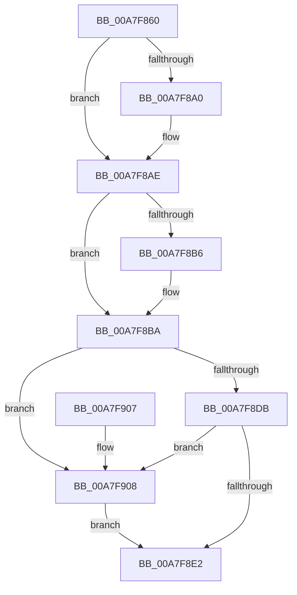

# ObMakeTemporaryObject

- RVA: `0x00A7F860`–`0x00A7F912` (길이 `178` bytes)
- VA: `0x0000000140A7F860`
- 실행 섹션: `PAGE`
- PDB 이름 있음: `예`; PDB Function 태그: `아니요`
- unwind 정보 RVA: `0x0005C748`
- 디코드: `50`개 명령, `178/178` bytes 표시
- 미해석 바이트: `0` (있으면 어셈블리에 `.byte`로 보존)

> 이 문서는 커널 이미지의 기계어와 PDB 기호를 분석해 생성했습니다. 4번과 5번은 함수 원형과 자료형을 바이너리 사용 방식에서 추정한 C 해석이며 원본 소스 복구 결과는 아닙니다.

## 1. Dependencies

- 직접 호출 지점: **6**; 고유 호출 대상: **6**
- 직접 호출자로 확인된 함수: **11**
- RIP 상대 이미지 참조: **0**

### Outgoing calls
- `0x00A7F890` → [KeAbPreAcquire](../../text/21/KeAbPreAcquire_function_00210230.md) (function, `0x00210230`)
- `0x00A7F8A9` → [ExfAcquirePushLockExclusiveEx](../../text/20/ExfAcquirePushLockExclusiveEx_function_0020FC90.md) (function, `0x0020FC90`)
- `0x00A7F8E5` → [KeAbPostRelease](../../text/2E/KeAbPostRelease_function_002E1600.md) (function, `0x002E1600`)
- `0x00A7F8EA` → [KeLeaveCriticalRegion](../../text/25/KeLeaveCriticalRegion_function_0025D8B0.md) (function, `0x0025D8B0`)
- `0x00A7F8F2` → [ObpDeleteNameCheck](../89/ObpDeleteNameCheck_function_0089A3F0.md) (function, `0x0089A3F0`)
- `0x00A7F90B` → [ExfReleasePushLock](../../text/26/ExfReleasePushLock_function_002638D0.md) (function, `0x002638D0`)

### Direct callers
- [IoDeleteDevice](../../text/26/IoDeleteDevice_function_0026FE90.md) at `0x0026FF08`
- [IopCompleteUnloadOrDelete](../../text/27/IopCompleteUnloadOrDelete_function_00270BC8.md) at `0x00270E9C`
- [IoDeleteDriver](../71/IoDeleteDriver_function_0071D400.md) at `0x0071D415`
- [ObShutdownSystem](../74/ObShutdownSystem_function_0074DBB0.md) at `0x0074DBFA`
- [ObShutdownSystem](../74/ObShutdownSystem_function_0074DBB0.md) at `0x0074DC50`
- [ObShutdownSystem](../74/ObShutdownSystem_function_0074DBB0.md) at `0x0074DCA6`
- [ObShutdownSystem](../74/ObShutdownSystem_function_0074DBB0.md) at `0x0074DCFC`
- [ObpDirectoryTeardownCallback](../83/ObpDirectoryTeardownCallback_function_0083CEC0.md) at `0x0083CECC`
- [IopLoadDriver](../99/IopLoadDriver_function_00997B54.md) at `0x009982B7`
- [IopLoadDriver](../99/IopLoadDriver_function_00997B54.md) at `0x0099841E`
- [IopLoadDriver](../99/IopLoadDriver_function_00997B54.md) at `0x009984B9`
- [NtMakeTemporaryObject](NtMakeTemporaryObject_function_00A7F7D0.md) at `0x00A7F821`
- [IopUnloadDriver](../AB/IopUnloadDriver_function_00ABF868.md) at `0x00ABFC65`
- [IoCreateDriver](../AC/IoCreateDriver_function_00AC9D70.md) at `0x00ACA079`
- [IovpUnloadDriver](../../pagevrfy/B9/IovpUnloadDriver_function_00B92AE8.md) at `0x00B92BDD`
- [IopInitializeBuiltinDriver](../../init/C7/IopInitializeBuiltinDriver_function_00C7625C.md) at `0x00C76703`

### Static image references
- 디코드된 RIP-relative 메모리 참조가 없습니다.

## 2. Other-region calls and transfers

- 다른 실행 섹션으로 향하는 call: **5**
  - `0x00A7F890` → [KeAbPreAcquire](../../text/21/KeAbPreAcquire_function_00210230.md) (`PAGE` → `.text`)
  - `0x00A7F8A9` → [ExfAcquirePushLockExclusiveEx](../../text/20/ExfAcquirePushLockExclusiveEx_function_0020FC90.md) (`PAGE` → `.text`)
  - `0x00A7F8E5` → [KeAbPostRelease](../../text/2E/KeAbPostRelease_function_002E1600.md) (`PAGE` → `.text`)
  - `0x00A7F8EA` → [KeLeaveCriticalRegion](../../text/25/KeLeaveCriticalRegion_function_0025D8B0.md) (`PAGE` → `.text`)
  - `0x00A7F90B` → [ExfReleasePushLock](../../text/26/ExfReleasePushLock_function_002638D0.md) (`PAGE` → `.text`)
- 별도 외부 분기/꼬리 이동을 확인하지 못했습니다.

## 3. Assembly (complete function range)

```asm
00A7F860  48 89 5C 24 08                  mov qword ptr [rsp + 8], rbx
00A7F865  48 89 74 24 10                  mov qword ptr [rsp + 0x10], rsi
00A7F86A  57                              push rdi
00A7F86B  48 83 EC 20                     sub rsp, 0x20
00A7F86F  65 48 8B 04 25 88 01 00 00      mov rax, qword ptr gs:[0x188]
00A7F878  48 8D 71 D0                     lea rsi, [rcx - 0x30]
00A7F87C  48 8D 5E 10                     lea rbx, [rsi + 0x10]
00A7F880  45 33 C0                        xor r8d, r8d
00A7F883  33 D2                           xor edx, edx
00A7F885  48 8B CB                        mov rcx, rbx
00A7F888  66 FF 88 E4 01 00 00            dec word ptr [rax + 0x1e4]
00A7F88F  90                              nop
00A7F890  E8 9B 09 79 FF                  call 0x140210230
00A7F895  F0 48 0F BA 2B 00               lock bts qword ptr [rbx], 0
00A7F89B  48 8B F8                        mov rdi, rax
00A7F89E  73 0E                           jae 0x140a7f8ae
00A7F8A0  4C 8B C3                        mov r8, rbx
00A7F8A3  48 8B D0                        mov rdx, rax
00A7F8A6  48 8B CB                        mov rcx, rbx
00A7F8A9  E8 E2 03 79 FF                  call 0x14020fc90
00A7F8AE  45 33 C0                        xor r8d, r8d
00A7F8B1  48 85 FF                        test rdi, rdi
00A7F8B4  74 04                           je 0x140a7f8ba
00A7F8B6  C6 47 0A 01                     mov byte ptr [rdi + 0xa], 1
00A7F8BA  80 66 1B EF                     and byte ptr [rsi + 0x1b], 0xef
00A7F8BE  0F 0D 0B                        prefetchw byte ptr [rbx]
00A7F8C1  48 8B 03                        mov rax, qword ptr [rbx]
00A7F8C4  48 8B C8                        mov rcx, rax
00A7F8C7  48 83 E1 F0                     and rcx, 0xfffffffffffffff0
00A7F8CB  48 83 F9 10                     cmp rcx, 0x10
00A7F8CF  48 8D 50 F0                     lea rdx, [rax - 0x10]
00A7F8D3  49 0F 46 D0                     cmovbe rdx, r8
00A7F8D7  A8 02                           test al, 2
00A7F8D9  75 2D                           jne 0x140a7f908
00A7F8DB  F0 48 0F B1 13                  lock cmpxchg qword ptr [rbx], rdx
00A7F8E0  75 26                           jne 0x140a7f908
00A7F8E2  48 8B CB                        mov rcx, rbx
00A7F8E5  E8 16 1D 86 FF                  call 0x1402e1600
00A7F8EA  E8 C1 DF 7D FF                  call 0x14025d8b0
00A7F8EF  48 8B CE                        mov rcx, rsi
00A7F8F2  E8 F9 AA E1 FF                  call 0x14089a3f0
00A7F8F7  48 8B 5C 24 30                  mov rbx, qword ptr [rsp + 0x30]
00A7F8FC  48 8B 74 24 38                  mov rsi, qword ptr [rsp + 0x38]
00A7F901  48 83 C4 20                     add rsp, 0x20
00A7F905  5F                              pop rdi
00A7F906  C3                              ret
00A7F907  CC                              int3
00A7F908  48 8B CB                        mov rcx, rbx
00A7F90B  E8 C0 3F 7E FF                  call 0x1402638d0
00A7F910  EB D0                           jmp 0x140a7f8e2
```

## 4. C-style interpretation (structured pseudocode)

```c
__int64 __fastcall ObMakeTemporaryObject(__int64 a1, int a2, int a3)
{
    __int64 result;
    __int64 v_rsp;
    unsigned __int64 v_stack_p10;
    unsigned __int64 v_stack_p8;

    v_stack_p8 = v_rbx;
    v_stack_p10 = v_rsi;
    v_rsp = (v_rsp) - (32);
    a3 = 0;
    a2 = 0;
    result = KeAbPreAcquire(a1 - 48 + 16, a2, a3, a4);
    if (!(condition_is_above_or_equal)) {
        a3 = a1 - 48 + 16;
        a2 = result;
        a1 = a1 - 48 + 16;
        result = ExfAcquirePushLockExclusiveEx(a1, a2, a3, a4);
    }
    a3 = 0;
    if (result != 0) {
        *(unsigned __int8 *)(result + 10) = 1;
    }
    a1 = (*(unsigned __int64 *)(a1 - 48 + 16)) & (-16);
    a2 = *(unsigned __int64 *)(a1 - 48 + 16) - 16;
    if (a1 <= 16) { a2 = 0; }
    if ((((unsigned __int8)(*(unsigned __int64 *)(a1 - 48 + 16))) & (2)) != 0) goto loc_00A7F908;
    if ((((unsigned __int8)(*(unsigned __int64 *)(a1 - 48 + 16))) & (2)) != 0) goto loc_00A7F908;
loc_00A7F8E2:
    result = KeAbPostRelease(a1 - 48 + 16, a2, a3, a4);
    result = KeLeaveCriticalRegion(a1 - 48 + 16, a2, a3, a4);
    result = ObpDeleteNameCheck(a1 - 48, a2, a3, a4);
    v_rsp = (v_rsp) + (32);
    return result;
loc_00A7F908:
    result = ExfReleasePushLock(v_stack_p8, a2, a3, a4);
    goto loc_00A7F8E2;
}
```

## 5. (Beta) C Style

```c
int64_t ObMakeTemporaryObject(void *Arg1, int32_t Arg2, int32_t Arg3)
{
    uint8_t *arg1 = (uint8_t *)Arg1;

    int64_t result;
    int64_t local_rsp;
    uint64_t v_stack_p10;
    uint64_t v_stack_p8;

    v_stack_p8 = local_rbx;
    v_stack_p10 = local_rsi;
    local_rsp = (local_rsp) - (32);
    Arg3 = 0;
    Arg2 = 0;
    result = KeAbPreAcquire(Arg1 - 48 + 16, Arg2, Arg3, a4);
    if (!(condition_is_above_or_equal)) {
        Arg3 = Arg1 - 48 + 16;
        Arg2 = result;
        Arg1 = Arg1 - 48 + 16;
        result = ExfAcquirePushLockExclusiveEx(Arg1, Arg2, Arg3, a4);
    }
    Arg3 = 0;
    if (result != 0) {
        *(uint8_t *)(result + 0xA) = 1;
    }
    Arg1 = (*(uint64_t *)(arg1 - 0x30 + 0x10)) & (-16);
    Arg2 = *(uint64_t *)(arg1 - 0x30 + 0x10) - 16;
    if (Arg1 <= 16) { Arg2 = 0; }
    if ((((uint8_t)(*(uint64_t *)(arg1 - 0x30 + 0x10))) & (2)) != 0) goto loc_00A7F908;
    if ((((uint8_t)(*(uint64_t *)(arg1 - 0x30 + 0x10))) & (2)) != 0) goto loc_00A7F908;
loc_00A7F8E2:
    result = KeAbPostRelease(Arg1 - 48 + 16, Arg2, Arg3, a4);
    result = KeLeaveCriticalRegion(Arg1 - 48 + 16, Arg2, Arg3, a4);
    result = ObpDeleteNameCheck(Arg1 - 48, Arg2, Arg3, a4);
    local_rsp = (local_rsp) + (32);
    return result;
loc_00A7F908:
    result = ExfReleasePushLock(v_stack_p8, Arg2, Arg3, a4);
    goto loc_00A7F8E2;
}
```

### 관측된 메모리 오프셋

구조체 형식이 확인되지 않은 접근은 인자 기준의 오프셋으로만 기록했습니다.

| 기준 인자 | 오프셋 표현 | 폭 (bit) | 접근 |
|---|---:|---:|---|
| `Arg1` | `- 0x30` | `64` | `R` |
| `Arg1` | `+ 0x0` | `8` | `R` |
| `Arg1` | `+ 0x0` | `64` | `R` |
| `Arg1` | `+ 0x0` | `64` | `R/W` |
| `Arg1` | `+ 0x10` | `64` | `R` |
| `Arg1` | `+ 0x1B` | `8` | `R/W` |

## 6. Execution-region graph

[열기: 2D/3D 그래프와 함수 탐색 컨트롤 패널](../../../control-panel.html?section=page&rva=0x00A7F860&view=graph)

- 2D 그래프는 위에서 아래로 흐르고, 3D 그래프는 빈 공간을 드래그해 회전합니다. Shift+드래그는 이동, 휠은 확대·축소, 함수 노드 선택은 대상 보고서 이동입니다.

### Static fallback


