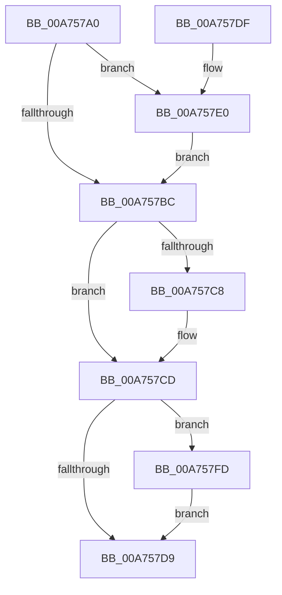

# ObpDeleteDirectoryObject

- RVA: `0x00A757A0`–`0x00A75804` (길이 `100` bytes)
- VA: `0x0000000140A757A0`
- 실행 섹션: `PAGE`
- PDB 이름 있음: `예`; PDB Function 태그: `아니요`
- unwind 정보 RVA: `0x0008C34C`
- 디코드: `27`개 명령, `100/100` bytes 표시
- 미해석 바이트: `0` (있으면 어셈블리에 `.byte`로 보존)

> 이 문서는 커널 이미지의 기계어와 PDB 기호를 분석해 생성했습니다. 4번과 5번은 함수 원형과 자료형을 바이너리 사용 방식에서 추정한 C 해석이며 원본 소스 복구 결과는 아닙니다.

## 1. Dependencies

- 직접 호출 지점: **4**; 고유 호출 대상: **3**
- 직접 호출자로 확인된 함수: **0**
- RIP 상대 이미지 참조: **0**

### Outgoing calls
- `0x00A757C8` → [ObDereferenceObjectDeferDelete](../../text/3F/ObDereferenceObjectDeferDelete_function_003FCE40.md) (function, `0x003FCE40`)
- `0x00A757F1` → [ExfAcquireReleasePushLockExclusive](../../text/41/ExfAcquireReleasePushLockExclusive_function_00419C2C.md) (function, `0x00419C2C`)
- `0x00A757F6` → [KeLeaveCriticalRegion](../../text/25/KeLeaveCriticalRegion_function_0025D8B0.md) (function, `0x0025D8B0`)
- `0x00A757FD` → [ObDereferenceObjectDeferDelete](../../text/3F/ObDereferenceObjectDeferDelete_function_003FCE40.md) (function, `0x003FCE40`)

### Direct callers
- 이 함수 시작 RVA로 연결되는 직접 call은 확인되지 않았습니다. 간접 호출은 완전히 역산할 수 없습니다.

### Static image references
- 디코드된 RIP-relative 메모리 참조가 없습니다.

## 2. Other-region calls and transfers

- 다른 실행 섹션으로 향하는 call: **4**
  - `0x00A757C8` → [ObDereferenceObjectDeferDelete](../../text/3F/ObDereferenceObjectDeferDelete_function_003FCE40.md) (`PAGE` → `.text`)
  - `0x00A757F1` → [ExfAcquireReleasePushLockExclusive](../../text/41/ExfAcquireReleasePushLockExclusive_function_00419C2C.md) (`PAGE` → `.text`)
  - `0x00A757F6` → [KeLeaveCriticalRegion](../../text/25/KeLeaveCriticalRegion_function_0025D8B0.md) (`PAGE` → `.text`)
  - `0x00A757FD` → [ObDereferenceObjectDeferDelete](../../text/3F/ObDereferenceObjectDeferDelete_function_003FCE40.md) (`PAGE` → `.text`)
- 별도 외부 분기/꼬리 이동을 확인하지 못했습니다.

## 3. Assembly (complete function range)

```asm
00A757A0  40 53                           push rbx
00A757A2  48 83 EC 20                     sub rsp, 0x20
00A757A6  48 8B D9                        mov rbx, rcx
00A757A9  F0 83 0C 24 00                  lock or dword ptr [rsp], 0
00A757AE  48 81 C1 28 01 00 00            add rcx, 0x128
00A757B5  48 8B 01                        mov rax, qword ptr [rcx]
00A757B8  A8 01                           test al, 1
00A757BA  75 24                           jne 0x140a757e0
00A757BC  48 8B 8B 38 01 00 00            mov rcx, qword ptr [rbx + 0x138]
00A757C3  48 85 C9                        test rcx, rcx
00A757C6  74 05                           je 0x140a757cd
00A757C8  E8 73 76 98 FF                  call 0x1403fce40
00A757CD  48 8B 8B 48 01 00 00            mov rcx, qword ptr [rbx + 0x148]
00A757D4  48 85 C9                        test rcx, rcx
00A757D7  75 24                           jne 0x140a757fd
00A757D9  48 83 C4 20                     add rsp, 0x20
00A757DD  5B                              pop rbx
00A757DE  C3                              ret
00A757DF  CC                              int3
00A757E0  65 48 8B 04 25 88 01 00 00      mov rax, qword ptr gs:[0x188]
00A757E9  66 FF 88 E4 01 00 00            dec word ptr [rax + 0x1e4]
00A757F0  90                              nop
00A757F1  E8 36 44 9A FF                  call 0x140419c2c
00A757F6  E8 B5 80 7E FF                  call 0x14025d8b0
00A757FB  EB BF                           jmp 0x140a757bc
00A757FD  E8 3E 76 98 FF                  call 0x1403fce40
00A75802  EB D5                           jmp 0x140a757d9
```

## 4. C-style interpretation (structured pseudocode)

```c
__int64 __fastcall ObpDeleteDirectoryObject(__int64 a1)
{
    __int64 result;
    __int64 v_rsp;
    unsigned int v_stack_m28;

    v_rsp = (v_rsp) - (32);
    a1 = (a1) + (296);
    if ((((unsigned __int8)(*(unsigned __int64 *)(a1))) & (1)) != 0) goto loc_00A757E0;
loc_00A757BC:
    result = *(unsigned __int64 *)(a1);
    if (*(unsigned __int64 *)(a1 + 312) != 0) {
        result = ObDereferenceObjectDeferDelete(*(unsigned __int64 *)(a1 + 312), a2, a3, a4);
    }
    if (*(unsigned __int64 *)(a1 + 328) != 0) goto loc_00A757FD;
loc_00A757D9:
    v_rsp = (v_rsp) + (32);
    return result;
loc_00A757E0:
    result = ExfAcquireReleasePushLockExclusive(*(unsigned __int64 *)(a1 + 328), a2, a3, a4);
    result = KeLeaveCriticalRegion(*(unsigned __int64 *)(a1 + 328), a2, a3, a4);
    goto loc_00A757BC;
loc_00A757FD:
    result = ObDereferenceObjectDeferDelete(*(unsigned __int64 *)(a1 + 328), a2, a3, a4);
    goto loc_00A757D9;
}
```

## 5. (Beta) C Style

```c
int64_t ObpDeleteDirectoryObject(void *Arg1)
{
    uint8_t *arg1 = (uint8_t *)Arg1;

    int64_t result;
    int64_t local_rsp;
    uint32_t v_stack_m28;

    local_rsp = (local_rsp) - (32);
    Arg1 = (Arg1) + (296);
    if ((((uint8_t)(*(uint64_t *)(arg1))) & (1)) != 0) goto loc_00A757E0;
loc_00A757BC:
    result = *(uint64_t *)(arg1);
    if (*(uint64_t *)(arg1 + 0x138) != 0) {
        result = ObDereferenceObjectDeferDelete(*(uint64_t *)(arg1 + 0x138), a2, a3, a4);
    }
    if (*(uint64_t *)(arg1 + 0x148) != 0) goto loc_00A757FD;
loc_00A757D9:
    local_rsp = (local_rsp) + (32);
    return result;
loc_00A757E0:
    result = ExfAcquireReleasePushLockExclusive(*(uint64_t *)(arg1 + 0x148), a2, a3, a4);
    result = KeLeaveCriticalRegion(*(uint64_t *)(arg1 + 0x148), a2, a3, a4);
    goto loc_00A757BC;
loc_00A757FD:
    result = ObDereferenceObjectDeferDelete(*(uint64_t *)(arg1 + 0x148), a2, a3, a4);
    goto loc_00A757D9;
}
```

### 관측된 메모리 오프셋

구조체 형식이 확인되지 않은 접근은 인자 기준의 오프셋으로만 기록했습니다.

| 기준 인자 | 오프셋 표현 | 폭 (bit) | 접근 |
|---|---:|---:|---|
| `Arg1` | `+ 0x0` | `64` | `R` |
| `Arg1` | `+ 0x138` | `64` | `R` |
| `Arg1` | `+ 0x148` | `64` | `R` |

## 6. Execution-region graph

[열기: 2D/3D 그래프와 함수 탐색 컨트롤 패널](../../../control-panel.html?section=page&rva=0x00A757A0&view=graph)

- 2D 그래프는 위에서 아래로 흐르고, 3D 그래프는 빈 공간을 드래그해 회전합니다. Shift+드래그는 이동, 휠은 확대·축소, 함수 노드 선택은 대상 보고서 이동입니다.

### Static fallback


