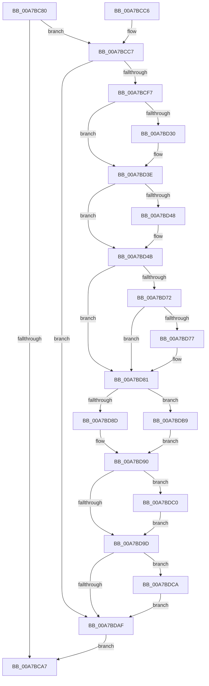

# ObpDeleteSymbolicLinkName

- RVA: `0x00A7BC80`–`0x00A7BDD4` (길이 `340` bytes)
- VA: `0x0000000140A7BC80`
- 실행 섹션: `PAGE`
- PDB 이름 있음: `예`; PDB Function 태그: `아니요`
- unwind 정보 RVA: `0x000B6798`
- 디코드: `95`개 명령, `340/340` bytes 표시
- 미해석 바이트: `0` (있으면 어셈블리에 `.byte`로 보존)

> 이 문서는 커널 이미지의 기계어와 PDB 기호를 분석해 생성했습니다. 4번과 5번은 함수 원형과 자료형을 바이너리 사용 방식에서 추정한 C 해석이며 원본 소스 복구 결과는 아닙니다.

## 1. Dependencies

- 직접 호출 지점: **7**; 고유 호출 대상: **7**
- 직접 호출자로 확인된 함수: **5**
- RIP 상대 이미지 참조: **1**

### Outgoing calls
- `0x00A7BCF7` → [PsGetCurrentServerSiloGlobals](../../text/2F/PsGetCurrentServerSiloGlobals_function_002FE1F0.md) (function, `0x002FE1F0`)
- `0x00A7BD20` → [KeAbPreAcquire](../../text/21/KeAbPreAcquire_function_00210230.md) (function, `0x00210230`)
- `0x00A7BD39` → [ExfAcquirePushLockExclusiveEx](../../text/20/ExfAcquirePushLockExclusiveEx_function_0020FC90.md) (function, `0x0020FC90`)
- `0x00A7BDA0` → [KeAbPostRelease](../../text/2E/KeAbPostRelease_function_002E1600.md) (function, `0x002E1600`)
- `0x00A7BDA5` → [KeLeaveGuardedRegion](../../text/2E/KeLeaveGuardedRegion_function_002E2C40.md) (function, `0x002E2C40`)
- `0x00A7BDC3` → [ExfTryToWakePushLock](../../text/26/ExfTryToWakePushLock_function_00265DD0.md) (function, `0x00265DD0`)
- `0x00A7BDCD` → [ObDereferenceObjectDeferDelete](../../text/3F/ObDereferenceObjectDeferDelete_function_003FCE40.md) (function, `0x003FCE40`)

### Direct callers
- [ObShutdownSystem](../74/ObShutdownSystem_function_0074DBB0.md) at `0x0074DF84`
- [ObpDecrementHandleCount](../86/ObpDecrementHandleCount_function_008632E0.md) at `0x0086380B`
- [ObCloseHandleTableEntry](../86/ObCloseHandleTableEntry_function_00869E20.md) at `0x0086A777`
- [sub_0089A511](../89/Unknown_function_0089A511.md) at `0x0089A5D2`
- [ObpMarkDirectoryObjectsTemporary](../99/ObpMarkDirectoryObjectsTemporary_function_0099F00C.md) at `0x0099F23C`

### Static image references
- `0x00A7BCD3` → RVA `0x00F0FF80` (`.data`; read)

## 2. Other-region calls and transfers

- 다른 실행 섹션으로 향하는 call: **7**
  - `0x00A7BCF7` → [PsGetCurrentServerSiloGlobals](../../text/2F/PsGetCurrentServerSiloGlobals_function_002FE1F0.md) (`PAGE` → `.text`)
  - `0x00A7BD20` → [KeAbPreAcquire](../../text/21/KeAbPreAcquire_function_00210230.md) (`PAGE` → `.text`)
  - `0x00A7BD39` → [ExfAcquirePushLockExclusiveEx](../../text/20/ExfAcquirePushLockExclusiveEx_function_0020FC90.md) (`PAGE` → `.text`)
  - `0x00A7BDA0` → [KeAbPostRelease](../../text/2E/KeAbPostRelease_function_002E1600.md) (`PAGE` → `.text`)
  - `0x00A7BDA5` → [KeLeaveGuardedRegion](../../text/2E/KeLeaveGuardedRegion_function_002E2C40.md) (`PAGE` → `.text`)
  - `0x00A7BDC3` → [ExfTryToWakePushLock](../../text/26/ExfTryToWakePushLock_function_00265DD0.md) (`PAGE` → `.text`)
  - `0x00A7BDCD` → [ObDereferenceObjectDeferDelete](../../text/3F/ObDereferenceObjectDeferDelete_function_003FCE40.md) (`PAGE` → `.text`)
- 별도 외부 분기/꼬리 이동을 확인하지 못했습니다.

## 3. Assembly (complete function range)

```asm
00A7BC80  48 8B C4                        mov rax, rsp
00A7BC83  48 89 58 08                     mov qword ptr [rax + 8], rbx
00A7BC87  48 89 68 10                     mov qword ptr [rax + 0x10], rbp
00A7BC8B  48 89 70 18                     mov qword ptr [rax + 0x18], rsi
00A7BC8F  48 89 78 20                     mov qword ptr [rax + 0x20], rdi
00A7BC93  41 54                           push r12
00A7BC95  41 56                           push r14
00A7BC97  41 57                           push r15
00A7BC99  48 83 EC 20                     sub rsp, 0x20
00A7BC9D  8B 41 18                        mov eax, dword ptr [rcx + 0x18]
00A7BCA0  4C 8B F1                        mov r14, rcx
00A7BCA3  85 C0                           test eax, eax
00A7BCA5  75 20                           jne 0x140a7bcc7
00A7BCA7  48 8B 5C 24 40                  mov rbx, qword ptr [rsp + 0x40]
00A7BCAC  48 8B 6C 24 48                  mov rbp, qword ptr [rsp + 0x48]
00A7BCB1  48 8B 74 24 50                  mov rsi, qword ptr [rsp + 0x50]
00A7BCB6  48 8B 7C 24 58                  mov rdi, qword ptr [rsp + 0x58]
00A7BCBB  48 83 C4 20                     add rsp, 0x20
00A7BCBF  41 5F                           pop r15
00A7BCC1  41 5E                           pop r14
00A7BCC3  41 5C                           pop r12
00A7BCC5  C3                              ret
00A7BCC6  CC                              int3
00A7BCC7  44 8D 60 FF                     lea r12d, [rax - 1]
00A7BCCB  48 8D 51 D0                     lea rdx, [rcx - 0x30]
00A7BCCF  0F B6 42 1A                     movzx eax, byte ptr [rdx + 0x1a]
00A7BCD3  48 8D 0D A6 42 49 00            lea rcx, [rip + 0x4942a6]
00A7BCDA  83 E0 03                        and eax, 3
00A7BCDD  0F B6 04 08                     movzx eax, byte ptr [rax + rcx]
00A7BCE1  48 2B D0                        sub rdx, rax
00A7BCE4  48 8B 02                        mov rax, qword ptr [rdx]
00A7BCE7  4C 8B B8 30 01 00 00            mov r15, qword ptr [rax + 0x130]
00A7BCEE  4D 85 FF                        test r15, r15
00A7BCF1  0F 84 B8 00 00 00               je 0x140a7bdaf
00A7BCF7  E8 F4 24 88 FF                  call 0x1402fe1f0
00A7BCFC  65 48 8B 0C 25 88 01 00 00      mov rcx, qword ptr gs:[0x188]
00A7BD05  48 83 CB FF                     or rbx, 0xffffffffffffffff
00A7BD09  45 33 C0                        xor r8d, r8d
00A7BD0C  33 D2                           xor edx, edx
00A7BD0E  48 8B F0                        mov rsi, rax
00A7BD11  48 8D 78 78                     lea rdi, [rax + 0x78]
00A7BD15  66 01 99 E6 01 00 00            add word ptr [rcx + 0x1e6], bx
00A7BD1C  48 8B CF                        mov rcx, rdi
00A7BD1F  90                              nop
00A7BD20  E8 0B 45 79 FF                  call 0x140210230
00A7BD25  F0 48 0F BA 2F 00               lock bts qword ptr [rdi], 0
00A7BD2B  48 8B E8                        mov rbp, rax
00A7BD2E  73 0E                           jae 0x140a7bd3e
00A7BD30  4C 8B C7                        mov r8, rdi
00A7BD33  48 8B D0                        mov rdx, rax
00A7BD36  48 8B CF                        mov rcx, rdi
00A7BD39  E8 52 3F 79 FF                  call 0x14020fc90
00A7BD3E  BA 01 00 00 00                  mov edx, 1
00A7BD43  48 85 ED                        test rbp, rbp
00A7BD46  74 03                           je 0x140a7bd4b
00A7BD48  88 55 0A                        mov byte ptr [rbp + 0xa], dl
00A7BD4B  33 C0                           xor eax, eax
00A7BD4D  41 8B CC                        mov ecx, r12d
00A7BD50  D3 E2                           shl edx, cl
00A7BD52  F7 D2                           not edx
00A7BD54  41 21 97 00 01 00 00            and dword ptr [r15 + 0x100], edx
00A7BD5B  43 C6 84 3C 04 01 00 00 00      mov byte ptr [r12 + r15 + 0x104], 0
00A7BD64  4B 87 44 E7 20                  xchg qword ptr [r15 + r12*8 + 0x20], rax
00A7BD69  48 8B E8                        mov rbp, rax
00A7BD6C  48 83 E5 F0                     and rbp, 0xfffffffffffffff0
00A7BD70  74 0F                           je 0x140a7bd81
00A7BD72  83 E0 0F                        and eax, 0xf
00A7BD75  76 0A                           jbe 0x140a7bd81
00A7BD77  F7 D8                           neg eax
00A7BD79  48 63 C8                        movsxd rcx, eax
00A7BD7C  F0 48 01 4D D0                  lock add qword ptr [rbp - 0x30], rcx
00A7BD81  48 8B 06                        mov rax, qword ptr [rsi]
00A7BD84  48 83 E0 F0                     and rax, 0xfffffffffffffff0
00A7BD88  4C 3B F8                        cmp r15, rax
00A7BD8B  75 2C                           jne 0x140a7bdb9
00A7BD8D  21 56 08                        and dword ptr [rsi + 8], edx
00A7BD90  F0 48 0F C1 1F                  lock xadd qword ptr [rdi], rbx
00A7BD95  80 E3 06                        and bl, 6
00A7BD98  80 FB 02                        cmp bl, 2
00A7BD9B  74 23                           je 0x140a7bdc0
00A7BD9D  48 8B CF                        mov rcx, rdi
00A7BDA0  E8 5B 58 86 FF                  call 0x1402e1600
00A7BDA5  E8 96 6E 86 FF                  call 0x1402e2c40
00A7BDAA  48 85 ED                        test rbp, rbp
00A7BDAD  75 1B                           jne 0x140a7bdca
00A7BDAF  41 83 66 18 00                  and dword ptr [r14 + 0x18], 0
00A7BDB4  E9 EE FE FF FF                  jmp 0x140a7bca7
00A7BDB9  42 FF 4C A6 0C                  dec dword ptr [rsi + r12*4 + 0xc]
00A7BDBE  EB D0                           jmp 0x140a7bd90
00A7BDC0  48 8B CF                        mov rcx, rdi
00A7BDC3  E8 08 A0 7E FF                  call 0x140265dd0
00A7BDC8  EB D3                           jmp 0x140a7bd9d
00A7BDCA  48 8B CD                        mov rcx, rbp
00A7BDCD  E8 6E 10 98 FF                  call 0x1403fce40
00A7BDD2  EB DB                           jmp 0x140a7bdaf
```

## 4. C-style interpretation (structured pseudocode)

```c
__int64 __fastcall ObpDeleteSymbolicLinkName(__int64 a1, __int64 a2, int a3)
{
    __int64 result;
    __int64 v_rbp;
    __int64 v_rbx;
    __int64 v_rsp;
    unsigned __int64 v_stack_p10;
    unsigned __int64 v_stack_p18;
    unsigned __int64 v_stack_p20;
    unsigned __int64 v_stack_p8;

    *(unsigned __int64 *)(v_rsp + 8) = v_rbx;
    *(unsigned __int64 *)(v_rsp + 16) = v_rbp;
    *(unsigned __int64 *)(v_rsp + 24) = v_rsi;
    *(unsigned __int64 *)(v_rsp + 32) = v_rdi;
    v_rsp = (v_rsp) - (32);
    if ((unsigned int)((unsigned int)(*(unsigned int *)(a1 + 24))) != 0) goto loc_00A7BCC7;
loc_00A7BCA7:
    v_rsp = (v_rsp) + (32);
    return (unsigned int)(*(unsigned int *)(a1 + 24));
loc_00A7BCC7:
    result = (unsigned int)((*(unsigned __int8 *)(a1 - 48 + 26)) & (3));
    a2 = (a1 - 48) - (*(unsigned __int8 *)(result + v_rip + 4801190 * 1));
    if (*(unsigned __int64 *)(*(unsigned __int64 *)(a2) + 304) == 0) goto loc_00A7BDAF;
    result = PsGetCurrentServerSiloGlobals(v_rip + 4801190, a2, a3, a4);
    v_rbx = (v_stack_p8) | (-1);
    a3 = 0;
    a2 = 0;
    result = KeAbPreAcquire(result + 120, a2, a3, a4);
    if (!(condition_is_above_or_equal)) {
        a3 = result + 120;
        a2 = result;
        a1 = result + 120;
        result = ExfAcquirePushLockExclusiveEx(a1, a2, a3, a4);
    }
    if (result != 0) {
        *(unsigned __int8 *)(result + 10) = 1;
    }
    result = 0;
    a2 = (unsigned int)((1) << ((unsigned __int8)((unsigned int)((unsigned int)((unsigned int)(*(unsigned int *)(a1 + 24)) - 1)))));
    a2 = (unsigned int)(~(a2));
    *(unsigned __int8 *)((unsigned int)(*(unsigned int *)(a1 + 24)) - 1 + *(unsigned __int64 *)(*(unsigned __int64 *)(a2) + 304) * 1 + 260) = 0;
    v_rbp = (0) & (-16);
    if (condition_is_equal) goto loc_00A7BD81;
    result = (unsigned int)((result) & (15));
    if (!(condition_is_below_or_equal)) {
        result = (unsigned int)(-(result));
        a1 = (int)((unsigned int)(result));
    }
    result = (*(unsigned __int64 *)(result)) & (-16);
    if ((*(unsigned __int64 *)(*(unsigned __int64 *)(a2) + 304)) != result) goto loc_00A7BDB9;
loc_00A7BD90:
    v_rbx = (unsigned __int8)((v_rbx) & (6));
    if (((unsigned __int8)(v_rbx)) == 2) goto loc_00A7BDC0;
loc_00A7BD9D:
    result = KeAbPostRelease(result + 120, a2, a3, a4);
    result = KeLeaveGuardedRegion(result + 120, a2, a3, a4);
    if (v_rbp != 0) goto loc_00A7BDCA;
loc_00A7BDAF:
    goto loc_00A7BCA7;
loc_00A7BDB9:
    goto loc_00A7BD90;
loc_00A7BDC0:
    result = ExfTryToWakePushLock(result + 120, a2, a3, a4);
    goto loc_00A7BD9D;
loc_00A7BDCA:
    result = ObDereferenceObjectDeferDelete(v_rbp, a2, a3, a4);
    goto loc_00A7BDAF;
}
```

## 5. (Beta) C Style

```c
int64_t ObpDeleteSymbolicLinkName(void *Arg1, int64_t Arg2, int32_t Arg3)
{
    uint8_t *arg1 = (uint8_t *)Arg1;

    int64_t result;
    int64_t local_rbp;
    int64_t local_rbx;
    int64_t local_rsp;
    uint64_t v_stack_p10;
    uint64_t v_stack_p18;
    uint64_t v_stack_p20;
    uint64_t v_stack_p8;

    *(uint64_t *)(local_rsp + 0x8) = local_rbx;
    *(uint64_t *)(local_rsp + 0x10) = local_rbp;
    *(uint64_t *)(local_rsp + 0x18) = local_rsi;
    *(uint64_t *)(local_rsp + 0x20) = local_rdi;
    local_rsp = (local_rsp) - (32);
    if ((uint32_t)((uint32_t)(*(uint32_t *)(arg1 + 0x18))) != 0) goto loc_00A7BCC7;
loc_00A7BCA7:
    local_rsp = (local_rsp) + (32);
    return (uint32_t)(*(uint32_t *)(arg1 + 0x18));
loc_00A7BCC7:
    result = (uint32_t)((*(uint8_t *)(arg1 - 0x30 + 0x1A)) & (3));
    Arg2 = (Arg1 - 48) - (*(uint8_t *)(result + v_rip + 0x4942A6 * 1));
    if (*(uint64_t *)(*(uint64_t *)(Arg2) + 0x130) == 0) goto loc_00A7BDAF;
    result = PsGetCurrentServerSiloGlobals(v_rip + 4801190, Arg2, Arg3, a4);
    local_rbx = (v_stack_p8) | (-1);
    Arg3 = 0;
    Arg2 = 0;
    result = KeAbPreAcquire(result + 120, Arg2, Arg3, a4);
    if (!(condition_is_above_or_equal)) {
        Arg3 = result + 120;
        Arg2 = result;
        Arg1 = result + 120;
        result = ExfAcquirePushLockExclusiveEx(Arg1, Arg2, Arg3, a4);
    }
    if (result != 0) {
        *(uint8_t *)(result + 0xA) = 1;
    }
    result = 0;
    Arg2 = (uint32_t)((1) << ((uint8_t)((uint32_t)((uint32_t)((uint32_t)(*(uint32_t *)(arg1 + 0x18)) - 1)))));
    Arg2 = (uint32_t)(~(Arg2));
    *(uint8_t *)((uint32_t)(*(uint32_t *)(arg1 + 0x18)) - 0x1 + *(uint64_t *)(*(uint64_t *)(Arg2) + 0x130) * 1 + 0x104) = 0;
    local_rbp = (0) & (-16);
    if (condition_is_equal) goto loc_00A7BD81;
    result = (uint32_t)((result) & (15));
    if (!(condition_is_below_or_equal)) {
        result = (uint32_t)(-(result));
        Arg1 = (int32_t)((uint32_t)(result));
    }
    result = (*(uint64_t *)(result)) & (-16);
    if ((*(uint64_t *)(*(uint64_t *)(Arg2) + 0x130)) != result) goto loc_00A7BDB9;
loc_00A7BD90:
    local_rbx = (uint8_t)((local_rbx) & (6));
    if (((uint8_t)(local_rbx)) == 2) goto loc_00A7BDC0;
loc_00A7BD9D:
    result = KeAbPostRelease(result + 120, Arg2, Arg3, a4);
    result = KeLeaveGuardedRegion(result + 120, Arg2, Arg3, a4);
    if (local_rbp != 0) goto loc_00A7BDCA;
loc_00A7BDAF:
    goto loc_00A7BCA7;
loc_00A7BDB9:
    goto loc_00A7BD90;
loc_00A7BDC0:
    result = ExfTryToWakePushLock(result + 120, Arg2, Arg3, a4);
    goto loc_00A7BD9D;
loc_00A7BDCA:
    result = ObDereferenceObjectDeferDelete(local_rbp, Arg2, Arg3, a4);
    goto loc_00A7BDAF;
}
```

### 관측된 메모리 오프셋

구조체 형식이 확인되지 않은 접근은 인자 기준의 오프셋으로만 기록했습니다.

| 기준 인자 | 오프셋 표현 | 폭 (bit) | 접근 |
|---|---:|---:|---|
| `Arg1` | `- 0x30` | `64` | `R` |
| `Arg1` | `+ 0x0` | `64` | `R` |
| `Arg1` | `+ 0x18` | `32` | `R` |
| `Arg1` | `+ 0x18` | `32` | `R/W` |
| `Arg1` | `+ 0x1A` | `8` | `R` |

## 6. Execution-region graph

[열기: 2D/3D 그래프와 함수 탐색 컨트롤 패널](../../../control-panel.html?section=page&rva=0x00A7BC80&view=graph)

- 2D 그래프는 위에서 아래로 흐르고, 3D 그래프는 빈 공간을 드래그해 회전합니다. Shift+드래그는 이동, 휠은 확대·축소, 함수 노드 선택은 대상 보고서 이동입니다.

### Static fallback


