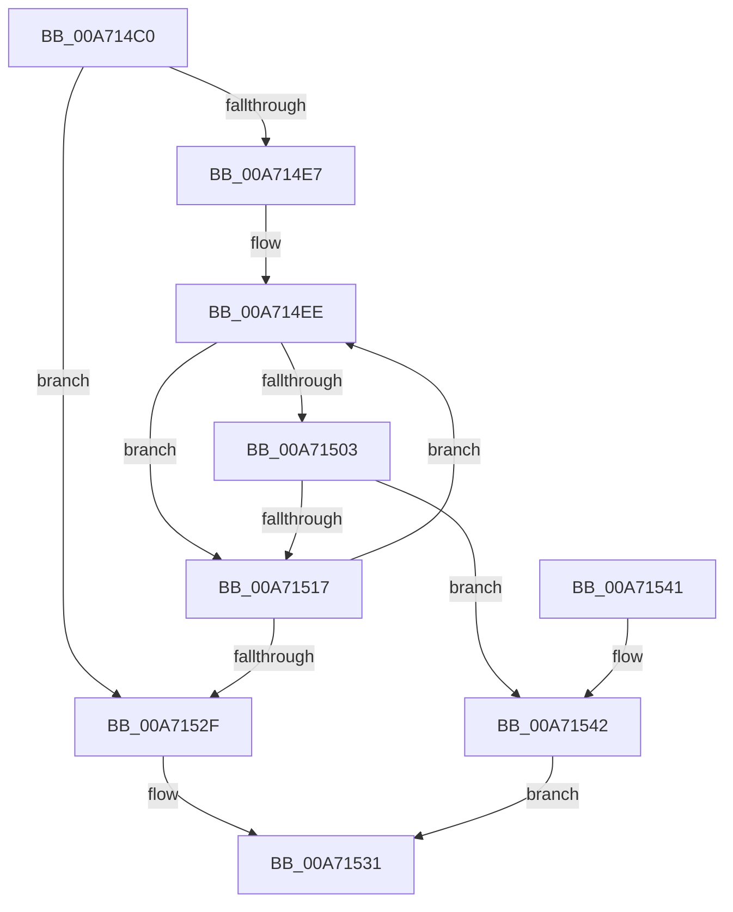

# ObpIsUnsecureName

- RVA: `0x00A714C0`–`0x00A71546` (길이 `134` bytes)
- VA: `0x0000000140A714C0`
- 실행 섹션: `PAGE`
- PDB 이름 있음: `예`; PDB Function 태그: `아니요`
- unwind 정보 RVA: `0x000B53BC`
- 디코드: `37`개 명령, `134/134` bytes 표시
- 미해석 바이트: `0` (있으면 어셈블리에 `.byte`로 보존)

> 이 문서는 커널 이미지의 기계어와 PDB 기호를 분석해 생성했습니다. 4번과 5번은 함수 원형과 자료형을 바이너리 사용 방식에서 추정한 C 해석이며 원본 소스 복구 결과는 아닙니다.

## 1. Dependencies

- 직접 호출 지점: **2**; 고유 호출 대상: **2**
- 직접 호출자로 확인된 함수: **1**
- RIP 상대 이미지 참조: **1**

### Outgoing calls
- `0x00A714F6` → [RtlInitUnicodeString](../../text/42/RtlInitUnicodeString_function_0042A780.md) (function, `0x0042A780`)
- `0x00A7150E` → [RtlPrefixUnicodeString](../8F/RtlPrefixUnicodeString_function_008F4F70.md) (function, `0x008F4F70`)

### Direct callers
- [ObpLookupObjectName](../89/ObpLookupObjectName_function_0089BE90.md) at `0x0089D92B`

### Static image references
- `0x00A714CF` → RVA `0x00E66D10` (`.data`; read)

## 2. Other-region calls and transfers

- 다른 실행 섹션으로 향하는 call: **1**
  - `0x00A714F6` → [RtlInitUnicodeString](../../text/42/RtlInitUnicodeString_function_0042A780.md) (`PAGE` → `.text`)
- 별도 외부 분기/꼬리 이동을 확인하지 못했습니다.

## 3. Assembly (complete function range)

```asm
00A714C0  48 89 5C 24 08                  mov qword ptr [rsp + 8], rbx
00A714C5  48 89 6C 24 10                  mov qword ptr [rsp + 0x10], rbp
00A714CA  56                              push rsi
00A714CB  48 83 EC 30                     sub rsp, 0x30
00A714CF  66 83 3D 39 58 3F 00 00         cmp word ptr [rip + 0x3f5839], 0
00A714D7  0F 57 C0                        xorps xmm0, xmm0
00A714DA  0F 11 44 24 20                  movups xmmword ptr [rsp + 0x20], xmm0
00A714DF  40 8A F2                        mov sil, dl
00A714E2  48 8B E9                        mov rbp, rcx
00A714E5  74 48                           je 0x140a7152f
00A714E7  48 8D 1D 22 58 3F 00            lea rbx, [rip + 0x3f5822]
00A714EE  48 8B D3                        mov rdx, rbx
00A714F1  48 8D 4C 24 20                  lea rcx, [rsp + 0x20]
00A714F6  E8 85 92 9B FF                  call 0x14042a780
00A714FB  66 83 7C 24 20 00               cmp word ptr [rsp + 0x20], 0
00A71501  74 14                           je 0x140a71517
00A71503  44 8A C6                        mov r8b, sil
00A71506  48 8D 4C 24 20                  lea rcx, [rsp + 0x20]
00A7150B  48 8B D5                        mov rdx, rbp
00A7150E  E8 5D 3A E8 FF                  call 0x1408f4f70
00A71513  84 C0                           test al, al
00A71515  75 2B                           jne 0x140a71542
00A71517  0F B7 44 24 20                  movzx eax, word ptr [rsp + 0x20]
00A7151C  48 83 C0 02                     add rax, 2
00A71520  48 D1 E8                        shr rax, 1
00A71523  66 83 7C 24 20 00               cmp word ptr [rsp + 0x20], 0
00A71529  48 8D 1C 43                     lea rbx, [rbx + rax*2]
00A7152D  75 BF                           jne 0x140a714ee
00A7152F  32 C0                           xor al, al
00A71531  48 8B 5C 24 40                  mov rbx, qword ptr [rsp + 0x40]
00A71536  48 8B 6C 24 48                  mov rbp, qword ptr [rsp + 0x48]
00A7153B  48 83 C4 30                     add rsp, 0x30
00A7153F  5E                              pop rsi
00A71540  C3                              ret
00A71541  CC                              int3
00A71542  B0 01                           mov al, 1
00A71544  EB EB                           jmp 0x140a71531
```

## 4. C-style interpretation (structured pseudocode)

```c
__int64 __fastcall ObpIsUnsecureName(__int64 a1, unsigned __int8 a2)
{
    __int64 result;
    __int64 v_rsp;
    unsigned __int64 v_stack_m18;
    unsigned __int64 v_stack_p10;
    unsigned __int64 v_stack_p8;

    v_stack_p8 = v_rbx;
    v_stack_p10 = v_rbp;
    v_rsp = (v_rsp) - (48);
    v_stack_m18 = v_xmm0;
    if ((*(unsigned __int16 *)(v_rip + 4151353)) == 0) goto loc_00A7152F;
loc_00A714EE:
    result = RtlInitUnicodeString(v_stack_m18, v_rip + 4151330, a3, a4);
    if (v_stack_m18 == 0) goto loc_00A71517;
    result = RtlPrefixUnicodeString(v_stack_m18, a1, a2, a4);
    if ((unsigned __int8)(result) != 0) goto loc_00A71542;
loc_00A71517:
    result = (v_stack_m18) + (2);
    result = (result) >> (1);
    if (v_stack_m18 != 0) goto loc_00A714EE;
loc_00A7152F:
    result = 0;
loc_00A71531:
    v_rsp = (v_rsp) + (48);
    return result;
loc_00A71542:
    goto loc_00A71531;
}
```

## 5. (Beta) C Style

```c
int64_t ObpIsUnsecureName(int64_t Arg1, uint8_t Arg2)
{
    int64_t result;
    int64_t local_rsp;
    uint64_t v_stack_m18;
    uint64_t v_stack_p10;
    uint64_t v_stack_p8;

    v_stack_p8 = local_rbx;
    v_stack_p10 = local_rbp;
    local_rsp = (local_rsp) - (48);
    v_stack_m18 = v_xmm0;
    if ((*(uint16_t *)(v_rip + 0x3F5839)) == 0) goto loc_00A7152F;
loc_00A714EE:
    result = RtlInitUnicodeString(v_stack_m18, v_rip + 4151330, a3, a4);
    if (v_stack_m18 == 0) goto loc_00A71517;
    result = RtlPrefixUnicodeString(v_stack_m18, Arg1, Arg2, a4);
    if ((uint8_t)(result) != 0) goto loc_00A71542;
loc_00A71517:
    result = (v_stack_m18) + (2);
    result = (result) >> (1);
    if (v_stack_m18 != 0) goto loc_00A714EE;
loc_00A7152F:
    result = 0;
loc_00A71531:
    local_rsp = (local_rsp) + (48);
    return result;
loc_00A71542:
    goto loc_00A71531;
}
```

## 6. Execution-region graph

[열기: 2D/3D 그래프와 함수 탐색 컨트롤 패널](../../../control-panel.html?section=page&rva=0x00A714C0&view=graph)

- 2D 그래프는 위에서 아래로 흐르고, 3D 그래프는 빈 공간을 드래그해 회전합니다. Shift+드래그는 이동, 휠은 확대·축소, 함수 노드 선택은 대상 보고서 이동입니다.

### Static fallback


