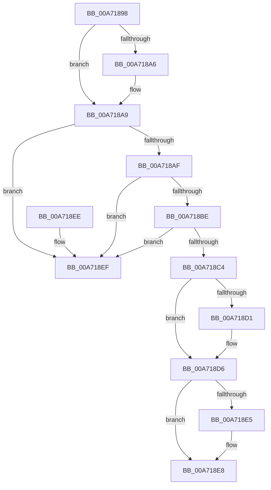

# PdcReleaseRwLockExclusive2

- RVA: `0x00A71898`–`0x00A718F6` (길이 `94` bytes)
- VA: `0x0000000140A71898`
- 실행 섹션: `PAGE`
- PDB 이름 있음: `예`; PDB Function 태그: `아니요`
- unwind 정보 RVA: `0x0005DAC8`
- 디코드: `30`개 명령, `94/94` bytes 표시
- 미해석 바이트: `0` (있으면 어셈블리에 `.byte`로 보존)

> 이 문서는 커널 이미지의 기계어와 PDB 기호를 분석해 생성했습니다. 4번과 5번은 함수 원형과 자료형을 바이너리 사용 방식에서 추정한 C 해석이며 원본 소스 복구 결과는 아닙니다.

## 1. Dependencies

- 직접 호출 지점: **1**; 고유 호출 대상: **1**
- 직접 호출자로 확인된 함수: **6**
- RIP 상대 이미지 참조: **0**

### Outgoing calls
- `0x00A718DB` → [KeReleaseMutex](../../text/39/KeReleaseMutex_function_00396810.md) (function, `0x00396810`)

### Direct callers
- [Pdcv2ActivationClientRegister](../79/Pdcv2ActivationClientRegister_function_0079AF28.md) at `0x0079B097`
- [Pdcv2ActivationClientRegister](../79/Pdcv2ActivationClientRegister_function_0079AF28.md) at `0x0079B0B0`
- [Pdcv2ActivationClientRenewActivation](../79/Pdcv2ActivationClientRenewActivation_function_0079B0F0.md) at `0x0079B28F`
- [Pdcv2pActivationClientCallback](../79/Pdcv2pActivationClientCallback_function_0079B2C0.md) at `0x0079B325`
- [Pdcv2pActivationClientCallback](../79/Pdcv2pActivationClientCallback_function_0079B2C0.md) at `0x0079B41B`
- [Pdcv2pActivationClientCallback](../79/Pdcv2pActivationClientCallback_function_0079B2C0.md) at `0x0079B47C`
- [Pdcv2ActivationClientActivate](../95/Pdcv2ActivationClientActivate_function_00953C70.md) at `0x009540AA`
- [Pdcv2ActivationClientDeactivate](../95/Pdcv2ActivationClientDeactivate_function_009552E0.md) at `0x00955537`
- [sub_00B2698A](../B2/Unknown_function_00B2698A.md) at `0x00B26994`

### Static image references
- 디코드된 RIP-relative 메모리 참조가 없습니다.

## 2. Other-region calls and transfers

- 다른 실행 섹션으로 향하는 call: **1**
  - `0x00A718DB` → [KeReleaseMutex](../../text/39/KeReleaseMutex_function_00396810.md) (`PAGE` → `.text`)
- 별도 외부 분기/꼬리 이동을 확인하지 못했습니다.

## 3. Assembly (complete function range)

```asm
00A71898  40 53                           push rbx
00A7189A  48 83 EC 20                     sub rsp, 0x20
00A7189E  48 8B DA                        mov rbx, rdx
00A718A1  48 85 D2                        test rdx, rdx
00A718A4  74 03                           je 0x140a718a9
00A718A6  C6 02 01                        mov byte ptr [rdx], 1
00A718A9  48 83 39 00                     cmp qword ptr [rcx], 0
00A718AD  74 40                           je 0x140a718ef
00A718AF  65 48 8B 04 25 88 01 00 00      mov rax, qword ptr gs:[0x188]
00A718B8  48 39 41 08                     cmp qword ptr [rcx + 8], rax
00A718BC  75 31                           jne 0x140a718ef
00A718BE  83 79 10 00                     cmp dword ptr [rcx + 0x10], 0
00A718C2  7E 2B                           jle 0x140a718ef
00A718C4  83 C8 FF                        or eax, 0xffffffff
00A718C7  F0 0F C1 41 10                  lock xadd dword ptr [rcx + 0x10], eax
00A718CC  83 F8 01                        cmp eax, 1
00A718CF  75 05                           jne 0x140a718d6
00A718D1  48 83 61 08 00                  and qword ptr [rcx + 8], 0
00A718D6  48 8B 09                        mov rcx, qword ptr [rcx]
00A718D9  33 D2                           xor edx, edx
00A718DB  E8 30 4F 92 FF                  call 0x140396810
00A718E0  48 85 DB                        test rbx, rbx
00A718E3  74 03                           je 0x140a718e8
00A718E5  C6 03 00                        mov byte ptr [rbx], 0
00A718E8  48 83 C4 20                     add rsp, 0x20
00A718EC  5B                              pop rbx
00A718ED  C3                              ret
00A718EE  CC                              int3
00A718EF  B9 05 00 00 00                  mov ecx, 5
00A718F4  CD 29                           int 0x29
```

## 4. C-style interpretation (structured pseudocode)

```c
__int64 __fastcall PdcReleaseRwLockExclusive2(__int64 a1, __int64 a2)
{
    __int64 result;
    __int64 v_rsp;

    v_rsp = (v_rsp) - (32);
    if (a2 != 0) {
        *(unsigned __int8 *)(a2) = 1;
    }
    if ((*(unsigned __int64 *)(a1)) == 0) goto loc_00A718EF;
    if ((*(unsigned __int64 *)(a1 + 8)) != (*(unsigned __int64 *)(gs_base + (0 + 392)))) goto loc_00A718EF;
    if ((*(unsigned int *)(a1 + 16)) <= 0) goto loc_00A718EF;
    result = (unsigned int)((*(unsigned __int64 *)(gs_base + (0 + 392))) | (0xFFFFFFFFULL));
    if (((unsigned int)(result)) == 1) {
    }
    a2 = 0;
    result = KeReleaseMutex(*(unsigned __int64 *)(a1), a2, a3, a4);
    if (0 != 0) {
        *(unsigned __int8 *)(a2) = 0;
    }
    v_rsp = (v_rsp) + (32);
    return result;
loc_00A718EF:
    return result;
}
```

## 5. (Beta) C Style

```c
int64_t PdcReleaseRwLockExclusive2(void *Arg1, int64_t Arg2)
{
    uint8_t *arg1 = (uint8_t *)Arg1;

    int64_t result;
    int64_t local_rsp;

    local_rsp = (local_rsp) - (32);
    if (Arg2 != 0) {
        *(uint8_t *)(Arg2) = 1;
    }
    if ((*(uint64_t *)(arg1)) == 0) goto loc_00A718EF;
    if ((*(uint64_t *)(arg1 + 0x8)) != (*(uint64_t *)(gs_base + (0 + 0x188)))) goto loc_00A718EF;
    if ((*(uint32_t *)(arg1 + 0x10)) <= 0) goto loc_00A718EF;
    result = (uint32_t)((*(uint64_t *)(gs_base + (0 + 0x188))) | (0xFFFFFFFFULL));
    if (((uint32_t)(result)) == 1) {
    }
    Arg2 = 0;
    result = KeReleaseMutex(*(uint64_t *)(arg1), Arg2, a3, a4);
    if (0 != 0) {
        *(uint8_t *)(Arg2) = 0;
    }
    local_rsp = (local_rsp) + (32);
    return result;
loc_00A718EF:
    return result;
}
```

### 관측된 메모리 오프셋

구조체 형식이 확인되지 않은 접근은 인자 기준의 오프셋으로만 기록했습니다.

| 기준 인자 | 오프셋 표현 | 폭 (bit) | 접근 |
|---|---:|---:|---|
| `Arg1` | `+ 0x0` | `64` | `R` |
| `Arg1` | `+ 0x8` | `64` | `R` |
| `Arg1` | `+ 0x8` | `64` | `R/W` |
| `Arg1` | `+ 0x10` | `32` | `R` |
| `Arg1` | `+ 0x10` | `32` | `R/W` |

## 6. Execution-region graph

[열기: 2D/3D 그래프와 함수 탐색 컨트롤 패널](../../../control-panel.html?section=page&rva=0x00A71898&view=graph)

- 2D 그래프는 위에서 아래로 흐르고, 3D 그래프는 빈 공간을 드래그해 회전합니다. Shift+드래그는 이동, 휠은 확대·축소, 함수 노드 선택은 대상 보고서 이동입니다.

### Static fallback


