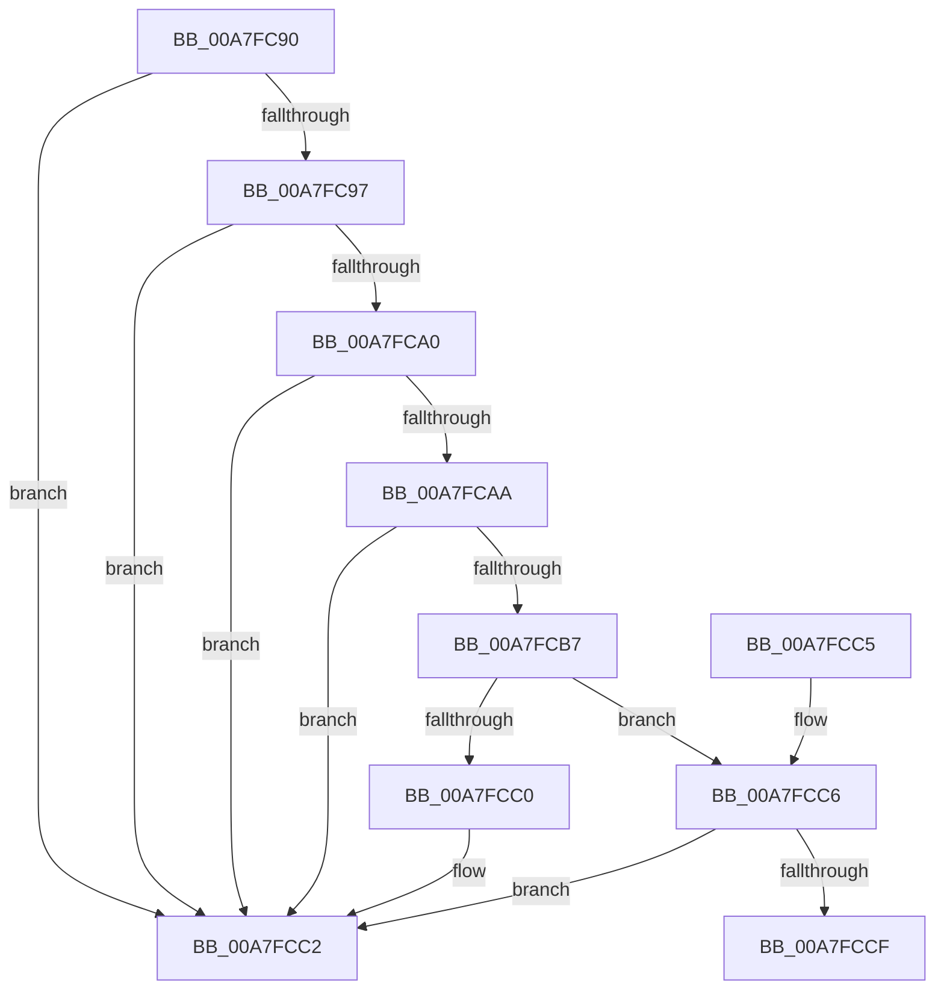

# Pdcv2pValidateActivationParameters

- RVA: `0x00A7FC90`–`0x00A7FCDB` (길이 `75` bytes)
- VA: `0x0000000140A7FC90`
- 실행 섹션: `PAGE`
- PDB 이름 있음: `예`; PDB Function 태그: `예`
- unwind 정보 RVA: `0x000DB714`
- 디코드: `26`개 명령, `75/75` bytes 표시
- 미해석 바이트: `0` (있으면 어셈블리에 `.byte`로 보존)

> 이 문서는 커널 이미지의 기계어와 PDB 기호를 분석해 생성했습니다. 4번과 5번은 함수 원형과 자료형을 바이너리 사용 방식에서 추정한 C 해석이며 원본 소스 복구 결과는 아닙니다.

## 1. Dependencies

- 직접 호출 지점: **0**; 고유 호출 대상: **0**
- 직접 호출자로 확인된 함수: **2**
- RIP 상대 이미지 참조: **0**

### Outgoing calls
- 직접 디코드된 call 명령이 없습니다.

### Direct callers
- [Pdcv2ActivationClientRenewActivation](../79/Pdcv2ActivationClientRenewActivation_function_0079B0F0.md) at `0x0079B19F`
- [Pdcv2ActivationClientActivate](../95/Pdcv2ActivationClientActivate_function_00953C70.md) at `0x00953D08`

### Static image references
- 디코드된 RIP-relative 메모리 참조가 없습니다.

## 2. Other-region calls and transfers

- 다른 실행 섹션으로 향하는 call: **0**
- call이 아닌 외부 분기/꼬리 이동: **1**
  - `0x00A7FCD6` → `0x00B42C10` (`tail-transfer`)

## 3. Assembly (complete function range)

```asm
00A7FC90  33 D2                           xor edx, edx
00A7FC92  48 85 C9                        test rcx, rcx
00A7FC95  74 2B                           je 0x140a7fcc2
00A7FC97  8B 01                           mov eax, dword ptr [rcx]
00A7FC99  FF C8                           dec eax
00A7FC9B  83 F8 01                        cmp eax, 1
00A7FC9E  77 22                           ja 0x140a7fcc2
00A7FCA0  48 F7 41 08 FC FF FF FF         test qword ptr [rcx + 8], -4
00A7FCA8  75 18                           jne 0x140a7fcc2
00A7FCAA  8B 41 04                        mov eax, dword ptr [rcx + 4]
00A7FCAD  83 E8 0A                        sub eax, 0xa
00A7FCB0  3D 22 01 00 00                  cmp eax, 0x122
00A7FCB5  77 0B                           ja 0x140a7fcc2
00A7FCB7  4C 8B 41 18                     mov r8, qword ptr [rcx + 0x18]
00A7FCBB  4D 85 C0                        test r8, r8
00A7FCBE  75 06                           jne 0x140a7fcc6
00A7FCC0  B2 01                           mov dl, 1
00A7FCC2  8A C2                           mov al, dl
00A7FCC4  C3                              ret
00A7FCC5  CC                              int3
00A7FCC6  49 8B 08                        mov rcx, qword ptr [r8]
00A7FCC9  48 83 F9 0A                     cmp rcx, 0xa
00A7FCCD  77 F3                           ja 0x140a7fcc2
00A7FCCF  4C 8B CA                        mov r9, rdx
00A7FCD2  49 8D 40 08                     lea rax, [r8 + 8]
00A7FCD6  E9 35 2F 0C 00                  jmp 0x140b42c10
```

## 4. C-style interpretation (structured pseudocode)

```c
__int64 __fastcall Pdcv2pValidateActivationParameters(__int64 a1, int a2)
{
    __int64 result;

    a2 = 0;
    if (a1 == 0) goto loc_00A7FCC2;
    result = (unsigned int)(((unsigned int)(*(unsigned int *)(a1))) - 1);
    if (((unsigned int)(result)) > 1) goto loc_00A7FCC2;
    if (((*(unsigned __int64 *)(a1 + 8)) & (-4)) != 0) goto loc_00A7FCC2;
    result = (unsigned int)(((unsigned int)(*(unsigned int *)(a1 + 4))) - (10));
    if (((unsigned int)(result)) > 290) goto loc_00A7FCC2;
    if (*(unsigned __int64 *)(a1 + 24) != 0) goto loc_00A7FCC6;
loc_00A7FCC2:
    return 1;
loc_00A7FCC6:
    if ((*(unsigned __int64 *)(*(unsigned __int64 *)(a1 + 24))) > 10) goto loc_00A7FCC2;
}
```

## 5. (Beta) C Style

```c
int64_t Pdcv2pValidateActivationParameters(int64_t Arg1, int32_t Arg2)
{
    int64_t result;

    Arg2 = 0;
    if (Arg1 == 0) goto loc_00A7FCC2;
    result = (uint32_t)(((uint32_t)(*(uint32_t *)(Arg1))) - 1);
    if (((uint32_t)(result)) > 1) goto loc_00A7FCC2;
    if (((*(uint64_t *)(Arg1 + 0x8)) & (-4)) != 0) goto loc_00A7FCC2;
    result = (uint32_t)(((uint32_t)(*(uint32_t *)(Arg1 + 0x4))) - (10));
    if (((uint32_t)(result)) > 290) goto loc_00A7FCC2;
    if (*(uint64_t *)(Arg1 + 0x18) != 0) goto loc_00A7FCC6;
loc_00A7FCC2:
    return 1;
loc_00A7FCC6:
    if ((*(uint64_t *)(*(uint64_t *)(Arg1 + 0x18))) > 10) goto loc_00A7FCC2;
}
```

## 6. Execution-region graph

[열기: 2D/3D 그래프와 함수 탐색 컨트롤 패널](../../../control-panel.html?section=page&rva=0x00A7FC90&view=graph)

- 2D 그래프는 위에서 아래로 흐르고, 3D 그래프는 빈 공간을 드래그해 회전합니다. Shift+드래그는 이동, 휠은 확대·축소, 함수 노드 선택은 대상 보고서 이동입니다.

### Static fallback


