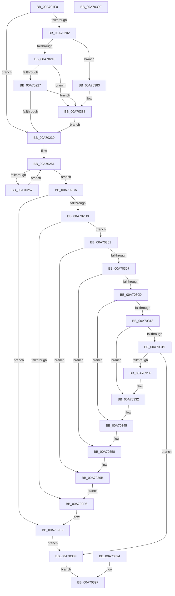

# PfSnHashUnsafeUnicodeString

- RVA: `0x00A701F0`–`0x00A703A0` (길이 `432` bytes)
- VA: `0x0000000140A701F0`
- 실행 섹션: `PAGE`
- PDB 이름 있음: `예`; PDB Function 태그: `아니요`
- unwind 정보 RVA: `0x000B4F80`
- 디코드: `114`개 명령, `432/432` bytes 표시
- 미해석 바이트: `0` (있으면 어셈블리에 `.byte`로 보존)

> 이 문서는 커널 이미지의 기계어와 PDB 기호를 분석해 생성했습니다. 4번과 5번은 함수 원형과 자료형을 바이너리 사용 방식에서 추정한 C 해석이며 원본 소스 복구 결과는 아닙니다.

## 1. Dependencies

- 직접 호출 지점: **1**; 고유 호출 대상: **1**
- 직접 호출자로 확인된 함수: **1**
- RIP 상대 이미지 참조: **0**

### Outgoing calls
- `0x00A70383` → [ExRaiseDatatypeMisalignment](../89/ExRaiseDatatypeMisalignment_function_00899FD0.md) (function, `0x00899FD0`)

### Direct callers
- [PfSnScanCommandLine](../95/PfSnScanCommandLine_function_0095FE78.md) at `0x0095FF16`

### Static image references
- 디코드된 RIP-relative 메모리 참조가 없습니다.

## 2. Other-region calls and transfers

- 다른 실행 섹션으로 향하는 call: **0**
- 별도 외부 분기/꼬리 이동을 확인하지 못했습니다.

## 3. Assembly (complete function range)

```asm
00A701F0  48 83 EC 38                     sub rsp, 0x38
00A701F4  4C 8B DA                        mov r11, rdx
00A701F7  0F B7 01                        movzx eax, word ptr [rcx]
00A701FA  45 33 D2                        xor r10d, r10d
00A701FD  66 85 C0                        test ax, ax
00A70200  74 2E                           je 0x140a70230
00A70202  4C 8B 41 08                     mov r8, qword ptr [rcx + 8]
00A70206  41 F6 C0 01                     test r8b, 1
00A7020A  0F 85 73 01 00 00               jne 0x140a70383
00A70210  49 8D 14 00                     lea rdx, [r8 + rax]
00A70214  48 B8 00 00 FF FF FF 7F 00 00   movabs rax, 0x7fffffff0000
00A7021E  48 3B D0                        cmp rdx, rax
00A70221  0F 87 61 01 00 00               ja 0x140a70388
00A70227  49 3B D0                        cmp rdx, r8
00A7022A  0F 82 58 01 00 00               jb 0x140a70388
00A70230  4C 89 54 24 20                  mov qword ptr [rsp + 0x20], r10
00A70235  4C 89 54 24 28                  mov qword ptr [rsp + 0x28], r10
00A7023A  4C 8B 41 08                     mov r8, qword ptr [rcx + 8]
00A7023E  4C 89 44 24 20                  mov qword ptr [rsp + 0x20], r8
00A70243  44 0F B7 09                     movzx r9d, word ptr [rcx]
00A70247  4C 89 4C 24 28                  mov qword ptr [rsp + 0x28], r9
00A7024C  B9 2F CB 04 00                  mov ecx, 0x4cb2f
00A70251  49 83 F9 08                     cmp r9, 8
00A70255  7C 73                           jl 0x140a702ca
00A70257  48 6B C9 25                     imul rcx, rcx, 0x25
00A7025B  41 0F B6 00                     movzx eax, byte ptr [r8]
00A7025F  48 03 C8                        add rcx, rax
00A70262  48 6B D1 25                     imul rdx, rcx, 0x25
00A70266  41 0F B6 40 01                  movzx eax, byte ptr [r8 + 1]
00A7026B  48 03 D0                        add rdx, rax
00A7026E  48 6B CA 25                     imul rcx, rdx, 0x25
00A70272  41 0F B6 40 02                  movzx eax, byte ptr [r8 + 2]
00A70277  48 03 C8                        add rcx, rax
00A7027A  48 6B D1 25                     imul rdx, rcx, 0x25
00A7027E  41 0F B6 40 03                  movzx eax, byte ptr [r8 + 3]
00A70283  48 03 D0                        add rdx, rax
00A70286  48 6B CA 25                     imul rcx, rdx, 0x25
00A7028A  41 0F B6 40 04                  movzx eax, byte ptr [r8 + 4]
00A7028F  48 03 C8                        add rcx, rax
00A70292  48 6B D1 25                     imul rdx, rcx, 0x25
00A70296  41 0F B6 40 05                  movzx eax, byte ptr [r8 + 5]
00A7029B  48 03 D0                        add rdx, rax
00A7029E  48 6B CA 25                     imul rcx, rdx, 0x25
00A702A2  41 0F B6 40 06                  movzx eax, byte ptr [r8 + 6]
00A702A7  48 03 C8                        add rcx, rax
00A702AA  48 6B C9 25                     imul rcx, rcx, 0x25
00A702AE  41 0F B6 40 07                  movzx eax, byte ptr [r8 + 7]
00A702B3  48 03 C8                        add rcx, rax
00A702B6  49 83 C0 08                     add r8, 8
00A702BA  4C 89 44 24 20                  mov qword ptr [rsp + 0x20], r8
00A702BF  49 83 E9 08                     sub r9, 8
00A702C3  4C 89 4C 24 28                  mov qword ptr [rsp + 0x28], r9
00A702C8  EB 87                           jmp 0x140a70251
00A702CA  49 83 E9 01                     sub r9, 1
00A702CE  74 19                           je 0x140a702e9
00A702D0  49 83 E9 01                     sub r9, 1
00A702D4  75 2B                           jne 0x140a70301
00A702D6  48 6B C9 25                     imul rcx, rcx, 0x25
00A702DA  41 0F B6 00                     movzx eax, byte ptr [r8]
00A702DE  48 03 C8                        add rcx, rax
00A702E1  49 FF C0                        inc r8
00A702E4  4C 89 44 24 20                  mov qword ptr [rsp + 0x20], r8
00A702E9  48 6B C9 25                     imul rcx, rcx, 0x25
00A702ED  41 0F B6 00                     movzx eax, byte ptr [r8]
00A702F1  48 03 C8                        add rcx, rax
00A702F4  49 FF C0                        inc r8
00A702F7  4C 89 44 24 20                  mov qword ptr [rsp + 0x20], r8
00A702FC  E9 8E 00 00 00                  jmp 0x140a7038f
00A70301  49 83 E9 01                     sub r9, 1
00A70305  74 64                           je 0x140a7036b
00A70307  49 83 E9 01                     sub r9, 1
00A7030B  74 4B                           je 0x140a70358
00A7030D  49 83 E9 01                     sub r9, 1
00A70311  74 32                           je 0x140a70345
00A70313  49 83 E9 01                     sub r9, 1
00A70317  74 19                           je 0x140a70332
00A70319  49 83 F9 01                     cmp r9, 1
00A7031D  75 70                           jne 0x140a7038f
00A7031F  48 6B C9 25                     imul rcx, rcx, 0x25
00A70323  41 0F B6 00                     movzx eax, byte ptr [r8]
00A70327  48 03 C8                        add rcx, rax
00A7032A  49 FF C0                        inc r8
00A7032D  4C 89 44 24 20                  mov qword ptr [rsp + 0x20], r8
00A70332  48 6B C9 25                     imul rcx, rcx, 0x25
00A70336  41 0F B6 00                     movzx eax, byte ptr [r8]
00A7033A  48 03 C8                        add rcx, rax
00A7033D  49 FF C0                        inc r8
00A70340  4C 89 44 24 20                  mov qword ptr [rsp + 0x20], r8
00A70345  48 6B C9 25                     imul rcx, rcx, 0x25
00A70349  41 0F B6 00                     movzx eax, byte ptr [r8]
00A7034D  48 03 C8                        add rcx, rax
00A70350  49 FF C0                        inc r8
00A70353  4C 89 44 24 20                  mov qword ptr [rsp + 0x20], r8
00A70358  48 6B C9 25                     imul rcx, rcx, 0x25
00A7035C  41 0F B6 00                     movzx eax, byte ptr [r8]
00A70360  48 03 C8                        add rcx, rax
00A70363  49 FF C0                        inc r8
00A70366  4C 89 44 24 20                  mov qword ptr [rsp + 0x20], r8
00A7036B  48 6B C9 25                     imul rcx, rcx, 0x25
00A7036F  41 0F B6 00                     movzx eax, byte ptr [r8]
00A70373  48 03 C8                        add rcx, rax
00A70376  49 FF C0                        inc r8
00A70379  4C 89 44 24 20                  mov qword ptr [rsp + 0x20], r8
00A7037E  E9 53 FF FF FF                  jmp 0x140a702d6
00A70383  E8 48 9C E2 FF                  call 0x140899fd0
00A70388  8A 00                           mov al, byte ptr [rax]
00A7038A  E9 A1 FE FF FF                  jmp 0x140a70230
00A7038F  49 89 0B                        mov qword ptr [r11], rcx
00A70392  EB 03                           jmp 0x140a70397
00A70394  44 8B D0                        mov r10d, eax
00A70397  41 8B C2                        mov eax, r10d
00A7039A  48 83 C4 38                     add rsp, 0x38
00A7039E  C3                              ret
00A7039F  CC                              int3
```

## 4. C-style interpretation (structured pseudocode)

```c
__int64 __fastcall PfSnHashUnsafeUnicodeString(__int64 a1, __int64 a2)
{
    __int64 result;
    __int64 v_r10;
    __int64 v_rsp;
    unsigned __int64 v_stack_m10;
    unsigned __int64 v_stack_m18;

    v_rsp = (v_rsp) - (56);
    v_r10 = 0;
    if ((unsigned __int16)(*(unsigned __int16 *)(a1)) == 0) goto loc_00A70230;
    if ((((unsigned __int8)(*(unsigned __int64 *)(a1 + 8))) & (1)) != 0) goto loc_00A70383;
    if ((*(unsigned __int64 *)(a1 + 8) + *(unsigned __int16 *)(a1) * 1) > (*(unsigned __int16 *)(a1))) goto loc_00A70388;
    if ((*(unsigned __int64 *)(a1 + 8) + *(unsigned __int16 *)(a1) * 1) < (*(unsigned __int64 *)(a1 + 8))) goto loc_00A70388;
loc_00A70230:
    v_stack_m18 = 0;
    v_stack_m10 = 0;
    v_stack_m18 = *(unsigned __int64 *)(a1 + 8);
    v_stack_m10 = *(unsigned __int16 *)(a1);
loc_00A70251:
    if ((*(unsigned __int16 *)(a1)) < 8) goto loc_00A702CA;
    a1 = ((unsigned int)(0x4CB2FULL)) * ((unsigned int)(0x4CB2FULL));
    a1 = (a1) + (*(unsigned __int8 *)(*(unsigned __int64 *)(a1 + 8)));
    a2 = (*(unsigned __int64 *)(a1 + 8) + *(unsigned __int16 *)(a1) * 1) * (a1);
    a2 = (a2) + (*(unsigned __int8 *)(*(unsigned __int64 *)(a1 + 8) + 1));
    a1 = (a1) * (a2);
    a1 = (a1) + (*(unsigned __int8 *)(*(unsigned __int64 *)(a1 + 8) + 2));
    a2 = (a2) * (a1);
    a2 = (a2) + (*(unsigned __int8 *)(*(unsigned __int64 *)(a1 + 8) + 3));
    a1 = (a1) * (a2);
    a1 = (a1) + (*(unsigned __int8 *)(*(unsigned __int64 *)(a1 + 8) + 4));
    a2 = (a2) * (a1);
    a2 = (a2) + (*(unsigned __int8 *)(*(unsigned __int64 *)(a1 + 8) + 5));
    a1 = (a1) * (a2);
    a1 = (a1) + (*(unsigned __int8 *)(*(unsigned __int64 *)(a1 + 8) + 6));
    a1 = (a1) * (a1);
    a1 = (a1) + (*(unsigned __int8 *)(*(unsigned __int64 *)(a1 + 8) + 7));
    a3 = (*(unsigned __int64 *)(a1 + 8)) + (8);
    v_stack_m18 = a3;
    a4 = (*(unsigned __int16 *)(a1)) - (8);
    v_stack_m10 = a4;
    goto loc_00A70251;
loc_00A702CA:
    a4 = (a4) - (1);
    if (condition_is_equal) goto loc_00A702E9;
    a4 = (a4) - (1);
    if (condition_is_not_equal) goto loc_00A70301;
loc_00A702D6:
    a1 = (a1) * (a1);
    a1 = (a1) + (*(unsigned __int8 *)(a3));
    a3 = (a3) + 1;
    v_stack_m18 = a3;
loc_00A702E9:
    a1 = (a1) * (a1);
    a1 = (a1) + (*(unsigned __int8 *)(a3));
    a3 = (a3) + 1;
    v_stack_m18 = a3;
    goto loc_00A7038F;
loc_00A70301:
    a4 = (a4) - (1);
    if (condition_is_equal) goto loc_00A7036B;
    a4 = (a4) - (1);
    if (condition_is_equal) goto loc_00A70358;
    a4 = (a4) - (1);
    if (condition_is_equal) goto loc_00A70345;
    a4 = (a4) - (1);
    if (condition_is_equal) goto loc_00A70332;
    if (a4 != 1) goto loc_00A7038F;
    a1 = (a1) * (a1);
    a1 = (a1) + (*(unsigned __int8 *)(a3));
    a3 = (a3) + 1;
    v_stack_m18 = a3;
loc_00A70332:
    a1 = (a1) * (a1);
    a1 = (a1) + (*(unsigned __int8 *)(a3));
    a3 = (a3) + 1;
    v_stack_m18 = a3;
loc_00A70345:
    a1 = (a1) * (a1);
    a1 = (a1) + (*(unsigned __int8 *)(a3));
    a3 = (a3) + 1;
    v_stack_m18 = a3;
loc_00A70358:
    a1 = (a1) * (a1);
    a1 = (a1) + (*(unsigned __int8 *)(a3));
    a3 = (a3) + 1;
    v_stack_m18 = a3;
loc_00A7036B:
    a1 = (a1) * (a1);
    a1 = (a1) + (*(unsigned __int8 *)(a3));
    a3 = (a3) + 1;
    v_stack_m18 = a3;
    goto loc_00A702D6;
loc_00A70383:
    result = ExRaiseDatatypeMisalignment(a1, a2, a3, a4);
loc_00A70388:
    goto loc_00A70230;
loc_00A7038F:
    *(unsigned __int64 *)(a2) = a1;
    goto loc_00A70397;
loc_00A70397:
    v_rsp = (v_rsp) + (56);
    return 0;
}
```

## 5. (Beta) C Style

```c
int64_t PfSnHashUnsafeUnicodeString(void *Arg1, int64_t Arg2)
{
    uint8_t *arg1 = (uint8_t *)Arg1;

    int64_t result;
    int64_t local_r10;
    int64_t local_rsp;
    uint64_t v_stack_m10;
    uint64_t v_stack_m18;

    local_rsp = (local_rsp) - (56);
    local_r10 = 0;
    if ((uint16_t)(*(uint16_t *)(arg1)) == 0) goto loc_00A70230;
    if ((((uint8_t)(*(uint64_t *)(arg1 + 0x8))) & (1)) != 0) goto loc_00A70383;
    if ((*(uint64_t *)(arg1 + 0x8) + *(uint16_t *)(arg1) * 1) > (*(uint16_t *)(arg1))) goto loc_00A70388;
    if ((*(uint64_t *)(arg1 + 0x8) + *(uint16_t *)(arg1) * 1) < (*(uint64_t *)(arg1 + 0x8))) goto loc_00A70388;
loc_00A70230:
    v_stack_m18 = 0;
    v_stack_m10 = 0;
    v_stack_m18 = *(uint64_t *)(arg1 + 0x8);
    v_stack_m10 = *(uint16_t *)(arg1);
loc_00A70251:
    if ((*(uint16_t *)(arg1)) < 8) goto loc_00A702CA;
    Arg1 = ((uint32_t)(0x4CB2FULL)) * ((uint32_t)(0x4CB2FULL));
    Arg1 = (Arg1) + (*(uint8_t *)(*(uint64_t *)(arg1 + 0x8)));
    Arg2 = (*(uint64_t *)(arg1 + 0x8) + *(uint16_t *)(arg1) * 1) * (Arg1);
    Arg2 = (Arg2) + (*(uint8_t *)(*(uint64_t *)(arg1 + 0x8) + 0x1));
    Arg1 = (Arg1) * (Arg2);
    Arg1 = (Arg1) + (*(uint8_t *)(*(uint64_t *)(arg1 + 0x8) + 0x2));
    Arg2 = (Arg2) * (Arg1);
    Arg2 = (Arg2) + (*(uint8_t *)(*(uint64_t *)(arg1 + 0x8) + 0x3));
    Arg1 = (Arg1) * (Arg2);
    Arg1 = (Arg1) + (*(uint8_t *)(*(uint64_t *)(arg1 + 0x8) + 0x4));
    Arg2 = (Arg2) * (Arg1);
    Arg2 = (Arg2) + (*(uint8_t *)(*(uint64_t *)(arg1 + 0x8) + 0x5));
    Arg1 = (Arg1) * (Arg2);
    Arg1 = (Arg1) + (*(uint8_t *)(*(uint64_t *)(arg1 + 0x8) + 0x6));
    Arg1 = (Arg1) * (Arg1);
    Arg1 = (Arg1) + (*(uint8_t *)(*(uint64_t *)(arg1 + 0x8) + 0x7));
    a3 = (*(uint64_t *)(arg1 + 0x8)) + (8);
    v_stack_m18 = a3;
    a4 = (*(uint16_t *)(arg1)) - (8);
    v_stack_m10 = a4;
    goto loc_00A70251;
loc_00A702CA:
    a4 = (a4) - (1);
    if (condition_is_equal) goto loc_00A702E9;
    a4 = (a4) - (1);
    if (condition_is_not_equal) goto loc_00A70301;
loc_00A702D6:
    Arg1 = (Arg1) * (Arg1);
    Arg1 = (Arg1) + (*(uint8_t *)(a3));
    a3 = (a3) + 1;
    v_stack_m18 = a3;
loc_00A702E9:
    Arg1 = (Arg1) * (Arg1);
    Arg1 = (Arg1) + (*(uint8_t *)(a3));
    a3 = (a3) + 1;
    v_stack_m18 = a3;
    goto loc_00A7038F;
loc_00A70301:
    a4 = (a4) - (1);
    if (condition_is_equal) goto loc_00A7036B;
    a4 = (a4) - (1);
    if (condition_is_equal) goto loc_00A70358;
    a4 = (a4) - (1);
    if (condition_is_equal) goto loc_00A70345;
    a4 = (a4) - (1);
    if (condition_is_equal) goto loc_00A70332;
    if (a4 != 1) goto loc_00A7038F;
    Arg1 = (Arg1) * (Arg1);
    Arg1 = (Arg1) + (*(uint8_t *)(a3));
    a3 = (a3) + 1;
    v_stack_m18 = a3;
loc_00A70332:
    Arg1 = (Arg1) * (Arg1);
    Arg1 = (Arg1) + (*(uint8_t *)(a3));
    a3 = (a3) + 1;
    v_stack_m18 = a3;
loc_00A70345:
    Arg1 = (Arg1) * (Arg1);
    Arg1 = (Arg1) + (*(uint8_t *)(a3));
    a3 = (a3) + 1;
    v_stack_m18 = a3;
loc_00A70358:
    Arg1 = (Arg1) * (Arg1);
    Arg1 = (Arg1) + (*(uint8_t *)(a3));
    a3 = (a3) + 1;
    v_stack_m18 = a3;
loc_00A7036B:
    Arg1 = (Arg1) * (Arg1);
    Arg1 = (Arg1) + (*(uint8_t *)(a3));
    a3 = (a3) + 1;
    v_stack_m18 = a3;
    goto loc_00A702D6;
loc_00A70383:
    result = ExRaiseDatatypeMisalignment(Arg1, Arg2, a3, a4);
loc_00A70388:
    goto loc_00A70230;
loc_00A7038F:
    *(void **)(Arg2) = Arg1;
    goto loc_00A70397;
loc_00A70397:
    local_rsp = (local_rsp) + (56);
    return 0;
}
```

### 관측된 메모리 오프셋

구조체 형식이 확인되지 않은 접근은 인자 기준의 오프셋으로만 기록했습니다.

| 기준 인자 | 오프셋 표현 | 폭 (bit) | 접근 |
|---|---:|---:|---|
| `Arg1` | `+ 0x0` | `16` | `R` |
| `Arg1` | `+ 0x8` | `64` | `R` |

## 6. Execution-region graph

[열기: 2D/3D 그래프와 함수 탐색 컨트롤 패널](../../../control-panel.html?section=page&rva=0x00A701F0&view=graph)

- 2D 그래프는 위에서 아래로 흐르고, 3D 그래프는 빈 공간을 드래그해 회전합니다. Shift+드래그는 이동, 휠은 확대·축소, 함수 노드 선택은 대상 보고서 이동입니다.

### Static fallback


