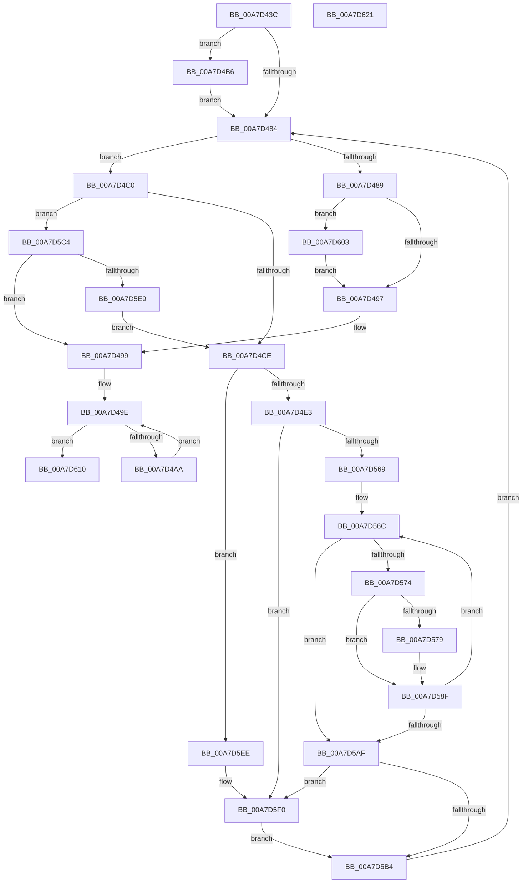

# PfpRpCHashAddEntries

- RVA: `0x00A7D43C`–`0x00A7D622` (길이 `486` bytes)
- VA: `0x0000000140A7D43C`
- 실행 섹션: `PAGE`
- PDB 이름 있음: `예`; PDB Function 태그: `아니요`
- unwind 정보 RVA: `0x000B6AB8`
- 디코드: `144`개 명령, `486/486` bytes 표시
- 미해석 바이트: `0` (있으면 어셈블리에 `.byte`로 보존)

> 이 문서는 커널 이미지의 기계어와 PDB 기호를 분석해 생성했습니다. 4번과 5번은 함수 원형과 자료형을 바이너리 사용 방식에서 추정한 C 해석이며 원본 소스 복구 결과는 아닙니다.

## 1. Dependencies

- 직접 호출 지점: **6**; 고유 호출 대상: **5**
- 직접 호출자로 확인된 함수: **1**
- RIP 상대 이미지 참조: **0**

### Outgoing calls
- `0x00A7D4AF` → [ExFreePoolWithTag](../../poolcode/B8/ExFreePoolWithTag_function_00B82870.md) (function, `0x00B82870`)
- `0x00A7D4B9` → [FsRtlAcquirePushLockExclusive](../../text/4A/FsRtlAcquirePushLockExclusive_function_004A05F4.md) (function, `0x004A05F4`)
- `0x00A7D5C7` → [PfLockExclusiveRelease](../../text/49/PfLockExclusiveRelease_function_00491D88.md) (function, `0x00491D88`)
- `0x00A7D5DA` → [PfpRpCHashGrow](../70/PfpRpCHashGrow_function_0070189C.md) (function, `0x0070189C`)
- `0x00A7D5F9` → [memcpy](../../text/6C/memcpy_function_006C6840.md) (function, `0x006C6840`)
- `0x00A7D606` → [PfLockExclusiveRelease](../../text/49/PfLockExclusiveRelease_function_00491D88.md) (function, `0x00491D88`)

### Direct callers
- [PfpRpControlRequestUpdate](PfpRpControlRequestUpdate_function_00A7D2A8.md) at `0x00A7D36B`
- [PfpRpControlRequestUpdate](PfpRpControlRequestUpdate_function_00A7D2A8.md) at `0x00A7D3A0`

### Static image references
- 디코드된 RIP-relative 메모리 참조가 없습니다.

## 2. Other-region calls and transfers

- 다른 실행 섹션으로 향하는 call: **5**
  - `0x00A7D4AF` → [ExFreePoolWithTag](../../poolcode/B8/ExFreePoolWithTag_function_00B82870.md) (`PAGE` → `POOLCODE`)
  - `0x00A7D4B9` → [FsRtlAcquirePushLockExclusive](../../text/4A/FsRtlAcquirePushLockExclusive_function_004A05F4.md) (`PAGE` → `.text`)
  - `0x00A7D5C7` → [PfLockExclusiveRelease](../../text/49/PfLockExclusiveRelease_function_00491D88.md) (`PAGE` → `.text`)
  - `0x00A7D5F9` → [memcpy](../../text/6C/memcpy_function_006C6840.md) (`PAGE` → `.text`)
  - `0x00A7D606` → [PfLockExclusiveRelease](../../text/49/PfLockExclusiveRelease_function_00491D88.md) (`PAGE` → `.text`)
- 별도 외부 분기/꼬리 이동을 확인하지 못했습니다.

## 3. Assembly (complete function range)

```asm
00A7D43C  48 89 4C 24 08                  mov qword ptr [rsp + 8], rcx
00A7D441  53                              push rbx
00A7D442  55                              push rbp
00A7D443  56                              push rsi
00A7D444  57                              push rdi
00A7D445  41 55                           push r13
00A7D447  41 56                           push r14
00A7D449  41 57                           push r15
00A7D44B  48 83 EC 20                     sub rsp, 0x20
00A7D44F  8B AC 24 80 00 00 00            mov ebp, dword ptr [rsp + 0x80]
00A7D456  48 8B F1                        mov rsi, rcx
00A7D459  8B 4A 08                        mov ecx, dword ptr [rdx + 8]
00A7D45C  41 BF 01 00 00 00               mov r15d, 1
00A7D462  48 83 64 24 78 00               and qword ptr [rsp + 0x78], 0
00A7D468  49 8B F9                        mov rdi, r9
00A7D46B  48 D3 E5                        shl rbp, cl
00A7D46E  4D 8B F0                        mov r14, r8
00A7D471  49 03 E9                        add rbp, r9
00A7D474  41 D3 E7                        shl r15d, cl
00A7D477  83 BC 24 80 00 00 00 00         cmp dword ptr [rsp + 0x80], 0
00A7D47F  48 8B DA                        mov rbx, rdx
00A7D482  75 32                           jne 0x140a7d4b6
00A7D484  48 3B FD                        cmp rdi, rbp
00A7D487  72 37                           jb 0x140a7d4c0
00A7D489  83 BC 24 80 00 00 00 00         cmp dword ptr [rsp + 0x80], 0
00A7D491  0F 85 6C 01 00 00               jne 0x140a7d603
00A7D497  33 F6                           xor esi, esi
00A7D499  48 8B 5C 24 78                  mov rbx, qword ptr [rsp + 0x78]
00A7D49E  48 8B CB                        mov rcx, rbx
00A7D4A1  48 85 DB                        test rbx, rbx
00A7D4A4  0F 84 66 01 00 00               je 0x140a7d610
00A7D4AA  48 8B 1B                        mov rbx, qword ptr [rbx]
00A7D4AD  33 D2                           xor edx, edx
00A7D4AF  E8 BC 53 10 00                  call 0x140b82870
00A7D4B4  EB E8                           jmp 0x140a7d49e
00A7D4B6  49 8B CE                        mov rcx, r14
00A7D4B9  E8 36 31 A2 FF                  call 0x1404a05f4
00A7D4BE  EB C4                           jmp 0x140a7d484
00A7D4C0  8B 43 10                        mov eax, dword ptr [rbx + 0x10]
00A7D4C3  03 C0                           add eax, eax
00A7D4C5  3B 43 0C                        cmp eax, dword ptr [rbx + 0xc]
00A7D4C8  0F 83 F6 00 00 00               jae 0x140a7d5c4
00A7D4CE  4C 8B 0F                        mov r9, qword ptr [rdi]
00A7D4D1  44 8B 43 0C                     mov r8d, dword ptr [rbx + 0xc]
00A7D4D5  4C 89 4C 24 68                  mov qword ptr [rsp + 0x68], r9
00A7D4DA  45 85 C0                        test r8d, r8d
00A7D4DD  0F 84 0B 01 00 00               je 0x140a7d5ee
00A7D4E3  8B 73 08                        mov esi, dword ptr [rbx + 8]
00A7D4E6  45 8D 58 FF                     lea r11d, [r8 - 1]
00A7D4EA  4C 8B 2B                        mov r13, qword ptr [rbx]
00A7D4ED  41 0F B6 C1                     movzx eax, r9b
00A7D4F1  48 05 CB 5D B1 00               add rax, 0xb15dcb
00A7D4F7  48 6B C8 25                     imul rcx, rax, 0x25
00A7D4FB  0F B6 44 24 69                  movzx eax, byte ptr [rsp + 0x69]
00A7D500  48 03 C8                        add rcx, rax
00A7D503  0F B6 44 24 6A                  movzx eax, byte ptr [rsp + 0x6a]
00A7D508  48 6B D1 25                     imul rdx, rcx, 0x25
00A7D50C  48 03 D0                        add rdx, rax
00A7D50F  0F B6 44 24 6B                  movzx eax, byte ptr [rsp + 0x6b]
00A7D514  48 6B CA 25                     imul rcx, rdx, 0x25
00A7D518  48 03 C8                        add rcx, rax
00A7D51B  0F B6 44 24 6C                  movzx eax, byte ptr [rsp + 0x6c]
00A7D520  48 6B D1 25                     imul rdx, rcx, 0x25
00A7D524  48 03 D0                        add rdx, rax
00A7D527  0F B6 44 24 6D                  movzx eax, byte ptr [rsp + 0x6d]
00A7D52C  48 6B CA 25                     imul rcx, rdx, 0x25
00A7D530  48 03 C8                        add rcx, rax
00A7D533  0F B6 44 24 6E                  movzx eax, byte ptr [rsp + 0x6e]
00A7D538  48 6B D1 25                     imul rdx, rcx, 0x25
00A7D53C  48 03 D0                        add rdx, rax
00A7D53F  0F B6 44 24 6F                  movzx eax, byte ptr [rsp + 0x6f]
00A7D544  48 6B CA 25                     imul rcx, rdx, 0x25
00A7D548  33 D2                           xor edx, edx
00A7D54A  48 03 C1                        add rax, rcx
00A7D54D  8B CE                           mov ecx, esi
00A7D54F  8B C0                           mov eax, eax
00A7D551  4C 23 D8                        and r11, rax
00A7D554  49 8B C3                        mov rax, r11
00A7D557  48 D3 E0                        shl rax, cl
00A7D55A  49 03 C5                        add rax, r13
00A7D55D  48 8B 08                        mov rcx, qword ptr [rax]
00A7D560  48 85 C9                        test rcx, rcx
00A7D563  0F 84 87 00 00 00               je 0x140a7d5f0
00A7D569  4C 8B D1                        mov r10, rcx
00A7D56C  49 8B CA                        mov rcx, r10
00A7D56F  4D 3B D1                        cmp r10, r9
00A7D572  74 3B                           je 0x140a7d5af
00A7D574  48 85 D2                        test rdx, rdx
00A7D577  75 16                           jne 0x140a7d58f
00A7D579  B9 B1 79 37 9E                  mov ecx, 0x9e3779b1
00A7D57E  49 8B C1                        mov rax, r9
00A7D581  48 0F AF C1                     imul rax, rcx
00A7D585  A8 01                           test al, 1
00A7D587  48 8D 50 01                     lea rdx, [rax + 1]
00A7D58B  48 0F 45 D0                     cmovne rdx, rax
00A7D58F  41 8D 48 FF                     lea ecx, [r8 - 1]
00A7D593  4C 03 DA                        add r11, rdx
00A7D596  4C 23 D9                        and r11, rcx
00A7D599  8B CE                           mov ecx, esi
00A7D59B  49 8B C3                        mov rax, r11
00A7D59E  48 D3 E0                        shl rax, cl
00A7D5A1  49 03 C5                        add rax, r13
00A7D5A4  48 8B 08                        mov rcx, qword ptr [rax]
00A7D5A7  4C 8B D1                        mov r10, rcx
00A7D5AA  48 85 C9                        test rcx, rcx
00A7D5AD  75 BD                           jne 0x140a7d56c
00A7D5AF  48 85 C9                        test rcx, rcx
00A7D5B2  74 3C                           je 0x140a7d5f0
00A7D5B4  48 8B 74 24 60                  mov rsi, qword ptr [rsp + 0x60]
00A7D5B9  41 8B C7                        mov eax, r15d
00A7D5BC  48 03 F8                        add rdi, rax
00A7D5BF  E9 C0 FE FF FF                  jmp 0x140a7d484
00A7D5C4  49 8B CE                        mov rcx, r14
00A7D5C7  E8 BC 47 A1 FF                  call 0x140491d88
00A7D5CC  4C 8D 4C 24 78                  lea r9, [rsp + 0x78]
00A7D5D1  4D 8B C6                        mov r8, r14
00A7D5D4  48 8B D3                        mov rdx, rbx
00A7D5D7  48 8B CE                        mov rcx, rsi
00A7D5DA  E8 BD 42 C8 FF                  call 0x14070189c
00A7D5DF  8B F0                           mov esi, eax
00A7D5E1  85 C0                           test eax, eax
00A7D5E3  0F 88 B0 FE FF FF               js 0x140a7d499
00A7D5E9  E9 E0 FE FF FF                  jmp 0x140a7d4ce
00A7D5EE  33 C0                           xor eax, eax
00A7D5F0  45 8B C7                        mov r8d, r15d
00A7D5F3  48 8B D7                        mov rdx, rdi
00A7D5F6  48 8B C8                        mov rcx, rax
00A7D5F9  E8 42 92 C4 FF                  call 0x1406c6840
00A7D5FE  FF 43 10                        inc dword ptr [rbx + 0x10]
00A7D601  EB B1                           jmp 0x140a7d5b4
00A7D603  49 8B CE                        mov rcx, r14
00A7D606  E8 7D 47 A1 FF                  call 0x140491d88
00A7D60B  E9 87 FE FF FF                  jmp 0x140a7d497
00A7D610  8B C6                           mov eax, esi
00A7D612  48 83 C4 20                     add rsp, 0x20
00A7D616  41 5F                           pop r15
00A7D618  41 5E                           pop r14
00A7D61A  41 5D                           pop r13
00A7D61C  5F                              pop rdi
00A7D61D  5E                              pop rsi
00A7D61E  5D                              pop rbp
00A7D61F  5B                              pop rbx
00A7D620  C3                              ret
00A7D621  CC                              int3
```

## 4. C-style interpretation (structured pseudocode)

```c
__int64 __fastcall PfpRpCHashAddEntries(__int64 a1, __int64 a2, __int64 a3, __int64 a4, unsigned int a5)
{
    __int64 result;
    __int64 v_r11;
    __int64 v_r15;
    __int64 v_rbp;
    __int64 v_rdi;
    __int64 v_rsi;
    __int64 v_rsp;
    unsigned __int64 v_stack_p10;
    unsigned __int8 v_stack_p11;
    unsigned __int8 v_stack_p12;
    unsigned __int8 v_stack_p13;
    unsigned __int8 v_stack_p14;
    unsigned __int8 v_stack_p15;
    unsigned __int8 v_stack_p16;
    unsigned __int8 v_stack_p17;
    unsigned __int64 v_stack_p20;
    unsigned __int64 v_stack_p8;

    v_stack_p8 = a1;
    v_rsp = (v_rsp) - (32);
    v_rbp = ((unsigned int)(a5)) << ((unsigned __int8)((unsigned int)(*(unsigned int *)(a2 + 8))));
    v_rbp = (v_rbp) + (a4);
    v_r15 = (unsigned int)((1) << ((unsigned __int8)((unsigned int)(*(unsigned int *)(a2 + 8)))));
    if (a5 != 0) goto loc_00A7D4B6;
loc_00A7D484:
    if (a4 < v_rbp) goto loc_00A7D4C0;
    if (a5 != 0) goto loc_00A7D603;
loc_00A7D497:
    v_rsi = 0;
loc_00A7D499:
loc_00A7D49E:
    if (v_stack_p20 == 0) goto loc_00A7D610;
    a2 = 0;
    result = ExFreePoolWithTag(v_stack_p20, a2, a3, a4);
    goto loc_00A7D49E;
loc_00A7D4B6:
    result = FsRtlAcquirePushLockExclusive(a3, a2, a3, a4);
    goto loc_00A7D484;
loc_00A7D4C0:
    result = (unsigned int)(((unsigned int)(*(unsigned int *)(*(unsigned __int64 *)(v_stack_p20) + 16))) + ((unsigned int)((unsigned int)(*(unsigned int *)(*(unsigned __int64 *)(v_stack_p20) + 16)))));
    if (((unsigned int)(result)) >= (*(unsigned int *)(*(unsigned __int64 *)(v_stack_p20) + 12))) goto loc_00A7D5C4;
loc_00A7D4CE:
    v_stack_p10 = *(unsigned __int64 *)(a4);
    if ((unsigned int)((unsigned int)(*(unsigned int *)(*(unsigned __int64 *)(v_stack_p20) + 12))) == 0) goto loc_00A7D5EE;
    result = ((unsigned __int8)(*(unsigned __int64 *)(a4))) + (0xB15DCBULL);
    a1 = (a3) * (result);
    a1 = (a1) + (v_stack_p11);
    a2 = (a2) * (a1);
    a2 = (a2) + (v_stack_p12);
    a1 = (a1) * (a2);
    a1 = (a1) + (v_stack_p13);
    a2 = (a2) * (a1);
    a2 = (a2) + (v_stack_p14);
    a1 = (a1) * (a2);
    a1 = (a1) + (v_stack_p15);
    a2 = (a2) * (a1);
    a2 = (a2) + (v_stack_p16);
    a1 = (a1) * (a2);
    a2 = 0;
    result = (v_stack_p17) + (a1);
    v_r11 = ((unsigned int)(*(unsigned int *)(*(unsigned __int64 *)(v_stack_p20) + 12)) - 1) & ((unsigned int)((unsigned int)(result)));
    result = (v_r11) << ((unsigned __int8)((unsigned int)((unsigned int)((unsigned int)(*(unsigned int *)(*(unsigned __int64 *)(v_stack_p20) + 8))))));
    result = (result) + (*(unsigned __int64 *)(*(unsigned __int64 *)(v_stack_p20)));
    if (*(unsigned __int64 *)(result) == 0) goto loc_00A7D5F0;
loc_00A7D56C:
    if ((*(unsigned __int64 *)(result)) == (*(unsigned __int64 *)(a4))) goto loc_00A7D5AF;
    if (0 == 0) {
        a1 = 0x9E3779B1ULL;
        result = *(unsigned __int64 *)(a4);
        result = (result) * (a1);
        a2 = result + 1;
        if ((((unsigned __int8)(result)) & (1)) != 0) { a2 = result; }
    }
    v_r11 = (v_r11) + (a2);
    v_r11 = (v_r11) & ((unsigned int)(*(unsigned int *)(*(unsigned __int64 *)(v_stack_p20) + 12)) - 1);
    result = (v_r11) << ((unsigned __int8)((unsigned int)((unsigned int)((unsigned int)(*(unsigned int *)(*(unsigned __int64 *)(v_stack_p20) + 8))))));
    result = (result) + (*(unsigned __int64 *)(*(unsigned __int64 *)(v_stack_p20)));
    if (*(unsigned __int64 *)(result) != 0) goto loc_00A7D56C;
loc_00A7D5AF:
    if (*(unsigned __int64 *)(result) == 0) goto loc_00A7D5F0;
loc_00A7D5B4:
    v_rdi = (a4) + ((unsigned int)((unsigned int)(v_r15)));
    goto loc_00A7D484;
loc_00A7D5C4:
    result = PfLockExclusiveRelease(a3, a2, (unsigned int)(*(unsigned int *)(*(unsigned __int64 *)(v_stack_p20) + 12)), *(unsigned __int64 *)(a4));
    result = PfpRpCHashGrow(v_stack_p8, *(unsigned __int64 *)(v_stack_p20), a3, v_stack_p20);
    if (sign_flag) goto loc_00A7D499;
    goto loc_00A7D4CE;
loc_00A7D5EE:
    result = 0;
loc_00A7D5F0:
    result = memcpy(0, v_rdi, (unsigned int)((unsigned int)(v_r15)), v_stack_p20);
    goto loc_00A7D5B4;
loc_00A7D603:
    result = PfLockExclusiveRelease(a3, v_rdi, (unsigned int)((unsigned int)(v_r15)), v_stack_p20);
    goto loc_00A7D497;
loc_00A7D610:
    v_rsp = (v_rsp) + (32);
    return (unsigned int)((unsigned int)((unsigned int)((unsigned int)(result))));
}
```

## 5. (Beta) C Style

```c
int64_t PfpRpCHashAddEntries(int64_t Arg1, void *Arg2, int64_t Arg3, int64_t Arg4, uint32_t Arg5)
{
    uint8_t *arg2 = (uint8_t *)Arg2;

    int64_t result;
    int64_t local_r11;
    int64_t local_r15;
    int64_t local_rbp;
    int64_t local_rdi;
    int64_t local_rsi;
    int64_t local_rsp;
    uint64_t v_stack_p10;
    uint8_t v_stack_p11;
    uint8_t v_stack_p12;
    uint8_t v_stack_p13;
    uint8_t v_stack_p14;
    uint8_t v_stack_p15;
    uint8_t v_stack_p16;
    uint8_t v_stack_p17;
    uint64_t v_stack_p20;
    uint64_t v_stack_p8;

    v_stack_p8 = Arg1;
    local_rsp = (local_rsp) - (32);
    local_rbp = ((uint32_t)(Arg5)) << ((uint8_t)((uint32_t)(*(uint32_t *)(arg2 + 0x8))));
    local_rbp = (local_rbp) + (Arg4);
    local_r15 = (uint32_t)((1) << ((uint8_t)((uint32_t)(*(uint32_t *)(arg2 + 0x8)))));
    if (Arg5 != 0) goto loc_00A7D4B6;
loc_00A7D484:
    if (Arg4 < local_rbp) goto loc_00A7D4C0;
    if (Arg5 != 0) goto loc_00A7D603;
loc_00A7D497:
    local_rsi = 0;
loc_00A7D499:
loc_00A7D49E:
    if (v_stack_p20 == 0) goto loc_00A7D610;
    Arg2 = 0;
    result = ExFreePoolWithTag(v_stack_p20, Arg2, Arg3, Arg4);
    goto loc_00A7D49E;
loc_00A7D4B6:
    result = FsRtlAcquirePushLockExclusive(Arg3, Arg2, Arg3, Arg4);
    goto loc_00A7D484;
loc_00A7D4C0:
    result = (uint32_t)(((uint32_t)(*(uint32_t *)(*(uint64_t *)(v_stack_p20) + 0x10))) + ((uint32_t)((uint32_t)(*(uint32_t *)(*(uint64_t *)(v_stack_p20) + 0x10)))));
    if (((uint32_t)(result)) >= (*(uint32_t *)(*(uint64_t *)(v_stack_p20) + 0xC))) goto loc_00A7D5C4;
loc_00A7D4CE:
    v_stack_p10 = *(uint64_t *)(Arg4);
    if ((uint32_t)((uint32_t)(*(uint32_t *)(*(uint64_t *)(v_stack_p20) + 0xC))) == 0) goto loc_00A7D5EE;
    result = ((uint8_t)(*(uint64_t *)(Arg4))) + (0xB15DCBULL);
    Arg1 = (Arg3) * (result);
    Arg1 = (Arg1) + (v_stack_p11);
    Arg2 = (Arg2) * (Arg1);
    Arg2 = (Arg2) + (v_stack_p12);
    Arg1 = (Arg1) * (Arg2);
    Arg1 = (Arg1) + (v_stack_p13);
    Arg2 = (Arg2) * (Arg1);
    Arg2 = (Arg2) + (v_stack_p14);
    Arg1 = (Arg1) * (Arg2);
    Arg1 = (Arg1) + (v_stack_p15);
    Arg2 = (Arg2) * (Arg1);
    Arg2 = (Arg2) + (v_stack_p16);
    Arg1 = (Arg1) * (Arg2);
    Arg2 = 0;
    result = (v_stack_p17) + (Arg1);
    local_r11 = ((uint32_t)(*(uint32_t *)(*(uint64_t *)(v_stack_p20) + 0xC)) - 1) & ((uint32_t)((uint32_t)(result)));
    result = (local_r11) << ((uint8_t)((uint32_t)((uint32_t)((uint32_t)(*(uint32_t *)(*(uint64_t *)(v_stack_p20) + 0x8))))));
    result = (result) + (*(uint64_t *)(*(uint64_t *)(v_stack_p20)));
    if (*(uint64_t *)(result) == 0) goto loc_00A7D5F0;
loc_00A7D56C:
    if ((*(uint64_t *)(result)) == (*(uint64_t *)(Arg4))) goto loc_00A7D5AF;
    if (0 == 0) {
        Arg1 = 0x9E3779B1ULL;
        result = *(uint64_t *)(Arg4);
        result = (result) * (Arg1);
        Arg2 = result + 1;
        if ((((uint8_t)(result)) & (1)) != 0) { Arg2 = result; }
    }
    local_r11 = (local_r11) + (Arg2);
    local_r11 = (local_r11) & ((uint32_t)(*(uint32_t *)(*(uint64_t *)(v_stack_p20) + 0xC)) - 1);
    result = (local_r11) << ((uint8_t)((uint32_t)((uint32_t)((uint32_t)(*(uint32_t *)(*(uint64_t *)(v_stack_p20) + 0x8))))));
    result = (result) + (*(uint64_t *)(*(uint64_t *)(v_stack_p20)));
    if (*(uint64_t *)(result) != 0) goto loc_00A7D56C;
loc_00A7D5AF:
    if (*(uint64_t *)(result) == 0) goto loc_00A7D5F0;
loc_00A7D5B4:
    local_rdi = (Arg4) + ((uint32_t)((uint32_t)(local_r15)));
    goto loc_00A7D484;
loc_00A7D5C4:
    result = PfLockExclusiveRelease(Arg3, Arg2, (uint32_t)(*(uint32_t *)(*(uint64_t *)(v_stack_p20) + 0xC)), *(uint64_t *)(Arg4));
    result = PfpRpCHashGrow(v_stack_p8, *(uint64_t *)(v_stack_p20), Arg3, v_stack_p20);
    if (sign_flag) goto loc_00A7D499;
    goto loc_00A7D4CE;
loc_00A7D5EE:
    result = 0;
loc_00A7D5F0:
    result = memcpy(0, local_rdi, (uint32_t)((uint32_t)(local_r15)), v_stack_p20);
    goto loc_00A7D5B4;
loc_00A7D603:
    result = PfLockExclusiveRelease(Arg3, local_rdi, (uint32_t)((uint32_t)(local_r15)), v_stack_p20);
    goto loc_00A7D497;
loc_00A7D610:
    local_rsp = (local_rsp) + (32);
    return (uint32_t)((uint32_t)((uint32_t)((uint32_t)(result))));
}
```

### 관측된 메모리 오프셋

구조체 형식이 확인되지 않은 접근은 인자 기준의 오프셋으로만 기록했습니다.

| 기준 인자 | 오프셋 표현 | 폭 (bit) | 접근 |
|---|---:|---:|---|
| `Arg2` | `+ 0x0` | `64` | `R` |
| `Arg2` | `+ 0x8` | `32` | `R` |
| `Arg2` | `+ 0xC` | `32` | `R` |
| `Arg2` | `+ 0x10` | `32` | `R` |
| `Arg2` | `+ 0x10` | `32` | `R/W` |

## 6. Execution-region graph

[열기: 2D/3D 그래프와 함수 탐색 컨트롤 패널](../../../control-panel.html?section=page&rva=0x00A7D43C&view=graph)

- 2D 그래프는 위에서 아래로 흐르고, 3D 그래프는 빈 공간을 드래그해 회전합니다. Shift+드래그는 이동, 휠은 확대·축소, 함수 노드 선택은 대상 보고서 이동입니다.

### Static fallback


