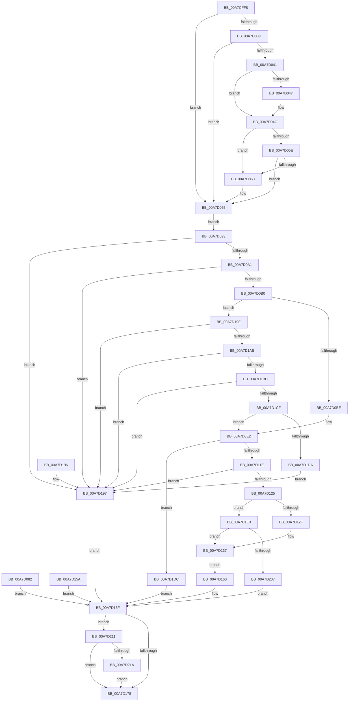

# PfpRpControlRequestCopy

- RVA: `0x00A7CFF8`–`0x00A7D229` (길이 `561` bytes)
- VA: `0x0000000140A7CFF8`
- 실행 섹션: `PAGE`
- PDB 이름 있음: `예`; PDB Function 태그: `아니요`
- unwind 정보 RVA: `0x000B6A48`
- 디코드: `146`개 명령, `561/561` bytes 표시
- 미해석 바이트: `0` (있으면 어셈블리에 `.byte`로 보존)

> 이 문서는 커널 이미지의 기계어와 PDB 기호를 분석해 생성했습니다. 4번과 5번은 함수 원형과 자료형을 바이너리 사용 방식에서 추정한 C 해석이며 원본 소스 복구 결과는 아닙니다.

## 1. Dependencies

- 직접 호출 지점: **5**; 고유 호출 대상: **5**
- 직접 호출자로 확인된 함수: **1**
- RIP 상대 이미지 참조: **1**

### Outgoing calls
- `0x00A7D047` → [ExRaiseDatatypeMisalignment](../89/ExRaiseDatatypeMisalignment_function_00899FD0.md) (function, `0x00899FD0`)
- `0x00A7D140` → [memcpy](../../text/6C/memcpy_function_006C6840.md) (function, `0x006C6840`)
- `0x00A7D182` → [_security_check_cookie](../../text/6A/_security_check_cookie_function_006AC640.md) (function, `0x006AC640`)
- `0x00A7D1F1` → [ExAllocatePool2](../../poolcode/B8/ExAllocatePool2_function_00B820F0.md) (function, `0x00B820F0`)
- `0x00A7D21F` → [ExFreePoolWithTag](../../poolcode/B8/ExFreePoolWithTag_function_00B82870.md) (function, `0x00B82870`)

### Direct callers
- [PfpRpControlRequest](PfpRpControlRequest_function_00A7CF24.md) at `0x00A7CF77`

### Static image references
- `0x00A7D007` → RVA `0x00E0A740` (`.data`; read)

## 2. Other-region calls and transfers

- 다른 실행 섹션으로 향하는 call: **4**
  - `0x00A7D140` → [memcpy](../../text/6C/memcpy_function_006C6840.md) (`PAGE` → `.text`)
  - `0x00A7D182` → [_security_check_cookie](../../text/6A/_security_check_cookie_function_006AC640.md) (`PAGE` → `.text`)
  - `0x00A7D1F1` → [ExAllocatePool2](../../poolcode/B8/ExAllocatePool2_function_00B820F0.md) (`PAGE` → `POOLCODE`)
  - `0x00A7D21F` → [ExFreePoolWithTag](../../poolcode/B8/ExFreePoolWithTag_function_00B82870.md) (`PAGE` → `POOLCODE`)
- 별도 외부 분기/꼬리 이동을 확인하지 못했습니다.

## 3. Assembly (complete function range)

```asm
00A7CFF8  40 53                           push rbx
00A7CFFA  56                              push rsi
00A7CFFB  57                              push rdi
00A7CFFC  41 56                           push r14
00A7CFFE  41 57                           push r15
00A7D000  48 81 EC 80 00 00 00            sub rsp, 0x80
00A7D007  48 8B 05 32 D7 38 00            mov rax, qword ptr [rip + 0x38d732]
00A7D00E  48 33 C4                        xor rax, rsp
00A7D011  48 89 44 24 70                  mov qword ptr [rsp + 0x70], rax
00A7D016  4D 8B F1                        mov r14, r9
00A7D019  4D 8B F8                        mov r15, r8
00A7D01C  44 8B D2                        mov r10d, edx
00A7D01F  48 8B F1                        mov rsi, rcx
00A7D022  4C 89 4C 24 30                  mov qword ptr [rsp + 0x30], r9
00A7D027  83 64 24 28 00                  and dword ptr [rsp + 0x28], 0
00A7D02C  33 FF                           xor edi, edi
00A7D02E  48 89 7C 24 20                  mov qword ptr [rsp + 0x20], rdi
00A7D033  40 38 BC 24 D0 00 00 00         cmp byte ptr [rsp + 0xd0], dil
00A7D03B  74 28                           je 0x140a7d065
00A7D03D  85 D2                           test edx, edx
00A7D03F  74 24                           je 0x140a7d065
00A7D041  40 F6 C6 07                     test sil, 7
00A7D045  74 05                           je 0x140a7d04c
00A7D047  E8 84 CF E1 FF                  call 0x140899fd0
00A7D04C  49 03 CA                        add rcx, r10
00A7D04F  48 B8 00 00 FF FF FF 7F 00 00   movabs rax, 0x7fffffff0000
00A7D059  48 3B C8                        cmp rcx, rax
00A7D05C  77 05                           ja 0x140a7d063
00A7D05E  48 3B CE                        cmp rcx, rsi
00A7D061  73 02                           jae 0x140a7d065
00A7D063  8A 00                           mov al, byte ptr [rax]
00A7D065  C7 44 24 28 18 00 00 00         mov dword ptr [rsp + 0x28], 0x18
00A7D06D  0F 10 16                        movups xmm2, xmmword ptr [rsi]
00A7D070  0F 11 54 24 38                  movups xmmword ptr [rsp + 0x38], xmm2
00A7D075  F2 0F 10 46 10                  movsd xmm0, qword ptr [rsi + 0x10]
00A7D07A  F2 0F 11 44 24 58               movsd qword ptr [rsp + 0x58], xmm0
00A7D080  EB 11                           jmp 0x140a7d093
00A7D082  8B D8                           mov ebx, eax
00A7D084  48 8B 7C 24 20                  mov rdi, qword ptr [rsp + 0x20]
00A7D089  4C 8B 74 24 30                  mov r14, qword ptr [rsp + 0x30]
00A7D08E  E9 DC 00 00 00                  jmp 0x140a7d16f
00A7D093  66 0F 7E D0                     movd eax, xmm2
00A7D097  66 83 F8 03                     cmp ax, 3
00A7D09B  0F 85 F6 00 00 00               jne 0x140a7d197
00A7D0A1  66 0F C5 C2 01                  pextrw eax, xmm2, 1
00A7D0A6  66 83 F8 04                     cmp ax, 4
00A7D0AA  0F 83 E7 00 00 00               jae 0x140a7d197
00A7D0B0  66 0F 6F C2                     movdqa xmm0, xmm2
00A7D0B4  66 83 F8 01                     cmp ax, 1
00A7D0B8  0F 84 E0 00 00 00               je 0x140a7d19e
00A7D0BE  66 0F 73 D8 0C                  psrldq xmm0, 0xc
00A7D0C3  66 41 0F 7E C1                  movd r9d, xmm0
00A7D0C8  66 0F 6F CA                     movdqa xmm1, xmm2
00A7D0CC  66 0F 73 D9 08                  psrldq xmm1, 8
00A7D0D1  66 0F 7E C9                     movd ecx, xmm1
00A7D0D5  66 0F 6F C2                     movdqa xmm0, xmm2
00A7D0D9  66 0F 73 D8 04                  psrldq xmm0, 4
00A7D0DE  66 0F 7E C0                     movd eax, xmm0
00A7D0E2  44 8B C1                        mov r8d, ecx
00A7D0E5  4C 03 C0                        add r8, rax
00A7D0E8  8B 54 24 58                     mov edx, dword ptr [rsp + 0x58]
00A7D0EC  41 8B C1                        mov eax, r9d
00A7D0EF  48 03 D0                        add rdx, rax
00A7D0F2  4A 8D 0C C5 17 00 00 00         lea rcx, [r8*8 + 0x17]
00A7D0FA  83 E1 07                        and ecx, 7
00A7D0FD  48 8D 04 D5 00 00 00 00         lea rax, [rdx*8]
00A7D105  48 2B C1                        sub rax, rcx
00A7D108  48 8D 48 1F                     lea rcx, [rax + 0x1f]
00A7D10C  4A 8D 0C C1                     lea rcx, [rcx + r8*8]
00A7D110  B8 FF FF FF FF                  mov eax, 0xffffffff
00A7D115  48 3B C8                        cmp rcx, rax
00A7D118  0F 87 BE 00 00 00               ja 0x140a7d1dc
00A7D11E  8B D9                           mov ebx, ecx
00A7D120  49 3B DA                        cmp rbx, r10
00A7D123  75 72                           jne 0x140a7d197
00A7D125  48 83 FB 28                     cmp rbx, 0x28
00A7D129  0F 87 B4 00 00 00               ja 0x140a7d1e3
00A7D12F  49 8B FE                        mov rdi, r14
00A7D132  4C 89 74 24 20                  mov qword ptr [rsp + 0x20], r14
00A7D137  4C 8B C3                        mov r8, rbx
00A7D13A  48 8B D6                        mov rdx, rsi
00A7D13D  48 8B CF                        mov rcx, rdi
00A7D140  E8 FB 96 C4 FF                  call 0x1406c6840
00A7D145  0F 10 44 24 38                  movups xmm0, xmmword ptr [rsp + 0x38]
00A7D14A  0F 11 07                        movups xmmword ptr [rdi], xmm0
00A7D14D  F2 0F 10 44 24 58               movsd xmm0, qword ptr [rsp + 0x58]
00A7D153  F2 0F 11 47 10                  movsd qword ptr [rdi + 0x10], xmm0
00A7D158  EB 0E                           jmp 0x140a7d168
00A7D15A  8B D8                           mov ebx, eax
00A7D15C  48 8B 7C 24 20                  mov rdi, qword ptr [rsp + 0x20]
00A7D161  4C 8B 74 24 30                  mov r14, qword ptr [rsp + 0x30]
00A7D166  EB 07                           jmp 0x140a7d16f
00A7D168  49 89 3F                        mov qword ptr [r15], rdi
00A7D16B  33 FF                           xor edi, edi
00A7D16D  33 DB                           xor ebx, ebx
00A7D16F  48 85 FF                        test rdi, rdi
00A7D172  0F 85 99 00 00 00               jne 0x140a7d211
00A7D178  8B C3                           mov eax, ebx
00A7D17A  48 8B 4C 24 70                  mov rcx, qword ptr [rsp + 0x70]
00A7D17F  48 33 CC                        xor rcx, rsp
00A7D182  E8 B9 F4 C2 FF                  call 0x1406ac640
00A7D187  48 81 C4 80 00 00 00            add rsp, 0x80
00A7D18E  41 5F                           pop r15
00A7D190  41 5E                           pop r14
00A7D192  5F                              pop rdi
00A7D193  5E                              pop rsi
00A7D194  5B                              pop rbx
00A7D195  C3                              ret
00A7D196  CC                              int3
00A7D197  BB 0D 00 00 C0                  mov ebx, 0xc000000d
00A7D19C  EB D1                           jmp 0x140a7d16f
00A7D19E  66 0F 73 D8 04                  psrldq xmm0, 4
00A7D1A3  66 0F 7E C0                     movd eax, xmm0
00A7D1A7  85 C0                           test eax, eax
00A7D1A9  75 EC                           jne 0x140a7d197
00A7D1AB  66 0F 6F C2                     movdqa xmm0, xmm2
00A7D1AF  66 0F 73 D8 08                  psrldq xmm0, 8
00A7D1B4  66 0F 7E C1                     movd ecx, xmm0
00A7D1B8  85 C9                           test ecx, ecx
00A7D1BA  75 DB                           jne 0x140a7d197
00A7D1BC  66 0F 6F C2                     movdqa xmm0, xmm2
00A7D1C0  66 0F 73 D8 0C                  psrldq xmm0, 0xc
00A7D1C5  66 41 0F 7E C1                  movd r9d, xmm0
00A7D1CA  45 85 C9                        test r9d, r9d
00A7D1CD  75 C8                           jne 0x140a7d197
00A7D1CF  44 39 4C 24 58                  cmp dword ptr [rsp + 0x58], r9d
00A7D1D4  0F 84 08 FF FF FF               je 0x140a7d0e2
00A7D1DA  EB BB                           jmp 0x140a7d197
00A7D1DC  BB 95 00 00 C0                  mov ebx, 0xc0000095
00A7D1E1  EB 8C                           jmp 0x140a7d16f
00A7D1E3  41 B8 50 66 52 43               mov r8d, 0x43526650
00A7D1E9  48 8B D3                        mov rdx, rbx
00A7D1EC  B9 00 01 00 00                  mov ecx, 0x100
00A7D1F1  E8 FA 4E 10 00                  call 0x140b820f0
00A7D1F6  48 8B F8                        mov rdi, rax
00A7D1F9  48 89 44 24 20                  mov qword ptr [rsp + 0x20], rax
00A7D1FE  48 85 C0                        test rax, rax
00A7D201  0F 85 30 FF FF FF               jne 0x140a7d137
00A7D207  BB 9A 00 00 C0                  mov ebx, 0xc000009a
00A7D20C  E9 5E FF FF FF                  jmp 0x140a7d16f
00A7D211  49 3B FE                        cmp rdi, r14
00A7D214  0F 84 5E FF FF FF               je 0x140a7d178
00A7D21A  33 D2                           xor edx, edx
00A7D21C  48 8B CF                        mov rcx, rdi
00A7D21F  E8 4C 56 10 00                  call 0x140b82870
00A7D224  E9 4F FF FF FF                  jmp 0x140a7d178
```

## 4. C-style interpretation (structured pseudocode)

```c
__int64 __fastcall PfpRpControlRequestCopy(__int64 a1, int a2, __int64 a3, __int64 a4, unsigned __int8 a5)
{
    __int64 result;
    __int64 v_rbx;
    __int64 v_rdi;
    __int64 v_rsp;
    unsigned __int64 v_stack_m38;
    unsigned __int64 v_stack_m50;
    unsigned __int64 v_stack_m70;
    unsigned __int64 v_stack_m78;
    unsigned int v_stack_m80;
    unsigned __int64 v_stack_m88;
    unsigned __int64 v_stack_p20;
    unsigned int v_stack_p58;

    v_rsp = (v_rsp) - (128);
    result = (*(unsigned __int64 *)(v_rip + 3725106)) ^ (v_rsp);
    v_stack_m38 = result;
    v_stack_m78 = a4;
    v_rdi = 0;
    v_stack_m88 = 0;
    if (a5 == 0) goto loc_00A7D065;
    if (a2 == 0) goto loc_00A7D065;
    if ((((unsigned __int8)(a1)) & (7)) != 0) {
        result = ExRaiseDatatypeMisalignment(a1, a2, a3, a4);
    }
    a1 = (a1) + ((unsigned int)(a2));
    if (a1 > result) goto loc_00A7D063;
    if (a1 < a1) {
        result = *(unsigned __int8 *)(result);
    }
    v_stack_m80 = 24;
    v_stack_m70 = v_xmm2;
    v_stack_m50 = v_xmm0;
    goto loc_00A7D093;
loc_00A7D093:
    if (((unsigned __int16)(result)) != 3) goto loc_00A7D197;
    if (((unsigned __int16)(result)) >= 4) goto loc_00A7D197;
    if (((unsigned __int16)(result)) == 1) goto loc_00A7D19E;
loc_00A7D0E2:
    a3 = ((unsigned int)((unsigned int)(a1))) + (result);
    a2 = ((unsigned int)(v_stack_m50)) + ((unsigned int)((unsigned int)(a4)));
    a1 = (unsigned int)((a3 * 8 + 23) & (7));
    result = (a2 * 8) - (a1);
    if ((result + 31 + a3 * 8) > ((unsigned int)(0xFFFFFFFFULL))) goto loc_00A7D1DC;
    if (((unsigned int)((unsigned int)(result + 31 + a3 * 8))) != ((unsigned int)(a2))) goto loc_00A7D197;
    if (((unsigned int)((unsigned int)(result + 31 + a3 * 8))) > 40) goto loc_00A7D1E3;
    v_stack_m88 = a4;
loc_00A7D137:
    result = memcpy(a4, a1, (unsigned int)((unsigned int)(result + 31 + a3 * 8)), a4);
    *(unsigned __int64 *)(a4) = v_xmm0;
    *(unsigned __int64 *)(a4 + 16) = v_xmm0;
    goto loc_00A7D168;
loc_00A7D168:
    *(unsigned __int64 *)(a3) = a4;
    v_rdi = 0;
    v_rbx = 0;
loc_00A7D16F:
    if (0 != 0) goto loc_00A7D211;
loc_00A7D178:
    a1 = (v_stack_m38) ^ (v_rsp);
    result = _security_check_cookie(a1, a1, (unsigned int)((unsigned int)(result + 31 + a3 * 8)), a4);
    v_rsp = (v_rsp) + (128);
    return result;
loc_00A7D197:
    goto loc_00A7D16F;
loc_00A7D19E:
    if ((unsigned int)(result) != 0) goto loc_00A7D197;
    if ((unsigned int)(a1) != 0) goto loc_00A7D197;
    if ((unsigned int)(a4) != 0) goto loc_00A7D197;
    if (v_stack_p58 == ((unsigned int)(a4))) goto loc_00A7D0E2;
    goto loc_00A7D197;
loc_00A7D1DC:
    goto loc_00A7D16F;
loc_00A7D1E3:
    result = ExAllocatePool2(256, (unsigned int)(0xC0000095ULL), (unsigned int)(0x43526650ULL), a4);
    v_stack_p20 = result;
    if (result != 0) goto loc_00A7D137;
    goto loc_00A7D16F;
loc_00A7D211:
    if (result == a4) goto loc_00A7D178;
    a2 = 0;
    result = ExFreePoolWithTag(result, a2, (unsigned int)(0x43526650ULL), a4);
    goto loc_00A7D178;
}
```

## 5. (Beta) C Style

```c
int64_t PfpRpControlRequestCopy(int64_t Arg1, int32_t Arg2, void *Arg3, int64_t Arg4, uint8_t Arg5)
{
    uint8_t *arg3 = (uint8_t *)Arg3;

    int64_t result;
    int64_t local_rbx;
    int64_t local_rdi;
    int64_t local_rsp;
    uint64_t v_stack_m38;
    uint64_t v_stack_m50;
    uint64_t v_stack_m70;
    uint64_t v_stack_m78;
    uint32_t v_stack_m80;
    uint64_t v_stack_m88;
    uint64_t v_stack_p20;
    uint32_t v_stack_p58;

    local_rsp = (local_rsp) - (128);
    result = (*(uint64_t *)(v_rip + 0x38D732)) ^ (local_rsp);
    v_stack_m38 = result;
    v_stack_m78 = Arg4;
    local_rdi = 0;
    v_stack_m88 = 0;
    if (Arg5 == 0) goto loc_00A7D065;
    if (Arg2 == 0) goto loc_00A7D065;
    if ((((uint8_t)(Arg1)) & (7)) != 0) {
        result = ExRaiseDatatypeMisalignment(Arg1, Arg2, Arg3, Arg4);
    }
    Arg1 = (Arg1) + ((uint32_t)(Arg2));
    if (Arg1 > result) goto loc_00A7D063;
    if (Arg1 < Arg1) {
        result = *(uint8_t *)(result);
    }
    v_stack_m80 = 24;
    v_stack_m70 = v_xmm2;
    v_stack_m50 = v_xmm0;
    goto loc_00A7D093;
loc_00A7D093:
    if (((uint16_t)(result)) != 3) goto loc_00A7D197;
    if (((uint16_t)(result)) >= 4) goto loc_00A7D197;
    if (((uint16_t)(result)) == 1) goto loc_00A7D19E;
loc_00A7D0E2:
    Arg3 = ((uint32_t)((uint32_t)(Arg1))) + (result);
    Arg2 = ((uint32_t)(v_stack_m50)) + ((uint32_t)((uint32_t)(Arg4)));
    Arg1 = (uint32_t)((Arg3 * 8 + 23) & (7));
    result = (Arg2 * 8) - (Arg1);
    if ((result + 31 + Arg3 * 8) > ((uint32_t)(0xFFFFFFFFULL))) goto loc_00A7D1DC;
    if (((uint32_t)((uint32_t)(result + 31 + Arg3 * 8))) != ((uint32_t)(Arg2))) goto loc_00A7D197;
    if (((uint32_t)((uint32_t)(result + 31 + Arg3 * 8))) > 40) goto loc_00A7D1E3;
    v_stack_m88 = Arg4;
loc_00A7D137:
    result = memcpy(Arg4, Arg1, (uint32_t)((uint32_t)(result + 31 + Arg3 * 8)), Arg4);
    *(uint64_t *)(Arg4) = v_xmm0;
    *(uint64_t *)(Arg4 + 0x10) = v_xmm0;
    goto loc_00A7D168;
loc_00A7D168:
    *(uint64_t *)(arg3) = Arg4;
    local_rdi = 0;
    local_rbx = 0;
loc_00A7D16F:
    if (0 != 0) goto loc_00A7D211;
loc_00A7D178:
    Arg1 = (v_stack_m38) ^ (local_rsp);
    result = _security_check_cookie(Arg1, Arg1, (uint32_t)((uint32_t)(result + 31 + Arg3 * 8)), Arg4);
    local_rsp = (local_rsp) + (128);
    return result;
loc_00A7D197:
    goto loc_00A7D16F;
loc_00A7D19E:
    if ((uint32_t)(result) != 0) goto loc_00A7D197;
    if ((uint32_t)(Arg1) != 0) goto loc_00A7D197;
    if ((uint32_t)(Arg4) != 0) goto loc_00A7D197;
    if (v_stack_p58 == ((uint32_t)(Arg4))) goto loc_00A7D0E2;
    goto loc_00A7D197;
loc_00A7D1DC:
    goto loc_00A7D16F;
loc_00A7D1E3:
    result = ExAllocatePool2(256, (uint32_t)(0xC0000095ULL), (uint32_t)(0x43526650ULL), Arg4);
    v_stack_p20 = result;
    if (result != 0) goto loc_00A7D137;
    goto loc_00A7D16F;
loc_00A7D211:
    if (result == Arg4) goto loc_00A7D178;
    Arg2 = 0;
    result = ExFreePoolWithTag(result, Arg2, (uint32_t)(0x43526650ULL), Arg4);
    goto loc_00A7D178;
}
```

### 관측된 메모리 오프셋

구조체 형식이 확인되지 않은 접근은 인자 기준의 오프셋으로만 기록했습니다.

| 기준 인자 | 오프셋 표현 | 폭 (bit) | 접근 |
|---|---:|---:|---|
| `Arg3` | `+ 0x0` | `64` | `W` |

## 6. Execution-region graph

[열기: 2D/3D 그래프와 함수 탐색 컨트롤 패널](../../../control-panel.html?section=page&rva=0x00A7CFF8&view=graph)

- 2D 그래프는 위에서 아래로 흐르고, 3D 그래프는 빈 공간을 드래그해 회전합니다. Shift+드래그는 이동, 휠은 확대·축소, 함수 노드 선택은 대상 보고서 이동입니다.

### Static fallback


