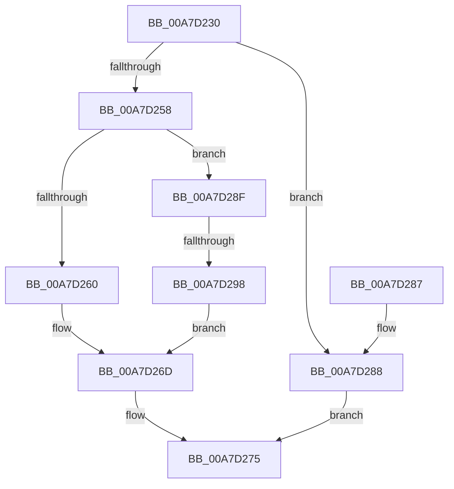

# PfpRpControlRequestPerform

- RVA: `0x00A7D230`–`0x00A7D29F` (길이 `111` bytes)
- VA: `0x0000000140A7D230`
- 실행 섹션: `PAGE`
- PDB 이름 있음: `예`; PDB Function 태그: `예`
- unwind 정보 RVA: `0x0005FD80`
- 디코드: `33`개 명령, `111/111` bytes 표시
- 미해석 바이트: `0` (있으면 어셈블리에 `.byte`로 보존)

> 이 문서는 커널 이미지의 기계어와 PDB 기호를 분석해 생성했습니다. 4번과 5번은 함수 원형과 자료형을 바이너리 사용 방식에서 추정한 C 해석이며 원본 소스 복구 결과는 아닙니다.

## 1. Dependencies

- 직접 호출 지점: **3**; 고유 호출 대상: **3**
- 직접 호출자로 확인된 함수: **1**
- RIP 상대 이미지 참조: **0**

### Outgoing calls
- `0x00A7D24F` → [ExAcquireRundownProtection](../../text/21/ExAcquireRundownProtection_function_00216620.md) (function, `0x00216620`)
- `0x00A7D266` → [PfpRpControlRequestUpdate](PfpRpControlRequestUpdate_function_00A7D2A8.md) (function, `0x00A7D2A8`)
- `0x00A7D270` → [ExReleaseRundownProtection](../../text/34/ExReleaseRundownProtection_function_00349E80.md) (function, `0x00349E80`)

### Direct callers
- [PfpRpControlRequest](PfpRpControlRequest_function_00A7CF24.md) at `0x00A7CF9C`

### Static image references
- 디코드된 RIP-relative 메모리 참조가 없습니다.

## 2. Other-region calls and transfers

- 다른 실행 섹션으로 향하는 call: **2**
  - `0x00A7D24F` → [ExAcquireRundownProtection](../../text/21/ExAcquireRundownProtection_function_00216620.md) (`PAGE` → `.text`)
  - `0x00A7D270` → [ExReleaseRundownProtection](../../text/34/ExReleaseRundownProtection_function_00349E80.md) (`PAGE` → `.text`)
- call이 아닌 외부 분기/꼬리 이동: **1**
  - `0x00A7D292` → [sub_00B428AA](../B4/Unknown_function_00B428AA.md) (`tail-transfer`)

## 3. Assembly (complete function range)

```asm
00A7D230  48 89 5C 24 08                  mov qword ptr [rsp + 8], rbx
00A7D235  48 89 74 24 10                  mov qword ptr [rsp + 0x10], rsi
00A7D23A  57                              push rdi
00A7D23B  48 83 EC 20                     sub rsp, 0x20
00A7D23F  48 8D B1 88 00 00 00            lea rsi, [rcx + 0x88]
00A7D246  48 8B D9                        mov rbx, rcx
00A7D249  48 8B CE                        mov rcx, rsi
00A7D24C  48 8B FA                        mov rdi, rdx
00A7D24F  E8 CC 93 79 FF                  call 0x140216620
00A7D254  84 C0                           test al, al
00A7D256  74 30                           je 0x140a7d288
00A7D258  0F B7 4F 02                     movzx ecx, word ptr [rdi + 2]
00A7D25C  85 C9                           test ecx, ecx
00A7D25E  75 2F                           jne 0x140a7d28f
00A7D260  48 8B D7                        mov rdx, rdi
00A7D263  48 8B CB                        mov rcx, rbx
00A7D266  E8 3D 00 00 00                  call 0x140a7d2a8
00A7D26B  8B D8                           mov ebx, eax
00A7D26D  48 8B CE                        mov rcx, rsi
00A7D270  E8 0B CC 8C FF                  call 0x140349e80
00A7D275  48 8B 74 24 38                  mov rsi, qword ptr [rsp + 0x38]
00A7D27A  8B C3                           mov eax, ebx
00A7D27C  48 8B 5C 24 30                  mov rbx, qword ptr [rsp + 0x30]
00A7D281  48 83 C4 20                     add rsp, 0x20
00A7D285  5F                              pop rdi
00A7D286  C3                              ret
00A7D287  CC                              int3
00A7D288  BB 80 00 00 C0                  mov ebx, 0xc0000080
00A7D28D  EB E6                           jmp 0x140a7d275
00A7D28F  83 F9 01                        cmp ecx, 1
00A7D292  0F 84 12 56 0C 00               je 0x140b428aa
00A7D298  BB 0D 00 00 C0                  mov ebx, 0xc000000d
00A7D29D  EB CE                           jmp 0x140a7d26d
```

## 4. C-style interpretation (structured pseudocode)

```c
__int64 __fastcall PfpRpControlRequestPerform(__int64 a1, __int64 a2)
{
    __int64 result;
    __int64 v_rsp;
    unsigned __int64 v_stack_p10;
    unsigned __int64 v_stack_p8;

    v_stack_p8 = v_rbx;
    v_stack_p10 = v_rsi;
    v_rsp = (v_rsp) - (32);
    result = ExAcquireRundownProtection(a1 + 136, a2, a3, a4);
    if ((unsigned __int8)(result) == 0) goto loc_00A7D288;
    if ((unsigned int)(*(unsigned __int16 *)(a2 + 2)) != 0) goto loc_00A7D28F;
    result = PfpRpControlRequestUpdate(a1, a2, a3, a4);
loc_00A7D26D:
    result = ExReleaseRundownProtection(a1 + 136, a2, a3, a4);
loc_00A7D275:
    v_rsp = (v_rsp) + (32);
    return (unsigned int)((unsigned int)((unsigned int)((unsigned int)(result))));
loc_00A7D288:
    goto loc_00A7D275;
loc_00A7D28F:
    goto loc_00A7D26D;
}
```

## 5. (Beta) C Style

```c
int64_t PfpRpControlRequestPerform(void *Arg1, void *Arg2)
{
    uint8_t *arg1 = (uint8_t *)Arg1;
    uint8_t *arg2 = (uint8_t *)Arg2;

    int64_t result;
    int64_t local_rsp;
    uint64_t v_stack_p10;
    uint64_t v_stack_p8;

    v_stack_p8 = local_rbx;
    v_stack_p10 = local_rsi;
    local_rsp = (local_rsp) - (32);
    result = ExAcquireRundownProtection(Arg1 + 136, Arg2, a3, a4);
    if ((uint8_t)(result) == 0) goto loc_00A7D288;
    if ((uint32_t)(*(uint16_t *)(arg2 + 0x2)) != 0) goto loc_00A7D28F;
    result = PfpRpControlRequestUpdate(Arg1, Arg2, a3, a4);
loc_00A7D26D:
    result = ExReleaseRundownProtection(Arg1 + 136, Arg2, a3, a4);
loc_00A7D275:
    local_rsp = (local_rsp) + (32);
    return (uint32_t)((uint32_t)((uint32_t)((uint32_t)(result))));
loc_00A7D288:
    goto loc_00A7D275;
loc_00A7D28F:
    goto loc_00A7D26D;
}
```

### 관측된 메모리 오프셋

구조체 형식이 확인되지 않은 접근은 인자 기준의 오프셋으로만 기록했습니다.

| 기준 인자 | 오프셋 표현 | 폭 (bit) | 접근 |
|---|---:|---:|---|
| `Arg1` | `+ 0x88` | `64` | `R` |
| `Arg2` | `+ 0x2` | `16` | `R` |

## 6. Execution-region graph

[열기: 2D/3D 그래프와 함수 탐색 컨트롤 패널](../../../control-panel.html?section=page&rva=0x00A7D230&view=graph)

- 2D 그래프는 위에서 아래로 흐르고, 3D 그래프는 빈 공간을 드래그해 회전합니다. Shift+드래그는 이동, 휠은 확대·축소, 함수 노드 선택은 대상 보고서 이동입니다.

### Static fallback


