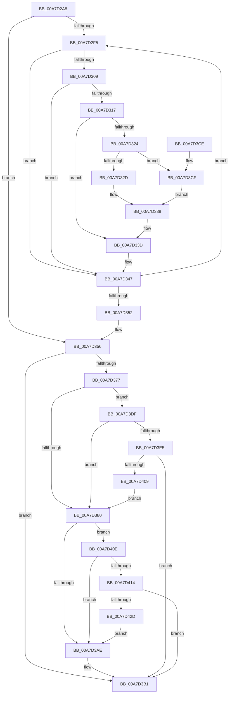

# PfpRpControlRequestUpdate

- RVA: `0x00A7D2A8`–`0x00A7D436` (길이 `398` bytes)
- VA: `0x0000000140A7D2A8`
- 실행 섹션: `PAGE`
- PDB 이름 있음: `예`; PDB Function 태그: `아니요`
- unwind 정보 RVA: `0x000B6A98`
- 디코드: `111`개 명령, `398/398` bytes 표시
- 미해석 바이트: `0` (있으면 어셈블리에 `.byte`로 보존)

> 이 문서는 커널 이미지의 기계어와 PDB 기호를 분석해 생성했습니다. 4번과 5번은 함수 원형과 자료형을 바이너리 사용 방식에서 추정한 C 해석이며 원본 소스 복구 결과는 아닙니다.

## 1. Dependencies

- 직접 호출 지점: **6**; 고유 호출 대상: **4**
- 직접 호출자로 확인된 함수: **1**
- RIP 상대 이미지 참조: **0**

### Outgoing calls
- `0x00A7D30E` → [PsLookupProcessByProcessId](../8A/PsLookupProcessByProcessId_function_008A2AA0.md) (function, `0x008A2AA0`)
- `0x00A7D342` → [ObfDereferenceObjectWithTag](../../text/2F/ObfDereferenceObjectWithTag_function_002F78E0.md) (function, `0x002F78E0`)
- `0x00A7D36B` → [PfpRpCHashAddEntries](PfpRpCHashAddEntries_function_00A7D43C.md) (function, `0x00A7D43C`)
- `0x00A7D3A0` → [PfpRpCHashAddEntries](PfpRpCHashAddEntries_function_00A7D43C.md) (function, `0x00A7D43C`)
- `0x00A7D400` → [PfpRpCHashDeleteEntries](../A3/PfpRpCHashDeleteEntries_function_00A322A8.md) (function, `0x00A322A8`)
- `0x00A7D424` → [PfpRpCHashDeleteEntries](../A3/PfpRpCHashDeleteEntries_function_00A322A8.md) (function, `0x00A322A8`)

### Direct callers
- [PfpRpControlRequestPerform](PfpRpControlRequestPerform_function_00A7D230.md) at `0x00A7D266`

### Static image references
- 디코드된 RIP-relative 메모리 참조가 없습니다.

## 2. Other-region calls and transfers

- 다른 실행 섹션으로 향하는 call: **1**
  - `0x00A7D342` → [ObfDereferenceObjectWithTag](../../text/2F/ObfDereferenceObjectWithTag_function_002F78E0.md) (`PAGE` → `.text`)
- 별도 외부 분기/꼬리 이동을 확인하지 못했습니다.

## 3. Assembly (complete function range)

```asm
00A7D2A8  48 8B C4                        mov rax, rsp
00A7D2AB  48 89 58 10                     mov qword ptr [rax + 0x10], rbx
00A7D2AF  48 89 68 18                     mov qword ptr [rax + 0x18], rbp
00A7D2B3  48 89 70 20                     mov qword ptr [rax + 0x20], rsi
00A7D2B7  57                              push rdi
00A7D2B8  41 54                           push r12
00A7D2BA  41 55                           push r13
00A7D2BC  41 56                           push r14
00A7D2BE  41 57                           push r15
00A7D2C0  48 83 EC 30                     sub rsp, 0x30
00A7D2C4  44 8B 7A 04                     mov r15d, dword ptr [rdx + 4]
00A7D2C8  4C 8D 6A 1F                     lea r13, [rdx + 0x1f]
00A7D2CC  44 03 7A 08                     add r15d, dword ptr [rdx + 8]
00A7D2D0  48 8B D9                        mov rbx, rcx
00A7D2D3  48 83 60 08 00                  and qword ptr [rax + 8], 0
00A7D2D8  48 8D 4A 18                     lea rcx, [rdx + 0x18]
00A7D2DC  33 F6                           xor esi, esi
00A7D2DE  48 8B FA                        mov rdi, rdx
00A7D2E1  4C 8B E1                        mov r12, rcx
00A7D2E4  4C 8B F1                        mov r14, rcx
00A7D2E7  4F 8D 6C FD 00                  lea r13, [r13 + r15*8]
00A7D2EC  49 83 E5 F8                     and r13, 0xfffffffffffffff8
00A7D2F0  45 85 FF                        test r15d, r15d
00A7D2F3  74 61                           je 0x140a7d356
00A7D2F5  41 8B 4E 04                     mov ecx, dword ptr [r14 + 4]
00A7D2F9  41 8B 2E                        mov ebp, dword ptr [r14]
00A7D2FC  49 89 2C 24                     mov qword ptr [r12], rbp
00A7D300  4D 8D 64 24 08                  lea r12, [r12 + 8]
00A7D305  85 C9                           test ecx, ecx
00A7D307  74 3E                           je 0x140a7d347
00A7D309  48 8D 54 24 60                  lea rdx, [rsp + 0x60]
00A7D30E  E8 8D 57 E2 FF                  call 0x1408a2aa0
00A7D313  85 C0                           test eax, eax
00A7D315  78 30                           js 0x140a7d347
00A7D317  48 8B 4C 24 60                  mov rcx, qword ptr [rsp + 0x60]
00A7D31C  39 A9 84 03 00 00               cmp dword ptr [rcx + 0x384], ebp
00A7D322  75 19                           jne 0x140a7d33d
00A7D324  3B 77 04                        cmp esi, dword ptr [rdi + 4]
00A7D327  0F 82 A2 00 00 00               jb 0x140a7d3cf
00A7D32D  F0 81 A1 F4 01 00 00 FF BF FF FF  lock and dword ptr [rcx + 0x1f4], 0xffffbfff
00A7D338  48 8B 4C 24 60                  mov rcx, qword ptr [rsp + 0x60]
00A7D33D  BA 44 66 6C 74                  mov edx, 0x746c6644
00A7D342  E8 99 A5 87 FF                  call 0x1402f78e0
00A7D347  FF C6                           inc esi
00A7D349  49 83 C6 08                     add r14, 8
00A7D34D  41 3B F7                        cmp esi, r15d
00A7D350  72 A3                           jb 0x140a7d2f5
00A7D352  48 8D 4F 18                     lea rcx, [rdi + 0x18]
00A7D356  8B 47 04                        mov eax, dword ptr [rdi + 4]
00A7D359  4C 8D 43 78                     lea r8, [rbx + 0x78]
00A7D35D  4C 8B C9                        mov r9, rcx
00A7D360  89 44 24 20                     mov dword ptr [rsp + 0x20], eax
00A7D364  48 8B CB                        mov rcx, rbx
00A7D367  48 8D 53 60                     lea rdx, [rbx + 0x60]
00A7D36B  E8 CC 00 00 00                  call 0x140a7d43c
00A7D370  45 33 F6                        xor r14d, r14d
00A7D373  85 C0                           test eax, eax
00A7D375  78 3A                           js 0x140a7d3b1
00A7D377  44 8B 4F 08                     mov r9d, dword ptr [rdi + 8]
00A7D37B  45 85 C9                        test r9d, r9d
00A7D37E  75 5F                           jne 0x140a7d3df
00A7D380  8B 47 0C                        mov eax, dword ptr [rdi + 0xc]
00A7D383  4C 8D 43 58                     lea r8, [rbx + 0x58]
00A7D387  48 8D 53 38                     lea rdx, [rbx + 0x38]
00A7D38B  48 8B CB                        mov rcx, rbx
00A7D38E  4C 8D 0C C5 00 00 00 00         lea r9, [rax*8]
00A7D396  8B 47 10                        mov eax, dword ptr [rdi + 0x10]
00A7D399  4D 03 CD                        add r9, r13
00A7D39C  89 44 24 20                     mov dword ptr [rsp + 0x20], eax
00A7D3A0  E8 97 00 00 00                  call 0x140a7d43c
00A7D3A5  44 8B 4F 0C                     mov r9d, dword ptr [rdi + 0xc]
00A7D3A9  45 85 C9                        test r9d, r9d
00A7D3AC  75 60                           jne 0x140a7d40e
00A7D3AE  41 8B C6                        mov eax, r14d
00A7D3B1  48 8B 5C 24 68                  mov rbx, qword ptr [rsp + 0x68]
00A7D3B6  48 8B 6C 24 70                  mov rbp, qword ptr [rsp + 0x70]
00A7D3BB  48 8B 74 24 78                  mov rsi, qword ptr [rsp + 0x78]
00A7D3C0  48 83 C4 30                     add rsp, 0x30
00A7D3C4  41 5F                           pop r15
00A7D3C6  41 5E                           pop r14
00A7D3C8  41 5D                           pop r13
00A7D3CA  41 5C                           pop r12
00A7D3CC  5F                              pop rdi
00A7D3CD  C3                              ret
00A7D3CE  CC                              int3
00A7D3CF  F0 81 89 F4 01 00 00 00 40 00 00  lock or dword ptr [rcx + 0x1f4], 0x4000
00A7D3DA  E9 59 FF FF FF                  jmp 0x140a7d338
00A7D3DF  44 39 73 70                     cmp dword ptr [rbx + 0x70], r14d
00A7D3E3  74 9B                           je 0x140a7d380
00A7D3E5  8B 47 04                        mov eax, dword ptr [rdi + 4]
00A7D3E8  4C 8D 43 78                     lea r8, [rbx + 0x78]
00A7D3EC  48 83 C0 03                     add rax, 3
00A7D3F0  48 8D 53 60                     lea rdx, [rbx + 0x60]
00A7D3F4  48 8D 0C C7                     lea rcx, [rdi + rax*8]
00A7D3F8  48 89 4C 24 20                  mov qword ptr [rsp + 0x20], rcx
00A7D3FD  48 8B CB                        mov rcx, rbx
00A7D400  E8 A3 4E FB FF                  call 0x140a322a8
00A7D405  85 C0                           test eax, eax
00A7D407  78 A8                           js 0x140a7d3b1
00A7D409  E9 72 FF FF FF                  jmp 0x140a7d380
00A7D40E  44 39 73 48                     cmp dword ptr [rbx + 0x48], r14d
00A7D412  74 9A                           je 0x140a7d3ae
00A7D414  4C 8D 43 58                     lea r8, [rbx + 0x58]
00A7D418  4C 89 6C 24 20                  mov qword ptr [rsp + 0x20], r13
00A7D41D  48 8D 53 38                     lea rdx, [rbx + 0x38]
00A7D421  48 8B CB                        mov rcx, rbx
00A7D424  E8 7F 4E FB FF                  call 0x140a322a8
00A7D429  85 C0                           test eax, eax
00A7D42B  78 84                           js 0x140a7d3b1
00A7D42D  4C 89 73 50                     mov qword ptr [rbx + 0x50], r14
00A7D431  E9 78 FF FF FF                  jmp 0x140a7d3ae
```

## 4. C-style interpretation (structured pseudocode)

```c
__int64 __fastcall PfpRpControlRequestUpdate(__int64 a1, __int64 a2)
{
    __int64 result;
    __int64 v_r13;
    __int64 v_r14;
    __int64 v_r15;
    __int64 v_rsi;
    __int64 v_rsp;
    unsigned int v_stack_m38;
    unsigned __int64 v_stack_p10;
    unsigned __int64 v_stack_p18;
    unsigned __int64 v_stack_p20;
    unsigned __int64 v_stack_p8;

    *(unsigned __int64 *)(v_rsp + 16) = v_rbx;
    *(unsigned __int64 *)(v_rsp + 24) = v_rbp;
    *(unsigned __int64 *)(v_rsp + 32) = v_rsi;
    v_rsp = (v_rsp) - (48);
    v_r15 = (unsigned int)(((unsigned int)(*(unsigned int *)(a2 + 4))) + (*(unsigned int *)(a2 + 8)));
    v_rsi = 0;
    v_r13 = (a2 + 31 + v_r15 * 8) & (-8);
    if ((unsigned int)(v_r15) == 0) goto loc_00A7D356;
loc_00A7D2F5:
    *(unsigned __int64 *)(a2 + 24) = (unsigned int)(*(unsigned int *)(a2 + 24));
    if ((unsigned int)((unsigned int)(*(unsigned int *)(a2 + 24 + 4))) == 0) goto loc_00A7D347;
    result = PsLookupProcessByProcessId((unsigned int)(*(unsigned int *)(a2 + 24 + 4)), v_stack_p8, a3, a4);
    if (sign_flag) goto loc_00A7D347;
    if ((*(unsigned int *)(v_stack_p8 + 900)) != ((unsigned int)((unsigned int)(*(unsigned int *)(a2 + 24))))) goto loc_00A7D33D;
    if (0 < (*(unsigned int *)(a2 + 4))) goto loc_00A7D3CF;
loc_00A7D338:
loc_00A7D33D:
    result = ObfDereferenceObjectWithTag(v_stack_p8, (unsigned int)(0x746C6644ULL), a3, a4);
loc_00A7D347:
    v_rsi = (unsigned int)((v_rsi) + 1);
    v_r14 = (a2 + 24) + (8);
    if (((unsigned int)(v_rsi)) < ((unsigned int)(v_r15))) goto loc_00A7D2F5;
loc_00A7D356:
    v_stack_m38 = (unsigned int)((unsigned int)(*(unsigned int *)(a2 + 4)));
    result = PfpRpCHashAddEntries(a1, a1 + 96, a1 + 120, a2 + 24);
    v_r14 = 0;
    if (sign_flag) goto loc_00A7D3B1;
    if ((unsigned int)((unsigned int)(*(unsigned int *)(a2 + 8))) != 0) goto loc_00A7D3DF;
loc_00A7D380:
    a4 = ((unsigned int)(*(unsigned int *)(a2 + 12)) * 8) + (v_r13);
    v_stack_m38 = (unsigned int)((unsigned int)(*(unsigned int *)(a2 + 16)));
    result = PfpRpCHashAddEntries(a1, a1 + 56, a1 + 88, a4);
    if ((unsigned int)((unsigned int)(*(unsigned int *)(a2 + 12))) != 0) goto loc_00A7D40E;
loc_00A7D3AE:
loc_00A7D3B1:
    v_rsp = (v_rsp) + (48);
    return 0;
loc_00A7D3CF:
    goto loc_00A7D338;
loc_00A7D3DF:
    if ((*(unsigned int *)(v_stack_p10 + 112)) == 0) goto loc_00A7D380;
    result = ((unsigned int)(*(unsigned int *)(a2 + 4))) + (3);
    v_stack_p20 = a2 + result * 8;
    result = PfpRpCHashDeleteEntries(v_stack_p10, v_stack_p10 + 96, v_stack_p10 + 120, (unsigned int)(*(unsigned int *)(a2 + 12)));
    if (sign_flag) goto loc_00A7D3B1;
    goto loc_00A7D380;
loc_00A7D40E:
    if ((*(unsigned int *)(v_stack_p10 + 72)) == 0) goto loc_00A7D3AE;
    v_stack_p20 = v_r13;
    result = PfpRpCHashDeleteEntries(v_stack_p10, v_stack_p10 + 56, v_stack_p10 + 88, (unsigned int)(*(unsigned int *)(a2 + 12)));
    if (sign_flag) goto loc_00A7D3B1;
    *(unsigned __int64 *)(v_stack_p10 + 80) = 0;
    goto loc_00A7D3AE;
}
```

## 5. (Beta) C Style

```c
int64_t PfpRpControlRequestUpdate(void *Arg1, void *Arg2)
{
    uint8_t *arg1 = (uint8_t *)Arg1;
    uint8_t *arg2 = (uint8_t *)Arg2;

    int64_t result;
    int64_t local_r13;
    int64_t local_r14;
    int64_t local_r15;
    int64_t local_rsi;
    int64_t local_rsp;
    uint32_t v_stack_m38;
    uint64_t v_stack_p10;
    uint64_t v_stack_p18;
    uint64_t v_stack_p20;
    uint64_t v_stack_p8;

    *(uint64_t *)(local_rsp + 0x10) = local_rbx;
    *(uint64_t *)(local_rsp + 0x18) = local_rbp;
    *(uint64_t *)(local_rsp + 0x20) = local_rsi;
    local_rsp = (local_rsp) - (48);
    local_r15 = (uint32_t)(((uint32_t)(*(uint32_t *)(arg2 + 0x4))) + (*(uint32_t *)(arg2 + 0x8)));
    local_rsi = 0;
    local_r13 = (Arg2 + 31 + local_r15 * 8) & (-8);
    if ((uint32_t)(local_r15) == 0) goto loc_00A7D356;
loc_00A7D2F5:
    *(uint64_t *)(arg2 + 0x18) = (uint32_t)(*(uint32_t *)(arg2 + 0x18));
    if ((uint32_t)((uint32_t)(*(uint32_t *)(arg2 + 0x18 + 0x4))) == 0) goto loc_00A7D347;
    result = PsLookupProcessByProcessId((uint32_t)(*(uint32_t *)(arg2 + 0x18 + 0x4)), v_stack_p8, a3, a4);
    if (sign_flag) goto loc_00A7D347;
    if ((*(uint32_t *)(v_stack_p8 + 0x384)) != ((uint32_t)((uint32_t)(*(uint32_t *)(arg2 + 0x18))))) goto loc_00A7D33D;
    if (0 < (*(uint32_t *)(arg2 + 0x4))) goto loc_00A7D3CF;
loc_00A7D338:
loc_00A7D33D:
    result = ObfDereferenceObjectWithTag(v_stack_p8, (uint32_t)(0x746C6644ULL), a3, a4);
loc_00A7D347:
    local_rsi = (uint32_t)((local_rsi) + 1);
    local_r14 = (Arg2 + 24) + (8);
    if (((uint32_t)(local_rsi)) < ((uint32_t)(local_r15))) goto loc_00A7D2F5;
loc_00A7D356:
    v_stack_m38 = (uint32_t)((uint32_t)(*(uint32_t *)(arg2 + 0x4)));
    result = PfpRpCHashAddEntries(Arg1, Arg1 + 96, Arg1 + 120, Arg2 + 24);
    local_r14 = 0;
    if (sign_flag) goto loc_00A7D3B1;
    if ((uint32_t)((uint32_t)(*(uint32_t *)(arg2 + 0x8))) != 0) goto loc_00A7D3DF;
loc_00A7D380:
    a4 = ((uint32_t)(*(uint32_t *)(arg2 + 0xC)) * 8) + (local_r13);
    v_stack_m38 = (uint32_t)((uint32_t)(*(uint32_t *)(arg2 + 0x10)));
    result = PfpRpCHashAddEntries(Arg1, Arg1 + 56, Arg1 + 88, a4);
    if ((uint32_t)((uint32_t)(*(uint32_t *)(arg2 + 0xC))) != 0) goto loc_00A7D40E;
loc_00A7D3AE:
loc_00A7D3B1:
    local_rsp = (local_rsp) + (48);
    return 0;
loc_00A7D3CF:
    goto loc_00A7D338;
loc_00A7D3DF:
    if ((*(uint32_t *)(v_stack_p10 + 0x70)) == 0) goto loc_00A7D380;
    result = ((uint32_t)(*(uint32_t *)(arg2 + 0x4))) + (3);
    v_stack_p20 = Arg2 + result * 8;
    result = PfpRpCHashDeleteEntries(v_stack_p10, v_stack_p10 + 96, v_stack_p10 + 120, (uint32_t)(*(uint32_t *)(arg2 + 0xC)));
    if (sign_flag) goto loc_00A7D3B1;
    goto loc_00A7D380;
loc_00A7D40E:
    if ((*(uint32_t *)(v_stack_p10 + 0x48)) == 0) goto loc_00A7D3AE;
    v_stack_p20 = local_r13;
    result = PfpRpCHashDeleteEntries(v_stack_p10, v_stack_p10 + 56, v_stack_p10 + 88, (uint32_t)(*(uint32_t *)(arg2 + 0xC)));
    if (sign_flag) goto loc_00A7D3B1;
    *(uint64_t *)(v_stack_p10 + 0x50) = 0;
    goto loc_00A7D3AE;
}
```

### 관측된 메모리 오프셋

구조체 형식이 확인되지 않은 접근은 인자 기준의 오프셋으로만 기록했습니다.

| 기준 인자 | 오프셋 표현 | 폭 (bit) | 접근 |
|---|---:|---:|---|
| `Arg1` | `+ 0x38` | `64` | `R` |
| `Arg1` | `+ 0x48` | `32` | `R` |
| `Arg1` | `+ 0x50` | `64` | `W` |
| `Arg1` | `+ 0x58` | `64` | `R` |
| `Arg1` | `+ 0x60` | `64` | `R` |
| `Arg1` | `+ 0x70` | `32` | `R` |
| `Arg1` | `+ 0x78` | `64` | `R` |
| `Arg2` | `+ 0x0` | `32` | `R` |
| `Arg2` | `+ 0x0` | `64` | `W` |
| `Arg2` | `+ 0x0 + r15*8` | `64` | `R` |
| `Arg2` | `+ 0x0 + rax*8` | `64` | `R` |
| `Arg2` | `+ 0x4` | `32` | `R` |
| `Arg2` | `+ 0x8` | `32` | `R` |
| `Arg2` | `+ 0x8` | `64` | `R` |
| `Arg2` | `+ 0xC` | `32` | `R` |
| `Arg2` | `+ 0x10` | `32` | `R` |
| `Arg2` | `+ 0x18` | `64` | `R` |
| `Arg2` | `+ 0x1F` | `64` | `R` |

## 6. Execution-region graph

[열기: 2D/3D 그래프와 함수 탐색 컨트롤 패널](../../../control-panel.html?section=page&rva=0x00A7D2A8&view=graph)

- 2D 그래프는 위에서 아래로 흐르고, 3D 그래프는 빈 공간을 드래그해 회전합니다. Shift+드래그는 이동, 휠은 확대·축소, 함수 노드 선택은 대상 보고서 이동입니다.

### Static fallback


