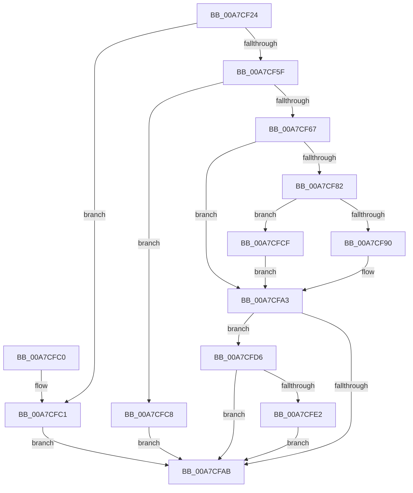

# PfpRpControlRequest

- RVA: `0x00A7CF24`–`0x00A7CFF0` (길이 `204` bytes)
- VA: `0x0000000140A7CF24`
- 실행 섹션: `PAGE`
- PDB 이름 있음: `예`; PDB Function 태그: `아니요`
- unwind 정보 RVA: `0x000B6A34`
- 디코드: `58`개 명령, `204/204` bytes 표시
- 미해석 바이트: `0` (있으면 어셈블리에 `.byte`로 보존)

> 이 문서는 커널 이미지의 기계어와 PDB 기호를 분석해 생성했습니다. 4번과 5번은 함수 원형과 자료형을 바이너리 사용 방식에서 추정한 C 해석이며 원본 소스 복구 결과는 아닙니다.

## 1. Dependencies

- 직접 호출 지점: **5**; 고유 호출 대상: **5**
- 직접 호출자로 확인된 함수: **1**
- RIP 상대 이미지 참조: **3**

### Outgoing calls
- `0x00A7CF77` → [PfpRpControlRequestCopy](PfpRpControlRequestCopy_function_00A7CFF8.md) (function, `0x00A7CFF8`)
- `0x00A7CF87` → [PfpRpControlRequestVerify](../../text/4B/PfpRpControlRequestVerify_function_004BC848.md) (function, `0x004BC848`)
- `0x00A7CF9C` → [PfpRpControlRequestPerform](PfpRpControlRequestPerform_function_00A7D230.md) (function, `0x00A7D230`)
- `0x00A7CFB5` → [_security_check_cookie](../../text/6A/_security_check_cookie_function_006AC640.md) (function, `0x006AC640`)
- `0x00A7CFE9` → [ExFreePoolWithTag](../../poolcode/B8/ExFreePoolWithTag_function_00B82870.md) (function, `0x00B82870`)

### Direct callers
- [PfSetSuperfetchInformation](../AD/PfSetSuperfetchInformation_function_00ADE6E8.md) at `0x00ADECBC`

### Static image references
- `0x00A7CF2C` → RVA `0x00E0A740` (`.data`; read)
- `0x00A7CF55` → RVA `0x00E671E0` (`.data`; read)
- `0x00A7CF95` → RVA `0x00E67148` (`.data`; read)

## 2. Other-region calls and transfers

- 다른 실행 섹션으로 향하는 call: **3**
  - `0x00A7CF87` → [PfpRpControlRequestVerify](../../text/4B/PfpRpControlRequestVerify_function_004BC848.md) (`PAGE` → `.text`)
  - `0x00A7CFB5` → [_security_check_cookie](../../text/6A/_security_check_cookie_function_006AC640.md) (`PAGE` → `.text`)
  - `0x00A7CFE9` → [ExFreePoolWithTag](../../poolcode/B8/ExFreePoolWithTag_function_00B82870.md) (`PAGE` → `POOLCODE`)
- 별도 외부 분기/꼬리 이동을 확인하지 못했습니다.

## 3. Assembly (complete function range)

```asm
00A7CF24  4C 8B DC                        mov r11, rsp
00A7CF27  53                              push rbx
00A7CF28  48 83 EC 70                     sub rsp, 0x70
00A7CF2C  48 8B 05 0D D8 38 00            mov rax, qword ptr [rip + 0x38d80d]
00A7CF33  48 33 C4                        xor rax, rsp
00A7CF36  48 89 44 24 60                  mov qword ptr [rsp + 0x60], rax
00A7CF3B  33 C0                           xor eax, eax
00A7CF3D  0F 57 C0                        xorps xmm0, xmm0
00A7CF40  49 21 43 B8                     and qword ptr [r11 - 0x48], rax
00A7CF44  44 8A C2                        mov r8b, dl
00A7CF47  0F 11 44 24 38                  movups xmmword ptr [rsp + 0x38], xmm0
00A7CF4C  0F 11 44 24 48                  movups xmmword ptr [rsp + 0x48], xmm0
00A7CF51  49 89 43 E0                     mov qword ptr [r11 - 0x20], rax
00A7CF55  8B 05 85 A2 3E 00               mov eax, dword ptr [rip + 0x3ea285]
00A7CF5B  A8 01                           test al, 1
00A7CF5D  74 62                           je 0x140a7cfc1
00A7CF5F  8B 51 18                        mov edx, dword ptr [rcx + 0x18]
00A7CF62  83 FA 18                        cmp edx, 0x18
00A7CF65  72 61                           jb 0x140a7cfc8
00A7CF67  48 8B 49 10                     mov rcx, qword ptr [rcx + 0x10]
00A7CF6B  4D 8D 4B C0                     lea r9, [r11 - 0x40]
00A7CF6F  45 88 43 A8                     mov byte ptr [r11 - 0x58], r8b
00A7CF73  4D 8D 43 B8                     lea r8, [r11 - 0x48]
00A7CF77  E8 7C 00 00 00                  call 0x140a7cff8
00A7CF7C  8B D8                           mov ebx, eax
00A7CF7E  85 C0                           test eax, eax
00A7CF80  78 21                           js 0x140a7cfa3
00A7CF82  48 8B 4C 24 30                  mov rcx, qword ptr [rsp + 0x30]
00A7CF87  E8 BC F8 A3 FF                  call 0x1404bc848
00A7CF8C  85 C0                           test eax, eax
00A7CF8E  75 3F                           jne 0x140a7cfcf
00A7CF90  48 8B 54 24 30                  mov rdx, qword ptr [rsp + 0x30]
00A7CF95  48 8D 0D AC A1 3E 00            lea rcx, [rip + 0x3ea1ac]
00A7CF9C  E8 8F 02 00 00                  call 0x140a7d230
00A7CFA1  8B D8                           mov ebx, eax
00A7CFA3  48 83 7C 24 30 00               cmp qword ptr [rsp + 0x30], 0
00A7CFA9  75 2B                           jne 0x140a7cfd6
00A7CFAB  8B C3                           mov eax, ebx
00A7CFAD  48 8B 4C 24 60                  mov rcx, qword ptr [rsp + 0x60]
00A7CFB2  48 33 CC                        xor rcx, rsp
00A7CFB5  E8 86 F6 C2 FF                  call 0x1406ac640
00A7CFBA  48 83 C4 70                     add rsp, 0x70
00A7CFBE  5B                              pop rbx
00A7CFBF  C3                              ret
00A7CFC0  CC                              int3
00A7CFC1  BB 80 00 00 C0                  mov ebx, 0xc0000080
00A7CFC6  EB E3                           jmp 0x140a7cfab
00A7CFC8  BB 06 02 00 C0                  mov ebx, 0xc0000206
00A7CFCD  EB DC                           jmp 0x140a7cfab
00A7CFCF  BB 7B 00 00 C0                  mov ebx, 0xc000007b
00A7CFD4  EB CD                           jmp 0x140a7cfa3
00A7CFD6  48 8D 44 24 38                  lea rax, [rsp + 0x38]
00A7CFDB  48 39 44 24 30                  cmp qword ptr [rsp + 0x30], rax
00A7CFE0  74 C9                           je 0x140a7cfab
00A7CFE2  48 8B 4C 24 30                  mov rcx, qword ptr [rsp + 0x30]
00A7CFE7  33 D2                           xor edx, edx
00A7CFE9  E8 82 58 10 00                  call 0x140b82870
00A7CFEE  EB BB                           jmp 0x140a7cfab
```

## 4. C-style interpretation (structured pseudocode)

```c
__int64 __fastcall PfpRpControlRequest(__int64 a1, unsigned __int8 a2)
{
    __int64 result;
    __int64 v_rsp;
    unsigned __int64 v_stack_m18;
    unsigned __int64 v_stack_m30;
    unsigned __int64 v_stack_m40;
    unsigned __int64 v_stack_m48;
    unsigned __int64 v_stack_p30;
    unsigned __int64 v_stack_p38;

    v_rsp = (v_rsp) - (112);
    result = (*(unsigned __int64 *)(v_rip + 3725325)) ^ (v_rsp);
    v_stack_m18 = result;
    result = 0;
    v_stack_m40 = v_xmm0;
    v_stack_m30 = v_xmm0;
    *(unsigned __int64 *)(v_rsp - 32) = 0;
    if ((((unsigned __int8)((unsigned int)(*(unsigned int *)(v_rip + 4104837)))) & (1)) == 0) goto loc_00A7CFC1;
    if (((unsigned int)((unsigned int)(*(unsigned int *)(a1 + 24)))) < 24) goto loc_00A7CFC8;
    *(unsigned __int8 *)(v_rsp - 88) = a2;
    result = PfpRpControlRequestCopy(*(unsigned __int64 *)(a1 + 16), (unsigned int)(*(unsigned int *)(a1 + 24)), v_rsp - 72, v_rsp - 64);
    if (sign_flag) goto loc_00A7CFA3;
    result = PfpRpControlRequestVerify(v_stack_m48, (unsigned int)(*(unsigned int *)(a1 + 24)), v_rsp - 72, v_rsp - 64);
    if ((unsigned int)(result) != 0) goto loc_00A7CFCF;
    result = PfpRpControlRequestPerform(v_rip + 4104620, v_stack_m48, v_rsp - 72, v_rsp - 64);
loc_00A7CFA3:
    if (v_stack_m48 != 0) goto loc_00A7CFD6;
loc_00A7CFAB:
    a1 = (v_stack_m18) ^ (v_rsp);
    result = _security_check_cookie(a1, v_stack_m48, v_rsp - 72, v_rsp - 64);
    v_rsp = (v_rsp) + (112);
    return result;
loc_00A7CFC1:
    goto loc_00A7CFAB;
loc_00A7CFC8:
    goto loc_00A7CFAB;
loc_00A7CFCF:
    goto loc_00A7CFA3;
loc_00A7CFD6:
    if (v_stack_p30 == v_stack_p38) goto loc_00A7CFAB;
    a2 = 0;
    result = ExFreePoolWithTag(v_stack_p30, a2, v_rsp - 72, v_rsp - 64);
    goto loc_00A7CFAB;
}
```

## 5. (Beta) C Style

```c
int64_t PfpRpControlRequest(void *Arg1, uint8_t Arg2)
{
    uint8_t *arg1 = (uint8_t *)Arg1;

    int64_t result;
    int64_t local_rsp;
    uint64_t v_stack_m18;
    uint64_t v_stack_m30;
    uint64_t v_stack_m40;
    uint64_t v_stack_m48;
    uint64_t v_stack_p30;
    uint64_t v_stack_p38;

    local_rsp = (local_rsp) - (112);
    result = (*(uint64_t *)(v_rip + 0x38D80D)) ^ (local_rsp);
    v_stack_m18 = result;
    result = 0;
    v_stack_m40 = v_xmm0;
    v_stack_m30 = v_xmm0;
    *(uint64_t *)(local_rsp - 0x20) = 0;
    if ((((uint8_t)((uint32_t)(*(uint32_t *)(v_rip + 0x3EA285)))) & (1)) == 0) goto loc_00A7CFC1;
    if (((uint32_t)((uint32_t)(*(uint32_t *)(arg1 + 0x18)))) < 24) goto loc_00A7CFC8;
    *(uint8_t *)(local_rsp - 0x58) = Arg2;
    result = PfpRpControlRequestCopy(*(uint64_t *)(arg1 + 0x10), (uint32_t)(*(uint32_t *)(arg1 + 0x18)), local_rsp - 72, local_rsp - 64);
    if (sign_flag) goto loc_00A7CFA3;
    result = PfpRpControlRequestVerify(v_stack_m48, (uint32_t)(*(uint32_t *)(arg1 + 0x18)), local_rsp - 72, local_rsp - 64);
    if ((uint32_t)(result) != 0) goto loc_00A7CFCF;
    result = PfpRpControlRequestPerform(v_rip + 4104620, v_stack_m48, local_rsp - 72, local_rsp - 64);
loc_00A7CFA3:
    if (v_stack_m48 != 0) goto loc_00A7CFD6;
loc_00A7CFAB:
    Arg1 = (v_stack_m18) ^ (local_rsp);
    result = _security_check_cookie(Arg1, v_stack_m48, local_rsp - 72, local_rsp - 64);
    local_rsp = (local_rsp) + (112);
    return result;
loc_00A7CFC1:
    goto loc_00A7CFAB;
loc_00A7CFC8:
    goto loc_00A7CFAB;
loc_00A7CFCF:
    goto loc_00A7CFA3;
loc_00A7CFD6:
    if (v_stack_p30 == v_stack_p38) goto loc_00A7CFAB;
    Arg2 = 0;
    result = ExFreePoolWithTag(v_stack_p30, Arg2, local_rsp - 72, local_rsp - 64);
    goto loc_00A7CFAB;
}
```

### 관측된 메모리 오프셋

구조체 형식이 확인되지 않은 접근은 인자 기준의 오프셋으로만 기록했습니다.

| 기준 인자 | 오프셋 표현 | 폭 (bit) | 접근 |
|---|---:|---:|---|
| `Arg1` | `+ 0x10` | `64` | `R` |
| `Arg1` | `+ 0x18` | `32` | `R` |

## 6. Execution-region graph

[열기: 2D/3D 그래프와 함수 탐색 컨트롤 패널](../../../control-panel.html?section=page&rva=0x00A7CF24&view=graph)

- 2D 그래프는 위에서 아래로 흐르고, 3D 그래프는 빈 공간을 드래그해 회전합니다. Shift+드래그는 이동, 휠은 확대·축소, 함수 노드 선택은 대상 보고서 이동입니다.

### Static fallback


