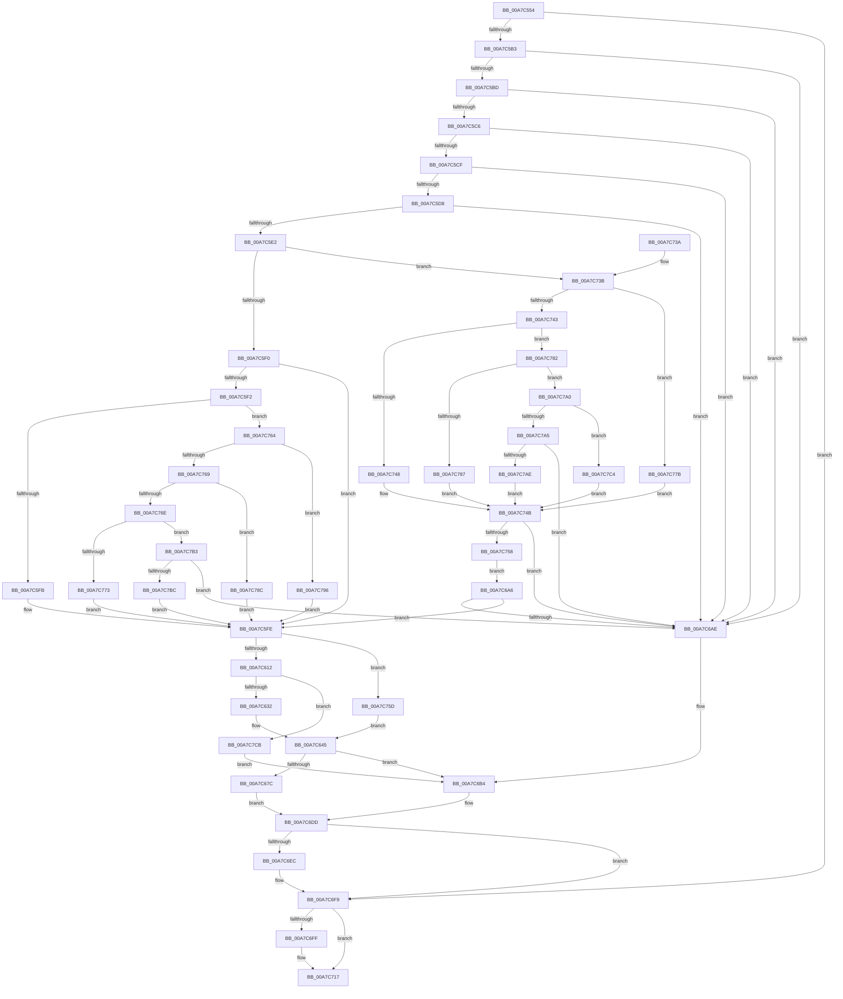

# PiCMGetObjectPropertyKeys

- RVA: `0x00A7C554`–`0x00A7C7D8` (길이 `644` bytes)
- VA: `0x0000000140A7C554`
- 실행 섹션: `PAGE`
- PDB 이름 있음: `예`; PDB Function 태그: `아니요`
- unwind 정보 RVA: `0x000B689C`
- 디코드: `173`개 명령, `644/644` bytes 표시
- 미해석 바이트: `0` (있으면 어셈블리에 `.byte`로 보존)

> 이 문서는 커널 이미지의 기계어와 PDB 기호를 분석해 생성했습니다. 4번과 5번은 함수 원형과 자료형을 바이너리 사용 방식에서 추정한 C 해석이며 원본 소스 복구 결과는 아닙니다.

## 1. Dependencies

- 직접 호출 지점: **6**; 고유 호출 대상: **6**
- 직접 호출자로 확인된 함수: **1**
- RIP 상대 이미지 참조: **2**

### Outgoing calls
- `0x00A7C5A4` → [PiCMCaptureObjectInputData](../8E/PiCMCaptureObjectInputData_function_008E8220.md) (function, `0x008E8220`)
- `0x00A7C621` → [ExAllocatePool2](../../poolcode/B8/ExAllocatePool2_function_00B820F0.md) (function, `0x00B820F0`)
- `0x00A7C670` → [PnpGetObjectPropertyKeys](../99/PnpGetObjectPropertyKeys_function_009919B4.md) (function, `0x009919B4`)
- `0x00A7C6E0` → [PiCMReturnBufferResultData](../8E/PiCMReturnBufferResultData_function_008ED6D0.md) (function, `0x008ED6D0`)
- `0x00A7C6F4` → [ExFreePoolWithTag](../../poolcode/B8/ExFreePoolWithTag_function_00B82870.md) (function, `0x00B82870`)
- `0x00A7C712` → [PiControlFreeUserModeCallersBuffer](../../text/44/PiControlFreeUserModeCallersBuffer_function_00448990.md) (function, `0x00448990`)

### Direct callers
- [PiCMHandleIoctl](../8E/PiCMHandleIoctl_function_008EB880.md) at `0x008EC149`

### Static image references
- `0x00A7C645` → RVA `0x00E66398` (`.data`; read)
- `0x00A7C74B` → RVA `0x00E663D0` (`.data`; read)

## 2. Other-region calls and transfers

- 다른 실행 섹션으로 향하는 call: **3**
  - `0x00A7C621` → [ExAllocatePool2](../../poolcode/B8/ExAllocatePool2_function_00B820F0.md) (`PAGE` → `POOLCODE`)
  - `0x00A7C6F4` → [ExFreePoolWithTag](../../poolcode/B8/ExFreePoolWithTag_function_00B82870.md) (`PAGE` → `POOLCODE`)
  - `0x00A7C712` → [PiControlFreeUserModeCallersBuffer](../../text/44/PiControlFreeUserModeCallersBuffer_function_00448990.md) (`PAGE` → `.text`)
- 별도 외부 분기/꼬리 이동을 확인하지 못했습니다.

## 3. Assembly (complete function range)

```asm
00A7C554  48 8B C4                        mov rax, rsp
00A7C557  48 89 58 08                     mov qword ptr [rax + 8], rbx
00A7C55B  48 89 70 10                     mov qword ptr [rax + 0x10], rsi
00A7C55F  48 89 78 18                     mov qword ptr [rax + 0x18], rdi
00A7C563  4C 89 60 20                     mov qword ptr [rax + 0x20], r12
00A7C567  55                              push rbp
00A7C568  41 55                           push r13
00A7C56A  41 56                           push r14
00A7C56C  48 8B EC                        mov rbp, rsp
00A7C56F  48 81 EC 80 00 00 00            sub rsp, 0x80
00A7C576  4C 8B 6D 48                     mov r13, qword ptr [rbp + 0x48]
00A7C57A  0F 57 C0                        xorps xmm0, xmm0
00A7C57D  33 F6                           xor esi, esi
00A7C57F  45 8B F1                        mov r14d, r9d
00A7C582  4D 8B E0                        mov r12, r8
00A7C585  89 75 48                        mov dword ptr [rbp + 0x48], esi
00A7C588  44 8B 45 40                     mov r8d, dword ptr [rbp + 0x40]
00A7C58C  4C 8D 4D D0                     lea r9, [rbp - 0x30]
00A7C590  33 C0                           xor eax, eax
00A7C592  41 89 75 00                     mov dword ptr [r13], esi
00A7C596  0F 11 45 D0                     movups xmmword ptr [rbp - 0x30], xmm0
00A7C59A  48 89 45 F0                     mov qword ptr [rbp - 0x10], rax
00A7C59E  8B FE                           mov edi, esi
00A7C5A0  0F 11 45 E0                     movups xmmword ptr [rbp - 0x20], xmm0
00A7C5A4  E8 77 BC E6 FF                  call 0x1408e8220
00A7C5A9  8B D8                           mov ebx, eax
00A7C5AB  85 C0                           test eax, eax
00A7C5AD  0F 88 46 01 00 00               js 0x140a7c6f9
00A7C5B3  48 39 75 E0                     cmp qword ptr [rbp - 0x20], rsi
00A7C5B7  0F 84 F1 00 00 00               je 0x140a7c6ae
00A7C5BD  39 75 D4                        cmp dword ptr [rbp - 0x2c], esi
00A7C5C0  0F 85 E8 00 00 00               jne 0x140a7c6ae
00A7C5C6  39 75 EC                        cmp dword ptr [rbp - 0x14], esi
00A7C5C9  0F 85 DF 00 00 00               jne 0x140a7c6ae
00A7C5CF  4D 85 E4                        test r12, r12
00A7C5D2  0F 84 D6 00 00 00               je 0x140a7c6ae
00A7C5D8  41 83 FE 14                     cmp r14d, 0x14
00A7C5DC  0F 82 CC 00 00 00               jb 0x140a7c6ae
00A7C5E2  8B 4D D8                        mov ecx, dword ptr [rbp - 0x28]
00A7C5E5  8D 5E 06                        lea ebx, [rsi + 6]
00A7C5E8  3B CB                           cmp ecx, ebx
00A7C5EA  0F 8F 4B 01 00 00               jg 0x140a7c73b
00A7C5F0  74 0C                           je 0x140a7c5fe
00A7C5F2  83 E9 01                        sub ecx, 1
00A7C5F5  0F 85 69 01 00 00               jne 0x140a7c764
00A7C5FB  8D 5E 01                        lea ebx, [rsi + 1]
00A7C5FE  41 8D 46 EC                     lea eax, [r14 - 0x14]
00A7C602  8B CE                           mov ecx, esi
00A7C604  83 F8 14                        cmp eax, 0x14
00A7C607  0F 43 C8                        cmovae ecx, eax
00A7C60A  85 C9                           test ecx, ecx
00A7C60C  0F 84 4B 01 00 00               je 0x140a7c75d
00A7C612  8B F1                           mov esi, ecx
00A7C614  41 B8 50 6E 70 34               mov r8d, 0x34706e50
00A7C61A  8B D1                           mov edx, ecx
00A7C61C  B9 00 01 00 00                  mov ecx, 0x100
00A7C621  E8 CA 5A 10 00                  call 0x140b820f0
00A7C626  48 8B F8                        mov rdi, rax
00A7C629  48 85 C0                        test rax, rax
00A7C62C  0F 84 99 01 00 00               je 0x140a7c7cb
00A7C632  48 B8 CD CC CC CC CC CC CC CC   movabs rax, 0xcccccccccccccccd
00A7C63C  48 F7 E6                        mul rsi
00A7C63F  48 C1 EA 04                     shr rdx, 4
00A7C643  33 F6                           xor esi, esi
00A7C645  48 8B 0D 4C 9D 3E 00            mov rcx, qword ptr [rip + 0x3e9d4c]
00A7C64C  48 8D 45 48                     lea rax, [rbp + 0x48]
00A7C650  48 89 44 24 40                  mov qword ptr [rsp + 0x40], rax
00A7C655  45 33 C9                        xor r9d, r9d
00A7C658  89 54 24 38                     mov dword ptr [rsp + 0x38], edx
00A7C65C  44 8B C3                        mov r8d, ebx
00A7C65F  89 55 48                        mov dword ptr [rbp + 0x48], edx
00A7C662  48 8B 55 E0                     mov rdx, qword ptr [rbp - 0x20]
00A7C666  48 89 7C 24 30                  mov qword ptr [rsp + 0x30], rdi
00A7C66B  40 88 74 24 28                  mov byte ptr [rsp + 0x28], sil
00A7C670  E8 3F 53 F1 FF                  call 0x1409919b4
00A7C675  44 8B D0                        mov r10d, eax
00A7C678  85 C0                           test eax, eax
00A7C67A  78 38                           js 0x140a7c6b4
00A7C67C  8B 4D 48                        mov ecx, dword ptr [rbp + 0x48]
00A7C67F  4C 8B CF                        mov r9, rdi
00A7C682  4C 89 6C 24 40                  mov qword ptr [rsp + 0x40], r13
00A7C687  44 89 74 24 38                  mov dword ptr [rsp + 0x38], r14d
00A7C68C  4C 89 64 24 30                  mov qword ptr [rsp + 0x30], r12
00A7C691  8D 14 89                        lea edx, [rcx + rcx*4]
00A7C694  8B 4D F0                        mov ecx, dword ptr [rbp - 0x10]
00A7C697  89 4C 24 28                     mov dword ptr [rsp + 0x28], ecx
00A7C69B  8B C8                           mov ecx, eax
00A7C69D  C1 E2 02                        shl edx, 2
00A7C6A0  89 54 24 20                     mov dword ptr [rsp + 0x20], edx
00A7C6A4  EB 37                           jmp 0x140a7c6dd
00A7C6A6  85 DB                           test ebx, ebx
00A7C6A8  0F 85 50 FF FF FF               jne 0x140a7c5fe
00A7C6AE  41 BA 0D 00 00 C0               mov r10d, 0xc000000d
00A7C6B4  8B 45 48                        mov eax, dword ptr [rbp + 0x48]
00A7C6B7  41 8B CA                        mov ecx, r10d
00A7C6BA  4C 89 6C 24 40                  mov qword ptr [rsp + 0x40], r13
00A7C6BF  44 89 74 24 38                  mov dword ptr [rsp + 0x38], r14d
00A7C6C4  4C 89 64 24 30                  mov qword ptr [rsp + 0x30], r12
00A7C6C9  8D 14 80                        lea edx, [rax + rax*4]
00A7C6CC  8B 45 F0                        mov eax, dword ptr [rbp - 0x10]
00A7C6CF  C1 E2 02                        shl edx, 2
00A7C6D2  89 44 24 28                     mov dword ptr [rsp + 0x28], eax
00A7C6D6  45 33 C9                        xor r9d, r9d
00A7C6D9  89 74 24 20                     mov dword ptr [rsp + 0x20], esi
00A7C6DD  45 33 C0                        xor r8d, r8d
00A7C6E0  E8 EB 0F E7 FF                  call 0x1408ed6d0
00A7C6E5  8B D8                           mov ebx, eax
00A7C6E7  48 85 FF                        test rdi, rdi
00A7C6EA  74 0D                           je 0x140a7c6f9
00A7C6EC  BA 50 6E 70 34                  mov edx, 0x34706e50
00A7C6F1  48 8B CF                        mov rcx, rdi
00A7C6F4  E8 77 61 10 00                  call 0x140b82870
00A7C6F9  48 39 75 E0                     cmp qword ptr [rbp - 0x20], rsi
00A7C6FD  74 18                           je 0x140a7c717
00A7C6FF  65 48 8B 0C 25 88 01 00 00      mov rcx, qword ptr gs:[0x188]
00A7C708  48 8B 55 E0                     mov rdx, qword ptr [rbp - 0x20]
00A7C70C  8A 89 32 02 00 00               mov cl, byte ptr [rcx + 0x232]
00A7C712  E8 79 C2 9C FF                  call 0x140448990
00A7C717  4C 8D 9C 24 80 00 00 00         lea r11, [rsp + 0x80]
00A7C71F  8B C3                           mov eax, ebx
00A7C721  49 8B 5B 20                     mov rbx, qword ptr [r11 + 0x20]
00A7C725  49 8B 73 28                     mov rsi, qword ptr [r11 + 0x28]
00A7C729  49 8B 7B 30                     mov rdi, qword ptr [r11 + 0x30]
00A7C72D  4D 8B 63 38                     mov r12, qword ptr [r11 + 0x38]
00A7C731  49 8B E3                        mov rsp, r11
00A7C734  41 5E                           pop r14
00A7C736  41 5D                           pop r13
00A7C738  5D                              pop rbp
00A7C739  C3                              ret
00A7C73A  CC                              int3
00A7C73B  81 E9 01 00 01 00               sub ecx, 0x10001
00A7C741  74 38                           je 0x140a7c77b
00A7C743  83 E9 01                        sub ecx, 1
00A7C746  75 3A                           jne 0x140a7c782
00A7C748  8D 59 08                        lea ebx, [rcx + 8]
00A7C74B  48 39 35 7E 9C 3E 00            cmp qword ptr [rip + 0x3e9c7e], rsi
00A7C752  0F 84 56 FF FF FF               je 0x140a7c6ae
00A7C758  E9 49 FF FF FF                  jmp 0x140a7c6a6
00A7C75D  8B D6                           mov edx, esi
00A7C75F  E9 E1 FE FF FF                  jmp 0x140a7c645
00A7C764  83 E9 01                        sub ecx, 1
00A7C767  74 2D                           je 0x140a7c796
00A7C769  83 E9 01                        sub ecx, 1
00A7C76C  74 1E                           je 0x140a7c78c
00A7C76E  83 E9 01                        sub ecx, 1
00A7C771  75 40                           jne 0x140a7c7b3
00A7C773  8D 59 03                        lea ebx, [rcx + 3]
00A7C776  E9 83 FE FF FF                  jmp 0x140a7c5fe
00A7C77B  BB 07 00 00 00                  mov ebx, 7
00A7C780  EB C9                           jmp 0x140a7c74b
00A7C782  83 E9 01                        sub ecx, 1
00A7C785  75 19                           jne 0x140a7c7a0
00A7C787  8D 59 09                        lea ebx, [rcx + 9]
00A7C78A  EB BF                           jmp 0x140a7c74b
00A7C78C  BB 04 00 00 00                  mov ebx, 4
00A7C791  E9 68 FE FF FF                  jmp 0x140a7c5fe
00A7C796  BB 02 00 00 00                  mov ebx, 2
00A7C79B  E9 5E FE FF FF                  jmp 0x140a7c5fe
00A7C7A0  83 E9 01                        sub ecx, 1
00A7C7A3  74 1F                           je 0x140a7c7c4
00A7C7A5  83 F9 01                        cmp ecx, 1
00A7C7A8  0F 85 00 FF FF FF               jne 0x140a7c6ae
00A7C7AE  8D 59 0A                        lea ebx, [rcx + 0xa]
00A7C7B1  EB 98                           jmp 0x140a7c74b
00A7C7B3  83 F9 01                        cmp ecx, 1
00A7C7B6  0F 85 F2 FE FF FF               jne 0x140a7c6ae
00A7C7BC  8D 59 04                        lea ebx, [rcx + 4]
00A7C7BF  E9 3A FE FF FF                  jmp 0x140a7c5fe
00A7C7C4  BB 0A 00 00 00                  mov ebx, 0xa
00A7C7C9  EB 80                           jmp 0x140a7c74b
00A7C7CB  33 F6                           xor esi, esi
00A7C7CD  41 BA 9A 00 00 C0               mov r10d, 0xc000009a
00A7C7D3  E9 DC FE FF FF                  jmp 0x140a7c6b4
```

## 4. C-style interpretation (structured pseudocode)

```c
__int64 __fastcall PiCMGetObjectPropertyKeys(__int64 a1, __int64 a2, __int64 a3, int a4, unsigned int a5, unsigned int a6)
{
    __int64 result;
    __int64 v_rsi;
    __int64 v_rsp;
    unsigned __int64 v_stack_m18;
    unsigned __int64 v_stack_m28;
    unsigned int v_stack_m2C;
    unsigned __int64 v_stack_m38;
    unsigned int v_stack_m40;
    unsigned int v_stack_m44;
    unsigned __int64 v_stack_m48;
    unsigned __int64 v_stack_m58;
    unsigned int v_stack_m60;
    unsigned __int64 v_stack_m68;
    unsigned __int8 v_stack_m70;
    unsigned int v_stack_m78;
    unsigned int v_stack_p30;

    *(unsigned __int64 *)(v_rsp + 8) = v_rbx;
    *(unsigned __int64 *)(v_rsp + 16) = v_rsi;
    *(unsigned __int64 *)(v_rsp + 24) = v_rdi;
    *(unsigned __int64 *)(v_rsp + 32) = v_r12;
    v_rsp = (v_rsp) - (128);
    v_rsi = 0;
    v_stack_p30 = 0;
    result = 0;
    *(unsigned int *)(a6) = 0;
    v_stack_m48 = v_xmm0;
    v_stack_m28 = 0;
    v_stack_m38 = v_xmm0;
    result = PiCMCaptureObjectInputData(a1, a2, (unsigned int)(a5), v_stack_m48);
    if (sign_flag) goto loc_00A7C6F9;
    if (v_stack_m38 == 0) goto loc_00A7C6AE;
    if (v_stack_m44 != 0) goto loc_00A7C6AE;
    if (v_stack_m2C != 0) goto loc_00A7C6AE;
    if (a3 == 0) goto loc_00A7C6AE;
    if (((unsigned int)((unsigned int)(a4))) < 20) goto loc_00A7C6AE;
    if (((unsigned int)((unsigned int)(v_stack_m40))) > ((unsigned int)(v_rsi + 6))) goto loc_00A7C73B;
    if (((unsigned int)((unsigned int)(v_stack_m40))) == ((unsigned int)(v_rsi + 6))) goto loc_00A7C5FE;
    a1 = (unsigned int)(((unsigned int)(v_stack_m40)) - (1));
    if (condition_is_not_equal) goto loc_00A7C764;
loc_00A7C5FE:
    a1 = 0;
    if (((unsigned int)((unsigned int)(a4) - 20)) >= 20) { a1 = (unsigned int)((unsigned int)(a4) - 20); }
    if ((unsigned int)(a1) == 0) goto loc_00A7C75D;
    result = ExAllocatePool2(256, (unsigned int)((unsigned int)(a1)), (unsigned int)(0x34706E50ULL), v_stack_m48);
    if (result == 0) goto loc_00A7C7CB;
    a2 = ((unsigned int)((unsigned int)(a1))) >> (4);
    v_rsi = 0;
loc_00A7C645:
    v_stack_m58 = a6;
    a4 = 0;
    v_stack_m60 = (unsigned int)(a2);
    v_stack_p30 = (unsigned int)(a2);
    v_stack_m68 = result;
    v_stack_m70 = 0;
    result = PnpGetObjectPropertyKeys(*(unsigned __int64 *)(v_rip + 4103500), v_stack_m38, (unsigned int)((unsigned int)(v_rsi + 1)), a4);
    if (sign_flag) goto loc_00A7C6B4;
    v_stack_m58 = a6;
    v_stack_m60 = (unsigned int)((unsigned int)(a4));
    v_stack_m68 = a3;
    v_stack_m70 = (unsigned int)((unsigned int)(v_stack_m28));
    a2 = (unsigned int)(((unsigned int)(a6) + (unsigned int)(a6) * 4) << (2));
    v_stack_m78 = (unsigned int)(a2);
    goto loc_00A7C6DD;
loc_00A7C6A6:
    if ((unsigned int)(v_rsi + 1) != 0) goto loc_00A7C5FE;
loc_00A7C6AE:
loc_00A7C6B4:
    v_stack_m58 = a6;
    v_stack_m60 = (unsigned int)((unsigned int)(a4));
    v_stack_m68 = a3;
    a2 = (unsigned int)(((unsigned int)(a6) + (unsigned int)(a6) * 4) << (2));
    v_stack_m70 = (unsigned int)((unsigned int)(v_stack_m28));
    a4 = 0;
    v_stack_m78 = 0;
loc_00A7C6DD:
    a3 = 0;
    result = PiCMReturnBufferResultData((unsigned int)((unsigned int)((unsigned int)(0xC000000DULL))), a2, a3, a4);
    if (result != 0) {
        a2 = 0x34706E50ULL;
        a1 = result;
        result = ExFreePoolWithTag(a1, a2, a3, a4);
    }
    if (v_stack_m38 != 0) {
        a1 = *(unsigned __int64 *)(gs_base + (0 + 392));
        a2 = v_stack_m38;
        a1 = *(unsigned __int8 *)(a1 + 562);
        result = PiControlFreeUserModeCallersBuffer(a1, a2, a3, a4);
    }
    return (unsigned int)((unsigned int)((unsigned int)((unsigned int)(result))));
loc_00A7C73B:
    a1 = (unsigned int)((a1) - (0x10001ULL));
    if (condition_is_equal) goto loc_00A7C77B;
    a1 = (unsigned int)((a1) - (1));
    if (condition_is_not_equal) goto loc_00A7C782;
loc_00A7C74B:
    if ((*(unsigned __int64 *)(v_rip + 4103294)) == (*(unsigned __int64 *)(v_stack_m18 + 40))) goto loc_00A7C6AE;
    goto loc_00A7C6A6;
loc_00A7C75D:
    goto loc_00A7C645;
loc_00A7C764:
    a1 = (unsigned int)((a1) - (1));
    if (condition_is_equal) goto loc_00A7C796;
    a1 = (unsigned int)((a1) - (1));
    if (condition_is_equal) goto loc_00A7C78C;
    a1 = (unsigned int)((a1) - (1));
    if (condition_is_not_equal) goto loc_00A7C7B3;
    goto loc_00A7C5FE;
loc_00A7C77B:
    goto loc_00A7C74B;
loc_00A7C782:
    a1 = (unsigned int)((a1) - (1));
    if (condition_is_not_equal) goto loc_00A7C7A0;
    goto loc_00A7C74B;
loc_00A7C78C:
    goto loc_00A7C5FE;
loc_00A7C796:
    goto loc_00A7C5FE;
loc_00A7C7A0:
    a1 = (unsigned int)((a1) - (1));
    if (condition_is_equal) goto loc_00A7C7C4;
    if (((unsigned int)(a1)) != 1) goto loc_00A7C6AE;
    goto loc_00A7C74B;
loc_00A7C7B3:
    if (((unsigned int)(a1)) != 1) goto loc_00A7C6AE;
    goto loc_00A7C5FE;
loc_00A7C7C4:
    goto loc_00A7C74B;
loc_00A7C7CB:
    v_rsi = 0;
    goto loc_00A7C6B4;
}
```

## 5. (Beta) C Style

```c
int64_t PiCMGetObjectPropertyKeys(int64_t Arg1, int64_t Arg2, int64_t Arg3, int32_t Arg4, uint32_t Arg5, void *Arg6)
{
    uint8_t *arg6 = (uint8_t *)Arg6;

    int64_t result;
    int64_t local_rsi;
    int64_t local_rsp;
    uint64_t v_stack_m18;
    uint64_t v_stack_m28;
    uint32_t v_stack_m2C;
    uint64_t v_stack_m38;
    uint32_t v_stack_m40;
    uint32_t v_stack_m44;
    uint64_t v_stack_m48;
    uint64_t v_stack_m58;
    uint32_t v_stack_m60;
    uint64_t v_stack_m68;
    uint8_t v_stack_m70;
    uint32_t v_stack_m78;
    uint32_t v_stack_p30;

    *(uint64_t *)(local_rsp + 0x8) = local_rbx;
    *(uint64_t *)(local_rsp + 0x10) = local_rsi;
    *(uint64_t *)(local_rsp + 0x18) = local_rdi;
    *(uint64_t *)(local_rsp + 0x20) = local_r12;
    local_rsp = (local_rsp) - (128);
    local_rsi = 0;
    v_stack_p30 = 0;
    result = 0;
    *(uint32_t *)(arg6) = 0;
    v_stack_m48 = v_xmm0;
    v_stack_m28 = 0;
    v_stack_m38 = v_xmm0;
    result = PiCMCaptureObjectInputData(Arg1, Arg2, (uint32_t)(Arg5), v_stack_m48);
    if (sign_flag) goto loc_00A7C6F9;
    if (v_stack_m38 == 0) goto loc_00A7C6AE;
    if (v_stack_m44 != 0) goto loc_00A7C6AE;
    if (v_stack_m2C != 0) goto loc_00A7C6AE;
    if (Arg3 == 0) goto loc_00A7C6AE;
    if (((uint32_t)((uint32_t)(Arg4))) < 20) goto loc_00A7C6AE;
    if (((uint32_t)((uint32_t)(v_stack_m40))) > ((uint32_t)(local_rsi + 6))) goto loc_00A7C73B;
    if (((uint32_t)((uint32_t)(v_stack_m40))) == ((uint32_t)(local_rsi + 6))) goto loc_00A7C5FE;
    Arg1 = (uint32_t)(((uint32_t)(v_stack_m40)) - (1));
    if (condition_is_not_equal) goto loc_00A7C764;
loc_00A7C5FE:
    Arg1 = 0;
    if (((uint32_t)((uint32_t)(Arg4) - 20)) >= 20) { Arg1 = (uint32_t)((uint32_t)(Arg4) - 20); }
    if ((uint32_t)(Arg1) == 0) goto loc_00A7C75D;
    result = ExAllocatePool2(256, (uint32_t)((uint32_t)(Arg1)), (uint32_t)(0x34706E50ULL), v_stack_m48);
    if (result == 0) goto loc_00A7C7CB;
    Arg2 = ((uint32_t)((uint32_t)(Arg1))) >> (4);
    local_rsi = 0;
loc_00A7C645:
    v_stack_m58 = Arg6;
    Arg4 = 0;
    v_stack_m60 = (uint32_t)(Arg2);
    v_stack_p30 = (uint32_t)(Arg2);
    v_stack_m68 = result;
    v_stack_m70 = 0;
    result = PnpGetObjectPropertyKeys(*(uint64_t *)(v_rip + 0x3E9D4C), v_stack_m38, (uint32_t)((uint32_t)(local_rsi + 1)), Arg4);
    if (sign_flag) goto loc_00A7C6B4;
    v_stack_m58 = Arg6;
    v_stack_m60 = (uint32_t)((uint32_t)(Arg4));
    v_stack_m68 = Arg3;
    v_stack_m70 = (uint32_t)((uint32_t)(v_stack_m28));
    Arg2 = (uint32_t)(((uint32_t)(Arg6) + (uint32_t)(Arg6) * 4) << (2));
    v_stack_m78 = (uint32_t)(Arg2);
    goto loc_00A7C6DD;
loc_00A7C6A6:
    if ((uint32_t)(local_rsi + 1) != 0) goto loc_00A7C5FE;
loc_00A7C6AE:
loc_00A7C6B4:
    v_stack_m58 = Arg6;
    v_stack_m60 = (uint32_t)((uint32_t)(Arg4));
    v_stack_m68 = Arg3;
    Arg2 = (uint32_t)(((uint32_t)(Arg6) + (uint32_t)(Arg6) * 4) << (2));
    v_stack_m70 = (uint32_t)((uint32_t)(v_stack_m28));
    Arg4 = 0;
    v_stack_m78 = 0;
loc_00A7C6DD:
    Arg3 = 0;
    result = PiCMReturnBufferResultData((uint32_t)((uint32_t)((uint32_t)(0xC000000DULL))), Arg2, Arg3, Arg4);
    if (result != 0) {
        Arg2 = 0x34706E50ULL;
        Arg1 = result;
        result = ExFreePoolWithTag(Arg1, Arg2, Arg3, Arg4);
    }
    if (v_stack_m38 != 0) {
        Arg1 = *(uint64_t *)(gs_base + (0 + 0x188));
        Arg2 = v_stack_m38;
        Arg1 = *(uint8_t *)(Arg1 + 0x232);
        result = PiControlFreeUserModeCallersBuffer(Arg1, Arg2, Arg3, Arg4);
    }
    return (uint32_t)((uint32_t)((uint32_t)((uint32_t)(result))));
loc_00A7C73B:
    Arg1 = (uint32_t)((Arg1) - (0x10001ULL));
    if (condition_is_equal) goto loc_00A7C77B;
    Arg1 = (uint32_t)((Arg1) - (1));
    if (condition_is_not_equal) goto loc_00A7C782;
loc_00A7C74B:
    if ((*(uint64_t *)(v_rip + 0x3E9C7E)) == (*(uint64_t *)(v_stack_m18 + 0x28))) goto loc_00A7C6AE;
    goto loc_00A7C6A6;
loc_00A7C75D:
    goto loc_00A7C645;
loc_00A7C764:
    Arg1 = (uint32_t)((Arg1) - (1));
    if (condition_is_equal) goto loc_00A7C796;
    Arg1 = (uint32_t)((Arg1) - (1));
    if (condition_is_equal) goto loc_00A7C78C;
    Arg1 = (uint32_t)((Arg1) - (1));
    if (condition_is_not_equal) goto loc_00A7C7B3;
    goto loc_00A7C5FE;
loc_00A7C77B:
    goto loc_00A7C74B;
loc_00A7C782:
    Arg1 = (uint32_t)((Arg1) - (1));
    if (condition_is_not_equal) goto loc_00A7C7A0;
    goto loc_00A7C74B;
loc_00A7C78C:
    goto loc_00A7C5FE;
loc_00A7C796:
    goto loc_00A7C5FE;
loc_00A7C7A0:
    Arg1 = (uint32_t)((Arg1) - (1));
    if (condition_is_equal) goto loc_00A7C7C4;
    if (((uint32_t)(Arg1)) != 1) goto loc_00A7C6AE;
    goto loc_00A7C74B;
loc_00A7C7B3:
    if (((uint32_t)(Arg1)) != 1) goto loc_00A7C6AE;
    goto loc_00A7C5FE;
loc_00A7C7C4:
    goto loc_00A7C74B;
loc_00A7C7CB:
    local_rsi = 0;
    goto loc_00A7C6B4;
}
```

### 관측된 메모리 오프셋

구조체 형식이 확인되지 않은 접근은 인자 기준의 오프셋으로만 기록했습니다.

| 기준 인자 | 오프셋 표현 | 폭 (bit) | 접근 |
|---|---:|---:|---|
| `Arg6` | `+ 0x0` | `32` | `W` |
| `Arg6` | `+ 0x0 + rax*4` | `32` | `R` |
| `Arg6` | `+ 0x0 + rcx*4` | `32` | `R` |

## 6. Execution-region graph

[열기: 2D/3D 그래프와 함수 탐색 컨트롤 패널](../../../control-panel.html?section=page&rva=0x00A7C554&view=graph)

- 2D 그래프는 위에서 아래로 흐르고, 3D 그래프는 빈 공간을 드래그해 회전합니다. Shift+드래그는 이동, 휠은 확대·축소, 함수 노드 선택은 대상 보고서 이동입니다.

### Static fallback


