# PiControlGetDevicePowerData

- RVA: `0x00A7A808`–`0x00A7AAC0` (길이 `696` bytes)
- VA: `0x0000000140A7A808`
- 실행 섹션: `PAGE`
- PDB 이름 있음: `예`; PDB Function 태그: `예`
- unwind 정보 RVA: `0x000B6404`
- 디코드: `182`개 명령, `696/696` bytes 표시
- 미해석 바이트: `0` (있으면 어셈블리에 `.byte`로 보존)

> 이 문서는 커널 이미지의 기계어와 PDB 기호를 분석해 생성했습니다. 4번과 5번은 함수 원형과 자료형을 바이너리 사용 방식에서 추정한 C 해석이며 원본 소스 복구 결과는 아닙니다.

## 1. Dependencies

- 직접 호출 지점: **6**; 고유 호출 대상: **6**
- 직접 호출자로 확인된 함수: **1**
- RIP 상대 이미지 참조: **1**

### Outgoing calls
- `0x00A7A849` → [memset](../../text/6C/memset_function_006C6C40.md) (function, `0x006C6C40`)
- `0x00A7A86E` → [PpIrpQueryCapabilities](../8F/PpIrpQueryCapabilities_function_008FAF8C.md) (function, `0x008FAF8C`)
- `0x00A7A87E` → [PipIsDevNodeDNStarted](../../text/47/PipIsDevNodeDNStarted_function_00470870.md) (function, `0x00470870`)
- `0x00A7A89A` → [PopLockGetDoDevicePowerState](../../text/4B/PopLockGetDoDevicePowerState_function_004BE7E8.md) (function, `0x004BE7E8`)
- `0x00A7A9D9` → [_security_check_cookie](../../text/6A/_security_check_cookie_function_006AC640.md) (function, `0x006AC640`)
- `0x00A7AAB5` → [memcpy](../../text/6C/memcpy_function_006C6840.md) (function, `0x006C6840`)

### Direct callers
- [PiControlGetPropertyData](../8F/PiControlGetPropertyData_function_008FA330.md) at `0x008FA5D6`

### Static image references
- `0x00A7A824` → RVA `0x00E0A740` (`.data`; read)

## 2. Other-region calls and transfers

- 다른 실행 섹션으로 향하는 call: **5**
  - `0x00A7A849` → [memset](../../text/6C/memset_function_006C6C40.md) (`PAGE` → `.text`)
  - `0x00A7A87E` → [PipIsDevNodeDNStarted](../../text/47/PipIsDevNodeDNStarted_function_00470870.md) (`PAGE` → `.text`)
  - `0x00A7A89A` → [PopLockGetDoDevicePowerState](../../text/4B/PopLockGetDoDevicePowerState_function_004BE7E8.md) (`PAGE` → `.text`)
  - `0x00A7A9D9` → [_security_check_cookie](../../text/6A/_security_check_cookie_function_006AC640.md) (`PAGE` → `.text`)
  - `0x00A7AAB5` → [memcpy](../../text/6C/memcpy_function_006C6840.md) (`PAGE` → `.text`)
- call이 아닌 외부 분기/꼬리 이동: **7**
  - `0x00A7AA6F` → [sub_00B42432](../B4/Unknown_function_00B42432.md) (`tail-transfer`)
  - `0x00A7AA77` → [sub_00B42432](../B4/Unknown_function_00B42432.md) (`tail-transfer`)
  - `0x00A7AA7F` → [sub_00B42432](../B4/Unknown_function_00B42432.md) (`tail-transfer`)
  - `0x00A7AA87` → [sub_00B42432](../B4/Unknown_function_00B42432.md) (`tail-transfer`)
  - `0x00A7AA9D` → [sub_00B42432 + 0x8](../B4/Unknown_function_00B42432.md) (`tail-transfer`)
  - `0x00A7AAA5` → [sub_00B42432 + 0x24](../B4/Unknown_function_00B42432.md) (`tail-transfer`)
  - `0x00A7AABB` → [sub_00B42432 + 0x24](../B4/Unknown_function_00B42432.md) (`tail-transfer`)

## 3. Assembly (complete function range)

```asm
00A7A808  48 89 5C 24 10                  mov qword ptr [rsp + 0x10], rbx
00A7A80D  55                              push rbp
00A7A80E  56                              push rsi
00A7A80F  57                              push rdi
00A7A810  41 54                           push r12
00A7A812  41 55                           push r13
00A7A814  41 56                           push r14
00A7A816  41 57                           push r15
00A7A818  48 8D 6C 24 E1                  lea rbp, [rsp - 0x1f]
00A7A81D  48 81 EC B0 00 00 00            sub rsp, 0xb0
00A7A824  48 8B 05 15 FF 38 00            mov rax, qword ptr [rip + 0x38ff15]
00A7A82B  48 33 C4                        xor rax, rsp
00A7A82E  48 89 45 0F                     mov qword ptr [rbp + 0xf], rax
00A7A832  4C 8B 7D 7F                     mov r15, qword ptr [rbp + 0x7f]
00A7A836  33 D2                           xor edx, edx
00A7A838  45 8B E0                        mov r12d, r8d
00A7A83B  4C 8B F1                        mov r14, rcx
00A7A83E  48 8D 4D CF                     lea rcx, [rbp - 0x31]
00A7A842  49 8B F9                        mov rdi, r9
00A7A845  44 8D 42 40                     lea r8d, [rdx + 0x40]
00A7A849  E8 F2 C3 C4 FF                  call 0x1406c6c40
00A7A84E  33 DB                           xor ebx, ebx
00A7A850  89 5D 97                        mov dword ptr [rbp - 0x69], ebx
00A7A853  41 89 1F                        mov dword ptr [r15], ebx
00A7A856  8D 73 38                        lea esi, [rbx + 0x38]
00A7A859  89 75 8F                        mov dword ptr [rbp - 0x71], esi
00A7A85C  41 83 FC 04                     cmp r12d, 4
00A7A860  0F 82 94 01 00 00               jb 0x140a7a9fa
00A7A866  49 8B 4E 20                     mov rcx, qword ptr [r14 + 0x20]
00A7A86A  48 8D 55 CF                     lea rdx, [rbp - 0x31]
00A7A86E  E8 19 07 E8 FF                  call 0x1408faf8c
00A7A873  85 C0                           test eax, eax
00A7A875  0F 88 A7 01 00 00               js 0x140a7aa22
00A7A87B  49 8B CE                        mov rcx, r14
00A7A87E  E8 ED 5F 9F FF                  call 0x140470870
00A7A883  44 8D 6B 01                     lea r13d, [rbx + 1]
00A7A887  85 C0                           test eax, eax
00A7A889  0F 84 72 01 00 00               je 0x140a7aa01
00A7A88F  49 8B 46 20                     mov rax, qword ptr [r14 + 0x20]
00A7A893  48 8B 88 38 01 00 00            mov rcx, qword ptr [rax + 0x138]
00A7A89A  E8 49 3F A4 FF                  call 0x1404be7e8
00A7A89F  85 C0                           test eax, eax
00A7A8A1  41 0F 44 C5                     cmove eax, r13d
00A7A8A5  89 45 93                        mov dword ptr [rbp - 0x6d], eax
00A7A8A8  8B 45 D3                        mov eax, dword ptr [rbp - 0x2d]
00A7A8AB  B9 09 00 00 00                  mov ecx, 9
00A7A8B0  41 84 C5                        test r13b, al
00A7A8B3  8D 51 02                        lea edx, [rcx + 2]
00A7A8B6  0F 45 CA                        cmovne ecx, edx
00A7A8B9  44 8D 4A F7                     lea r9d, [rdx - 9]
00A7A8BD  89 4D 97                        mov dword ptr [rbp - 0x69], ecx
00A7A8C0  41 84 C1                        test r9b, al
00A7A8C3  0F 85 60 01 00 00               jne 0x140a7aa29
00A7A8C9  0F BA E0 0A                     bt eax, 0xa
00A7A8CD  0F 82 61 01 00 00               jb 0x140a7aa34
00A7A8D3  0F BA E0 0B                     bt eax, 0xb
00A7A8D7  0F 82 62 01 00 00               jb 0x140a7aa3f
00A7A8DD  0F BA E0 0C                     bt eax, 0xc
00A7A8E1  0F 82 63 01 00 00               jb 0x140a7aa4a
00A7A8E7  41 BE 80 00 00 00               mov r14d, 0x80
00A7A8ED  0F BA E0 0D                     bt eax, 0xd
00A7A8F1  0F 82 5E 01 00 00               jb 0x140a7aa55
00A7A8F7  0F BA E0 10                     bt eax, 0x10
00A7A8FB  0F 82 5F 01 00 00               jb 0x140a7aa60
00A7A901  8B 45 F7                        mov eax, dword ptr [rbp - 9]
00A7A904  4D 8B D1                        mov r10, r9
00A7A907  0F 28 45 DF                     movaps xmm0, xmmword ptr [rbp - 0x21]
00A7A90B  F2 0F 10 4D EF                  movsd xmm1, qword ptr [rbp - 0x11]
00A7A910  8B 55 FF                        mov edx, dword ptr [rbp - 1]
00A7A913  4C 63 45 FB                     movsxd r8, dword ptr [rbp - 5]
00A7A917  89 45 BF                        mov dword ptr [rbp - 0x41], eax
00A7A91A  8B 45 03                        mov eax, dword ptr [rbp + 3]
00A7A91D  89 45 9B                        mov dword ptr [rbp - 0x65], eax
00A7A920  8B 45 07                        mov eax, dword ptr [rbp + 7]
00A7A923  89 45 9F                        mov dword ptr [rbp - 0x61], eax
00A7A926  8B 45 0B                        mov eax, dword ptr [rbp + 0xb]
00A7A929  89 45 A3                        mov dword ptr [rbp - 0x5d], eax
00A7A92C  0F 11 45 A7                     movups xmmword ptr [rbp - 0x59], xmm0
00A7A930  F2 0F 11 4D B7                  movsd qword ptr [rbp - 0x49], xmm1
00A7A935  41 2B D5                        sub edx, r13d
00A7A938  0F 84 46 01 00 00               je 0x140a7aa84
00A7A93E  41 2B D5                        sub edx, r13d
00A7A941  0F 84 35 01 00 00               je 0x140a7aa7c
00A7A947  41 2B D5                        sub edx, r13d
00A7A94A  0F 84 24 01 00 00               je 0x140a7aa74
00A7A950  41 3B D5                        cmp edx, r13d
00A7A953  0F 84 13 01 00 00               je 0x140a7aa6c
00A7A959  45 85 C0                        test r8d, r8d
00A7A95C  0F 85 B6 00 00 00               jne 0x140a7aa18
00A7A962  8B D3                           mov edx, ebx
00A7A964  4D 2B D5                        sub r10, r13
00A7A967  75 CC                           jne 0x140a7a935
00A7A969  41 84 CE                        test r14b, cl
00A7A96C  0F 85 9B 00 00 00               jne 0x140a7aa0d
00A7A972  F6 C1 40                        test cl, 0x40
00A7A975  0F 85 11 01 00 00               jne 0x140a7aa8c
00A7A97B  F6 C1 20                        test cl, 0x20
00A7A97E  75 0C                           jne 0x140a7a98c
00A7A980  44 0F B6 4D 97                  movzx r9d, byte ptr [rbp - 0x69]
00A7A985  41 C1 E9 04                     shr r9d, 4
00A7A989  45 23 CD                        and r9d, r13d
00A7A98C  45 85 C0                        test r8d, r8d
00A7A98F  75 09                           jne 0x140a7a99a
00A7A991  45 85 C9                        test r9d, r9d
00A7A994  0F 85 FD 00 00 00               jne 0x140a7aa97
00A7A99A  44 89 45 C3                     mov dword ptr [rbp - 0x3d], r8d
00A7A99E  44 3B E6                        cmp r12d, esi
00A7A9A1  0F 82 FB 00 00 00               jb 0x140a7aaa2
00A7A9A7  48 85 FF                        test rdi, rdi
00A7A9AA  74 21                           je 0x140a7a9cd
00A7A9AC  0F 10 45 8F                     movups xmm0, xmmword ptr [rbp - 0x71]
00A7A9B0  0F 10 4D 9F                     movups xmm1, xmmword ptr [rbp - 0x61]
00A7A9B4  0F 11 07                        movups xmmword ptr [rdi], xmm0
00A7A9B7  0F 10 45 AF                     movups xmm0, xmmword ptr [rbp - 0x51]
00A7A9BB  0F 11 4F 10                     movups xmmword ptr [rdi + 0x10], xmm1
00A7A9BF  F2 0F 10 4D BF                  movsd xmm1, qword ptr [rbp - 0x41]
00A7A9C4  0F 11 47 20                     movups xmmword ptr [rdi + 0x20], xmm0
00A7A9C8  F2 0F 11 4F 30                  movsd qword ptr [rdi + 0x30], xmm1
00A7A9CD  8B C3                           mov eax, ebx
00A7A9CF  41 89 37                        mov dword ptr [r15], esi
00A7A9D2  48 8B 4D 0F                     mov rcx, qword ptr [rbp + 0xf]
00A7A9D6  48 33 CC                        xor rcx, rsp
00A7A9D9  E8 62 1C C3 FF                  call 0x1406ac640
00A7A9DE  48 8B 9C 24 F8 00 00 00         mov rbx, qword ptr [rsp + 0xf8]
00A7A9E6  48 81 C4 B0 00 00 00            add rsp, 0xb0
00A7A9ED  41 5F                           pop r15
00A7A9EF  41 5E                           pop r14
00A7A9F1  41 5D                           pop r13
00A7A9F3  41 5C                           pop r12
00A7A9F5  5F                              pop rdi
00A7A9F6  5E                              pop rsi
00A7A9F7  5D                              pop rbp
00A7A9F8  C3                              ret
00A7A9F9  CC                              int3
00A7A9FA  B8 05 00 00 80                  mov eax, 0x80000005
00A7A9FF  EB CE                           jmp 0x140a7a9cf
00A7AA01  C7 45 93 04 00 00 00            mov dword ptr [rbp - 0x6d], 4
00A7AA08  E9 9B FE FF FF                  jmp 0x140a7a8a8
00A7AA0D  41 B9 04 00 00 00               mov r9d, 4
00A7AA13  E9 74 FF FF FF                  jmp 0x140a7a98c
00A7AA18  42 8B 54 85 DF                  mov edx, dword ptr [rbp + r8*4 - 0x21]
00A7AA1D  E9 42 FF FF FF                  jmp 0x140a7a964
00A7AA22  B8 0E 00 00 C0                  mov eax, 0xc000000e
00A7AA27  EB A9                           jmp 0x140a7a9d2
00A7AA29  83 C9 04                        or ecx, 4
00A7AA2C  89 4D 97                        mov dword ptr [rbp - 0x69], ecx
00A7AA2F  E9 95 FE FF FF                  jmp 0x140a7a8c9
00A7AA34  83 C9 10                        or ecx, 0x10
00A7AA37  89 4D 97                        mov dword ptr [rbp - 0x69], ecx
00A7AA3A  E9 94 FE FF FF                  jmp 0x140a7a8d3
00A7AA3F  83 C9 20                        or ecx, 0x20
00A7AA42  89 4D 97                        mov dword ptr [rbp - 0x69], ecx
00A7AA45  E9 93 FE FF FF                  jmp 0x140a7a8dd
00A7AA4A  83 C9 40                        or ecx, 0x40
00A7AA4D  89 4D 97                        mov dword ptr [rbp - 0x69], ecx
00A7AA50  E9 92 FE FF FF                  jmp 0x140a7a8e7
00A7AA55  41 0B CE                        or ecx, r14d
00A7AA58  89 4D 97                        mov dword ptr [rbp - 0x69], ecx
00A7AA5B  E9 97 FE FF FF                  jmp 0x140a7a8f7
00A7AA60  0F BA E9 08                     bts ecx, 8
00A7AA64  89 4D 97                        mov dword ptr [rbp - 0x69], ecx
00A7AA67  E9 95 FE FF FF                  jmp 0x140a7a901
00A7AA6C  41 0B CE                        or ecx, r14d
00A7AA6F  E9 BE 79 0C 00                  jmp 0x140b42432
00A7AA74  83 C9 44                        or ecx, 0x44
00A7AA77  E9 B6 79 0C 00                  jmp 0x140b42432
00A7AA7C  83 C9 22                        or ecx, 0x22
00A7AA7F  E9 AE 79 0C 00                  jmp 0x140b42432
00A7AA84  83 C9 10                        or ecx, 0x10
00A7AA87  E9 A6 79 0C 00                  jmp 0x140b42432
00A7AA8C  41 B9 03 00 00 00               mov r9d, 3
00A7AA92  E9 F5 FE FF FF                  jmp 0x140a7a98c
00A7AA97  41 B8 04 00 00 00               mov r8d, 4
00A7AA9D  E9 98 79 0C 00                  jmp 0x140b4243a
00A7AAA2  48 85 FF                        test rdi, rdi
00A7AAA5  0F 84 AB 79 0C 00               je 0x140b42456
00A7AAAB  4D 8B C4                        mov r8, r12
00A7AAAE  48 8D 55 8F                     lea rdx, [rbp - 0x71]
00A7AAB2  48 8B CF                        mov rcx, rdi
00A7AAB5  E8 86 BD C4 FF                  call 0x1406c6840
00A7AABA  90                              nop
00A7AABB  E9 96 79 0C 00                  jmp 0x140b42456
```

## 4. C-style interpretation (structured pseudocode)

```c
__int64 __fastcall PiControlGetDevicePowerData(__int64 a1, int a2, int a3, __int64 a4, __int64 a5)
{
    __int64 result;
    __int64 v_r10;
    __int64 v_rbx;
    __int64 v_rsp;
    unsigned __int64 v_stack_m48;
    unsigned int v_stack_m4C;
    unsigned int v_stack_m50;
    unsigned int v_stack_m54;
    unsigned __int64 v_stack_m57;
    unsigned int v_stack_m58;
    unsigned int v_stack_m5C;
    unsigned int v_stack_m60;
    unsigned __int64 v_stack_m68;
    unsigned __int64 v_stack_m78;
    unsigned int v_stack_m84;
    unsigned __int64 v_stack_m88;
    unsigned int v_stack_m94;
    unsigned int v_stack_m98;
    unsigned __int64 v_stack_mA0;
    unsigned __int64 v_stack_mA8;
    unsigned __int64 v_stack_mB0;
    unsigned int v_stack_mB4;
    unsigned int v_stack_mB8;
    unsigned int v_stack_mBC;
    unsigned int v_stack_mC0;
    unsigned int v_stack_mC4;
    unsigned int v_stack_mC8;
    unsigned __int64 v_stack_p10;

    v_stack_p10 = v_rbx;
    v_rsp = (v_rsp) - (176);
    result = (*(unsigned __int64 *)(v_rip + 3735317)) ^ (v_rsp);
    v_stack_m48 = result;
    a2 = 0;
    result = memset(v_stack_m88, a2, a2 + 64, a4);
    v_rbx = 0;
    v_stack_mC0 = 0;
    *(unsigned int *)(a5) = 0;
    v_stack_mC8 = (unsigned int)(v_rbx + 56);
    if (((unsigned int)((unsigned int)(a3))) < 4) goto loc_00A7A9FA;
    result = PpIrpQueryCapabilities(*(unsigned __int64 *)(a1 + 32), v_stack_m88, a2 + 64, a4);
    if (sign_flag) goto loc_00A7AA22;
    result = PipIsDevNodeDNStarted(a1, v_stack_m88, a2 + 64, a4);
    if ((unsigned int)(result) == 0) goto loc_00A7AA01;
    result = PopLockGetDoDevicePowerState(*(unsigned __int64 *)(*(unsigned __int64 *)(a1 + 32) + 312), v_stack_m88, a2 + 64, a4);
    if ((unsigned int)(result) == 0) { result = (unsigned int)(v_rbx + 1); }
    v_stack_mC4 = (unsigned int)(result);
loc_00A7A8A8:
    a1 = 9;
    if ((((unsigned __int8)(v_rbx + 1)) & ((unsigned __int8)((unsigned int)(v_stack_m84)))) != 0) { a1 = (unsigned int)(9 + 2); }
    v_stack_mC0 = (unsigned int)(a1);
    if ((((unsigned __int8)(9 + 2 - 9)) & ((unsigned __int8)((unsigned int)(v_stack_m84)))) != 0) goto loc_00A7AA29;
loc_00A7A8C9:
    if (condition_is_below) goto loc_00A7AA34;
loc_00A7A8D3:
    if (condition_is_below) goto loc_00A7AA3F;
loc_00A7A8DD:
    if (condition_is_below) goto loc_00A7AA4A;
loc_00A7A8E7:
    if (condition_is_below) goto loc_00A7AA55;
loc_00A7A8F7:
    if (condition_is_below) goto loc_00A7AA60;
loc_00A7A901:
    v_stack_m98 = (unsigned int)((unsigned int)(v_stack_m60));
    v_stack_mBC = (unsigned int)((unsigned int)(v_stack_m54));
    v_stack_mB8 = (unsigned int)((unsigned int)(v_stack_m50));
    v_stack_mB4 = (unsigned int)((unsigned int)(v_stack_m4C));
    v_stack_mB0 = v_xmm0;
    v_stack_mA0 = v_xmm1;
loc_00A7A935:
    a2 = (unsigned int)(((unsigned int)(v_stack_m58)) - ((unsigned int)(v_rbx + 1)));
    if (condition_is_equal) goto loc_00A7AA84;
    a2 = (unsigned int)((a2) - ((unsigned int)(v_rbx + 1)));
    if (condition_is_equal) goto loc_00A7AA7C;
    a2 = (unsigned int)((a2) - ((unsigned int)(v_rbx + 1)));
    if (condition_is_equal) goto loc_00A7AA74;
    if (a2 == ((unsigned int)(v_rbx + 1))) goto loc_00A7AA6C;
    if ((unsigned int)((int)(v_stack_m5C)) != 0) goto loc_00A7AA18;
loc_00A7A964:
    v_r10 = (9 + 2 - 9) - (v_rbx + 1);
    if (condition_is_not_equal) goto loc_00A7A935;
    if (((128) & ((unsigned __int8)(a1))) != 0) goto loc_00A7AA0D;
    if ((((unsigned __int8)(a1)) & (64)) != 0) goto loc_00A7AA8C;
    if ((((unsigned __int8)(a1)) & (32)) == 0) {
        a4 = v_stack_mC0;
        a4 = (unsigned int)((a4) >> (4));
        a4 = (unsigned int)((a4) & ((unsigned int)(v_rbx + 1)));
    }
    if ((unsigned int)((int)(v_stack_m5C)) != 0) goto loc_00A7A99A;
    if ((unsigned int)(a4) != 0) goto loc_00A7AA97;
loc_00A7A99A:
    v_stack_m94 = (unsigned int)((int)(v_stack_m5C));
    if (((unsigned int)((unsigned int)(a3))) < ((unsigned int)(v_rbx + 56))) goto loc_00A7AAA2;
    if (a4 != 0) {
        *(unsigned __int64 *)(a4) = v_xmm0;
        *(unsigned __int64 *)(a4 + 16) = v_xmm1;
        *(unsigned __int64 *)(a4 + 32) = v_xmm0;
        *(unsigned __int64 *)(a4 + 48) = v_xmm1;
    }
loc_00A7A9CF:
    *(unsigned int *)(a5) = (unsigned int)(v_rbx + 56);
loc_00A7A9D2:
    a1 = (v_stack_m48) ^ (v_rsp);
    result = _security_check_cookie(a1, 0, (int)(v_stack_m5C), a4);
    v_rsp = (v_rsp) + (176);
    return result;
loc_00A7A9FA:
    goto loc_00A7A9CF;
loc_00A7AA01:
    v_stack_mC4 = 4;
    goto loc_00A7A8A8;
loc_00A7AA0D:
    goto loc_00A7A98C;
loc_00A7AA18:
    goto loc_00A7A964;
loc_00A7AA22:
    goto loc_00A7A9D2;
loc_00A7AA29:
    a1 = (unsigned int)((a1) | (4));
    v_stack_mC0 = (unsigned int)(a1);
    goto loc_00A7A8C9;
loc_00A7AA34:
    a1 = (unsigned int)((a1) | (16));
    v_stack_mC0 = (unsigned int)(a1);
    goto loc_00A7A8D3;
loc_00A7AA3F:
    a1 = (unsigned int)((a1) | (32));
    v_stack_mC0 = (unsigned int)(a1);
    goto loc_00A7A8DD;
loc_00A7AA4A:
    a1 = (unsigned int)((a1) | (64));
    v_stack_mC0 = (unsigned int)(a1);
    goto loc_00A7A8E7;
loc_00A7AA55:
    a1 = (unsigned int)((a1) | (128));
    v_stack_mC0 = (unsigned int)(a1);
    goto loc_00A7A8F7;
loc_00A7AA60:
    v_stack_mC0 = (unsigned int)(a1);
    goto loc_00A7A901;
loc_00A7AA6C:
    a1 = (unsigned int)((a1) | (128));
loc_00A7AA74:
    a1 = (unsigned int)((a1) | (68));
loc_00A7AA7C:
    a1 = (unsigned int)((a1) | (34));
loc_00A7AA84:
    a1 = (unsigned int)((a1) | (16));
loc_00A7AA8C:
    goto loc_00A7A98C;
loc_00A7AA97:
loc_00A7AAA2:
    result = memcpy(a4, v_stack_mC8, (unsigned int)(a3), 3);
}
```

## 5. (Beta) C Style

```c
int64_t PiControlGetDevicePowerData(void *Arg1, int32_t Arg2, int32_t Arg3, int64_t Arg4, void *Arg5)
{
    uint8_t *arg1 = (uint8_t *)Arg1;
    uint8_t *arg5 = (uint8_t *)Arg5;

    int64_t result;
    int64_t local_r10;
    int64_t local_rbx;
    int64_t local_rsp;
    uint64_t v_stack_m48;
    uint32_t v_stack_m4C;
    uint32_t v_stack_m50;
    uint32_t v_stack_m54;
    uint64_t v_stack_m57;
    uint32_t v_stack_m58;
    uint32_t v_stack_m5C;
    uint32_t v_stack_m60;
    uint64_t v_stack_m68;
    uint64_t v_stack_m78;
    uint32_t v_stack_m84;
    uint64_t v_stack_m88;
    uint32_t v_stack_m94;
    uint32_t v_stack_m98;
    uint64_t v_stack_mA0;
    uint64_t v_stack_mA8;
    uint64_t v_stack_mB0;
    uint32_t v_stack_mB4;
    uint32_t v_stack_mB8;
    uint32_t v_stack_mBC;
    uint32_t v_stack_mC0;
    uint32_t v_stack_mC4;
    uint32_t v_stack_mC8;
    uint64_t v_stack_p10;

    v_stack_p10 = local_rbx;
    local_rsp = (local_rsp) - (176);
    result = (*(uint64_t *)(v_rip + 0x38FF15)) ^ (local_rsp);
    v_stack_m48 = result;
    Arg2 = 0;
    result = memset(v_stack_m88, Arg2, Arg2 + 64, Arg4);
    local_rbx = 0;
    v_stack_mC0 = 0;
    *(uint32_t *)(arg5) = 0;
    v_stack_mC8 = (uint32_t)(local_rbx + 56);
    if (((uint32_t)((uint32_t)(Arg3))) < 4) goto loc_00A7A9FA;
    result = PpIrpQueryCapabilities(*(uint64_t *)(arg1 + 0x20), v_stack_m88, Arg2 + 64, Arg4);
    if (sign_flag) goto loc_00A7AA22;
    result = PipIsDevNodeDNStarted(Arg1, v_stack_m88, Arg2 + 64, Arg4);
    if ((uint32_t)(result) == 0) goto loc_00A7AA01;
    result = PopLockGetDoDevicePowerState(*(uint64_t *)(*(uint64_t *)(arg1 + 0x20) + 0x138), v_stack_m88, Arg2 + 64, Arg4);
    if ((uint32_t)(result) == 0) { result = (uint32_t)(local_rbx + 1); }
    v_stack_mC4 = (uint32_t)(result);
loc_00A7A8A8:
    Arg1 = 9;
    if ((((uint8_t)(local_rbx + 1)) & ((uint8_t)((uint32_t)(v_stack_m84)))) != 0) { Arg1 = (uint32_t)(9 + 2); }
    v_stack_mC0 = (uint32_t)(Arg1);
    if ((((uint8_t)(9 + 2 - 9)) & ((uint8_t)((uint32_t)(v_stack_m84)))) != 0) goto loc_00A7AA29;
loc_00A7A8C9:
    if (condition_is_below) goto loc_00A7AA34;
loc_00A7A8D3:
    if (condition_is_below) goto loc_00A7AA3F;
loc_00A7A8DD:
    if (condition_is_below) goto loc_00A7AA4A;
loc_00A7A8E7:
    if (condition_is_below) goto loc_00A7AA55;
loc_00A7A8F7:
    if (condition_is_below) goto loc_00A7AA60;
loc_00A7A901:
    v_stack_m98 = (uint32_t)((uint32_t)(v_stack_m60));
    v_stack_mBC = (uint32_t)((uint32_t)(v_stack_m54));
    v_stack_mB8 = (uint32_t)((uint32_t)(v_stack_m50));
    v_stack_mB4 = (uint32_t)((uint32_t)(v_stack_m4C));
    v_stack_mB0 = v_xmm0;
    v_stack_mA0 = v_xmm1;
loc_00A7A935:
    Arg2 = (uint32_t)(((uint32_t)(v_stack_m58)) - ((uint32_t)(local_rbx + 1)));
    if (condition_is_equal) goto loc_00A7AA84;
    Arg2 = (uint32_t)((Arg2) - ((uint32_t)(local_rbx + 1)));
    if (condition_is_equal) goto loc_00A7AA7C;
    Arg2 = (uint32_t)((Arg2) - ((uint32_t)(local_rbx + 1)));
    if (condition_is_equal) goto loc_00A7AA74;
    if (Arg2 == ((uint32_t)(local_rbx + 1))) goto loc_00A7AA6C;
    if ((uint32_t)((int32_t)(v_stack_m5C)) != 0) goto loc_00A7AA18;
loc_00A7A964:
    local_r10 = (9 + 2 - 9) - (local_rbx + 1);
    if (condition_is_not_equal) goto loc_00A7A935;
    if (((128) & ((uint8_t)(Arg1))) != 0) goto loc_00A7AA0D;
    if ((((uint8_t)(Arg1)) & (64)) != 0) goto loc_00A7AA8C;
    if ((((uint8_t)(Arg1)) & (32)) == 0) {
        Arg4 = v_stack_mC0;
        Arg4 = (uint32_t)((Arg4) >> (4));
        Arg4 = (uint32_t)((Arg4) & ((uint32_t)(local_rbx + 1)));
    }
    if ((uint32_t)((int32_t)(v_stack_m5C)) != 0) goto loc_00A7A99A;
    if ((uint32_t)(Arg4) != 0) goto loc_00A7AA97;
loc_00A7A99A:
    v_stack_m94 = (uint32_t)((int32_t)(v_stack_m5C));
    if (((uint32_t)((uint32_t)(Arg3))) < ((uint32_t)(local_rbx + 56))) goto loc_00A7AAA2;
    if (Arg4 != 0) {
        *(uint64_t *)(Arg4) = v_xmm0;
        *(uint64_t *)(Arg4 + 0x10) = v_xmm1;
        *(uint64_t *)(Arg4 + 0x20) = v_xmm0;
        *(uint64_t *)(Arg4 + 0x30) = v_xmm1;
    }
loc_00A7A9CF:
    *(uint32_t *)(arg5) = (uint32_t)(local_rbx + 56);
loc_00A7A9D2:
    Arg1 = (v_stack_m48) ^ (local_rsp);
    result = _security_check_cookie(Arg1, 0, (int32_t)(v_stack_m5C), Arg4);
    local_rsp = (local_rsp) + (176);
    return result;
loc_00A7A9FA:
    goto loc_00A7A9CF;
loc_00A7AA01:
    v_stack_mC4 = 4;
    goto loc_00A7A8A8;
loc_00A7AA0D:
    goto loc_00A7A98C;
loc_00A7AA18:
    goto loc_00A7A964;
loc_00A7AA22:
    goto loc_00A7A9D2;
loc_00A7AA29:
    Arg1 = (uint32_t)((Arg1) | (4));
    v_stack_mC0 = (uint32_t)(Arg1);
    goto loc_00A7A8C9;
loc_00A7AA34:
    Arg1 = (uint32_t)((Arg1) | (16));
    v_stack_mC0 = (uint32_t)(Arg1);
    goto loc_00A7A8D3;
loc_00A7AA3F:
    Arg1 = (uint32_t)((Arg1) | (32));
    v_stack_mC0 = (uint32_t)(Arg1);
    goto loc_00A7A8DD;
loc_00A7AA4A:
    Arg1 = (uint32_t)((Arg1) | (64));
    v_stack_mC0 = (uint32_t)(Arg1);
    goto loc_00A7A8E7;
loc_00A7AA55:
    Arg1 = (uint32_t)((Arg1) | (128));
    v_stack_mC0 = (uint32_t)(Arg1);
    goto loc_00A7A8F7;
loc_00A7AA60:
    v_stack_mC0 = (uint32_t)(Arg1);
    goto loc_00A7A901;
loc_00A7AA6C:
    Arg1 = (uint32_t)((Arg1) | (128));
loc_00A7AA74:
    Arg1 = (uint32_t)((Arg1) | (68));
loc_00A7AA7C:
    Arg1 = (uint32_t)((Arg1) | (34));
loc_00A7AA84:
    Arg1 = (uint32_t)((Arg1) | (16));
loc_00A7AA8C:
    goto loc_00A7A98C;
loc_00A7AA97:
loc_00A7AAA2:
    result = memcpy(Arg4, v_stack_mC8, (uint32_t)(Arg3), 3);
}
```

### 관측된 메모리 오프셋

구조체 형식이 확인되지 않은 접근은 인자 기준의 오프셋으로만 기록했습니다.

| 기준 인자 | 오프셋 표현 | 폭 (bit) | 접근 |
|---|---:|---:|---|
| `Arg1` | `+ 0x20` | `64` | `R` |
| `Arg5` | `+ 0x0` | `32` | `W` |

## 6. Execution-region graph

[열기: 2D/3D 그래프와 함수 탐색 컨트롤 패널](../../../control-panel.html?section=page&rva=0x00A7A808&view=graph)

- 2D 그래프는 위에서 아래로 흐르고, 3D 그래프는 빈 공간을 드래그해 회전합니다. Shift+드래그는 이동, 휠은 확대·축소, 함수 노드 선택은 대상 보고서 이동입니다.

### Static fallback

```mermaid
flowchart TD
  bb_00A7A808[BB_00A7A808]
  bb_00A7A866[BB_00A7A866]
  bb_00A7A87B[BB_00A7A87B]
  bb_00A7A88F[BB_00A7A88F]
  bb_00A7A8A8[BB_00A7A8A8]
  bb_00A7A8C9[BB_00A7A8C9]
  bb_00A7A8D3[BB_00A7A8D3]
  bb_00A7A8DD[BB_00A7A8DD]
  bb_00A7A8E7[BB_00A7A8E7]
  bb_00A7A8F7[BB_00A7A8F7]
  bb_00A7A901[BB_00A7A901]
  bb_00A7A935[BB_00A7A935]
  bb_00A7A93E[BB_00A7A93E]
  bb_00A7A947[BB_00A7A947]
  bb_00A7A950[BB_00A7A950]
  bb_00A7A959[BB_00A7A959]
  bb_00A7A962[BB_00A7A962]
  bb_00A7A964[BB_00A7A964]
  bb_00A7A969[BB_00A7A969]
  bb_00A7A972[BB_00A7A972]
  bb_00A7A97B[BB_00A7A97B]
  bb_00A7A980[BB_00A7A980]
  bb_00A7A98C[BB_00A7A98C]
  bb_00A7A991[BB_00A7A991]
  bb_00A7A99A[BB_00A7A99A]
  bb_00A7A9A7[BB_00A7A9A7]
  bb_00A7A9AC[BB_00A7A9AC]
  bb_00A7A9CD[BB_00A7A9CD]
  bb_00A7A9CF[BB_00A7A9CF]
  bb_00A7A9D2[BB_00A7A9D2]
  bb_00A7A9F9[BB_00A7A9F9]
  bb_00A7A9FA[BB_00A7A9FA]
  bb_00A7AA01[BB_00A7AA01]
  bb_00A7AA0D[BB_00A7AA0D]
  bb_00A7AA18[BB_00A7AA18]
  bb_00A7AA22[BB_00A7AA22]
  bb_00A7AA29[BB_00A7AA29]
  bb_00A7AA34[BB_00A7AA34]
  bb_00A7AA3F[BB_00A7AA3F]
  bb_00A7AA4A[BB_00A7AA4A]
  bb_00A7AA55[BB_00A7AA55]
  bb_00A7AA60[BB_00A7AA60]
  bb_00A7AA6C[BB_00A7AA6C]
  bb_00A7AA74[BB_00A7AA74]
  bb_00A7AA7C[BB_00A7AA7C]
  bb_00A7AA84[BB_00A7AA84]
  bb_00A7AA8C[BB_00A7AA8C]
  bb_00A7AA97[BB_00A7AA97]
  bb_00A7AAA2[BB_00A7AAA2]
  bb_00A7AAAB[BB_00A7AAAB]
  bb_00A7A808 -->|branch| bb_00A7A9FA
  bb_00A7A808 -->|fallthrough| bb_00A7A866
  bb_00A7A866 -->|branch| bb_00A7AA22
  bb_00A7A866 -->|fallthrough| bb_00A7A87B
  bb_00A7A87B -->|branch| bb_00A7AA01
  bb_00A7A87B -->|fallthrough| bb_00A7A88F
  bb_00A7A88F -->|flow| bb_00A7A8A8
  bb_00A7A8A8 -->|branch| bb_00A7AA29
  bb_00A7A8A8 -->|fallthrough| bb_00A7A8C9
  bb_00A7A8C9 -->|branch| bb_00A7AA34
  bb_00A7A8C9 -->|fallthrough| bb_00A7A8D3
  bb_00A7A8D3 -->|branch| bb_00A7AA3F
  bb_00A7A8D3 -->|fallthrough| bb_00A7A8DD
  bb_00A7A8DD -->|branch| bb_00A7AA4A
  bb_00A7A8DD -->|fallthrough| bb_00A7A8E7
  bb_00A7A8E7 -->|branch| bb_00A7AA55
  bb_00A7A8E7 -->|fallthrough| bb_00A7A8F7
  bb_00A7A8F7 -->|branch| bb_00A7AA60
  bb_00A7A8F7 -->|fallthrough| bb_00A7A901
  bb_00A7A901 -->|flow| bb_00A7A935
  bb_00A7A935 -->|branch| bb_00A7AA84
  bb_00A7A935 -->|fallthrough| bb_00A7A93E
  bb_00A7A93E -->|branch| bb_00A7AA7C
  bb_00A7A93E -->|fallthrough| bb_00A7A947
  bb_00A7A947 -->|branch| bb_00A7AA74
  bb_00A7A947 -->|fallthrough| bb_00A7A950
  bb_00A7A950 -->|branch| bb_00A7AA6C
  bb_00A7A950 -->|fallthrough| bb_00A7A959
  bb_00A7A959 -->|branch| bb_00A7AA18
  bb_00A7A959 -->|fallthrough| bb_00A7A962
  bb_00A7A962 -->|flow| bb_00A7A964
  bb_00A7A964 -->|branch| bb_00A7A935
  bb_00A7A964 -->|fallthrough| bb_00A7A969
  bb_00A7A969 -->|branch| bb_00A7AA0D
  bb_00A7A969 -->|fallthrough| bb_00A7A972
  bb_00A7A972 -->|branch| bb_00A7AA8C
  bb_00A7A972 -->|fallthrough| bb_00A7A97B
  bb_00A7A97B -->|branch| bb_00A7A98C
  bb_00A7A97B -->|fallthrough| bb_00A7A980
  bb_00A7A980 -->|flow| bb_00A7A98C
  bb_00A7A98C -->|branch| bb_00A7A99A
  bb_00A7A98C -->|fallthrough| bb_00A7A991
  bb_00A7A991 -->|branch| bb_00A7AA97
  bb_00A7A991 -->|fallthrough| bb_00A7A99A
  bb_00A7A99A -->|branch| bb_00A7AAA2
  bb_00A7A99A -->|fallthrough| bb_00A7A9A7
  bb_00A7A9A7 -->|branch| bb_00A7A9CD
  bb_00A7A9A7 -->|fallthrough| bb_00A7A9AC
  bb_00A7A9AC -->|flow| bb_00A7A9CD
  bb_00A7A9CD -->|flow| bb_00A7A9CF
  bb_00A7A9CF -->|flow| bb_00A7A9D2
  bb_00A7A9F9 -->|flow| bb_00A7A9FA
  bb_00A7A9FA -->|branch| bb_00A7A9CF
  bb_00A7AA01 -->|branch| bb_00A7A8A8
  bb_00A7AA0D -->|branch| bb_00A7A98C
  bb_00A7AA18 -->|branch| bb_00A7A964
  bb_00A7AA22 -->|branch| bb_00A7A9D2
  bb_00A7AA29 -->|branch| bb_00A7A8C9
  bb_00A7AA34 -->|branch| bb_00A7A8D3
  bb_00A7AA3F -->|branch| bb_00A7A8DD
  bb_00A7AA4A -->|branch| bb_00A7A8E7
  bb_00A7AA55 -->|branch| bb_00A7A8F7
  bb_00A7AA60 -->|branch| bb_00A7A901
  bb_00A7AA8C -->|branch| bb_00A7A98C
  bb_00A7AAA2 -->|fallthrough| bb_00A7AAAB
```


