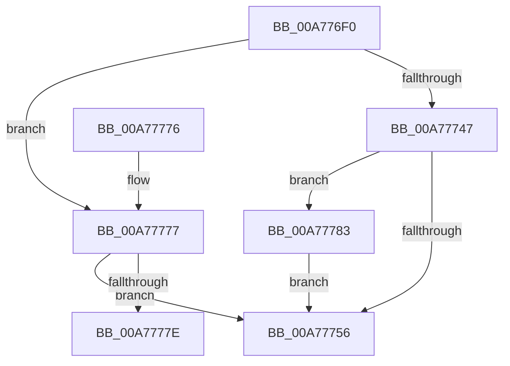

# PiDmGetReferencedObjectFromProperty

- RVA: `0x00A776F0`–`0x00A77793` (길이 `163` bytes)
- VA: `0x0000000140A776F0`
- 실행 섹션: `PAGE`
- PDB 이름 있음: `예`; PDB Function 태그: `예`
- unwind 정보 RVA: `0x000B5E6C`
- 디코드: `45`개 명령, `163/163` bytes 표시
- 미해석 바이트: `0` (있으면 어셈블리에 `.byte`로 보존)

> 이 문서는 커널 이미지의 기계어와 PDB 기호를 분석해 생성했습니다. 4번과 5번은 함수 원형과 자료형을 바이너리 사용 방식에서 추정한 C 해석이며 원본 소스 복구 결과는 아닙니다.

## 1. Dependencies

- 직접 호출 지점: **3**; 고유 호출 대상: **3**
- 직접 호출자로 확인된 함수: **1**
- RIP 상대 이미지 참조: **1**

### Outgoing calls
- `0x00A7773C` → [PiDmObjectGetCachedObjectReference](../8F/PiDmObjectGetCachedObjectReference_function_008F7FB0.md) (function, `0x008F7FB0`)
- `0x00A77763` → [_security_check_cookie](../../text/6A/_security_check_cookie_function_006AC640.md) (function, `0x006AC640`)
- `0x00A77783` → [PiDmObjectRelease](../8E/PiDmObjectRelease_function_008E4F70.md) (function, `0x008E4F70`)

### Direct callers
- [PiDmObjectProcessPropertyChange](../8F/PiDmObjectProcessPropertyChange_function_008F8A48.md) at `0x008F8BE3`

### Static image references
- `0x00A776FE` → RVA `0x00E0A740` (`.data`; read)

## 2. Other-region calls and transfers

- 다른 실행 섹션으로 향하는 call: **1**
  - `0x00A77763` → [_security_check_cookie](../../text/6A/_security_check_cookie_function_006AC640.md) (`PAGE` → `.text`)
- call이 아닌 외부 분기/꼬리 이동: **1**
  - `0x00A7777E` → [sub_00B41876](../B4/Unknown_function_00B41876.md) (`tail-transfer`)

## 3. Assembly (complete function range)

```asm
00A776F0  40 53                           push rbx
00A776F2  55                              push rbp
00A776F3  56                              push rsi
00A776F4  57                              push rdi
00A776F5  41 56                           push r14
00A776F7  48 81 EC E0 00 00 00            sub rsp, 0xe0
00A776FE  48 8B 05 3B 30 39 00            mov rax, qword ptr [rip + 0x39303b]
00A77705  48 33 C4                        xor rax, rsp
00A77708  48 89 84 24 D0 00 00 00         mov qword ptr [rsp + 0xd0], rax
00A77710  48 8B B4 24 40 01 00 00         mov rsi, qword ptr [rsp + 0x140]
00A77718  48 8B EA                        mov rbp, rdx
00A7771B  4C 8B B4 24 30 01 00 00         mov r14, qword ptr [rsp + 0x130]
00A77723  8B F9                           mov edi, ecx
00A77725  83 64 24 60 00                  and dword ptr [rsp + 0x60], 0
00A7772A  4D 8B CE                        mov r9, r14
00A7772D  48 83 64 24 68 00               and qword ptr [rsp + 0x68], 0
00A77733  48 83 26 00                     and qword ptr [rsi], 0
00A77737  48 89 74 24 20                  mov qword ptr [rsp + 0x20], rsi
00A7773C  E8 6F 08 E8 FF                  call 0x1408f7fb0
00A77741  8B D8                           mov ebx, eax
00A77743  85 C0                           test eax, eax
00A77745  78 30                           js 0x140a77777
00A77747  48 8B 0E                        mov rcx, qword ptr [rsi]
00A7774A  8B 94 24 38 01 00 00            mov edx, dword ptr [rsp + 0x138]
00A77751  39 51 1C                        cmp dword ptr [rcx + 0x1c], edx
00A77754  75 2D                           jne 0x140a77783
00A77756  8B C3                           mov eax, ebx
00A77758  48 8B 8C 24 D0 00 00 00         mov rcx, qword ptr [rsp + 0xd0]
00A77760  48 33 CC                        xor rcx, rsp
00A77763  E8 D8 4E C3 FF                  call 0x1406ac640
00A77768  48 81 C4 E0 00 00 00            add rsp, 0xe0
00A7776F  41 5E                           pop r14
00A77771  5F                              pop rdi
00A77772  5E                              pop rsi
00A77773  5D                              pop rbp
00A77774  5B                              pop rbx
00A77775  C3                              ret
00A77776  CC                              int3
00A77777  3D 16 00 00 C0                  cmp eax, 0xc0000016
00A7777C  75 D8                           jne 0x140a77756
00A7777E  E9 F3 A0 0C 00                  jmp 0x140b41876
00A77783  E8 E8 D7 E6 FF                  call 0x1408e4f70
00A77788  48 83 26 00                     and qword ptr [rsi], 0
00A7778C  BB 34 00 00 C0                  mov ebx, 0xc0000034
00A77791  EB C3                           jmp 0x140a77756
```

## 4. C-style interpretation (structured pseudocode)

```c
__int64 __fastcall PiDmGetReferencedObjectFromProperty(int a1, __int64 a2, __int64 a3, __int64 a4, __int64 a5, unsigned int a6, __int64 a7)
{
    __int64 result;
    __int64 v_rsp;
    unsigned __int64 v_stack_m38;
    unsigned __int64 v_stack_mA0;
    unsigned int v_stack_mA8;
    unsigned __int64 v_stack_mE8;

    v_rsp = (v_rsp) - (224);
    result = (*(unsigned __int64 *)(v_rip + 3747899)) ^ (v_rsp);
    v_stack_m38 = result;
    v_stack_mE8 = a7;
    result = PiDmObjectGetCachedObjectReference(a1, a2, a3, a5);
    if (sign_flag) goto loc_00A77777;
    if ((*(unsigned int *)(*(unsigned __int64 *)(a7) + 28)) != ((unsigned int)((unsigned int)(a6)))) goto loc_00A77783;
loc_00A77756:
    a1 = (v_stack_m38) ^ (v_rsp);
    result = _security_check_cookie(a1, (unsigned int)(a6), a3, a5);
    v_rsp = (v_rsp) + (224);
    return result;
loc_00A77777:
    if (((unsigned int)(result)) != 0xC0000016ULL) goto loc_00A77756;
loc_00A77783:
    result = PiDmObjectRelease(a1, (unsigned int)(a6), a3, a5);
    goto loc_00A77756;
}
```

## 5. (Beta) C Style

```c
int64_t PiDmGetReferencedObjectFromProperty(int32_t Arg1, int64_t Arg2, int64_t Arg3, int64_t Arg4, int64_t Arg5, uint32_t Arg6, void *Arg7)
{
    uint8_t *arg7 = (uint8_t *)Arg7;

    int64_t result;
    int64_t local_rsp;
    uint64_t v_stack_m38;
    uint64_t v_stack_mA0;
    uint32_t v_stack_mA8;
    uint64_t v_stack_mE8;

    local_rsp = (local_rsp) - (224);
    result = (*(uint64_t *)(v_rip + 0x39303B)) ^ (local_rsp);
    v_stack_m38 = result;
    v_stack_mE8 = Arg7;
    result = PiDmObjectGetCachedObjectReference(Arg1, Arg2, Arg3, Arg5);
    if (sign_flag) goto loc_00A77777;
    if ((*(uint32_t *)(*(uint64_t *)(arg7) + 0x1C)) != ((uint32_t)((uint32_t)(Arg6)))) goto loc_00A77783;
loc_00A77756:
    Arg1 = (v_stack_m38) ^ (local_rsp);
    result = _security_check_cookie(Arg1, (uint32_t)(Arg6), Arg3, Arg5);
    local_rsp = (local_rsp) + (224);
    return result;
loc_00A77777:
    if (((uint32_t)(result)) != 0xC0000016ULL) goto loc_00A77756;
loc_00A77783:
    result = PiDmObjectRelease(Arg1, (uint32_t)(Arg6), Arg3, Arg5);
    goto loc_00A77756;
}
```

### 관측된 메모리 오프셋

구조체 형식이 확인되지 않은 접근은 인자 기준의 오프셋으로만 기록했습니다.

| 기준 인자 | 오프셋 표현 | 폭 (bit) | 접근 |
|---|---:|---:|---|
| `Arg7` | `+ 0x0` | `64` | `R` |
| `Arg7` | `+ 0x0` | `64` | `R/W` |

## 6. Execution-region graph

[열기: 2D/3D 그래프와 함수 탐색 컨트롤 패널](../../../control-panel.html?section=page&rva=0x00A776F0&view=graph)

- 2D 그래프는 위에서 아래로 흐르고, 3D 그래프는 빈 공간을 드래그해 회전합니다. Shift+드래그는 이동, 휠은 확대·축소, 함수 노드 선택은 대상 보고서 이동입니다.

### Static fallback


