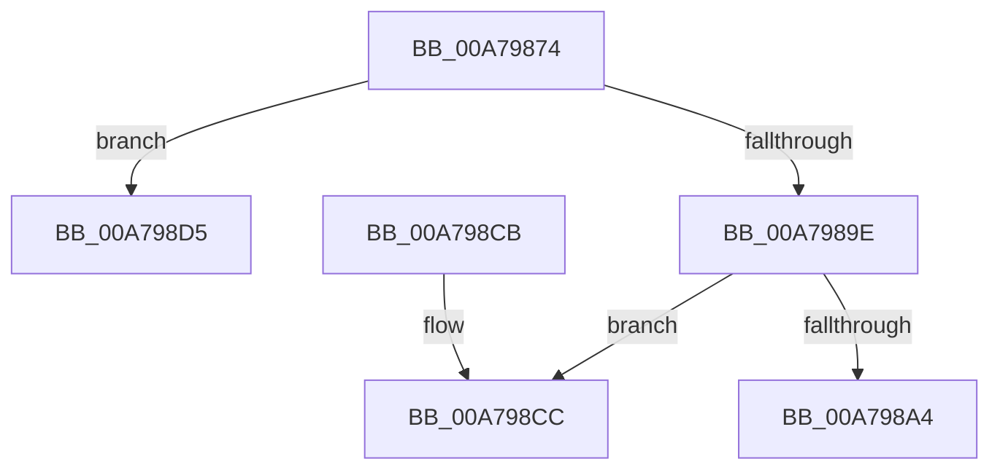

# PiPnpAddDeviceToPdoDeviceListEnumContext

- RVA: `0x00A79874`–`0x00A798DD` (길이 `105` bytes)
- VA: `0x0000000140A79874`
- 실행 섹션: `PAGE`
- PDB 이름 있음: `예`; PDB Function 태그: `예`
- unwind 정보 RVA: `0x000B6264`
- 디코드: `34`개 명령, `105/105` bytes 표시
- 미해석 바이트: `0` (있으면 어셈블리에 `.byte`로 보존)

> 이 문서는 커널 이미지의 기계어와 PDB 기호를 분석해 생성했습니다. 4번과 5번은 함수 원형과 자료형을 바이너리 사용 방식에서 추정한 C 해석이며 원본 소스 복구 결과는 아닙니다.

## 1. Dependencies

- 직접 호출 지점: **0**; 고유 호출 대상: **0**
- 직접 호출자로 확인된 함수: **1**
- RIP 상대 이미지 참조: **0**

### Outgoing calls
- 직접 디코드된 call 명령이 없습니다.

### Direct callers
- [PiPnpPdoDeviceListEnumCallback](PiPnpPdoDeviceListEnumCallback_function_00A79830.md) at `0x00A79847`

### Static image references
- 디코드된 RIP-relative 메모리 참조가 없습니다.

## 2. Other-region calls and transfers

- 다른 실행 섹션으로 향하는 call: **0**
- call이 아닌 외부 분기/꼬리 이동: **2**
  - `0x00A798D0` → [sub_00B41E9E](../B4/Unknown_function_00B41E9E.md) (`tail-transfer`)
  - `0x00A798D8` → [sub_00B41E9E](../B4/Unknown_function_00B41E9E.md) (`tail-transfer`)

## 3. Assembly (complete function range)

```asm
00A79874  48 89 5C 24 08                  mov qword ptr [rsp + 8], rbx
00A79879  48 89 6C 24 10                  mov qword ptr [rsp + 0x10], rbp
00A7987E  48 89 74 24 18                  mov qword ptr [rsp + 0x18], rsi
00A79883  57                              push rdi
00A79884  41 56                           push r14
00A79886  41 57                           push r15
00A79888  48 83 EC 20                     sub rsp, 0x20
00A7988C  48 8D 79 08                     lea rdi, [rcx + 8]
00A79890  4C 8B FA                        mov r15, rdx
00A79893  48 8B 1F                        mov rbx, qword ptr [rdi]
00A79896  48 8B F1                        mov rsi, rcx
00A79899  48 85 DB                        test rbx, rbx
00A7989C  74 37                           je 0x140a798d5
00A7989E  8B 01                           mov eax, dword ptr [rcx]
00A798A0  39 03                           cmp dword ptr [rbx], eax
00A798A2  74 28                           je 0x140a798cc
00A798A4  8B 03                           mov eax, dword ptr [rbx]
00A798A6  4C 89 7C C3 08                  mov qword ptr [rbx + rax*8 + 8], r15
00A798AB  48 8B 07                        mov rax, qword ptr [rdi]
00A798AE  FF 00                           inc dword ptr [rax]
00A798B0  33 C0                           xor eax, eax
00A798B2  48 8B 5C 24 40                  mov rbx, qword ptr [rsp + 0x40]
00A798B7  48 8B 6C 24 48                  mov rbp, qword ptr [rsp + 0x48]
00A798BC  48 8B 74 24 50                  mov rsi, qword ptr [rsp + 0x50]
00A798C1  48 83 C4 20                     add rsp, 0x20
00A798C5  41 5F                           pop r15
00A798C7  41 5E                           pop r14
00A798C9  5F                              pop rdi
00A798CA  C3                              ret
00A798CB  CC                              int3
00A798CC  48 8D 69 08                     lea rbp, [rcx + 8]
00A798D0  E9 C9 85 0C 00                  jmp 0x140b41e9e
00A798D5  48 8B EF                        mov rbp, rdi
00A798D8  E9 C1 85 0C 00                  jmp 0x140b41e9e
```

## 4. C-style interpretation (structured pseudocode)

```c
__int64 __fastcall PiPnpAddDeviceToPdoDeviceListEnumContext(__int64 a1, __int64 a2)
{
    __int64 result;
    __int64 v_rsp;
    unsigned __int64 v_stack_p10;
    unsigned __int64 v_stack_p18;
    unsigned __int64 v_stack_p8;

    v_stack_p8 = v_rbx;
    v_stack_p10 = v_rbp;
    v_stack_p18 = v_rsi;
    v_rsp = (v_rsp) - (32);
    if (*(unsigned __int64 *)(a1 + 8) == 0) goto loc_00A798D5;
    if ((*(unsigned int *)(*(unsigned __int64 *)(a1 + 8))) == ((unsigned int)((unsigned int)(*(unsigned int *)(a1))))) goto loc_00A798CC;
    *(unsigned __int64 *)(*(unsigned __int64 *)(a1 + 8) + (unsigned int)(*(unsigned int *)(*(unsigned __int64 *)(a1 + 8))) * 8 + 8) = a2;
    result = 0;
    v_rsp = (v_rsp) + (32);
    return result;
loc_00A798CC:
loc_00A798D5:
}
```

## 5. (Beta) C Style

```c
int64_t PiPnpAddDeviceToPdoDeviceListEnumContext(void *Arg1, int64_t Arg2)
{
    uint8_t *arg1 = (uint8_t *)Arg1;

    int64_t result;
    int64_t local_rsp;
    uint64_t v_stack_p10;
    uint64_t v_stack_p18;
    uint64_t v_stack_p8;

    v_stack_p8 = local_rbx;
    v_stack_p10 = local_rbp;
    v_stack_p18 = local_rsi;
    local_rsp = (local_rsp) - (32);
    if (*(uint64_t *)(arg1 + 0x8) == 0) goto loc_00A798D5;
    if ((*(uint32_t *)(*(uint64_t *)(arg1 + 0x8))) == ((uint32_t)((uint32_t)(*(uint32_t *)(arg1))))) goto loc_00A798CC;
    *(uint64_t *)(*(uint64_t *)(arg1 + 0x8) + (uint32_t)(*(uint32_t *)(*(uint64_t *)(arg1 + 0x8))) * 8 + 0x8) = Arg2;
    result = 0;
    local_rsp = (local_rsp) + (32);
    return result;
loc_00A798CC:
loc_00A798D5:
}
```

### 관측된 메모리 오프셋

구조체 형식이 확인되지 않은 접근은 인자 기준의 오프셋으로만 기록했습니다.

| 기준 인자 | 오프셋 표현 | 폭 (bit) | 접근 |
|---|---:|---:|---|
| `Arg1` | `+ 0x0` | `32` | `R` |
| `Arg1` | `+ 0x0` | `64` | `R` |
| `Arg1` | `+ 0x8` | `64` | `R` |

## 6. Execution-region graph

[열기: 2D/3D 그래프와 함수 탐색 컨트롤 패널](../../../control-panel.html?section=page&rva=0x00A79874&view=graph)

- 2D 그래프는 위에서 아래로 흐르고, 3D 그래프는 빈 공간을 드래그해 회전합니다. Shift+드래그는 이동, 휠은 확대·축소, 함수 노드 선택은 대상 보고서 이동입니다.

### Static fallback


