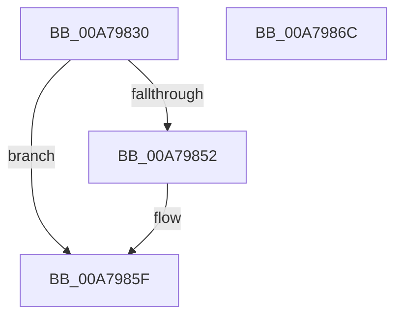

# PiPnpPdoDeviceListEnumCallback

- RVA: `0x00A79830`–`0x00A7986D` (길이 `61` bytes)
- VA: `0x0000000140A79830`
- 실행 섹션: `PAGE`
- PDB 이름 있음: `예`; PDB Function 태그: `아니요`
- unwind 정보 RVA: `0x0005CAAC`
- 디코드: `20`개 명령, `61/61` bytes 표시
- 미해석 바이트: `0` (있으면 어셈블리에 `.byte`로 보존)

> 이 문서는 커널 이미지의 기계어와 PDB 기호를 분석해 생성했습니다. 4번과 5번은 함수 원형과 자료형을 바이너리 사용 방식에서 추정한 C 해석이며 원본 소스 복구 결과는 아닙니다.

## 1. Dependencies

- 직접 호출 지점: **2**; 고유 호출 대상: **2**
- 직접 호출자로 확인된 함수: **0**
- RIP 상대 이미지 참조: **0**

### Outgoing calls
- `0x00A79847` → [PiPnpAddDeviceToPdoDeviceListEnumContext](PiPnpAddDeviceToPdoDeviceListEnumContext_function_00A79874.md) (function, `0x00A79874`)
- `0x00A7985A` → [ObfReferenceObjectWithTag](../../text/21/ObfReferenceObjectWithTag_function_00210710.md) (function, `0x00210710`)

### Direct callers
- 이 함수 시작 RVA로 연결되는 직접 call은 확인되지 않았습니다. 간접 호출은 완전히 역산할 수 없습니다.

### Static image references
- 디코드된 RIP-relative 메모리 참조가 없습니다.

## 2. Other-region calls and transfers

- 다른 실행 섹션으로 향하는 call: **1**
  - `0x00A7985A` → [ObfReferenceObjectWithTag](../../text/21/ObfReferenceObjectWithTag_function_00210710.md) (`PAGE` → `.text`)
- 별도 외부 분기/꼬리 이동을 확인하지 못했습니다.

## 3. Assembly (complete function range)

```asm
00A79830  48 89 5C 24 08                  mov qword ptr [rsp + 8], rbx
00A79835  57                              push rdi
00A79836  48 83 EC 20                     sub rsp, 0x20
00A7983A  48 8B 79 20                     mov rdi, qword ptr [rcx + 0x20]
00A7983E  48 8B C2                        mov rax, rdx
00A79841  48 8B D7                        mov rdx, rdi
00A79844  48 8B C8                        mov rcx, rax
00A79847  E8 28 00 00 00                  call 0x140a79874
00A7984C  8B D8                           mov ebx, eax
00A7984E  85 C0                           test eax, eax
00A79850  78 0D                           js 0x140a7985f
00A79852  BA 50 6E 70 6C                  mov edx, 0x6c706e50
00A79857  48 8B CF                        mov rcx, rdi
00A7985A  E8 B1 6E 79 FF                  call 0x140210710
00A7985F  8B C3                           mov eax, ebx
00A79861  48 8B 5C 24 30                  mov rbx, qword ptr [rsp + 0x30]
00A79866  48 83 C4 20                     add rsp, 0x20
00A7986A  5F                              pop rdi
00A7986B  C3                              ret
00A7986C  CC                              int3
```

## 4. C-style interpretation (structured pseudocode)

```c
__int64 __fastcall PiPnpPdoDeviceListEnumCallback(__int64 a1, __int64 a2)
{
    __int64 result;
    __int64 v_rsp;
    unsigned __int64 v_stack_p8;

    v_stack_p8 = v_rbx;
    v_rsp = (v_rsp) - (32);
    result = PiPnpAddDeviceToPdoDeviceListEnumContext(a2, *(unsigned __int64 *)(a1 + 32), a3, a4);
    if (!(sign_flag)) {
        a2 = 0x6C706E50ULL;
        a1 = *(unsigned __int64 *)(a1 + 32);
        result = ObfReferenceObjectWithTag(a1, a2, a3, a4);
    }
    v_rsp = (v_rsp) + (32);
    return (unsigned int)((unsigned int)((unsigned int)((unsigned int)(result))));
}
```

## 5. (Beta) C Style

```c
int64_t PiPnpPdoDeviceListEnumCallback(void *Arg1, int64_t Arg2)
{
    uint8_t *arg1 = (uint8_t *)Arg1;

    int64_t result;
    int64_t local_rsp;
    uint64_t v_stack_p8;

    v_stack_p8 = local_rbx;
    local_rsp = (local_rsp) - (32);
    result = PiPnpAddDeviceToPdoDeviceListEnumContext(Arg2, *(uint64_t *)(arg1 + 0x20), a3, a4);
    if (!(sign_flag)) {
        Arg2 = 0x6C706E50ULL;
        Arg1 = *(uint64_t *)(arg1 + 0x20);
        result = ObfReferenceObjectWithTag(Arg1, Arg2, a3, a4);
    }
    local_rsp = (local_rsp) + (32);
    return (uint32_t)((uint32_t)((uint32_t)((uint32_t)(result))));
}
```

### 관측된 메모리 오프셋

구조체 형식이 확인되지 않은 접근은 인자 기준의 오프셋으로만 기록했습니다.

| 기준 인자 | 오프셋 표현 | 폭 (bit) | 접근 |
|---|---:|---:|---|
| `Arg1` | `+ 0x20` | `64` | `R` |

## 6. Execution-region graph

[열기: 2D/3D 그래프와 함수 탐색 컨트롤 패널](../../../control-panel.html?section=page&rva=0x00A79830&view=graph)

- 2D 그래프는 위에서 아래로 흐르고, 3D 그래프는 빈 공간을 드래그해 회전합니다. Shift+드래그는 이동, 휠은 확대·축소, 함수 노드 선택은 대상 보고서 이동입니다.

### Static fallback


