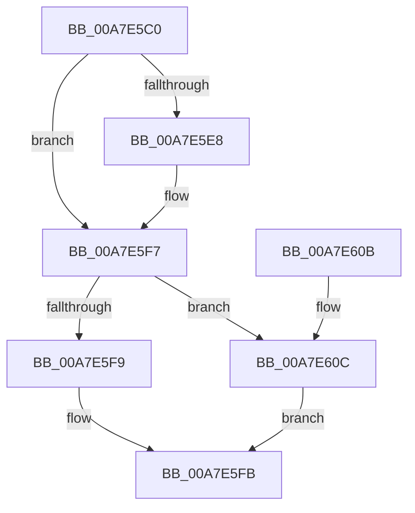

# PiSwDeviceCompareObjects

- RVA: `0x00A7E5C0`–`0x00A7E616` (길이 `86` bytes)
- VA: `0x0000000140A7E5C0`
- 실행 섹션: `PAGE`
- PDB 이름 있음: `예`; PDB Function 태그: `아니요`
- unwind 정보 RVA: `0x0005C748`
- 디코드: `28`개 명령, `86/86` bytes 표시
- 미해석 바이트: `0` (있으면 어셈블리에 `.byte`로 보존)

> 이 문서는 커널 이미지의 기계어와 PDB 기호를 분석해 생성했습니다. 4번과 5번은 함수 원형과 자료형을 바이너리 사용 방식에서 추정한 C 해석이며 원본 소스 복구 결과는 아닙니다.

## 1. Dependencies

- 직접 호출 지점: **2**; 고유 호출 대상: **1**
- 직접 호출자로 확인된 함수: **0**
- RIP 상대 이미지 참조: **0**

### Outgoing calls
- `0x00A7E5DD` → [wcsicmp](../../text/50/wcsicmp_function_00500080.md) (function, `0x00500080`)
- `0x00A7E5F0` → [wcsicmp](../../text/50/wcsicmp_function_00500080.md) (function, `0x00500080`)

### Direct callers
- 이 함수 시작 RVA로 연결되는 직접 call은 확인되지 않았습니다. 간접 호출은 완전히 역산할 수 없습니다.

### Static image references
- 디코드된 RIP-relative 메모리 참조가 없습니다.

## 2. Other-region calls and transfers

- 다른 실행 섹션으로 향하는 call: **2**
  - `0x00A7E5DD` → [wcsicmp](../../text/50/wcsicmp_function_00500080.md) (`PAGE` → `.text`)
  - `0x00A7E5F0` → [wcsicmp](../../text/50/wcsicmp_function_00500080.md) (`PAGE` → `.text`)
- 별도 외부 분기/꼬리 이동을 확인하지 못했습니다.

## 3. Assembly (complete function range)

```asm
00A7E5C0  48 89 5C 24 08                  mov qword ptr [rsp + 8], rbx
00A7E5C5  48 89 74 24 10                  mov qword ptr [rsp + 0x10], rsi
00A7E5CA  57                              push rdi
00A7E5CB  48 83 EC 20                     sub rsp, 0x20
00A7E5CF  48 8B 3A                        mov rdi, qword ptr [rdx]
00A7E5D2  49 8B 30                        mov rsi, qword ptr [r8]
00A7E5D5  48 8B 4F 10                     mov rcx, qword ptr [rdi + 0x10]
00A7E5D9  48 8B 56 10                     mov rdx, qword ptr [rsi + 0x10]
00A7E5DD  E8 9E 1A A8 FF                  call 0x140500080
00A7E5E2  33 DB                           xor ebx, ebx
00A7E5E4  85 C0                           test eax, eax
00A7E5E6  75 0F                           jne 0x140a7e5f7
00A7E5E8  48 8B 56 08                     mov rdx, qword ptr [rsi + 8]
00A7E5EC  48 8B 4F 08                     mov rcx, qword ptr [rdi + 8]
00A7E5F0  E8 8B 1A A8 FF                  call 0x140500080
00A7E5F5  85 C0                           test eax, eax
00A7E5F7  79 13                           jns 0x140a7e60c
00A7E5F9  33 C0                           xor eax, eax
00A7E5FB  48 8B 5C 24 30                  mov rbx, qword ptr [rsp + 0x30]
00A7E600  48 8B 74 24 38                  mov rsi, qword ptr [rsp + 0x38]
00A7E605  48 83 C4 20                     add rsp, 0x20
00A7E609  5F                              pop rdi
00A7E60A  C3                              ret
00A7E60B  CC                              int3
00A7E60C  85 C0                           test eax, eax
00A7E60E  0F 9E C3                        setle bl
00A7E611  8D 43 01                        lea eax, [rbx + 1]
00A7E614  EB E5                           jmp 0x140a7e5fb
```

## 4. C-style interpretation (structured pseudocode)

```c
__int64 __fastcall PiSwDeviceCompareObjects(__int64 a1, __int64 a2, __int64 a3)
{
    __int64 result;
    __int64 v_rbx;
    __int64 v_rsp;
    unsigned __int64 v_stack_p10;
    unsigned __int64 v_stack_p8;

    v_stack_p8 = v_rbx;
    v_stack_p10 = v_rsi;
    v_rsp = (v_rsp) - (32);
    result = wcsicmp(*(unsigned __int64 *)(*(unsigned __int64 *)(a2) + 16), *(unsigned __int64 *)(*(unsigned __int64 *)(a3) + 16), a3, a4);
    v_rbx = 0;
    if ((unsigned int)(result) == 0) {
        a2 = *(unsigned __int64 *)(*(unsigned __int64 *)(a3) + 8);
        a1 = *(unsigned __int64 *)(*(unsigned __int64 *)(a2) + 8);
        result = wcsicmp(a1, a2, a3, a4);
    }
    if (!sign_flag) goto loc_00A7E60C;
    result = 0;
loc_00A7E5FB:
    v_rsp = (v_rsp) + (32);
    return result;
loc_00A7E60C:
    v_rbx = (condition_is_less_or_equal) ? 1 : 0;
    goto loc_00A7E5FB;
}
```

## 5. (Beta) C Style

```c
int64_t PiSwDeviceCompareObjects(int64_t Arg1, void *Arg2, void *Arg3)
{
    uint8_t *arg2 = (uint8_t *)Arg2;
    uint8_t *arg3 = (uint8_t *)Arg3;

    int64_t result;
    int64_t local_rbx;
    int64_t local_rsp;
    uint64_t v_stack_p10;
    uint64_t v_stack_p8;

    v_stack_p8 = local_rbx;
    v_stack_p10 = local_rsi;
    local_rsp = (local_rsp) - (32);
    result = wcsicmp(*(uint64_t *)(*(uint64_t *)(arg2) + 0x10), *(uint64_t *)(*(uint64_t *)(arg3) + 0x10), Arg3, a4);
    local_rbx = 0;
    if ((uint32_t)(result) == 0) {
        Arg2 = *(uint64_t *)(*(uint64_t *)(arg3) + 0x8);
        Arg1 = *(uint64_t *)(*(uint64_t *)(arg2) + 0x8);
        result = wcsicmp(Arg1, Arg2, Arg3, a4);
    }
    if (!sign_flag) goto loc_00A7E60C;
    result = 0;
loc_00A7E5FB:
    local_rsp = (local_rsp) + (32);
    return result;
loc_00A7E60C:
    local_rbx = (condition_is_less_or_equal) ? 1 : 0;
    goto loc_00A7E5FB;
}
```

### 관측된 메모리 오프셋

구조체 형식이 확인되지 않은 접근은 인자 기준의 오프셋으로만 기록했습니다.

| 기준 인자 | 오프셋 표현 | 폭 (bit) | 접근 |
|---|---:|---:|---|
| `Arg2` | `+ 0x0` | `64` | `R` |
| `Arg3` | `+ 0x0` | `64` | `R` |

## 6. Execution-region graph

[열기: 2D/3D 그래프와 함수 탐색 컨트롤 패널](../../../control-panel.html?section=page&rva=0x00A7E5C0&view=graph)

- 2D 그래프는 위에서 아래로 흐르고, 3D 그래프는 빈 공간을 드래그해 회전합니다. Shift+드래그는 이동, 휠은 확대·축소, 함수 노드 선택은 대상 보고서 이동입니다.

### Static fallback


