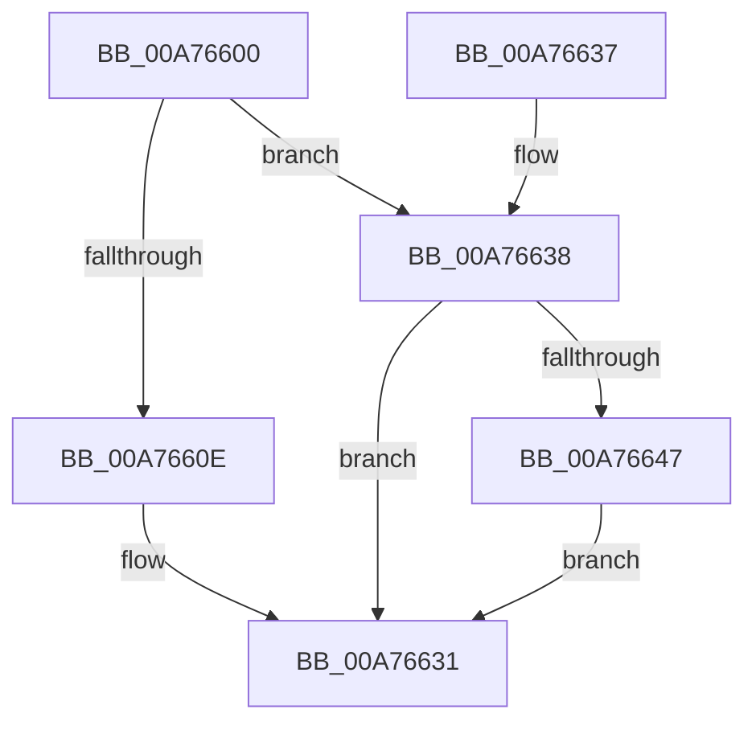

# PiUEventBroadcastDevnodesChangedEvent

- RVA: `0x00A76600`–`0x00A7667C` (길이 `124` bytes)
- VA: `0x0000000140A76600`
- 실행 섹션: `PAGE`
- PDB 이름 있음: `예`; PDB Function 태그: `아니요`
- unwind 정보 RVA: `0x000B5AE0`
- 디코드: `36`개 명령, `124/124` bytes 표시
- 미해석 바이트: `0` (있으면 어셈블리에 `.byte`로 보존)

> 이 문서는 커널 이미지의 기계어와 PDB 기호를 분석해 생성했습니다. 4번과 5번은 함수 원형과 자료형을 바이너리 사용 방식에서 추정한 C 해석이며 원본 소스 복구 결과는 아닙니다.

## 1. Dependencies

- 직접 호출 지점: **4**; 고유 호출 대상: **3**
- 직접 호출자로 확인된 함수: **1**
- RIP 상대 이미지 참조: **2**

### Outgoing calls
- `0x00A7662C` → [ZwUpdateWnfStateData](../../text/6B/ZwUpdateWnfStateData_function_006B0D10.md) (function, `0x006B0D10`)
- `0x00A76638` → [PsGetSessionById](../../text/22/PsGetSessionById_function_00225150.md) (function, `0x00225150`)
- `0x00A76668` → [ZwUpdateWnfStateData](../../text/6B/ZwUpdateWnfStateData_function_006B0D10.md) (function, `0x006B0D10`)
- `0x00A76675` → [ObfDereferenceObjectWithTag](../../text/2F/ObfDereferenceObjectWithTag_function_002F78E0.md) (function, `0x002F78E0`)

### Direct callers
- [PiUEventBroadcastEventWorker](PiUEventBroadcastEventWorker_function_00A764D0.md) at `0x00A765B9`

### Static image references
- `0x00A76610` → RVA `0x0001BA88` (`.rdata`; read)
- `0x00A7664B` → RVA `0x00020AD8` (`.rdata`; read)

## 2. Other-region calls and transfers

- 다른 실행 섹션으로 향하는 call: **4**
  - `0x00A7662C` → [ZwUpdateWnfStateData](../../text/6B/ZwUpdateWnfStateData_function_006B0D10.md) (`PAGE` → `.text`)
  - `0x00A76638` → [PsGetSessionById](../../text/22/PsGetSessionById_function_00225150.md) (`PAGE` → `.text`)
  - `0x00A76668` → [ZwUpdateWnfStateData](../../text/6B/ZwUpdateWnfStateData_function_006B0D10.md) (`PAGE` → `.text`)
  - `0x00A76675` → [ObfDereferenceObjectWithTag](../../text/2F/ObfDereferenceObjectWithTag_function_002F78E0.md) (`PAGE` → `.text`)
- 별도 외부 분기/꼬리 이동을 확인하지 못했습니다.

## 3. Assembly (complete function range)

```asm
00A76600  89 4C 24 08                     mov dword ptr [rsp + 8], ecx
00A76604  53                              push rbx
00A76605  48 83 EC 40                     sub rsp, 0x40
00A76609  83 F9 FF                        cmp ecx, -1
00A7660C  75 2A                           jne 0x140a76638
00A7660E  33 C0                           xor eax, eax
00A76610  48 8D 0D 71 54 5A FF            lea rcx, [rip - 0xa5ab8f]
00A76617  89 44 24 30                     mov dword ptr [rsp + 0x30], eax
00A7661B  45 33 C9                        xor r9d, r9d
00A7661E  89 44 24 28                     mov dword ptr [rsp + 0x28], eax
00A76622  45 33 C0                        xor r8d, r8d
00A76625  33 D2                           xor edx, edx
00A76627  48 89 44 24 20                  mov qword ptr [rsp + 0x20], rax
00A7662C  E8 DF A6 C3 FF                  call 0x1406b0d10
00A76631  48 83 C4 40                     add rsp, 0x40
00A76635  5B                              pop rbx
00A76636  C3                              ret
00A76637  CC                              int3
00A76638  E8 13 EB 7A FF                  call 0x140225150
00A7663D  48 8B D8                        mov rbx, rax
00A76640  33 C0                           xor eax, eax
00A76642  48 85 DB                        test rbx, rbx
00A76645  74 EA                           je 0x140a76631
00A76647  89 44 24 30                     mov dword ptr [rsp + 0x30], eax
00A7664B  48 8D 0D 86 A4 5A FF            lea rcx, [rip - 0xa55b7a]
00A76652  89 44 24 28                     mov dword ptr [rsp + 0x28], eax
00A76656  45 33 C9                        xor r9d, r9d
00A76659  48 8D 44 24 50                  lea rax, [rsp + 0x50]
00A7665E  45 33 C0                        xor r8d, r8d
00A76661  33 D2                           xor edx, edx
00A76663  48 89 44 24 20                  mov qword ptr [rsp + 0x20], rax
00A76668  E8 A3 A6 C3 FF                  call 0x1406b0d10
00A7666D  BA 50 73 51 79                  mov edx, 0x79517350
00A76672  48 8B CB                        mov rcx, rbx
00A76675  E8 66 12 88 FF                  call 0x1402f78e0
00A7667A  EB B5                           jmp 0x140a76631
```

## 4. C-style interpretation (structured pseudocode)

```c
__int64 __fastcall PiUEventBroadcastDevnodesChangedEvent(int a1, int a2, int a3, int a4)
{
    __int64 result;
    __int64 v_rsp;
    unsigned int v_stack_m18;
    unsigned int v_stack_m20;
    unsigned __int64 v_stack_m28;
    unsigned __int64 v_stack_p20;
    unsigned int v_stack_p28;
    unsigned int v_stack_p30;
    unsigned __int64 v_stack_p50;
    unsigned int v_stack_p8;

    v_stack_p8 = a1;
    v_rsp = (v_rsp) - (64);
    if (a1 != -1) goto loc_00A76638;
    result = 0;
    v_stack_m18 = 0;
    a4 = 0;
    v_stack_m20 = 0;
    a3 = 0;
    a2 = 0;
    v_stack_m28 = 0;
    result = ZwUpdateWnfStateData(v_rip - 10857359, a2, a3, a4);
loc_00A76631:
    v_rsp = (v_rsp) + (64);
    return result;
loc_00A76638:
    result = PsGetSessionById(v_rip - 10857359, a2, a3, a4);
    result = 0;
    if (0 == 0) goto loc_00A76631;
    v_stack_p30 = 0;
    v_stack_p28 = 0;
    a4 = 0;
    a3 = 0;
    a2 = 0;
    v_stack_p20 = v_stack_p50;
    result = ZwUpdateWnfStateData(v_rip - 10836858, a2, a3, a4);
    result = ObfDereferenceObjectWithTag(result, (unsigned int)(0x79517350ULL), a3, a4);
    goto loc_00A76631;
}
```

## 5. (Beta) C Style

```c
int64_t PiUEventBroadcastDevnodesChangedEvent(int32_t Arg1, int32_t Arg2, int32_t Arg3, int32_t Arg4)
{
    int64_t result;
    int64_t local_rsp;
    uint32_t v_stack_m18;
    uint32_t v_stack_m20;
    uint64_t v_stack_m28;
    uint64_t v_stack_p20;
    uint32_t v_stack_p28;
    uint32_t v_stack_p30;
    uint64_t v_stack_p50;
    uint32_t v_stack_p8;

    v_stack_p8 = Arg1;
    local_rsp = (local_rsp) - (64);
    if (Arg1 != -1) goto loc_00A76638;
    result = 0;
    v_stack_m18 = 0;
    Arg4 = 0;
    v_stack_m20 = 0;
    Arg3 = 0;
    Arg2 = 0;
    v_stack_m28 = 0;
    result = ZwUpdateWnfStateData(v_rip - 10857359, Arg2, Arg3, Arg4);
loc_00A76631:
    local_rsp = (local_rsp) + (64);
    return result;
loc_00A76638:
    result = PsGetSessionById(v_rip - 10857359, Arg2, Arg3, Arg4);
    result = 0;
    if (0 == 0) goto loc_00A76631;
    v_stack_p30 = 0;
    v_stack_p28 = 0;
    Arg4 = 0;
    Arg3 = 0;
    Arg2 = 0;
    v_stack_p20 = v_stack_p50;
    result = ZwUpdateWnfStateData(v_rip - 10836858, Arg2, Arg3, Arg4);
    result = ObfDereferenceObjectWithTag(result, (uint32_t)(0x79517350ULL), Arg3, Arg4);
    goto loc_00A76631;
}
```

## 6. Execution-region graph

[열기: 2D/3D 그래프와 함수 탐색 컨트롤 패널](../../../control-panel.html?section=page&rva=0x00A76600&view=graph)

- 2D 그래프는 위에서 아래로 흐르고, 3D 그래프는 빈 공간을 드래그해 회전합니다. Shift+드래그는 이동, 휠은 확대·축소, 함수 노드 선택은 대상 보고서 이동입니다.

### Static fallback


