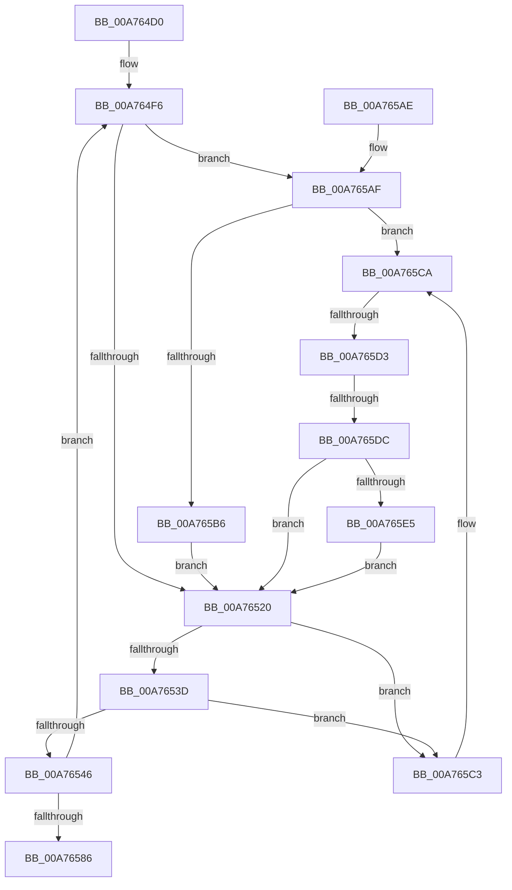

# PiUEventBroadcastEventWorker

- RVA: `0x00A764D0`–`0x00A765FA` (길이 `298` bytes)
- VA: `0x0000000140A764D0`
- 실행 섹션: `PAGE`
- PDB 이름 있음: `예`; PDB Function 태그: `예`
- unwind 정보 RVA: `0x000B5AB4`
- 디코드: `69`개 명령, `298/298` bytes 표시
- 미해석 바이트: `0` (있으면 어셈블리에 `.byte`로 보존)

> 이 문서는 커널 이미지의 기계어와 PDB 기호를 분석해 생성했습니다. 4번과 5번은 함수 원형과 자료형을 바이너리 사용 방식에서 추정한 C 해석이며 원본 소스 복구 결과는 아닙니다.

## 1. Dependencies

- 직접 호출 지점: **8**; 고유 호출 대상: **5**
- 직접 호출자로 확인된 함수: **0**
- RIP 상대 이미지 참조: **3**

### Outgoing calls
- `0x00A764FD` → [ExAcquireFastMutex](../../text/20/ExAcquireFastMutex_function_0020E5A0.md) (function, `0x0020E5A0`)
- `0x00A76513` → [ExReleaseFastMutex](../../text/25/ExReleaseFastMutex_function_002519C0.md) (function, `0x002519C0`)
- `0x00A76527` → [ExAcquireFastMutex](../../text/20/ExAcquireFastMutex_function_0020E5A0.md) (function, `0x0020E5A0`)
- `0x00A7656B` → [ExReleaseFastMutex](../../text/25/ExReleaseFastMutex_function_002519C0.md) (function, `0x002519C0`)
- `0x00A76578` → [ExFreePoolWithTag](../../poolcode/B8/ExFreePoolWithTag_function_00B82870.md) (function, `0x00B82870`)
- `0x00A7658E` → [ExFreePoolWithTag](../../poolcode/B8/ExFreePoolWithTag_function_00B82870.md) (function, `0x00B82870`)
- `0x00A765B9` → [PiUEventBroadcastDevnodesChangedEvent](PiUEventBroadcastDevnodesChangedEvent_function_00A76600.md) (function, `0x00A76600`)
- `0x00A765F0` → [PiUEventBroadcastPortsChangedEvent](../72/PiUEventBroadcastPortsChangedEvent_function_0072DDA8.md) (function, `0x0072DDA8`)

### Direct callers
- 이 함수 시작 RVA로 연결되는 직접 call은 확인되지 않았습니다. 간접 호출은 완전히 역산할 수 없습니다.

### Static image references
- `0x00A764EC` → RVA `0x00F8CAE0` (`.data`; read)
- `0x00A764F6` → RVA `0x00F8CA40` (`.data`; read)
- `0x00A76546` → RVA `0x00F8CAE0` (`.data`; write)

## 2. Other-region calls and transfers

- 다른 실행 섹션으로 향하는 call: **6**
  - `0x00A764FD` → [ExAcquireFastMutex](../../text/20/ExAcquireFastMutex_function_0020E5A0.md) (`PAGE` → `.text`)
  - `0x00A76513` → [ExReleaseFastMutex](../../text/25/ExReleaseFastMutex_function_002519C0.md) (`PAGE` → `.text`)
  - `0x00A76527` → [ExAcquireFastMutex](../../text/20/ExAcquireFastMutex_function_0020E5A0.md) (`PAGE` → `.text`)
  - `0x00A7656B` → [ExReleaseFastMutex](../../text/25/ExReleaseFastMutex_function_002519C0.md) (`PAGE` → `.text`)
  - `0x00A76578` → [ExFreePoolWithTag](../../poolcode/B8/ExFreePoolWithTag_function_00B82870.md) (`PAGE` → `POOLCODE`)
  - `0x00A7658E` → [ExFreePoolWithTag](../../poolcode/B8/ExFreePoolWithTag_function_00B82870.md) (`PAGE` → `POOLCODE`)
- call이 아닌 외부 분기/꼬리 이동: **2**
  - `0x00A765CD` → [sub_00B413CC + 0x12](../B4/Unknown_function_00B413CC.md) (`tail-transfer`)
  - `0x00A765D6` → [sub_00B413CC](../B4/Unknown_function_00B413CC.md) (`tail-transfer`)

## 3. Assembly (complete function range)

```asm
00A764D0  48 8B C4                        mov rax, rsp
00A764D3  48 89 58 08                     mov qword ptr [rax + 8], rbx
00A764D7  48 89 68 10                     mov qword ptr [rax + 0x10], rbp
00A764DB  48 89 70 18                     mov qword ptr [rax + 0x18], rsi
00A764DF  48 89 78 20                     mov qword ptr [rax + 0x20], rdi
00A764E3  41 54                           push r12
00A764E5  48 83 EC 20                     sub rsp, 0x20
00A764E9  48 8B E9                        mov rbp, rcx
00A764EC  4C 8D 25 ED 65 51 00            lea r12, [rip + 0x5165ed]
00A764F3  40 32 F6                        xor sil, sil
00A764F6  48 8D 0D 43 65 51 00            lea rcx, [rip + 0x516543]
00A764FD  E8 9E 80 79 FF                  call 0x14020e5a0
00A76502  48 8B 3D D7 65 51 00            mov rdi, qword ptr [rip + 0x5165d7]
00A76509  48 8D 0D 30 65 51 00            lea rcx, [rip + 0x516530]
00A76510  8A 5F 10                        mov bl, byte ptr [rdi + 0x10]
00A76513  E8 A8 B4 7D FF                  call 0x1402519c0
00A76518  84 DB                           test bl, bl
00A7651A  0F 85 8F 00 00 00               jne 0x140a765af
00A76520  48 8D 0D 19 65 51 00            lea rcx, [rip + 0x516519]
00A76527  E8 74 80 79 FF                  call 0x14020e5a0
00A7652C  48 8B 05 AD 65 51 00            mov rax, qword ptr [rip + 0x5165ad]
00A76533  4C 39 60 08                     cmp qword ptr [rax + 8], r12
00A76537  0F 85 86 00 00 00               jne 0x140a765c3
00A7653D  48 8B 08                        mov rcx, qword ptr [rax]
00A76540  48 39 41 08                     cmp qword ptr [rcx + 8], rax
00A76544  75 7D                           jne 0x140a765c3
00A76546  48 89 0D 93 65 51 00            mov qword ptr [rip + 0x516593], rcx
00A7654D  B8 01 00 00 00                  mov eax, 1
00A76552  4C 89 61 08                     mov qword ptr [rcx + 8], r12
00A76556  48 8D 0D E3 64 51 00            lea rcx, [rip + 0x5164e3]
00A7655D  4C 39 25 7C 65 51 00            cmp qword ptr [rip + 0x51657c], r12
00A76564  40 0F B6 F6                     movzx esi, sil
00A76568  0F 44 F0                        cmove esi, eax
00A7656B  E8 50 B4 7D FF                  call 0x1402519c0
00A76570  BA 50 6E 70 59                  mov edx, 0x59706e50
00A76575  48 8B CF                        mov rcx, rdi
00A76578  E8 F3 C2 10 00                  call 0x140b82870
00A7657D  40 84 F6                        test sil, sil
00A76580  0F 84 70 FF FF FF               je 0x140a764f6
00A76586  BA 50 6E 70 59                  mov edx, 0x59706e50
00A7658B  48 8B CD                        mov rcx, rbp
00A7658E  E8 DD C2 10 00                  call 0x140b82870
00A76593  48 8B 5C 24 30                  mov rbx, qword ptr [rsp + 0x30]
00A76598  48 8B 6C 24 38                  mov rbp, qword ptr [rsp + 0x38]
00A7659D  48 8B 74 24 40                  mov rsi, qword ptr [rsp + 0x40]
00A765A2  48 8B 7C 24 48                  mov rdi, qword ptr [rsp + 0x48]
00A765A7  48 83 C4 20                     add rsp, 0x20
00A765AB  41 5C                           pop r12
00A765AD  C3                              ret
00A765AE  CC                              int3
00A765AF  8B 4F 14                        mov ecx, dword ptr [rdi + 0x14]
00A765B2  85 C9                           test ecx, ecx
00A765B4  75 14                           jne 0x140a765ca
00A765B6  8B 4F 18                        mov ecx, dword ptr [rdi + 0x18]
00A765B9  E8 42 00 00 00                  call 0x140a76600
00A765BE  E9 5D FF FF FF                  jmp 0x140a76520
00A765C3  B9 03 00 00 00                  mov ecx, 3
00A765C8  CD 29                           int 0x29
00A765CA  83 E9 01                        sub ecx, 1
00A765CD  0F 84 0B AE 0C 00               je 0x140b413de
00A765D3  83 E9 01                        sub ecx, 1
00A765D6  0F 84 F0 AD 0C 00               je 0x140b413cc
00A765DC  83 F9 01                        cmp ecx, 1
00A765DF  0F 85 3B FF FF FF               jne 0x140a76520
00A765E5  8B 4F 18                        mov ecx, dword ptr [rdi + 0x18]
00A765E8  4C 8D 47 2C                     lea r8, [rdi + 0x2c]
00A765EC  48 8D 57 1C                     lea rdx, [rdi + 0x1c]
00A765F0  E8 B3 77 CB FF                  call 0x14072dda8
00A765F5  E9 26 FF FF FF                  jmp 0x140a76520
```

## 4. C-style interpretation (structured pseudocode)

```c
__int64 __fastcall PiUEventBroadcastEventWorker(__int64 a1)
{
    __int64 result;
    __int64 v_rsi;
    __int64 v_rsp;
    unsigned __int64 v_stack_p10;
    unsigned __int64 v_stack_p18;
    unsigned __int64 v_stack_p20;
    unsigned __int64 v_stack_p8;

    *(unsigned __int64 *)(v_rsp + 8) = v_rbx;
    *(unsigned __int64 *)(v_rsp + 16) = v_rbp;
    *(unsigned __int64 *)(v_rsp + 24) = v_rsi;
    *(unsigned __int64 *)(v_rsp + 32) = v_rdi;
    v_rsp = (v_rsp) - (32);
    v_rsi = 0;
loc_00A764F6:
    result = ExAcquireFastMutex(v_rip + 5334339, a2, a3, a4);
    result = ExReleaseFastMutex(v_rip + 5334320, a2, a3, a4);
    if ((unsigned __int8)(*(unsigned __int8 *)(*(unsigned __int64 *)(v_rip + 5334487) + 16)) != 0) goto loc_00A765AF;
loc_00A76520:
    result = ExAcquireFastMutex(v_rip + 5334297, a2, a3, a4);
    if ((*(unsigned __int64 *)(*(unsigned __int64 *)(v_rip + 5334445) + 8)) != (v_rip + 5334509)) goto loc_00A765C3;
    if ((*(unsigned __int64 *)(*(unsigned __int64 *)(*(unsigned __int64 *)(v_rip + 5334445)) + 8)) != (*(unsigned __int64 *)(v_rip + 5334445))) goto loc_00A765C3;
    *(unsigned __int64 *)(v_rip + 5334419) = *(unsigned __int64 *)(*(unsigned __int64 *)(v_rip + 5334445));
    *(unsigned __int64 *)(*(unsigned __int64 *)(*(unsigned __int64 *)(v_rip + 5334445)) + 8) = v_rip + 5334509;
    v_rsi = 0;
    if ((*(unsigned __int64 *)(v_rip + 5334396)) == (v_rip + 5334509)) { v_rsi = 1; }
    result = ExReleaseFastMutex(v_rip + 5334243, a2, a3, a4);
    result = ExFreePoolWithTag(*(unsigned __int64 *)(v_rip + 5334487), (unsigned int)(0x59706E50ULL), a3, a4);
    if ((unsigned __int8)(v_rsi) == 0) goto loc_00A764F6;
    result = ExFreePoolWithTag(a1, (unsigned int)(0x59706E50ULL), a3, a4);
    v_rsp = (v_rsp) + (32);
    return result;
loc_00A765AF:
    if ((unsigned int)((unsigned int)(*(unsigned int *)(v_stack_p20 + 20))) != 0) goto loc_00A765CA;
    result = PiUEventBroadcastDevnodesChangedEvent((unsigned int)(*(unsigned int *)(v_stack_p20 + 24)), (unsigned int)(0x59706E50ULL), a3, a4);
    goto loc_00A76520;
loc_00A765C3:
loc_00A765CA:
    a1 = (unsigned int)((3) - (1));
    a1 = (unsigned int)((a1) - (1));
    if (((unsigned int)(a1)) != 1) goto loc_00A76520;
    result = PiUEventBroadcastPortsChangedEvent((unsigned int)(*(unsigned int *)(v_stack_p20 + 24)), v_stack_p20 + 28, v_stack_p20 + 44, a4);
    goto loc_00A76520;
}
```

## 5. (Beta) C Style

```c
int64_t PiUEventBroadcastEventWorker(int64_t Arg1)
{
    int64_t result;
    int64_t local_rsi;
    int64_t local_rsp;
    uint64_t v_stack_p10;
    uint64_t v_stack_p18;
    uint64_t v_stack_p20;
    uint64_t v_stack_p8;

    *(uint64_t *)(local_rsp + 0x8) = local_rbx;
    *(uint64_t *)(local_rsp + 0x10) = local_rbp;
    *(uint64_t *)(local_rsp + 0x18) = local_rsi;
    *(uint64_t *)(local_rsp + 0x20) = local_rdi;
    local_rsp = (local_rsp) - (32);
    local_rsi = 0;
loc_00A764F6:
    result = ExAcquireFastMutex(v_rip + 5334339, a2, a3, a4);
    result = ExReleaseFastMutex(v_rip + 5334320, a2, a3, a4);
    if ((uint8_t)(*(uint8_t *)(*(uint64_t *)(v_rip + 0x5165D7) + 0x10)) != 0) goto loc_00A765AF;
loc_00A76520:
    result = ExAcquireFastMutex(v_rip + 5334297, a2, a3, a4);
    if ((*(uint64_t *)(*(uint64_t *)(v_rip + 0x5165AD) + 0x8)) != (v_rip + 5334509)) goto loc_00A765C3;
    if ((*(uint64_t *)(*(uint64_t *)(*(uint64_t *)(v_rip + 0x5165AD)) + 0x8)) != (*(uint64_t *)(v_rip + 0x5165AD))) goto loc_00A765C3;
    *(uint64_t *)(v_rip + 0x516593) = *(uint64_t *)(*(uint64_t *)(v_rip + 0x5165AD));
    *(uint64_t *)(*(uint64_t *)(*(uint64_t *)(v_rip + 0x5165AD)) + 0x8) = v_rip + 5334509;
    local_rsi = 0;
    if ((*(uint64_t *)(v_rip + 0x51657C)) == (v_rip + 5334509)) { local_rsi = 1; }
    result = ExReleaseFastMutex(v_rip + 5334243, a2, a3, a4);
    result = ExFreePoolWithTag(*(uint64_t *)(v_rip + 0x5165D7), (uint32_t)(0x59706E50ULL), a3, a4);
    if ((uint8_t)(local_rsi) == 0) goto loc_00A764F6;
    result = ExFreePoolWithTag(Arg1, (uint32_t)(0x59706E50ULL), a3, a4);
    local_rsp = (local_rsp) + (32);
    return result;
loc_00A765AF:
    if ((uint32_t)((uint32_t)(*(uint32_t *)(v_stack_p20 + 0x14))) != 0) goto loc_00A765CA;
    result = PiUEventBroadcastDevnodesChangedEvent((uint32_t)(*(uint32_t *)(v_stack_p20 + 0x18)), (uint32_t)(0x59706E50ULL), a3, a4);
    goto loc_00A76520;
loc_00A765C3:
loc_00A765CA:
    Arg1 = (uint32_t)((3) - (1));
    Arg1 = (uint32_t)((Arg1) - (1));
    if (((uint32_t)(Arg1)) != 1) goto loc_00A76520;
    result = PiUEventBroadcastPortsChangedEvent((uint32_t)(*(uint32_t *)(v_stack_p20 + 0x18)), v_stack_p20 + 28, v_stack_p20 + 44, a4);
    goto loc_00A76520;
}
```

## 6. Execution-region graph

[열기: 2D/3D 그래프와 함수 탐색 컨트롤 패널](../../../control-panel.html?section=page&rva=0x00A764D0&view=graph)

- 2D 그래프는 위에서 아래로 흐르고, 3D 그래프는 빈 공간을 드래그해 회전합니다. Shift+드래그는 이동, 휠은 확대·축소, 함수 노드 선택은 대상 보고서 이동입니다.

### Static fallback


