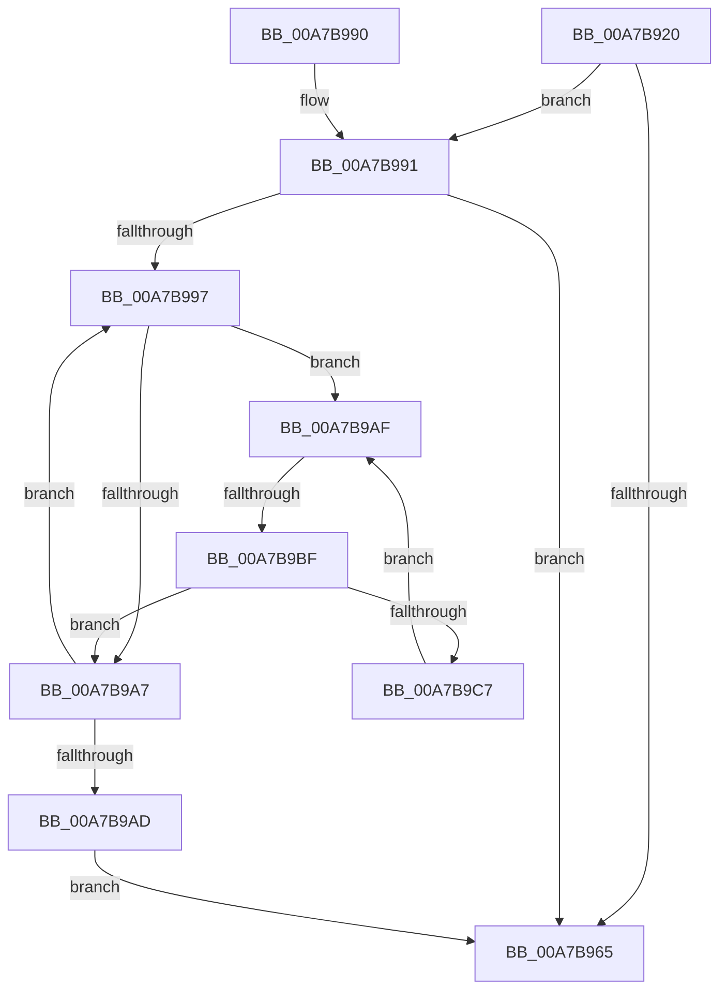

# PnpDiagRundownConnectionResourceForEachDevice

- RVA: `0x00A7B920`–`0x00A7B9C9` (길이 `169` bytes)
- VA: `0x0000000140A7B920`
- 실행 섹션: `PAGE`
- PDB 이름 있음: `예`; PDB Function 태그: `예`
- unwind 정보 RVA: `0x000B66B8`
- 디코드: `51`개 명령, `169/169` bytes 표시
- 미해석 바이트: `0` (있으면 어셈블리에 `.byte`로 보존)

> 이 문서는 커널 이미지의 기계어와 PDB 기호를 분석해 생성했습니다. 4번과 5번은 함수 원형과 자료형을 바이너리 사용 방식에서 추정한 C 해석이며 원본 소스 복구 결과는 아닙니다.

## 1. Dependencies

- 직접 호출 지점: **1**; 고유 호출 대상: **1**
- 직접 호출자로 확인된 함수: **0**
- RIP 상대 이미지 참조: **1**

### Outgoing calls
- `0x00A7B96E` → [_security_check_cookie](../../text/6A/_security_check_cookie_function_006AC640.md) (function, `0x006AC640`)

### Direct callers
- 이 함수 시작 RVA로 연결되는 직접 call은 확인되지 않았습니다. 간접 호출은 완전히 역산할 수 없습니다.

### Static image references
- `0x00A7B93F` → RVA `0x00E0A740` (`.data`; read)

## 2. Other-region calls and transfers

- 다른 실행 섹션으로 향하는 call: **1**
  - `0x00A7B96E` → [_security_check_cookie](../../text/6A/_security_check_cookie_function_006AC640.md) (`PAGE` → `.text`)
- call이 아닌 외부 분기/꼬리 이동: **1**
  - `0x00A7B9B9` → [sub_00B426A8](../B4/Unknown_function_00B426A8.md) (`tail-transfer`)

## 3. Assembly (complete function range)

```asm
00A7B920  48 8B C4                        mov rax, rsp
00A7B923  48 89 58 08                     mov qword ptr [rax + 8], rbx
00A7B927  48 89 70 10                     mov qword ptr [rax + 0x10], rsi
00A7B92B  48 89 78 18                     mov qword ptr [rax + 0x18], rdi
00A7B92F  55                              push rbp
00A7B930  41 56                           push r14
00A7B932  41 57                           push r15
00A7B934  48 8D 68 A1                     lea rbp, [rax - 0x5f]
00A7B938  48 81 EC 90 00 00 00            sub rsp, 0x90
00A7B93F  48 8B 05 FA ED 38 00            mov rax, qword ptr [rip + 0x38edfa]
00A7B946  48 33 C4                        xor rax, rsp
00A7B949  48 89 45 37                     mov qword ptr [rbp + 0x37], rax
00A7B94D  48 83 65 EF 00                  and qword ptr [rbp - 0x11], 0
00A7B952  4C 8B F9                        mov r15, rcx
00A7B955  83 65 E7 00                     and dword ptr [rbp - 0x19], 0
00A7B959  48 8B 99 A8 01 00 00            mov rbx, qword ptr [rcx + 0x1a8]
00A7B960  48 85 DB                        test rbx, rbx
00A7B963  75 2C                           jne 0x140a7b991
00A7B965  33 C0                           xor eax, eax
00A7B967  48 8B 4D 37                     mov rcx, qword ptr [rbp + 0x37]
00A7B96B  48 33 CC                        xor rcx, rsp
00A7B96E  E8 CD 0C C3 FF                  call 0x1406ac640
00A7B973  4C 8D 9C 24 90 00 00 00         lea r11, [rsp + 0x90]
00A7B97B  49 8B 5B 20                     mov rbx, qword ptr [r11 + 0x20]
00A7B97F  49 8B 73 28                     mov rsi, qword ptr [r11 + 0x28]
00A7B983  49 8B 7B 30                     mov rdi, qword ptr [r11 + 0x30]
00A7B987  49 8B E3                        mov rsp, r11
00A7B98A  41 5F                           pop r15
00A7B98C  41 5E                           pop r14
00A7B98E  5D                              pop rbp
00A7B98F  C3                              ret
00A7B990  CC                              int3
00A7B991  33 FF                           xor edi, edi
00A7B993  39 3B                           cmp dword ptr [rbx], edi
00A7B995  76 CE                           jbe 0x140a7b965
00A7B997  48 8D 0C FF                     lea rcx, [rdi + rdi*8]
00A7B99B  33 F6                           xor esi, esi
00A7B99D  4C 8D 34 8B                     lea r14, [rbx + rcx*4]
00A7B9A1  41 39 76 10                     cmp dword ptr [r14 + 0x10], esi
00A7B9A5  77 08                           ja 0x140a7b9af
00A7B9A7  FF C7                           inc edi
00A7B9A9  3B 3B                           cmp edi, dword ptr [rbx]
00A7B9AB  72 EA                           jb 0x140a7b997
00A7B9AD  EB B6                           jmp 0x140a7b965
00A7B9AF  48 8D 0C B6                     lea rcx, [rsi + rsi*4]
00A7B9B3  41 80 7C 8E 14 84               cmp byte ptr [r14 + rcx*4 + 0x14], 0x84
00A7B9B9  0F 84 E9 6C 0C 00               je 0x140b426a8
00A7B9BF  FF C6                           inc esi
00A7B9C1  41 3B 76 10                     cmp esi, dword ptr [r14 + 0x10]
00A7B9C5  73 E0                           jae 0x140a7b9a7
00A7B9C7  EB E6                           jmp 0x140a7b9af
```

## 4. C-style interpretation (structured pseudocode)

```c
__int64 __fastcall PnpDiagRundownConnectionResourceForEachDevice(__int64 a1)
{
    __int64 result;
    __int64 v_rdi;
    __int64 v_rsi;
    __int64 v_rsp;
    unsigned __int64 v_stack_m18;

    *(unsigned __int64 *)(v_rsp + 8) = v_rbx;
    *(unsigned __int64 *)(v_rsp + 16) = v_rsi;
    *(unsigned __int64 *)(v_rsp + 24) = v_rdi;
    v_rsp = (v_rsp) - (144);
    result = (*(unsigned __int64 *)(v_rip + 3730938)) ^ (v_rsp);
    *(unsigned __int64 *)(v_rsp - 95 + 55) = result;
    if (*(unsigned __int64 *)(a1 + 424) != 0) goto loc_00A7B991;
loc_00A7B965:
    result = 0;
    a1 = (*(unsigned __int64 *)(v_rsp - 95 + 55)) ^ (v_rsp);
    result = _security_check_cookie(a1, a2, a3, a4);
    return result;
loc_00A7B991:
    v_rdi = 0;
    if ((*(unsigned int *)(*(unsigned __int64 *)(v_stack_m18 + 32))) <= 0) goto loc_00A7B965;
loc_00A7B997:
    v_rsi = 0;
    if ((*(unsigned int *)(*(unsigned __int64 *)(v_stack_m18 + 32) + v_rdi + v_rdi * 8 * 4 + 16)) > 0) goto loc_00A7B9AF;
loc_00A7B9A7:
    v_rdi = (unsigned int)((v_rdi) + 1);
    if (((unsigned int)(v_rdi)) < (*(unsigned int *)(*(unsigned __int64 *)(v_stack_m18 + 32)))) goto loc_00A7B997;
    goto loc_00A7B965;
loc_00A7B9AF:
    v_rsi = (unsigned int)((v_rsi) + 1);
    if (((unsigned int)(v_rsi)) >= (*(unsigned int *)(*(unsigned __int64 *)(v_stack_m18 + 32) + v_rdi + v_rdi * 8 * 4 + 16))) goto loc_00A7B9A7;
    goto loc_00A7B9AF;
}
```

## 5. (Beta) C Style

```c
int64_t PnpDiagRundownConnectionResourceForEachDevice(void *Arg1)
{
    uint8_t *arg1 = (uint8_t *)Arg1;

    int64_t result;
    int64_t local_rdi;
    int64_t local_rsi;
    int64_t local_rsp;
    uint64_t v_stack_m18;

    *(uint64_t *)(local_rsp + 0x8) = local_rbx;
    *(uint64_t *)(local_rsp + 0x10) = local_rsi;
    *(uint64_t *)(local_rsp + 0x18) = local_rdi;
    local_rsp = (local_rsp) - (144);
    result = (*(uint64_t *)(v_rip + 0x38EDFA)) ^ (local_rsp);
    *(uint64_t *)(local_rsp - 0x5F + 0x37) = result;
    if (*(uint64_t *)(arg1 + 0x1A8) != 0) goto loc_00A7B991;
loc_00A7B965:
    result = 0;
    Arg1 = (*(uint64_t *)(local_rsp - 0x5F + 0x37)) ^ (local_rsp);
    result = _security_check_cookie(Arg1, a2, a3, a4);
    return result;
loc_00A7B991:
    local_rdi = 0;
    if ((*(uint32_t *)(*(uint64_t *)(v_stack_m18 + 0x20))) <= 0) goto loc_00A7B965;
loc_00A7B997:
    local_rsi = 0;
    if ((*(uint32_t *)(*(uint64_t *)(v_stack_m18 + 0x20) + local_rdi + local_rdi * 8 * 4 + 0x10)) > 0) goto loc_00A7B9AF;
loc_00A7B9A7:
    local_rdi = (uint32_t)((local_rdi) + 1);
    if (((uint32_t)(local_rdi)) < (*(uint32_t *)(*(uint64_t *)(v_stack_m18 + 0x20)))) goto loc_00A7B997;
    goto loc_00A7B965;
loc_00A7B9AF:
    local_rsi = (uint32_t)((local_rsi) + 1);
    if (((uint32_t)(local_rsi)) >= (*(uint32_t *)(*(uint64_t *)(v_stack_m18 + 0x20) + local_rdi + local_rdi * 8 * 4 + 0x10))) goto loc_00A7B9A7;
    goto loc_00A7B9AF;
}
```

### 관측된 메모리 오프셋

구조체 형식이 확인되지 않은 접근은 인자 기준의 오프셋으로만 기록했습니다.

| 기준 인자 | 오프셋 표현 | 폭 (bit) | 접근 |
|---|---:|---:|---|
| `Arg1` | `+ 0x1A8` | `64` | `R` |

## 6. Execution-region graph

[열기: 2D/3D 그래프와 함수 탐색 컨트롤 패널](../../../control-panel.html?section=page&rva=0x00A7B920&view=graph)

- 2D 그래프는 위에서 아래로 흐르고, 3D 그래프는 빈 공간을 드래그해 회전합니다. Shift+드래그는 이동, 휠은 확대·축소, 함수 노드 선택은 대상 보고서 이동입니다.

### Static fallback


