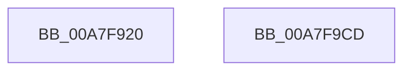

# PnpDiagRundownParentDevNodeForEachDevice

- RVA: `0x00A7F920`–`0x00A7F9CE` (길이 `174` bytes)
- VA: `0x0000000140A7F920`
- 실행 섹션: `PAGE`
- PDB 이름 있음: `예`; PDB Function 태그: `아니요`
- unwind 정보 RVA: `0x000B6E70`
- 디코드: `42`개 명령, `174/174` bytes 표시
- 미해석 바이트: `0` (있으면 어셈블리에 `.byte`로 보존)

> 이 문서는 커널 이미지의 기계어와 PDB 기호를 분석해 생성했습니다. 4번과 5번은 함수 원형과 자료형을 바이너리 사용 방식에서 추정한 C 해석이며 원본 소스 복구 결과는 아닙니다.

## 1. Dependencies

- 직접 호출 지점: **2**; 고유 호출 대상: **2**
- 직접 호출자로 확인된 함수: **0**
- RIP 상대 이미지 참조: **3**

### Outgoing calls
- `0x00A7F9B1` → [EtwWrite](../../text/41/EtwWrite_function_0041C720.md) (function, `0x0041C720`)
- `0x00A7F9BF` → [_security_check_cookie](../../text/6A/_security_check_cookie_function_006AC640.md) (function, `0x006AC640`)

### Direct callers
- 이 함수 시작 RVA로 연결되는 직접 call은 확인되지 않았습니다. 간접 호출은 완전히 역산할 수 없습니다.

### Static image references
- `0x00A7F932` → RVA `0x00E0A740` (`.data`; read)
- `0x00A7F98B` → RVA `0x00010AE8` (`.rdata`; read)
- `0x00A7F9A1` → RVA `0x00E662D0` (`.data`; read)

## 2. Other-region calls and transfers

- 다른 실행 섹션으로 향하는 call: **2**
  - `0x00A7F9B1` → [EtwWrite](../../text/41/EtwWrite_function_0041C720.md) (`PAGE` → `.text`)
  - `0x00A7F9BF` → [_security_check_cookie](../../text/6A/_security_check_cookie_function_006AC640.md) (`PAGE` → `.text`)
- 별도 외부 분기/꼬리 이동을 확인하지 못했습니다.

## 3. Assembly (complete function range)

```asm
00A7F920  48 89 4C 24 08                  mov qword ptr [rsp + 8], rcx
00A7F925  55                              push rbp
00A7F926  48 8D 6C 24 A9                  lea rbp, [rsp - 0x57]
00A7F92B  48 81 EC 90 00 00 00            sub rsp, 0x90
00A7F932  48 8B 05 07 AE 38 00            mov rax, qword ptr [rip + 0x38ae07]
00A7F939  48 33 C4                        xor rax, rsp
00A7F93C  48 89 45 47                     mov qword ptr [rbp + 0x47], rax
00A7F940  48 C7 45 0F 08 00 00 00         mov qword ptr [rbp + 0xf], 8
00A7F948  48 8D 45 67                     lea rax, [rbp + 0x67]
00A7F94C  48 89 45 07                     mov qword ptr [rbp + 7], rax
00A7F950  48 8B D1                        mov rdx, rcx
00A7F953  48 8B 41 10                     mov rax, qword ptr [rcx + 0x10]
00A7F957  45 33 C0                        xor r8d, r8d
00A7F95A  48 89 45 FF                     mov qword ptr [rbp - 1], rax
00A7F95E  48 8D 45 FF                     lea rax, [rbp - 1]
00A7F962  48 89 45 17                     mov qword ptr [rbp + 0x17], rax
00A7F966  48 C7 45 1F 08 00 00 00         mov qword ptr [rbp + 0x1f], 8
00A7F96E  0F B7 41 28                     movzx eax, word ptr [rcx + 0x28]
00A7F972  45 8D 48 04                     lea r9d, [r8 + 4]
00A7F976  D1 E8                           shr eax, 1
00A7F978  89 45 F7                        mov dword ptr [rbp - 9], eax
00A7F97B  48 8D 45 F7                     lea rax, [rbp - 9]
00A7F97F  48 89 45 27                     mov qword ptr [rbp + 0x27], rax
00A7F983  4C 89 4D 2F                     mov qword ptr [rbp + 0x2f], r9
00A7F987  48 8B 42 30                     mov rax, qword ptr [rdx + 0x30]
00A7F98B  48 8D 15 56 11 59 FF            lea rdx, [rip - 0xa6eeaa]
00A7F992  0F B7 49 28                     movzx ecx, word ptr [rcx + 0x28]
00A7F996  48 89 45 37                     mov qword ptr [rbp + 0x37], rax
00A7F99A  48 8D 45 07                     lea rax, [rbp + 7]
00A7F99E  89 4D 3F                        mov dword ptr [rbp + 0x3f], ecx
00A7F9A1  48 8B 0D 28 69 3E 00            mov rcx, qword ptr [rip + 0x3e6928]
00A7F9A8  48 89 44 24 20                  mov qword ptr [rsp + 0x20], rax
00A7F9AD  44 89 45 43                     mov dword ptr [rbp + 0x43], r8d
00A7F9B1  E8 6A CD 99 FF                  call 0x14041c720
00A7F9B6  33 C0                           xor eax, eax
00A7F9B8  48 8B 4D 47                     mov rcx, qword ptr [rbp + 0x47]
00A7F9BC  48 33 CC                        xor rcx, rsp
00A7F9BF  E8 7C CC C2 FF                  call 0x1406ac640
00A7F9C4  48 81 C4 90 00 00 00            add rsp, 0x90
00A7F9CB  5D                              pop rbp
00A7F9CC  C3                              ret
00A7F9CD  CC                              int3
```

## 4. C-style interpretation (structured pseudocode)

```c
__int64 __fastcall PnpDiagRundownParentDevNodeForEachDevice(__int64 a1, __int64 a2, int a3)
{
    __int64 result;
    __int64 v_rsp;
    unsigned __int64 v_stack_m18;
    unsigned int v_stack_m1C;
    unsigned int v_stack_m20;
    unsigned __int64 v_stack_m28;
    unsigned __int64 v_stack_m30;
    unsigned __int64 v_stack_m38;
    unsigned __int64 v_stack_m40;
    unsigned __int64 v_stack_m48;
    unsigned __int64 v_stack_m50;
    unsigned __int64 v_stack_m58;
    unsigned __int64 v_stack_m5F;
    unsigned __int64 v_stack_m60;
    unsigned int v_stack_m68;
    unsigned __int64 v_stack_m78;
    unsigned __int64 v_stack_p8;

    v_stack_p8 = a1;
    v_rsp = (v_rsp) - (144);
    result = (*(unsigned __int64 *)(v_rip + 3714567)) ^ (v_rsp);
    v_stack_m18 = result;
    v_stack_m50 = 8;
    v_stack_m58 = v_stack_p8;
    a3 = 0;
    v_stack_m60 = *(unsigned __int64 *)(a1 + 16);
    v_stack_m48 = v_stack_m60;
    v_stack_m40 = 8;
    result = (unsigned int)((*(unsigned __int16 *)(a1 + 40)) >> (1));
    v_stack_m68 = (unsigned int)(result);
    v_stack_m38 = v_stack_m68;
    v_stack_m30 = a3 + 4;
    v_stack_m28 = *(unsigned __int64 *)(a1 + 48);
    v_stack_m20 = (unsigned int)(*(unsigned __int16 *)(a1 + 40));
    v_stack_m78 = v_stack_m58;
    v_stack_m1C = 0;
    result = EtwWrite(*(unsigned __int64 *)(v_rip + 4090152), v_rip - 10940074, a3, a3 + 4);
    result = 0;
    a1 = (v_stack_m18) ^ (v_rsp);
    result = _security_check_cookie(a1, v_rip - 10940074, a3, a3 + 4);
    v_rsp = (v_rsp) + (144);
    return result;
}
```

## 5. (Beta) C Style

```c
int64_t PnpDiagRundownParentDevNodeForEachDevice(void *Arg1, int64_t Arg2, int32_t Arg3)
{
    uint8_t *arg1 = (uint8_t *)Arg1;

    int64_t result;
    int64_t local_rsp;
    uint64_t v_stack_m18;
    uint32_t v_stack_m1C;
    uint32_t v_stack_m20;
    uint64_t v_stack_m28;
    uint64_t v_stack_m30;
    uint64_t v_stack_m38;
    uint64_t v_stack_m40;
    uint64_t v_stack_m48;
    uint64_t v_stack_m50;
    uint64_t v_stack_m58;
    uint64_t v_stack_m5F;
    uint64_t v_stack_m60;
    uint32_t v_stack_m68;
    uint64_t v_stack_m78;
    uint64_t v_stack_p8;

    v_stack_p8 = Arg1;
    local_rsp = (local_rsp) - (144);
    result = (*(uint64_t *)(v_rip + 0x38AE07)) ^ (local_rsp);
    v_stack_m18 = result;
    v_stack_m50 = 8;
    v_stack_m58 = v_stack_p8;
    Arg3 = 0;
    v_stack_m60 = *(uint64_t *)(arg1 + 0x10);
    v_stack_m48 = v_stack_m60;
    v_stack_m40 = 8;
    result = (uint32_t)((*(uint16_t *)(arg1 + 0x28)) >> (1));
    v_stack_m68 = (uint32_t)(result);
    v_stack_m38 = v_stack_m68;
    v_stack_m30 = Arg3 + 4;
    v_stack_m28 = *(uint64_t *)(arg1 + 0x30);
    v_stack_m20 = (uint32_t)(*(uint16_t *)(arg1 + 0x28));
    v_stack_m78 = v_stack_m58;
    v_stack_m1C = 0;
    result = EtwWrite(*(uint64_t *)(v_rip + 0x3E6928), v_rip - 10940074, Arg3, Arg3 + 4);
    result = 0;
    Arg1 = (v_stack_m18) ^ (local_rsp);
    result = _security_check_cookie(Arg1, v_rip - 10940074, Arg3, Arg3 + 4);
    local_rsp = (local_rsp) + (144);
    return result;
}
```

### 관측된 메모리 오프셋

구조체 형식이 확인되지 않은 접근은 인자 기준의 오프셋으로만 기록했습니다.

| 기준 인자 | 오프셋 표현 | 폭 (bit) | 접근 |
|---|---:|---:|---|
| `Arg1` | `+ 0x10` | `64` | `R` |
| `Arg1` | `+ 0x28` | `16` | `R` |
| `Arg1` | `+ 0x30` | `64` | `R` |

## 6. Execution-region graph

[열기: 2D/3D 그래프와 함수 탐색 컨트롤 패널](../../../control-panel.html?section=page&rva=0x00A7F920&view=graph)

- 2D 그래프는 위에서 아래로 흐르고, 3D 그래프는 빈 공간을 드래그해 회전합니다. Shift+드래그는 이동, 휠은 확대·축소, 함수 노드 선택은 대상 보고서 이동입니다.

### Static fallback


