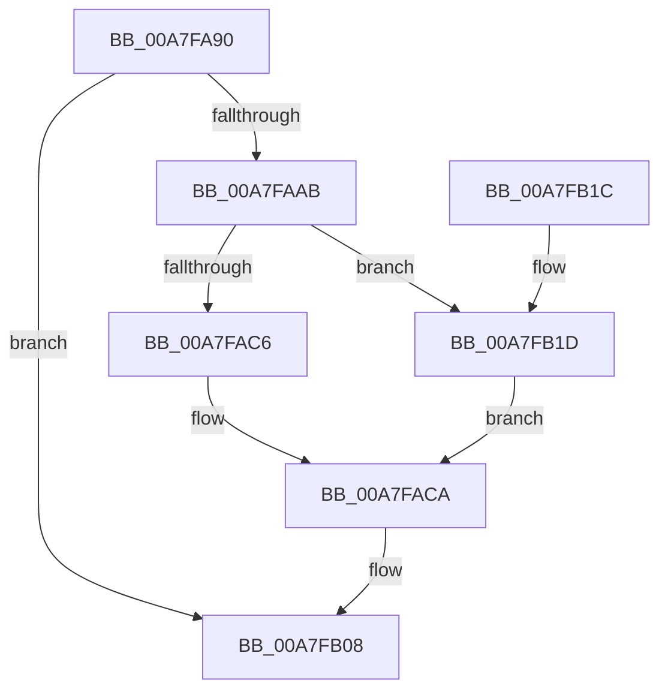

# PnpDiagRundownParentPdoForEachDevice

- RVA: `0x00A7FA90`–`0x00A7FB22` (길이 `146` bytes)
- VA: `0x0000000140A7FA90`
- 실행 섹션: `PAGE`
- PDB 이름 있음: `예`; PDB Function 태그: `아니요`
- unwind 정보 RVA: `0x000B6ED0`
- 디코드: `34`개 명령, `146/146` bytes 표시
- 미해석 바이트: `0` (있으면 어셈블리에 `.byte`로 보존)

> 이 문서는 커널 이미지의 기계어와 PDB 기호를 분석해 생성했습니다. 4번과 5번은 함수 원형과 자료형을 바이너리 사용 방식에서 추정한 C 해석이며 원본 소스 복구 결과는 아닙니다.

## 1. Dependencies

- 직접 호출 지점: **2**; 고유 호출 대상: **2**
- 직접 호출자로 확인된 함수: **0**
- RIP 상대 이미지 참조: **3**

### Outgoing calls
- `0x00A7FB03` → [EtwWrite](../../text/41/EtwWrite_function_0041C720.md) (function, `0x0041C720`)
- `0x00A7FB12` → [_security_check_cookie](../../text/6A/_security_check_cookie_function_006AC640.md) (function, `0x006AC640`)

### Direct callers
- 이 함수 시작 RVA로 연결되는 직접 call은 확인되지 않았습니다. 간접 호출은 완전히 역산할 수 없습니다.

### Static image references
- `0x00A7FA94` → RVA `0x00E0A740` (`.data`; read)
- `0x00A7FACA` → RVA `0x00E662D0` (`.data`; read)
- `0x00A7FAD1` → RVA `0x00010B08` (`.rdata`; read)

## 2. Other-region calls and transfers

- 다른 실행 섹션으로 향하는 call: **2**
  - `0x00A7FB03` → [EtwWrite](../../text/41/EtwWrite_function_0041C720.md) (`PAGE` → `.text`)
  - `0x00A7FB12` → [_security_check_cookie](../../text/6A/_security_check_cookie_function_006AC640.md) (`PAGE` → `.text`)
- 별도 외부 분기/꼬리 이동을 확인하지 못했습니다.

## 3. Assembly (complete function range)

```asm
00A7FA90  48 83 EC 68                     sub rsp, 0x68
00A7FA94  48 8B 05 A5 AC 38 00            mov rax, qword ptr [rip + 0x38aca5]
00A7FA9B  48 33 C4                        xor rax, rsp
00A7FA9E  48 89 44 24 58                  mov qword ptr [rsp + 0x58], rax
00A7FAA3  33 D2                           xor edx, edx
00A7FAA5  48 39 51 50                     cmp qword ptr [rcx + 0x50], rdx
00A7FAA9  75 5D                           jne 0x140a7fb08
00A7FAAB  48 8D 41 20                     lea rax, [rcx + 0x20]
00A7FAAF  48 C7 44 24 40 08 00 00 00      mov qword ptr [rsp + 0x40], 8
00A7FAB8  48 89 44 24 38                  mov qword ptr [rsp + 0x38], rax
00A7FABD  48 8B 41 10                     mov rax, qword ptr [rcx + 0x10]
00A7FAC1  48 85 C0                        test rax, rax
00A7FAC4  74 57                           je 0x140a7fb1d
00A7FAC6  48 8B 40 20                     mov rax, qword ptr [rax + 0x20]
00A7FACA  48 8B 0D FF 67 3E 00            mov rcx, qword ptr [rip + 0x3e67ff]
00A7FAD1  48 8D 15 30 10 59 FF            lea rdx, [rip - 0xa6efd0]
00A7FAD8  48 89 44 24 30                  mov qword ptr [rsp + 0x30], rax
00A7FADD  41 B9 02 00 00 00               mov r9d, 2
00A7FAE3  48 8D 44 24 30                  lea rax, [rsp + 0x30]
00A7FAE8  48 C7 44 24 50 08 00 00 00      mov qword ptr [rsp + 0x50], 8
00A7FAF1  48 89 44 24 48                  mov qword ptr [rsp + 0x48], rax
00A7FAF6  45 33 C0                        xor r8d, r8d
00A7FAF9  48 8D 44 24 38                  lea rax, [rsp + 0x38]
00A7FAFE  48 89 44 24 20                  mov qword ptr [rsp + 0x20], rax
00A7FB03  E8 18 CC 99 FF                  call 0x14041c720
00A7FB08  33 C0                           xor eax, eax
00A7FB0A  48 8B 4C 24 58                  mov rcx, qword ptr [rsp + 0x58]
00A7FB0F  48 33 CC                        xor rcx, rsp
00A7FB12  E8 29 CB C2 FF                  call 0x1406ac640
00A7FB17  48 83 C4 68                     add rsp, 0x68
00A7FB1B  C3                              ret
00A7FB1C  CC                              int3
00A7FB1D  48 8B C2                        mov rax, rdx
00A7FB20  EB A8                           jmp 0x140a7faca
```

## 4. C-style interpretation (structured pseudocode)

```c
__int64 __fastcall PnpDiagRundownParentPdoForEachDevice(__int64 a1, int a2, int a3)
{
    __int64 result;
    __int64 v_rsp;
    unsigned __int64 v_stack_m10;
    unsigned __int64 v_stack_m18;
    unsigned __int64 v_stack_m20;
    unsigned __int64 v_stack_m28;
    unsigned __int64 v_stack_m30;
    unsigned __int64 v_stack_m38;
    unsigned __int64 v_stack_m48;

    v_rsp = (v_rsp) - (104);
    result = (*(unsigned __int64 *)(v_rip + 3714213)) ^ (v_rsp);
    v_stack_m10 = result;
    a2 = 0;
    if ((*(unsigned __int64 *)(a1 + 80)) != 0) goto loc_00A7FB08;
    v_stack_m28 = 8;
    v_stack_m30 = a1 + 32;
    if (*(unsigned __int64 *)(a1 + 16) == 0) goto loc_00A7FB1D;
loc_00A7FACA:
    v_stack_m38 = *(unsigned __int64 *)(*(unsigned __int64 *)(a1 + 16) + 32);
    v_stack_m18 = 8;
    v_stack_m20 = v_stack_m38;
    a3 = 0;
    v_stack_m48 = v_stack_m30;
    result = EtwWrite(*(unsigned __int64 *)(v_rip + 4089855), v_rip - 10940368, a3, 2);
loc_00A7FB08:
    result = 0;
    a1 = (v_stack_m10) ^ (v_rsp);
    result = _security_check_cookie(a1, v_rip - 10940368, a3, 2);
    v_rsp = (v_rsp) + (104);
    return result;
loc_00A7FB1D:
    goto loc_00A7FACA;
}
```

## 5. (Beta) C Style

```c
int64_t PnpDiagRundownParentPdoForEachDevice(void *Arg1, int32_t Arg2, int32_t Arg3)
{
    uint8_t *arg1 = (uint8_t *)Arg1;

    int64_t result;
    int64_t local_rsp;
    uint64_t v_stack_m10;
    uint64_t v_stack_m18;
    uint64_t v_stack_m20;
    uint64_t v_stack_m28;
    uint64_t v_stack_m30;
    uint64_t v_stack_m38;
    uint64_t v_stack_m48;

    local_rsp = (local_rsp) - (104);
    result = (*(uint64_t *)(v_rip + 0x38ACA5)) ^ (local_rsp);
    v_stack_m10 = result;
    Arg2 = 0;
    if ((*(uint64_t *)(arg1 + 0x50)) != 0) goto loc_00A7FB08;
    v_stack_m28 = 8;
    v_stack_m30 = Arg1 + 32;
    if (*(uint64_t *)(arg1 + 0x10) == 0) goto loc_00A7FB1D;
loc_00A7FACA:
    v_stack_m38 = *(uint64_t *)(*(uint64_t *)(arg1 + 0x10) + 0x20);
    v_stack_m18 = 8;
    v_stack_m20 = v_stack_m38;
    Arg3 = 0;
    v_stack_m48 = v_stack_m30;
    result = EtwWrite(*(uint64_t *)(v_rip + 0x3E67FF), v_rip - 10940368, Arg3, 2);
loc_00A7FB08:
    result = 0;
    Arg1 = (v_stack_m10) ^ (local_rsp);
    result = _security_check_cookie(Arg1, v_rip - 10940368, Arg3, 2);
    local_rsp = (local_rsp) + (104);
    return result;
loc_00A7FB1D:
    goto loc_00A7FACA;
}
```

### 관측된 메모리 오프셋

구조체 형식이 확인되지 않은 접근은 인자 기준의 오프셋으로만 기록했습니다.

| 기준 인자 | 오프셋 표현 | 폭 (bit) | 접근 |
|---|---:|---:|---|
| `Arg1` | `+ 0x10` | `64` | `R` |
| `Arg1` | `+ 0x20` | `64` | `R` |
| `Arg1` | `+ 0x50` | `64` | `R` |

## 6. Execution-region graph

[열기: 2D/3D 그래프와 함수 탐색 컨트롤 패널](../../../control-panel.html?section=page&rva=0x00A7FA90&view=graph)

- 2D 그래프는 위에서 아래로 흐르고, 3D 그래프는 빈 공간을 드래그해 회전합니다. Shift+드래그는 이동, 휠은 확대·축소, 함수 노드 선택은 대상 보고서 이동입니다.

### Static fallback


