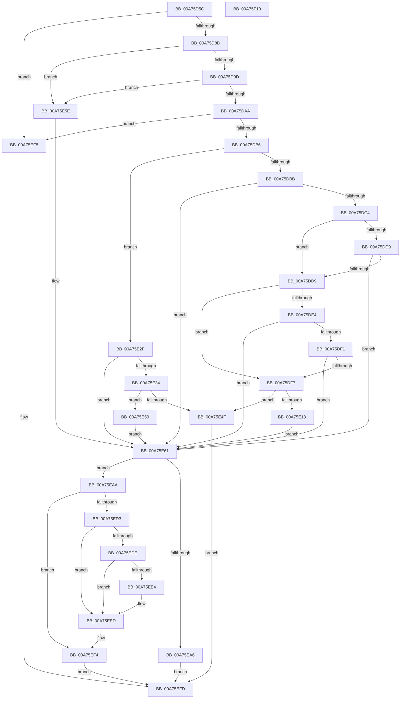

# PnpGetDeviceInstanceCsConfigFlags

- RVA: `0x00A75D5C`–`0x00A75F11` (길이 `437` bytes)
- VA: `0x0000000140A75D5C`
- 실행 섹션: `PAGE`
- PDB 이름 있음: `예`; PDB Function 태그: `아니요`
- unwind 정보 RVA: `0x000AB20C`
- 디코드: `123`개 명령, `437/437` bytes 표시
- 미해석 바이트: `0` (있으면 어셈블리에 `.byte`로 보존)

> 이 문서는 커널 이미지의 기계어와 PDB 기호를 분석해 생성했습니다. 4번과 5번은 함수 원형과 자료형을 바이너리 사용 방식에서 추정한 C 해석이며 원본 소스 복구 결과는 아닙니다.

## 1. Dependencies

- 직접 호출 지점: **8**; 고유 호출 대상: **7**
- 직접 호출자로 확인된 함수: **2**
- RIP 상대 이미지 참조: **2**

### Outgoing calls
- `0x00A75E06` → [ExAllocatePool2](../../poolcode/B8/ExAllocatePool2_function_00B820F0.md) (function, `0x00B820F0`)
- `0x00A75E1E` → [memcpy](../../text/6C/memcpy_function_006C6840.md) (function, `0x006C6840`)
- `0x00A75E42` → [ExAllocatePool2](../../poolcode/B8/ExAllocatePool2_function_00B820F0.md) (function, `0x00B820F0`)
- `0x00A75E90` → [_CmOpenDeviceRegKey](../8E/_CmOpenDeviceRegKey_function_008EE540.md) (function, `0x008EE540`)
- `0x00A75E9D` → [PnpUnicodeStringToWstrFree](../8F/PnpUnicodeStringToWstrFree_function_008F59F0.md) (function, `0x008F59F0`)
- `0x00A75EBE` → [IopGetRegistryValue](../99/IopGetRegistryValue_function_009990EC.md) (function, `0x009990EC`)
- `0x00A75ECA` → [ZwClose](../../text/6A/ZwClose_function_006AD2B0.md) (function, `0x006AD2B0`)
- `0x00A75EEF` → [ExFreePoolWithTag](../../poolcode/B8/ExFreePoolWithTag_function_00B82870.md) (function, `0x00B82870`)

### Direct callers
- [PnpIsDeviceInstanceEnabled](PnpIsDeviceInstanceEnabled_function_00A75A3C.md) at `0x00A75BCE`
- [PiCMCreateDevice](../AC/PiCMCreateDevice_function_00ACB824.md) at `0x00ACBCC9`

### Static image references
- `0x00A75E61` → RVA `0x00E66398` (`.data`; read)
- `0x00A75EB7` → RVA `0x00AFDBE0` (` ?? ::NNGAKEGL::`string'`; read)

## 2. Other-region calls and transfers

- 다른 실행 섹션으로 향하는 call: **5**
  - `0x00A75E06` → [ExAllocatePool2](../../poolcode/B8/ExAllocatePool2_function_00B820F0.md) (`PAGE` → `POOLCODE`)
  - `0x00A75E1E` → [memcpy](../../text/6C/memcpy_function_006C6840.md) (`PAGE` → `.text`)
  - `0x00A75E42` → [ExAllocatePool2](../../poolcode/B8/ExAllocatePool2_function_00B820F0.md) (`PAGE` → `POOLCODE`)
  - `0x00A75ECA` → [ZwClose](../../text/6A/ZwClose_function_006AD2B0.md) (`PAGE` → `.text`)
  - `0x00A75EEF` → [ExFreePoolWithTag](../../poolcode/B8/ExFreePoolWithTag_function_00B82870.md) (`PAGE` → `POOLCODE`)
- 별도 외부 분기/꼬리 이동을 확인하지 못했습니다.

## 3. Assembly (complete function range)

```asm
00A75D5C  48 8B C4                        mov rax, rsp
00A75D5F  48 89 58 08                     mov qword ptr [rax + 8], rbx
00A75D63  48 89 68 10                     mov qword ptr [rax + 0x10], rbp
00A75D67  56                              push rsi
00A75D68  57                              push rdi
00A75D69  41 56                           push r14
00A75D6B  48 83 EC 40                     sub rsp, 0x40
00A75D6F  33 ED                           xor ebp, ebp
00A75D71  4D 8B F0                        mov r14, r8
00A75D74  48 89 68 18                     mov qword ptr [rax + 0x18], rbp
00A75D78  48 8B F9                        mov rdi, rcx
00A75D7B  48 89 68 20                     mov qword ptr [rax + 0x20], rbp
00A75D7F  41 89 28                        mov dword ptr [r8], ebp
00A75D82  48 85 C9                        test rcx, rcx
00A75D85  0F 84 6D 01 00 00               je 0x140a75ef8
00A75D8B  0F B7 51 02                     movzx edx, word ptr [rcx + 2]
00A75D8F  44 8D 4D 02                     lea r9d, [rbp + 2]
00A75D93  66 41 3B D1                     cmp dx, r9w
00A75D97  0F 82 C1 00 00 00               jb 0x140a75e5e
00A75D9D  48 8B 59 08                     mov rbx, qword ptr [rcx + 8]
00A75DA1  48 85 DB                        test rbx, rbx
00A75DA4  0F 84 B4 00 00 00               je 0x140a75e5e
00A75DAA  0F B7 09                        movzx ecx, word ptr [rcx]
00A75DAD  66 3B CA                        cmp cx, dx
00A75DB0  0F 87 42 01 00 00               ja 0x140a75ef8
00A75DB6  66 85 C9                        test cx, cx
00A75DB9  74 74                           je 0x140a75e2f
00A75DBB  66 39 2B                        cmp word ptr [rbx], bp
00A75DBE  0F 84 9D 00 00 00               je 0x140a75e61
00A75DC4  66 3B CA                        cmp cx, dx
00A75DC7  75 10                           jne 0x140a75dd9
00A75DC9  8B C1                           mov eax, ecx
00A75DCB  48 D1 E8                        shr rax, 1
00A75DCE  66 39 6C 43 FE                  cmp word ptr [rbx + rax*2 - 2], bp
00A75DD3  0F 84 88 00 00 00               je 0x140a75e61
00A75DD9  48 8B C2                        mov rax, rdx
00A75DDC  49 2B C1                        sub rax, r9
00A75DDF  48 3B C8                        cmp rcx, rax
00A75DE2  77 13                           ja 0x140a75df7
00A75DE4  48 8B C1                        mov rax, rcx
00A75DE7  48 D1 E8                        shr rax, 1
00A75DEA  66 39 6C 43 FE                  cmp word ptr [rbx + rax*2 - 2], bp
00A75DEF  74 70                           je 0x140a75e61
00A75DF1  66 39 2C 43                     cmp word ptr [rbx + rax*2], bp
00A75DF5  74 6A                           je 0x140a75e61
00A75DF7  48 8D 51 02                     lea rdx, [rcx + 2]
00A75DFB  41 B8 50 70 73 75               mov r8d, 0x75737050
00A75E01  B9 00 01 00 00                  mov ecx, 0x100
00A75E06  E8 E5 C2 10 00                  call 0x140b820f0
00A75E0B  48 8B D8                        mov rbx, rax
00A75E0E  48 85 C0                        test rax, rax
00A75E11  74 3C                           je 0x140a75e4f
00A75E13  44 0F B7 07                     movzx r8d, word ptr [rdi]
00A75E17  48 8B C8                        mov rcx, rax
00A75E1A  48 8B 57 08                     mov rdx, qword ptr [rdi + 8]
00A75E1E  E8 1D 0A C5 FF                  call 0x1406c6840
00A75E23  0F B7 07                        movzx eax, word ptr [rdi]
00A75E26  48 D1 E8                        shr rax, 1
00A75E29  66 89 2C 43                     mov word ptr [rbx + rax*2], bp
00A75E2D  EB 32                           jmp 0x140a75e61
00A75E2F  66 39 2B                        cmp word ptr [rbx], bp
00A75E32  74 2D                           je 0x140a75e61
00A75E34  41 B8 50 70 73 75               mov r8d, 0x75737050
00A75E3A  49 8B D1                        mov rdx, r9
00A75E3D  B9 00 01 00 00                  mov ecx, 0x100
00A75E42  E8 A9 C2 10 00                  call 0x140b820f0
00A75E47  48 8B D8                        mov rbx, rax
00A75E4A  48 85 C0                        test rax, rax
00A75E4D  75 0A                           jne 0x140a75e59
00A75E4F  B8 9A 00 00 C0                  mov eax, 0xc000009a
00A75E54  E9 A4 00 00 00                  jmp 0x140a75efd
00A75E59  66 89 28                        mov word ptr [rax], bp
00A75E5C  EB 03                           jmp 0x140a75e61
00A75E5E  48 8B DD                        mov rbx, rbp
00A75E61  48 8B 0D 30 05 3F 00            mov rcx, qword ptr [rip + 0x3f0530]
00A75E68  48 8D 44 24 70                  lea rax, [rsp + 0x70]
00A75E6D  48 89 6C 24 38                  mov qword ptr [rsp + 0x38], rbp
00A75E72  45 33 C9                        xor r9d, r9d
00A75E75  48 89 44 24 30                  mov qword ptr [rsp + 0x30], rax
00A75E7A  41 B8 10 02 00 00               mov r8d, 0x210
00A75E80  40 88 6C 24 28                  mov byte ptr [rsp + 0x28], bpl
00A75E85  48 8B D3                        mov rdx, rbx
00A75E88  C7 44 24 20 19 00 02 00         mov dword ptr [rsp + 0x20], 0x20019
00A75E90  E8 AB 86 E7 FF                  call 0x1408ee540
00A75E95  48 8B D7                        mov rdx, rdi
00A75E98  48 8B CB                        mov rcx, rbx
00A75E9B  8B F0                           mov esi, eax
00A75E9D  E8 4E FB E7 FF                  call 0x1408f59f0
00A75EA2  85 F6                           test esi, esi
00A75EA4  79 04                           jns 0x140a75eaa
00A75EA6  8B C6                           mov eax, esi
00A75EA8  EB 53                           jmp 0x140a75efd
00A75EAA  48 8B 4C 24 70                  mov rcx, qword ptr [rsp + 0x70]
00A75EAF  4C 8D 4C 24 78                  lea r9, [rsp + 0x78]
00A75EB4  45 33 C0                        xor r8d, r8d
00A75EB7  48 8D 15 22 7D 08 00            lea rdx, [rip + 0x87d22]
00A75EBE  E8 29 32 F2 FF                  call 0x1409990ec
00A75EC3  48 8B 4C 24 70                  mov rcx, qword ptr [rsp + 0x70]
00A75EC8  8B D8                           mov ebx, eax
00A75ECA  E8 E1 73 C3 FF                  call 0x1406ad2b0
00A75ECF  85 DB                           test ebx, ebx
00A75ED1  78 21                           js 0x140a75ef4
00A75ED3  48 8B 4C 24 78                  mov rcx, qword ptr [rsp + 0x78]
00A75ED8  83 79 04 04                     cmp dword ptr [rcx + 4], 4
00A75EDC  75 0F                           jne 0x140a75eed
00A75EDE  83 79 0C 04                     cmp dword ptr [rcx + 0xc], 4
00A75EE2  72 09                           jb 0x140a75eed
00A75EE4  8B 41 08                        mov eax, dword ptr [rcx + 8]
00A75EE7  8B 14 08                        mov edx, dword ptr [rax + rcx]
00A75EEA  41 89 16                        mov dword ptr [r14], edx
00A75EED  33 D2                           xor edx, edx
00A75EEF  E8 7C C9 10 00                  call 0x140b82870
00A75EF4  8B C3                           mov eax, ebx
00A75EF6  EB 05                           jmp 0x140a75efd
00A75EF8  B8 0D 00 00 C0                  mov eax, 0xc000000d
00A75EFD  48 8B 5C 24 60                  mov rbx, qword ptr [rsp + 0x60]
00A75F02  48 8B 6C 24 68                  mov rbp, qword ptr [rsp + 0x68]
00A75F07  48 83 C4 40                     add rsp, 0x40
00A75F0B  41 5E                           pop r14
00A75F0D  5F                              pop rdi
00A75F0E  5E                              pop rsi
00A75F0F  C3                              ret
00A75F10  CC                              int3
```

## 4. C-style interpretation (structured pseudocode)

```c
__int64 __fastcall PnpGetDeviceInstanceCsConfigFlags(__int64 a1, __int64 a2, __int64 a3)
{
    __int64 result;
    __int64 v_rbp;
    __int64 v_rsp;
    unsigned __int64 v_stack_m20;
    unsigned __int64 v_stack_m28;
    unsigned __int8 v_stack_m30;
    unsigned int v_stack_m38;
    unsigned __int64 v_stack_p10;
    unsigned __int64 v_stack_p18;
    unsigned __int64 v_stack_p20;
    unsigned __int64 v_stack_p8;

    *(unsigned __int64 *)(v_rsp + 8) = v_rbx;
    *(unsigned __int64 *)(v_rsp + 16) = v_rbp;
    v_rsp = (v_rsp) - (64);
    v_rbp = 0;
    *(unsigned __int64 *)(v_rsp + 24) = 0;
    *(unsigned __int64 *)(v_rsp + 32) = 0;
    *(unsigned int *)(a3) = 0;
    if (a1 == 0) goto loc_00A75EF8;
    if (((unsigned __int16)(*(unsigned __int16 *)(a1 + 2))) < ((unsigned __int16)(v_rbp + 2))) goto loc_00A75E5E;
    if (*(unsigned __int64 *)(a1 + 8) == 0) goto loc_00A75E5E;
    if (((unsigned __int16)(*(unsigned __int16 *)(a1))) > ((unsigned __int16)(*(unsigned __int16 *)(a1 + 2)))) goto loc_00A75EF8;
    if ((unsigned __int16)(*(unsigned __int16 *)(a1)) == 0) goto loc_00A75E2F;
    if ((*(unsigned __int16 *)(*(unsigned __int64 *)(a1 + 8))) == 0) goto loc_00A75E61;
    if (((unsigned __int16)(*(unsigned __int16 *)(a1))) != ((unsigned __int16)(*(unsigned __int16 *)(a1 + 2)))) goto loc_00A75DD9;
    result = ((unsigned int)((unsigned int)(*(unsigned __int16 *)(a1)))) >> (1);
    if ((*(unsigned __int16 *)(*(unsigned __int64 *)(a1 + 8) + result * 2 - 2)) == 0) goto loc_00A75E61;
loc_00A75DD9:
    result = (*(unsigned __int16 *)(a1 + 2)) - (v_rbp + 2);
    if ((*(unsigned __int16 *)(a1)) > result) goto loc_00A75DF7;
    result = (*(unsigned __int16 *)(a1)) >> (1);
    if ((*(unsigned __int16 *)(*(unsigned __int64 *)(a1 + 8) + result * 2 - 2)) == 0) goto loc_00A75E61;
    if ((*(unsigned __int16 *)(*(unsigned __int64 *)(a1 + 8) + result * 2)) == 0) goto loc_00A75E61;
loc_00A75DF7:
    result = ExAllocatePool2(256, *(unsigned __int16 *)(a1) + 2, (unsigned int)(0x75737050ULL), v_rbp + 2);
    if (result == 0) goto loc_00A75E4F;
    result = memcpy(result, *(unsigned __int64 *)(a1 + 8), *(unsigned __int16 *)(a1), v_rbp + 2);
    result = (*(unsigned __int16 *)(a1)) >> (1);
    *(unsigned __int16 *)(result + result * 2) = 0;
    goto loc_00A75E61;
loc_00A75E2F:
    if ((*(unsigned __int16 *)(result)) == 0) goto loc_00A75E61;
    result = ExAllocatePool2(256, v_rbp + 2, (unsigned int)(0x75737050ULL), v_rbp + 2);
    if (result != 0) goto loc_00A75E59;
loc_00A75E4F:
    goto loc_00A75EFD;
loc_00A75E59:
    *(unsigned __int16 *)((unsigned int)(0xC000009AULL)) = 0;
    goto loc_00A75E61;
loc_00A75E5E:
loc_00A75E61:
    v_stack_m20 = 0;
    a4 = 0;
    v_stack_m28 = v_stack_p18;
    v_stack_m30 = 0;
    v_stack_m38 = 0x20019ULL;
    result = _CmOpenDeviceRegKey(*(unsigned __int64 *)(v_rip + 4130096), 0, 528, a4);
    result = PnpUnicodeStringToWstrFree(0, a1, 528, a4);
    if (!sign_flag) goto loc_00A75EAA;
    goto loc_00A75EFD;
loc_00A75EAA:
    a3 = 0;
    result = IopGetRegistryValue(v_stack_p18, v_rip + 556322, a3, v_stack_p20);
    result = ZwClose(v_stack_p18, v_rip + 556322, a3, v_stack_p20);
    if (sign_flag) goto loc_00A75EF4;
    if ((*(unsigned int *)(v_stack_p20 + 4)) != 4) goto loc_00A75EED;
    if ((*(unsigned int *)(v_stack_p20 + 12)) >= 4) {
        result = *(unsigned int *)(v_stack_p20 + 8);
        a2 = *(unsigned int *)(result + v_stack_p20 * 1);
        *(unsigned int *)(a3) = (unsigned int)(a2);
    }
    a2 = 0;
    result = ExFreePoolWithTag(v_stack_p20, a2, a3, v_stack_p20);
loc_00A75EF4:
    goto loc_00A75EFD;
loc_00A75EF8:
loc_00A75EFD:
    v_rsp = (v_rsp) + (64);
    return (unsigned int)(0xC000000DULL);
}
```

## 5. (Beta) C Style

```c
int64_t PnpGetDeviceInstanceCsConfigFlags(void *Arg1, int64_t Arg2, void *Arg3)
{
    uint8_t *arg1 = (uint8_t *)Arg1;
    uint8_t *arg3 = (uint8_t *)Arg3;

    int64_t result;
    int64_t local_rbp;
    int64_t local_rsp;
    uint64_t v_stack_m20;
    uint64_t v_stack_m28;
    uint8_t v_stack_m30;
    uint32_t v_stack_m38;
    uint64_t v_stack_p10;
    uint64_t v_stack_p18;
    uint64_t v_stack_p20;
    uint64_t v_stack_p8;

    *(uint64_t *)(local_rsp + 0x8) = local_rbx;
    *(uint64_t *)(local_rsp + 0x10) = local_rbp;
    local_rsp = (local_rsp) - (64);
    local_rbp = 0;
    *(uint64_t *)(local_rsp + 0x18) = 0;
    *(uint64_t *)(local_rsp + 0x20) = 0;
    *(uint32_t *)(arg3) = 0;
    if (Arg1 == NULL) goto loc_00A75EF8;
    if (((uint16_t)(*(uint16_t *)(arg1 + 0x2))) < ((uint16_t)(local_rbp + 2))) goto loc_00A75E5E;
    if (*(uint64_t *)(arg1 + 0x8) == 0) goto loc_00A75E5E;
    if (((uint16_t)(*(uint16_t *)(arg1))) > ((uint16_t)(*(uint16_t *)(arg1 + 0x2)))) goto loc_00A75EF8;
    if ((uint16_t)(*(uint16_t *)(arg1)) == 0) goto loc_00A75E2F;
    if ((*(uint16_t *)(*(uint64_t *)(arg1 + 0x8))) == 0) goto loc_00A75E61;
    if (((uint16_t)(*(uint16_t *)(arg1))) != ((uint16_t)(*(uint16_t *)(arg1 + 0x2)))) goto loc_00A75DD9;
    result = ((uint32_t)((uint32_t)(*(uint16_t *)(arg1)))) >> (1);
    if ((*(uint16_t *)(*(uint64_t *)(arg1 + 0x8) + result * 2 - 0x2)) == 0) goto loc_00A75E61;
loc_00A75DD9:
    result = (*(uint16_t *)(arg1 + 0x2)) - (local_rbp + 2);
    if ((*(uint16_t *)(arg1)) > result) goto loc_00A75DF7;
    result = (*(uint16_t *)(arg1)) >> (1);
    if ((*(uint16_t *)(*(uint64_t *)(arg1 + 0x8) + result * 2 - 0x2)) == 0) goto loc_00A75E61;
    if ((*(uint16_t *)(*(uint64_t *)(arg1 + 0x8) + result * 2)) == 0) goto loc_00A75E61;
loc_00A75DF7:
    result = ExAllocatePool2(256, *(uint16_t *)(arg1) + 2, (uint32_t)(0x75737050ULL), local_rbp + 2);
    if (result == 0) goto loc_00A75E4F;
    result = memcpy(result, *(uint64_t *)(arg1 + 0x8), *(uint16_t *)(arg1), local_rbp + 2);
    result = (*(uint16_t *)(arg1)) >> (1);
    *(uint16_t *)(result + result * 2) = 0;
    goto loc_00A75E61;
loc_00A75E2F:
    if ((*(uint16_t *)(result)) == 0) goto loc_00A75E61;
    result = ExAllocatePool2(256, local_rbp + 2, (uint32_t)(0x75737050ULL), local_rbp + 2);
    if (result != 0) goto loc_00A75E59;
loc_00A75E4F:
    goto loc_00A75EFD;
loc_00A75E59:
    *(uint16_t *)((uint32_t)(0xC000009AULL)) = 0;
    goto loc_00A75E61;
loc_00A75E5E:
loc_00A75E61:
    v_stack_m20 = 0;
    a4 = 0;
    v_stack_m28 = v_stack_p18;
    v_stack_m30 = 0;
    v_stack_m38 = 0x20019ULL;
    result = _CmOpenDeviceRegKey(*(uint64_t *)(v_rip + 0x3F0530), 0, 528, a4);
    result = PnpUnicodeStringToWstrFree(0, Arg1, 528, a4);
    if (!sign_flag) goto loc_00A75EAA;
    goto loc_00A75EFD;
loc_00A75EAA:
    Arg3 = 0;
    result = IopGetRegistryValue(v_stack_p18, v_rip + 556322, Arg3, v_stack_p20);
    result = ZwClose(v_stack_p18, v_rip + 556322, Arg3, v_stack_p20);
    if (sign_flag) goto loc_00A75EF4;
    if ((*(uint32_t *)(v_stack_p20 + 0x4)) != 4) goto loc_00A75EED;
    if ((*(uint32_t *)(v_stack_p20 + 0xC)) >= 4) {
        result = *(uint32_t *)(v_stack_p20 + 0x8);
        Arg2 = *(uint32_t *)(result + v_stack_p20 * 1);
        *(uint32_t *)(arg3) = (uint32_t)(Arg2);
    }
    Arg2 = 0;
    result = ExFreePoolWithTag(v_stack_p20, Arg2, Arg3, v_stack_p20);
loc_00A75EF4:
    goto loc_00A75EFD;
loc_00A75EF8:
loc_00A75EFD:
    local_rsp = (local_rsp) + (64);
    return (uint32_t)(0xC000000DULL);
}
```

### 관측된 메모리 오프셋

구조체 형식이 확인되지 않은 접근은 인자 기준의 오프셋으로만 기록했습니다.

| 기준 인자 | 오프셋 표현 | 폭 (bit) | 접근 |
|---|---:|---:|---|
| `Arg1` | `+ 0x0` | `16` | `R` |
| `Arg1` | `+ 0x8` | `64` | `R` |
| `Arg3` | `+ 0x0` | `32` | `W` |

## 6. Execution-region graph

[열기: 2D/3D 그래프와 함수 탐색 컨트롤 패널](../../../control-panel.html?section=page&rva=0x00A75D5C&view=graph)

- 2D 그래프는 위에서 아래로 흐르고, 3D 그래프는 빈 공간을 드래그해 회전합니다. Shift+드래그는 이동, 휠은 확대·축소, 함수 노드 선택은 대상 보고서 이동입니다.

### Static fallback


