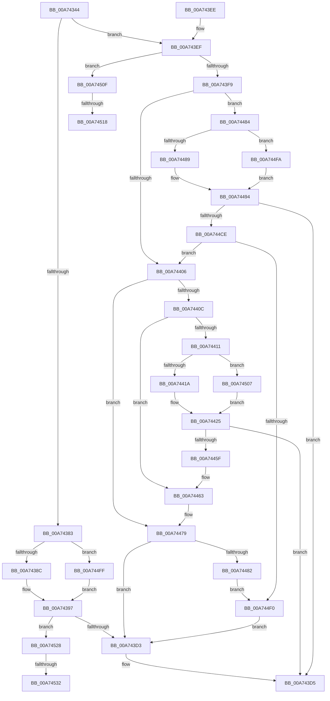

# PnpGetDeviceResourcesFromRegistry

- RVA: `0x00A74344`–`0x00A7453E` (길이 `506` bytes)
- VA: `0x0000000140A74344`
- 실행 섹션: `PAGE`
- PDB 이름 있음: `예`; PDB Function 태그: `예`
- unwind 정보 RVA: `0x000B57C4`
- 디코드: `128`개 명령, `506/506` bytes 표시
- 미해석 바이트: `0` (있으면 어셈블리에 `.byte`로 보존)

> 이 문서는 커널 이미지의 기계어와 PDB 기호를 분석해 생성했습니다. 4번과 5번은 함수 원형과 자료형을 바이너리 사용 방식에서 추정한 C 해석이며 원본 소스 복구 결과는 아닙니다.

## 1. Dependencies

- 직접 호출 지점: **6**; 고유 호출 대상: **3**
- 직접 호출자로 확인된 함수: **3**
- RIP 상대 이미지 참조: **2**

### Outgoing calls
- `0x00A743C4` → [_CmOpenDeviceRegKey](../8E/_CmOpenDeviceRegKey_function_008EE540.md) (function, `0x008EE540`)
- `0x00A74452` → [_CmOpenDeviceRegKey](../8E/_CmOpenDeviceRegKey_function_008EE540.md) (function, `0x008EE540`)
- `0x00A7446E` → [PnpReadDeviceConfiguration](../70/PnpReadDeviceConfiguration_function_00703350.md) (function, `0x00703350`)
- `0x00A744C1` → [_CmOpenDeviceRegKey](../8E/_CmOpenDeviceRegKey_function_008EE540.md) (function, `0x008EE540`)
- `0x00A744DD` → [PnpReadDeviceConfiguration](../70/PnpReadDeviceConfiguration_function_00703350.md) (function, `0x00703350`)
- `0x00A744F0` → [ZwClose](../../text/6A/ZwClose_function_006AD2B0.md) (function, `0x006AD2B0`)

### Direct callers
- [IopQueryDeviceResources](../8F/IopQueryDeviceResources_function_008FC344.md) at `0x008FC3C6`
- [IopQueryDeviceResources](../8F/IopQueryDeviceResources_function_008FC344.md) at `0x008FC3EE`
- [IopQueryDeviceResources](../8F/IopQueryDeviceResources_function_008FC344.md) at `0x008FC4B0`
- [IopQueryDeviceResources](../8F/IopQueryDeviceResources_function_008FC344.md) at `0x008FC554`
- [IopQueryDeviceResources](../8F/IopQueryDeviceResources_function_008FC344.md) at `0x008FC58A`
- [sub_00B40828](../B4/Unknown_function_00B40828.md) at `0x00B40B49`
- [sub_00B420B0](../B4/Unknown_function_00B420B0.md) at `0x00B423D5`

### Static image references
- `0x00A7439F` → RVA `0x00E66398` (`.data`; read)
- `0x00A74532` → RVA `0x00B000A0` (` ?? ::NNGAKEGL::`string'`; read)

## 2. Other-region calls and transfers

- 다른 실행 섹션으로 향하는 call: **1**
  - `0x00A744F0` → [ZwClose](../../text/6A/ZwClose_function_006AD2B0.md) (`PAGE` → `.text`)
- call이 아닌 외부 분기/꼬리 이동: **4**
  - `0x00A74512` → [sub_00B40726](../B4/Unknown_function_00B40726.md) (`tail-transfer`)
  - `0x00A74523` → [sub_00B40726 + 0x3](../B4/Unknown_function_00B40726.md) (`tail-transfer`)
  - `0x00A7452C` → [sub_00B40726 + 0x6B](../B4/Unknown_function_00B40726.md) (`tail-transfer`)
  - `0x00A74539` → [sub_00B40726 + 0x7C](../B4/Unknown_function_00B40726.md) (`tail-transfer`)

## 3. Assembly (complete function range)

```asm
00A74344  48 89 5C 24 08                  mov qword ptr [rsp + 8], rbx
00A74349  48 89 74 24 10                  mov qword ptr [rsp + 0x10], rsi
00A7434E  55                              push rbp
00A7434F  57                              push rdi
00A74350  41 54                           push r12
00A74352  41 55                           push r13
00A74354  41 56                           push r14
00A74356  48 8B EC                        mov rbp, rsp
00A74359  48 83 EC 50                     sub rsp, 0x50
00A7435D  4C 8B 65 50                     mov r12, qword ptr [rbp + 0x50]
00A74361  45 33 ED                        xor r13d, r13d
00A74364  4D 89 29                        mov qword ptr [r9], r13
00A74367  4D 8B F1                        mov r14, r9
00A7436A  4C 89 6D 48                     mov qword ptr [rbp + 0x48], r13
00A7436E  41 8B F0                        mov esi, r8d
00A74371  4C 89 6D F0                     mov qword ptr [rbp - 0x10], r13
00A74375  48 8B F9                        mov rdi, rcx
00A74378  45 89 2C 24                     mov dword ptr [r12], r13d
00A7437C  41 8B DD                        mov ebx, r13d
00A7437F  85 D2                           test edx, edx
00A74381  74 6C                           je 0x140a743ef
00A74383  48 85 C9                        test rcx, rcx
00A74386  0F 84 73 01 00 00               je 0x140a744ff
00A7438C  48 8B 81 38 01 00 00            mov rax, qword ptr [rcx + 0x138]
00A74393  48 8B 50 28                     mov rdx, qword ptr [rax + 0x28]
00A74397  48 8B 52 30                     mov rdx, qword ptr [rdx + 0x30]
00A7439B  48 8D 45 48                     lea rax, [rbp + 0x48]
00A7439F  48 8B 0D F2 1F 3F 00            mov rcx, qword ptr [rip + 0x3f1ff2]
00A743A6  45 33 C9                        xor r9d, r9d
00A743A9  4C 89 6C 24 38                  mov qword ptr [rsp + 0x38], r13
00A743AE  48 89 44 24 30                  mov qword ptr [rsp + 0x30], rax
00A743B3  44 88 6C 24 28                  mov byte ptr [rsp + 0x28], r13b
00A743B8  45 8D 41 14                     lea r8d, [r9 + 0x14]
00A743BC  C7 44 24 20 19 00 02 00         mov dword ptr [rsp + 0x20], 0x20019
00A743C4  E8 77 A1 E7 FF                  call 0x1408ee540
00A743C9  8B D8                           mov ebx, eax
00A743CB  85 C0                           test eax, eax
00A743CD  0F 89 55 01 00 00               jns 0x140a74528
00A743D3  8B C3                           mov eax, ebx
00A743D5  4C 8D 5C 24 50                  lea r11, [rsp + 0x50]
00A743DA  49 8B 5B 30                     mov rbx, qword ptr [r11 + 0x30]
00A743DE  49 8B 73 38                     mov rsi, qword ptr [r11 + 0x38]
00A743E2  49 8B E3                        mov rsp, r11
00A743E5  41 5E                           pop r14
00A743E7  41 5D                           pop r13
00A743E9  41 5C                           pop r12
00A743EB  5F                              pop rdi
00A743EC  5D                              pop rbp
00A743ED  C3                              ret
00A743EE  CC                              int3
00A743EF  40 F6 C6 01                     test sil, 1
00A743F3  0F 85 16 01 00 00               jne 0x140a7450f
00A743F9  49 8B CD                        mov rcx, r13
00A743FC  48 89 4D 48                     mov qword ptr [rbp + 0x48], rcx
00A74400  40 F6 C6 02                     test sil, 2
00A74404  75 7E                           jne 0x140a74484
00A74406  40 F6 C6 04                     test sil, 4
00A7440A  74 6D                           je 0x140a74479
00A7440C  48 85 C9                        test rcx, rcx
00A7440F  75 52                           jne 0x140a74463
00A74411  48 85 FF                        test rdi, rdi
00A74414  0F 84 ED 00 00 00               je 0x140a74507
00A7441A  48 8B 87 38 01 00 00            mov rax, qword ptr [rdi + 0x138]
00A74421  48 8B 50 28                     mov rdx, qword ptr [rax + 0x28]
00A74425  48 8B 52 30                     mov rdx, qword ptr [rdx + 0x30]
00A74429  48 8D 45 48                     lea rax, [rbp + 0x48]
00A7442D  48 8B 0D 64 1F 3F 00            mov rcx, qword ptr [rip + 0x3f1f64]
00A74434  45 33 C9                        xor r9d, r9d
00A74437  4C 89 6C 24 38                  mov qword ptr [rsp + 0x38], r13
00A7443C  48 89 44 24 30                  mov qword ptr [rsp + 0x30], rax
00A74441  44 88 6C 24 28                  mov byte ptr [rsp + 0x28], r13b
00A74446  45 8D 41 14                     lea r8d, [r9 + 0x14]
00A7444A  C7 44 24 20 19 00 02 00         mov dword ptr [rsp + 0x20], 0x20019
00A74452  E8 E9 A0 E7 FF                  call 0x1408ee540
00A74457  85 C0                           test eax, eax
00A74459  0F 88 76 FF FF FF               js 0x140a743d5
00A7445F  48 8B 4D 48                     mov rcx, qword ptr [rbp + 0x48]
00A74463  4D 8B CC                        mov r9, r12
00A74466  4D 8B C6                        mov r8, r14
00A74469  BA 04 00 00 00                  mov edx, 4
00A7446E  E8 DD EE C8 FF                  call 0x140703350
00A74473  48 8B 4D 48                     mov rcx, qword ptr [rbp + 0x48]
00A74477  8B D8                           mov ebx, eax
00A74479  48 85 C9                        test rcx, rcx
00A7447C  0F 84 51 FF FF FF               je 0x140a743d3
00A74482  EB 6C                           jmp 0x140a744f0
00A74484  48 85 FF                        test rdi, rdi
00A74487  74 71                           je 0x140a744fa
00A74489  48 8B 87 38 01 00 00            mov rax, qword ptr [rdi + 0x138]
00A74490  48 8B 50 28                     mov rdx, qword ptr [rax + 0x28]
00A74494  48 8B 52 30                     mov rdx, qword ptr [rdx + 0x30]
00A74498  48 8D 45 48                     lea rax, [rbp + 0x48]
00A7449C  48 8B 0D F5 1E 3F 00            mov rcx, qword ptr [rip + 0x3f1ef5]
00A744A3  45 33 C9                        xor r9d, r9d
00A744A6  4C 89 6C 24 38                  mov qword ptr [rsp + 0x38], r13
00A744AB  48 89 44 24 30                  mov qword ptr [rsp + 0x30], rax
00A744B0  44 88 6C 24 28                  mov byte ptr [rsp + 0x28], r13b
00A744B5  45 8D 41 14                     lea r8d, [r9 + 0x14]
00A744B9  C7 44 24 20 19 00 02 00         mov dword ptr [rsp + 0x20], 0x20019
00A744C1  E8 7A A0 E7 FF                  call 0x1408ee540
00A744C6  85 C0                           test eax, eax
00A744C8  0F 88 07 FF FF FF               js 0x140a743d5
00A744CE  48 8B 4D 48                     mov rcx, qword ptr [rbp + 0x48]
00A744D2  4D 8B CC                        mov r9, r12
00A744D5  4D 8B C6                        mov r8, r14
00A744D8  BA 02 00 00 00                  mov edx, 2
00A744DD  E8 6E EE C8 FF                  call 0x140703350
00A744E2  48 8B 4D 48                     mov rcx, qword ptr [rbp + 0x48]
00A744E6  8B D8                           mov ebx, eax
00A744E8  85 C0                           test eax, eax
00A744EA  0F 88 16 FF FF FF               js 0x140a74406
00A744F0  E8 BB 8D C3 FF                  call 0x1406ad2b0
00A744F5  E9 D9 FE FF FF                  jmp 0x140a743d3
00A744FA  49 8B D5                        mov rdx, r13
00A744FD  EB 95                           jmp 0x140a74494
00A744FF  49 8B D5                        mov rdx, r13
00A74502  E9 90 FE FF FF                  jmp 0x140a74397
00A74507  49 8B D5                        mov rdx, r13
00A7450A  E9 16 FF FF FF                  jmp 0x140a74425
00A7450F  48 85 FF                        test rdi, rdi
00A74512  0F 84 0E C2 0C 00               je 0x140b40726
00A74518  48 8B 81 38 01 00 00            mov rax, qword ptr [rcx + 0x138]
00A7451F  48 8B 50 28                     mov rdx, qword ptr [rax + 0x28]
00A74523  E9 01 C2 0C 00                  jmp 0x140b40729
00A74528  40 F6 C6 01                     test sil, 1
00A7452C  0F 84 5F C2 0C 00               je 0x140b40791
00A74532  48 8D 15 67 BB 08 00            lea rdx, [rip + 0x8bb67]
00A74539  E9 64 C2 0C 00                  jmp 0x140b407a2
```

## 4. C-style interpretation (structured pseudocode)

```c
__int64 __fastcall PnpGetDeviceResourcesFromRegistry(__int64 a1, int a2, int a3, __int64 a4, __int64 a5)
{
    __int64 result;
    __int64 v_r13;
    __int64 v_rsp;
    unsigned __int64 v_stack_m18;
    unsigned __int64 v_stack_m20;
    unsigned __int64 v_stack_m28;
    unsigned int v_stack_m30;
    unsigned __int64 v_stack_m38;
    unsigned __int64 v_stack_m40;
    unsigned __int64 v_stack_m48;
    unsigned __int8 v_stack_m50;
    unsigned int v_stack_m58;
    unsigned __int64 v_stack_p10;
    unsigned __int64 v_stack_p20;
    unsigned __int64 v_stack_p8;

    v_stack_p8 = v_rbx;
    v_stack_p10 = v_rsi;
    v_rsp = (v_rsp) - (80);
    v_r13 = 0;
    *(unsigned __int64 *)(a4) = 0;
    v_stack_p20 = 0;
    v_stack_m38 = 0;
    *(unsigned int *)(a5) = 0;
    if (a2 == 0) goto loc_00A743EF;
    if (a1 == 0) goto loc_00A744FF;
loc_00A74397:
    a4 = 0;
    v_stack_m40 = 0;
    v_stack_m48 = v_stack_p20;
    v_stack_m50 = 0;
    v_stack_m58 = 0x20019ULL;
    result = _CmOpenDeviceRegKey(*(unsigned __int64 *)(v_rip + 4136946), *(unsigned __int64 *)(*(unsigned __int64 *)(*(unsigned __int64 *)(a1 + 312) + 40) + 48), a4 + 20, a4);
    if (!sign_flag) goto loc_00A74528;
loc_00A743D3:
loc_00A743D5:
    return (unsigned int)((unsigned int)((unsigned int)((unsigned int)(result))));
loc_00A743EF:
    if ((((unsigned __int8)(*(unsigned __int64 *)(v_stack_m28 + 56))) & (1)) != 0) goto loc_00A7450F;
    v_stack_p20 = 0;
    if ((((unsigned __int8)(*(unsigned __int64 *)(v_stack_m28 + 56))) & (2)) != 0) goto loc_00A74484;
loc_00A74406:
    if ((((unsigned __int8)(*(unsigned __int64 *)(v_stack_m28 + 56))) & (4)) == 0) goto loc_00A74479;
    if (0 != 0) goto loc_00A74463;
    if (a1 == 0) goto loc_00A74507;
loc_00A74425:
    a4 = 0;
    v_stack_m18 = 0;
    v_stack_m20 = v_stack_p20;
    v_stack_m28 = 0;
    v_stack_m30 = 0x20019ULL;
    result = _CmOpenDeviceRegKey(*(unsigned __int64 *)(v_rip + 4136804), *(unsigned __int64 *)(*(unsigned __int64 *)(*(unsigned __int64 *)(a1 + 312) + 40) + 48), a4 + 20, a4);
    if (sign_flag) goto loc_00A743D5;
loc_00A74463:
    result = PnpReadDeviceConfiguration(v_stack_p20, 4, 0, a5);
loc_00A74479:
    if (v_stack_p20 == 0) goto loc_00A743D3;
    goto loc_00A744F0;
loc_00A74484:
    if (a1 == 0) goto loc_00A744FA;
loc_00A74494:
    a4 = 0;
    v_stack_m18 = 0;
    v_stack_m20 = v_stack_p20;
    v_stack_m28 = 0;
    v_stack_m30 = 0x20019ULL;
    result = _CmOpenDeviceRegKey(*(unsigned __int64 *)(v_rip + 4136693), *(unsigned __int64 *)(*(unsigned __int64 *)(*(unsigned __int64 *)(a1 + 312) + 40) + 48), a4 + 20, a4);
    if (sign_flag) goto loc_00A743D5;
    result = PnpReadDeviceConfiguration(v_stack_p20, 2, 0, a5);
    if (sign_flag) goto loc_00A74406;
loc_00A744F0:
    result = ZwClose(v_stack_p20, 2, 0, a5);
    goto loc_00A743D3;
loc_00A744FA:
    goto loc_00A74494;
loc_00A744FF:
    goto loc_00A74397;
loc_00A74507:
    goto loc_00A74425;
loc_00A7450F:
loc_00A74528:
}
```

## 5. (Beta) C Style

```c
int64_t PnpGetDeviceResourcesFromRegistry(void *Arg1, int32_t Arg2, int32_t Arg3, void *Arg4, void *Arg5)
{
    uint8_t *arg1 = (uint8_t *)Arg1;
    uint8_t *arg4 = (uint8_t *)Arg4;
    uint8_t *arg5 = (uint8_t *)Arg5;

    int64_t result;
    int64_t local_r13;
    int64_t local_rsp;
    uint64_t v_stack_m18;
    uint64_t v_stack_m20;
    uint64_t v_stack_m28;
    uint32_t v_stack_m30;
    uint64_t v_stack_m38;
    uint64_t v_stack_m40;
    uint64_t v_stack_m48;
    uint8_t v_stack_m50;
    uint32_t v_stack_m58;
    uint64_t v_stack_p10;
    uint64_t v_stack_p20;
    uint64_t v_stack_p8;

    v_stack_p8 = local_rbx;
    v_stack_p10 = local_rsi;
    local_rsp = (local_rsp) - (80);
    local_r13 = 0;
    *(uint64_t *)(arg4) = 0;
    v_stack_p20 = 0;
    v_stack_m38 = 0;
    *(uint32_t *)(arg5) = 0;
    if (Arg2 == 0) goto loc_00A743EF;
    if (Arg1 == NULL) goto loc_00A744FF;
loc_00A74397:
    Arg4 = 0;
    v_stack_m40 = 0;
    v_stack_m48 = v_stack_p20;
    v_stack_m50 = 0;
    v_stack_m58 = 0x20019ULL;
    result = _CmOpenDeviceRegKey(*(uint64_t *)(v_rip + 0x3F1FF2), *(uint64_t *)(*(uint64_t *)(*(uint64_t *)(arg1 + 0x138) + 0x28) + 0x30), Arg4 + 20, Arg4);
    if (!sign_flag) goto loc_00A74528;
loc_00A743D3:
loc_00A743D5:
    return (uint32_t)((uint32_t)((uint32_t)((uint32_t)(result))));
loc_00A743EF:
    if ((((uint8_t)(*(uint64_t *)(v_stack_m28 + 0x38))) & (1)) != 0) goto loc_00A7450F;
    v_stack_p20 = 0;
    if ((((uint8_t)(*(uint64_t *)(v_stack_m28 + 0x38))) & (2)) != 0) goto loc_00A74484;
loc_00A74406:
    if ((((uint8_t)(*(uint64_t *)(v_stack_m28 + 0x38))) & (4)) == 0) goto loc_00A74479;
    if (0 != 0) goto loc_00A74463;
    if (Arg1 == NULL) goto loc_00A74507;
loc_00A74425:
    Arg4 = 0;
    v_stack_m18 = 0;
    v_stack_m20 = v_stack_p20;
    v_stack_m28 = 0;
    v_stack_m30 = 0x20019ULL;
    result = _CmOpenDeviceRegKey(*(uint64_t *)(v_rip + 0x3F1F64), *(uint64_t *)(*(uint64_t *)(*(uint64_t *)(arg1 + 0x138) + 0x28) + 0x30), Arg4 + 20, Arg4);
    if (sign_flag) goto loc_00A743D5;
loc_00A74463:
    result = PnpReadDeviceConfiguration(v_stack_p20, 4, 0, Arg5);
loc_00A74479:
    if (v_stack_p20 == 0) goto loc_00A743D3;
    goto loc_00A744F0;
loc_00A74484:
    if (Arg1 == NULL) goto loc_00A744FA;
loc_00A74494:
    Arg4 = 0;
    v_stack_m18 = 0;
    v_stack_m20 = v_stack_p20;
    v_stack_m28 = 0;
    v_stack_m30 = 0x20019ULL;
    result = _CmOpenDeviceRegKey(*(uint64_t *)(v_rip + 0x3F1EF5), *(uint64_t *)(*(uint64_t *)(*(uint64_t *)(arg1 + 0x138) + 0x28) + 0x30), Arg4 + 20, Arg4);
    if (sign_flag) goto loc_00A743D5;
    result = PnpReadDeviceConfiguration(v_stack_p20, 2, 0, Arg5);
    if (sign_flag) goto loc_00A74406;
loc_00A744F0:
    result = ZwClose(v_stack_p20, 2, 0, Arg5);
    goto loc_00A743D3;
loc_00A744FA:
    goto loc_00A74494;
loc_00A744FF:
    goto loc_00A74397;
loc_00A74507:
    goto loc_00A74425;
loc_00A7450F:
loc_00A74528:
}
```

### 관측된 메모리 오프셋

구조체 형식이 확인되지 않은 접근은 인자 기준의 오프셋으로만 기록했습니다.

| 기준 인자 | 오프셋 표현 | 폭 (bit) | 접근 |
|---|---:|---:|---|
| `Arg1` | `+ 0x138` | `64` | `R` |
| `Arg4` | `+ 0x0` | `64` | `W` |
| `Arg5` | `+ 0x0` | `32` | `W` |

## 6. Execution-region graph

[열기: 2D/3D 그래프와 함수 탐색 컨트롤 패널](../../../control-panel.html?section=page&rva=0x00A74344&view=graph)

- 2D 그래프는 위에서 아래로 흐르고, 3D 그래프는 빈 공간을 드래그해 회전합니다. Shift+드래그는 이동, 휠은 확대·축소, 함수 노드 선택은 대상 보고서 이동입니다.

### Static fallback


