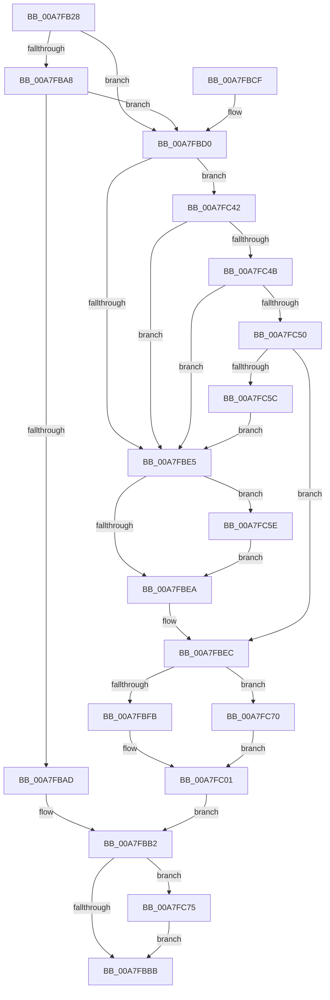

# PnpInitializeInheritedRestrictedSd

- RVA: `0x00A7FB28`–`0x00A7FC87` (길이 `351` bytes)
- VA: `0x0000000140A7FB28`
- 실행 섹션: `PAGE`
- PDB 이름 있음: `예`; PDB Function 태그: `아니요`
- unwind 정보 RVA: `0x000B6F1C`
- 디코드: `95`개 명령, `351/351` bytes 표시
- 미해석 바이트: `0` (있으면 어셈블리에 `.byte`로 보존)

> 이 문서는 커널 이미지의 기계어와 PDB 기호를 분석해 생성했습니다. 4번과 5번은 함수 원형과 자료형을 바이너리 사용 방식에서 추정한 C 해석이며 원본 소스 복구 결과는 아닙니다.

## 1. Dependencies

- 직접 호출 지점: **5**; 고유 호출 대상: **4**
- 직접 호출자로 확인된 함수: **1**
- RIP 상대 이미지 참조: **3**

### Outgoing calls
- `0x00A7FB9C` → [PnpGetObjectProperty](../8E/PnpGetObjectProperty_function_008E1110.md) (function, `0x008E1110`)
- `0x00A7FC38` → [PnpSetObjectProperty](../8F/PnpSetObjectProperty_function_008F66E8.md) (function, `0x008F66E8`)
- `0x00A7FC53` → [RtlValidSecurityDescriptor](../8B/RtlValidSecurityDescriptor_function_008BD3F0.md) (function, `0x008BD3F0`)
- `0x00A7FC66` → [ExFreePoolWithTag](../../poolcode/B8/ExFreePoolWithTag_function_00B82870.md) (function, `0x00B82870`)
- `0x00A7FC7D` → [ExFreePoolWithTag](../../poolcode/B8/ExFreePoolWithTag_function_00B82870.md) (function, `0x00B82870`)

### Direct callers
- [PiProcessNewDeviceNode](../A2/PiProcessNewDeviceNode_function_00A28F20.md) at `0x00A2A253`

### Static image references
- `0x00A7FB87` → RVA `0x00011478` (`.rdata`; read)
- `0x00A7FC16` → RVA `0x000115B8` (`.rdata`; read)
- `0x00A7FC22` → RVA `0x00E66398` (`.data`; read)

## 2. Other-region calls and transfers

- 다른 실행 섹션으로 향하는 call: **2**
  - `0x00A7FC66` → [ExFreePoolWithTag](../../poolcode/B8/ExFreePoolWithTag_function_00B82870.md) (`PAGE` → `POOLCODE`)
  - `0x00A7FC7D` → [ExFreePoolWithTag](../../poolcode/B8/ExFreePoolWithTag_function_00B82870.md) (`PAGE` → `POOLCODE`)
- 별도 외부 분기/꼬리 이동을 확인하지 못했습니다.

## 3. Assembly (complete function range)

```asm
00A7FB28  4C 8B DC                        mov r11, rsp
00A7FB2B  49 89 5B 10                     mov qword ptr [r11 + 0x10], rbx
00A7FB2F  55                              push rbp
00A7FB30  56                              push rsi
00A7FB31  57                              push rdi
00A7FB32  41 56                           push r14
00A7FB34  41 57                           push r15
00A7FB36  48 83 EC 70                     sub rsp, 0x70
00A7FB3A  83 64 24 50 00                  and dword ptr [rsp + 0x50], 0
00A7FB3F  49 8D 43 08                     lea rax, [r11 + 8]
00A7FB43  41 83 63 20 00                  and dword ptr [r11 + 0x20], 0
00A7FB48  41 8A E8                        mov bpl, r8b
00A7FB4B  4C 8B 41 10                     mov r8, qword ptr [rcx + 0x10]
00A7FB4F  4C 8B FA                        mov r15, rdx
00A7FB52  41 83 63 08 00                  and dword ptr [r11 + 8], 0
00A7FB57  4C 8B F1                        mov r14, rcx
00A7FB5A  49 83 63 C8 00                  and qword ptr [r11 - 0x38], 0
00A7FB5F  41 B9 01 00 00 00               mov r9d, 1
00A7FB65  49 89 43 B0                     mov qword ptr [r11 - 0x50], rax
00A7FB69  BA 00 02 00 00                  mov edx, 0x200
00A7FB6E  4D 8B 40 30                     mov r8, qword ptr [r8 + 0x30]
00A7FB72  49 8D 43 C8                     lea rax, [r11 - 0x38]
00A7FB76  49 89 43 A8                     mov qword ptr [r11 - 0x58], rax
00A7FB7A  B9 50 70 73 75                  mov ecx, 0x75737050
00A7FB7F  49 8D 43 20                     lea rax, [r11 + 0x20]
00A7FB83  49 89 43 A0                     mov qword ptr [r11 - 0x60], rax
00A7FB87  48 8D 05 EA 18 59 FF            lea rax, [rip - 0xa6e716]
00A7FB8E  49 89 43 98                     mov qword ptr [r11 - 0x68], rax
00A7FB92  49 83 63 90 00                  and qword ptr [r11 - 0x70], 0
00A7FB97  49 83 63 88 00                  and qword ptr [r11 - 0x78], 0
00A7FB9C  E8 6F 15 E6 FF                  call 0x1408e1110
00A7FBA1  3D 25 02 00 C0                  cmp eax, 0xc0000225
00A7FBA6  75 28                           jne 0x140a7fbd0
00A7FBA8  40 84 ED                        test bpl, bpl
00A7FBAB  74 23                           je 0x140a7fbd0
00A7FBAD  48 8B 5C 24 60                  mov rbx, qword ptr [rsp + 0x60]
00A7FBB2  48 85 DB                        test rbx, rbx
00A7FBB5  0F 85 BA 00 00 00               jne 0x140a7fc75
00A7FBBB  48 8B 9C 24 A8 00 00 00         mov rbx, qword ptr [rsp + 0xa8]
00A7FBC3  48 83 C4 70                     add rsp, 0x70
00A7FBC7  41 5F                           pop r15
00A7FBC9  41 5E                           pop r14
00A7FBCB  5F                              pop rdi
00A7FBCC  5E                              pop rsi
00A7FBCD  5D                              pop rbp
00A7FBCE  C3                              ret
00A7FBCF  CC                              int3
00A7FBD0  8B BC 24 A0 00 00 00            mov edi, dword ptr [rsp + 0xa0]
00A7FBD7  BE 13 00 00 00                  mov esi, 0x13
00A7FBDC  48 8B 5C 24 60                  mov rbx, qword ptr [rsp + 0x60]
00A7FBE1  85 C0                           test eax, eax
00A7FBE3  79 5D                           jns 0x140a7fc42
00A7FBE5  48 85 DB                        test rbx, rbx
00A7FBE8  75 74                           jne 0x140a7fc5e
00A7FBEA  33 DB                           xor ebx, ebx
00A7FBEC  40 F6 DD                        neg bpl
00A7FBEF  1B C0                           sbb eax, eax
00A7FBF1  25 00 00 02 00                  and eax, 0x20000
00A7FBF6  48 85 DB                        test rbx, rbx
00A7FBF9  75 75                           jne 0x140a7fc70
00A7FBFB  33 FF                           xor edi, edi
00A7FBFD  33 C9                           xor ecx, ecx
00A7FBFF  33 F6                           xor esi, esi
00A7FC01  49 8B 56 30                     mov rdx, qword ptr [r14 + 0x30]
00A7FC05  4D 8B CF                        mov r9, r15
00A7FC08  89 44 24 48                     mov dword ptr [rsp + 0x48], eax
00A7FC0C  41 B8 01 00 00 00               mov r8d, 1
00A7FC12  89 7C 24 40                     mov dword ptr [rsp + 0x40], edi
00A7FC16  48 8D 05 9B 19 59 FF            lea rax, [rip - 0xa6e665]
00A7FC1D  48 89 4C 24 38                  mov qword ptr [rsp + 0x38], rcx
00A7FC22  48 8B 0D 6F 67 3E 00            mov rcx, qword ptr [rip + 0x3e676f]
00A7FC29  89 74 24 30                     mov dword ptr [rsp + 0x30], esi
00A7FC2D  48 89 44 24 28                  mov qword ptr [rsp + 0x28], rax
00A7FC32  48 83 64 24 20 00               and qword ptr [rsp + 0x20], 0
00A7FC38  E8 AB 6A E7 FF                  call 0x1408f66e8
00A7FC3D  E9 70 FF FF FF                  jmp 0x140a7fbb2
00A7FC42  39 B4 24 B8 00 00 00            cmp dword ptr [rsp + 0xb8], esi
00A7FC49  75 9A                           jne 0x140a7fbe5
00A7FC4B  83 FF 28                        cmp edi, 0x28
00A7FC4E  72 95                           jb 0x140a7fbe5
00A7FC50  48 8B CB                        mov rcx, rbx
00A7FC53  E8 98 D7 E3 FF                  call 0x1408bd3f0
00A7FC58  84 C0                           test al, al
00A7FC5A  75 90                           jne 0x140a7fbec
00A7FC5C  EB 87                           jmp 0x140a7fbe5
00A7FC5E  BA 50 70 73 75                  mov edx, 0x75737050
00A7FC63  48 8B CB                        mov rcx, rbx
00A7FC66  E8 05 2C 10 00                  call 0x140b82870
00A7FC6B  E9 7A FF FF FF                  jmp 0x140a7fbea
00A7FC70  48 8B CB                        mov rcx, rbx
00A7FC73  EB 8C                           jmp 0x140a7fc01
00A7FC75  BA 50 70 73 75                  mov edx, 0x75737050
00A7FC7A  48 8B CB                        mov rcx, rbx
00A7FC7D  E8 EE 2B 10 00                  call 0x140b82870
00A7FC82  E9 34 FF FF FF                  jmp 0x140a7fbbb
```

## 4. C-style interpretation (structured pseudocode)

```c
__int64 __fastcall PnpInitializeInheritedRestrictedSd(__int64 a1, __int64 a2, unsigned __int8 a3)
{
    __int64 result;
    __int64 v_rbp;
    __int64 v_rbx;
    __int64 v_rdi;
    __int64 v_rsi;
    __int64 v_rsp;
    unsigned __int64 v_stack_m38;
    unsigned int v_stack_m48;
    unsigned __int64 v_stack_p10;
    unsigned __int64 v_stack_p20;
    unsigned __int64 v_stack_p28;
    unsigned int v_stack_p30;
    unsigned __int64 v_stack_p38;
    unsigned int v_stack_p40;
    unsigned int v_stack_p48;
    unsigned __int64 v_stack_p60;
    unsigned int v_stack_pA0;
    unsigned int v_stack_pB8;

    *(unsigned __int64 *)(v_rsp + 16) = v_rbx;
    v_rsp = (v_rsp) - (112);
    *(unsigned __int64 *)(v_rsp - 80) = v_rsp + 8;
    *(unsigned __int64 *)(v_rsp - 88) = v_rsp - 56;
    *(unsigned __int64 *)(v_rsp - 96) = v_rsp + 32;
    *(unsigned __int64 *)(v_rsp - 104) = v_rip - 10938134;
    result = PnpGetObjectProperty((unsigned int)(0x75737050ULL), 512, *(unsigned __int64 *)(*(unsigned __int64 *)(a1 + 16) + 48), 1);
    if (((unsigned int)(result)) != 0xC0000225ULL) goto loc_00A7FBD0;
    if (a3 == 0) goto loc_00A7FBD0;
loc_00A7FBB2:
    if (v_stack_m38 != 0) goto loc_00A7FC75;
loc_00A7FBBB:
    v_rsp = (v_rsp) + (112);
    return result;
loc_00A7FBD0:
    if (!sign_flag) goto loc_00A7FC42;
loc_00A7FBE5:
    if (v_stack_p60 != 0) goto loc_00A7FC5E;
loc_00A7FBEA:
    v_rbx = 0;
loc_00A7FBEC:
    v_rbp = (unsigned __int8)(-(a3));
    result = (unsigned int)((result) & (0x20000ULL));
    if (0 != 0) goto loc_00A7FC70;
    v_rdi = 0;
    a1 = 0;
    v_rsi = 0;
loc_00A7FC01:
    v_stack_p48 = (unsigned int)(result);
    v_stack_p40 = 0;
    v_stack_p38 = 0;
    v_stack_p30 = 0;
    v_stack_p28 = v_rip - 10937957;
    result = PnpSetObjectProperty(*(unsigned __int64 *)(v_rip + 4089711), *(unsigned __int64 *)(a1 + 48), 1, a2);
    goto loc_00A7FBB2;
loc_00A7FC42:
    if (v_stack_pB8 != 0) goto loc_00A7FBE5;
    if (0 < 40) goto loc_00A7FBE5;
    result = RtlValidSecurityDescriptor(0, *(unsigned __int64 *)(a1 + 48), 1, a2);
    if ((unsigned __int8)(result) != 0) goto loc_00A7FBEC;
    goto loc_00A7FBE5;
loc_00A7FC5E:
    result = ExFreePoolWithTag(0, (unsigned int)(0x75737050ULL), 1, a2);
    goto loc_00A7FBEA;
loc_00A7FC70:
    goto loc_00A7FC01;
loc_00A7FC75:
    result = ExFreePoolWithTag(0, (unsigned int)(0x75737050ULL), 1, a2);
    goto loc_00A7FBBB;
}
```

## 5. (Beta) C Style

```c
int64_t PnpInitializeInheritedRestrictedSd(void *Arg1, int64_t Arg2, uint8_t Arg3)
{
    uint8_t *arg1 = (uint8_t *)Arg1;

    int64_t result;
    int64_t local_rbp;
    int64_t local_rbx;
    int64_t local_rdi;
    int64_t local_rsi;
    int64_t local_rsp;
    uint64_t v_stack_m38;
    uint32_t v_stack_m48;
    uint64_t v_stack_p10;
    uint64_t v_stack_p20;
    uint64_t v_stack_p28;
    uint32_t v_stack_p30;
    uint64_t v_stack_p38;
    uint32_t v_stack_p40;
    uint32_t v_stack_p48;
    uint64_t v_stack_p60;
    uint32_t v_stack_pA0;
    uint32_t v_stack_pB8;

    *(uint64_t *)(local_rsp + 0x10) = local_rbx;
    local_rsp = (local_rsp) - (112);
    *(uint64_t *)(local_rsp - 0x50) = local_rsp + 8;
    *(uint64_t *)(local_rsp - 0x58) = local_rsp - 56;
    *(uint64_t *)(local_rsp - 0x60) = local_rsp + 32;
    *(uint64_t *)(local_rsp - 0x68) = v_rip - 10938134;
    result = PnpGetObjectProperty((uint32_t)(0x75737050ULL), 512, *(uint64_t *)(*(uint64_t *)(arg1 + 0x10) + 0x30), 1);
    if (((uint32_t)(result)) != 0xC0000225ULL) goto loc_00A7FBD0;
    if (Arg3 == 0) goto loc_00A7FBD0;
loc_00A7FBB2:
    if (v_stack_m38 != 0) goto loc_00A7FC75;
loc_00A7FBBB:
    local_rsp = (local_rsp) + (112);
    return result;
loc_00A7FBD0:
    if (!sign_flag) goto loc_00A7FC42;
loc_00A7FBE5:
    if (v_stack_p60 != 0) goto loc_00A7FC5E;
loc_00A7FBEA:
    local_rbx = 0;
loc_00A7FBEC:
    local_rbp = (uint8_t)(-(Arg3));
    result = (uint32_t)((result) & (0x20000ULL));
    if (0 != 0) goto loc_00A7FC70;
    local_rdi = 0;
    Arg1 = 0;
    local_rsi = 0;
loc_00A7FC01:
    v_stack_p48 = (uint32_t)(result);
    v_stack_p40 = 0;
    v_stack_p38 = 0;
    v_stack_p30 = 0;
    v_stack_p28 = v_rip - 10937957;
    result = PnpSetObjectProperty(*(uint64_t *)(v_rip + 0x3E676F), *(uint64_t *)(arg1 + 0x30), 1, Arg2);
    goto loc_00A7FBB2;
loc_00A7FC42:
    if (v_stack_pB8 != 0) goto loc_00A7FBE5;
    if (0 < 40) goto loc_00A7FBE5;
    result = RtlValidSecurityDescriptor(0, *(uint64_t *)(arg1 + 0x30), 1, Arg2);
    if ((uint8_t)(result) != 0) goto loc_00A7FBEC;
    goto loc_00A7FBE5;
loc_00A7FC5E:
    result = ExFreePoolWithTag(0, (uint32_t)(0x75737050ULL), 1, Arg2);
    goto loc_00A7FBEA;
loc_00A7FC70:
    goto loc_00A7FC01;
loc_00A7FC75:
    result = ExFreePoolWithTag(0, (uint32_t)(0x75737050ULL), 1, Arg2);
    goto loc_00A7FBBB;
}
```

### 관측된 메모리 오프셋

구조체 형식이 확인되지 않은 접근은 인자 기준의 오프셋으로만 기록했습니다.

| 기준 인자 | 오프셋 표현 | 폭 (bit) | 접근 |
|---|---:|---:|---|
| `Arg1` | `+ 0x10` | `64` | `R` |
| `Arg1` | `+ 0x30` | `64` | `R` |

## 6. Execution-region graph

[열기: 2D/3D 그래프와 함수 탐색 컨트롤 패널](../../../control-panel.html?section=page&rva=0x00A7FB28&view=graph)

- 2D 그래프는 위에서 아래로 흐르고, 3D 그래프는 빈 공간을 드래그해 회전합니다. Shift+드래그는 이동, 휠은 확대·축소, 함수 노드 선택은 대상 보고서 이동입니다.

### Static fallback


