# PnpIsDeviceInstanceEnabled

- RVA: `0x00A75A3C`–`0x00A75D55` (길이 `793` bytes)
- VA: `0x0000000140A75A3C`
- 실행 섹션: `PAGE`
- PDB 이름 있음: `예`; PDB Function 태그: `예`
- unwind 정보 RVA: `0x000B5A14`
- 디코드: `203`개 명령, `793/793` bytes 표시
- 미해석 바이트: `0` (있으면 어셈블리에 `.byte`로 보존)

> 이 문서는 커널 이미지의 기계어와 PDB 기호를 분석해 생성했습니다. 4번과 5번은 함수 원형과 자료형을 바이너리 사용 방식에서 추정한 C 해석이며 원본 소스 복구 결과는 아닙니다.

## 1. Dependencies

- 직접 호출 지점: **11**; 고유 호출 대상: **10**
- 직접 호출자로 확인된 함수: **3**
- RIP 상대 이미지 참조: **1**

### Outgoing calls
- `0x00A75A7D` → [PnpDeviceObjectFromDeviceInstanceWithTag](../8E/PnpDeviceObjectFromDeviceInstanceWithTag_function_008E7490.md) (function, `0x008E7490`)
- `0x00A75B33` → [ExAllocatePool2](../../poolcode/B8/ExAllocatePool2_function_00B820F0.md) (function, `0x00B820F0`)
- `0x00A75B52` → [memcpy](../../text/6C/memcpy_function_006C6840.md) (function, `0x006C6840`)
- `0x00A75BAF` → [CmGetDeviceRegProp](../8E/CmGetDeviceRegProp_function_008ED870.md) (function, `0x008ED870`)
- `0x00A75BCE` → [PnpGetDeviceInstanceCsConfigFlags](PnpGetDeviceInstanceCsConfigFlags_function_00A75D5C.md) (function, `0x00A75D5C`)
- `0x00A75C02` → [PnpDisableDevice](../72/PnpDisableDevice_function_0072C6FC.md) (function, `0x0072C6FC`)
- `0x00A75C3D` → [_CmOpenDeviceRegKey](../8E/_CmOpenDeviceRegKey_function_008EE540.md) (function, `0x008EE540`)
- `0x00A75CDF` → [ExAllocatePool2](../../poolcode/B8/ExAllocatePool2_function_00B820F0.md) (function, `0x00B820F0`)
- `0x00A75D2D` → [ObfDereferenceObjectWithTag](../../text/2F/ObfDereferenceObjectWithTag_function_002F78E0.md) (function, `0x002F78E0`)
- `0x00A75D3B` → [ZwClose](../../text/6A/ZwClose_function_006AD2B0.md) (function, `0x006AD2B0`)
- `0x00A75D4B` → [PnpUnicodeStringToWstrFree](../8F/PnpUnicodeStringToWstrFree_function_008F59F0.md) (function, `0x008F59F0`)

### Direct callers
- [PiProfileUpdateDeviceTreeCallback](../73/PiProfileUpdateDeviceTreeCallback_function_00737630.md) at `0x00737650`
- [PiProfileUpdateDeviceTreeCallback](../73/PiProfileUpdateDeviceTreeCallback_function_00737630.md) at `0x007376A7`
- [PiProcessNewDeviceNode](../A2/PiProcessNewDeviceNode_function_00A28F20.md) at `0x00A2A21E`
- [sub_00B420B0](../B4/Unknown_function_00B420B0.md) at `0x00B42376`

### Static image references
- `0x00A75B78` → RVA `0x00E66398` (`.data`; read)

## 2. Other-region calls and transfers

- 다른 실행 섹션으로 향하는 call: **5**
  - `0x00A75B33` → [ExAllocatePool2](../../poolcode/B8/ExAllocatePool2_function_00B820F0.md) (`PAGE` → `POOLCODE`)
  - `0x00A75B52` → [memcpy](../../text/6C/memcpy_function_006C6840.md) (`PAGE` → `.text`)
  - `0x00A75CDF` → [ExAllocatePool2](../../poolcode/B8/ExAllocatePool2_function_00B820F0.md) (`PAGE` → `POOLCODE`)
  - `0x00A75D2D` → [ObfDereferenceObjectWithTag](../../text/2F/ObfDereferenceObjectWithTag_function_002F78E0.md) (`PAGE` → `.text`)
  - `0x00A75D3B` → [ZwClose](../../text/6A/ZwClose_function_006AD2B0.md) (`PAGE` → `.text`)
- call이 아닌 외부 분기/꼬리 이동: **2**
  - `0x00A75D05` → [sub_00B412BE](../B4/Unknown_function_00B412BE.md) (`tail-transfer`)
  - `0x00A75D14` → [sub_00B412BE](../B4/Unknown_function_00B412BE.md) (`tail-transfer`)

## 3. Assembly (complete function range)

```asm
00A75A3C  48 89 5C 24 10                  mov qword ptr [rsp + 0x10], rbx
00A75A41  44 89 44 24 18                  mov dword ptr [rsp + 0x18], r8d
00A75A46  48 89 4C 24 08                  mov qword ptr [rsp + 8], rcx
00A75A4B  55                              push rbp
00A75A4C  56                              push rsi
00A75A4D  57                              push rdi
00A75A4E  41 54                           push r12
00A75A50  41 55                           push r13
00A75A52  41 56                           push r14
00A75A54  41 57                           push r15
00A75A56  48 8B EC                        mov rbp, rsp
00A75A59  48 83 EC 50                     sub rsp, 0x50
00A75A5D  33 DB                           xor ebx, ebx
00A75A5F  48 8B FA                        mov rdi, rdx
00A75A62  BA 50 6E 70 55                  mov edx, 0x55706e50
00A75A67  89 5D 58                        mov dword ptr [rbp + 0x58], ebx
00A75A6A  48 8B CF                        mov rcx, rdi
00A75A6D  89 5D F0                        mov dword ptr [rbp - 0x10], ebx
00A75A70  41 8B F0                        mov esi, r8d
00A75A73  89 5D F4                        mov dword ptr [rbp - 0xc], ebx
00A75A76  44 8D 7B 01                     lea r15d, [rbx + 1]
00A75A7A  44 8B E3                        mov r12d, ebx
00A75A7D  E8 0E 1A E7 FF                  call 0x1408e7490
00A75A82  45 33 C9                        xor r9d, r9d
00A75A85  4C 8B E8                        mov r13, rax
00A75A88  48 85 C0                        test rax, rax
00A75A8B  0F 84 F6 01 00 00               je 0x140a75c87
00A75A91  48 8B 80 38 01 00 00            mov rax, qword ptr [rax + 0x138]
00A75A98  48 8B 48 28                     mov rcx, qword ptr [rax + 0x28]
00A75A9C  4C 8B F1                        mov r14, rcx
00A75A9F  48 85 C9                        test rcx, rcx
00A75AA2  74 10                           je 0x140a75ab4
00A75AA4  F7 81 8C 01 00 00 00 20 00 00   test dword ptr [rcx + 0x18c], 0x2000
00A75AAE  0F 85 48 02 00 00               jne 0x140a75cfc
00A75AB4  48 85 FF                        test rdi, rdi
00A75AB7  0F 84 90 01 00 00               je 0x140a75c4d
00A75ABD  44 0F B7 47 02                  movzx r8d, word ptr [rdi + 2]
00A75AC2  41 BA 02 00 00 00               mov r10d, 2
00A75AC8  66 45 3B C2                     cmp r8w, r10w
00A75ACC  0F 82 99 00 00 00               jb 0x140a75b6b
00A75AD2  48 8B 4F 08                     mov rcx, qword ptr [rdi + 8]
00A75AD6  48 85 C9                        test rcx, rcx
00A75AD9  0F 84 8C 00 00 00               je 0x140a75b6b
00A75ADF  0F B7 17                        movzx edx, word ptr [rdi]
00A75AE2  66 41 3B D0                     cmp dx, r8w
00A75AE6  0F 87 61 01 00 00               ja 0x140a75c4d
00A75AEC  66 85 D2                        test dx, dx
00A75AEF  0F 84 D6 01 00 00               je 0x140a75ccb
00A75AF5  66 44 39 09                     cmp word ptr [rcx], r9w
00A75AF9  0F 84 C4 01 00 00               je 0x140a75cc3
00A75AFF  66 41 3B D0                     cmp dx, r8w
00A75B03  75 11                           jne 0x140a75b16
00A75B05  8B C2                           mov eax, edx
00A75B07  48 D1 E8                        shr rax, 1
00A75B0A  66 44 39 4C 41 FE               cmp word ptr [rcx + rax*2 - 2], r9w
00A75B10  0F 84 AD 01 00 00               je 0x140a75cc3
00A75B16  49 8B C0                        mov rax, r8
00A75B19  49 2B C2                        sub rax, r10
00A75B1C  48 3B D0                        cmp rdx, rax
00A75B1F  0F 86 85 01 00 00               jbe 0x140a75caa
00A75B25  49 03 D2                        add rdx, r10
00A75B28  B9 00 01 00 00                  mov ecx, 0x100
00A75B2D  41 B8 50 70 73 75               mov r8d, 0x75737050
00A75B33  E8 B8 C5 10 00                  call 0x140b820f0
00A75B38  45 33 C9                        xor r9d, r9d
00A75B3B  48 8B F0                        mov rsi, rax
00A75B3E  48 85 C0                        test rax, rax
00A75B41  0F 84 06 01 00 00               je 0x140a75c4d
00A75B47  44 0F B7 07                     movzx r8d, word ptr [rdi]
00A75B4B  48 8B C8                        mov rcx, rax
00A75B4E  48 8B 57 08                     mov rdx, qword ptr [rdi + 8]
00A75B52  E8 E9 0C C5 FF                  call 0x1406c6840
00A75B57  0F B7 07                        movzx eax, word ptr [rdi]
00A75B5A  48 8B DE                        mov rbx, rsi
00A75B5D  48 D1 E8                        shr rax, 1
00A75B60  45 33 C9                        xor r9d, r9d
00A75B63  66 44 89 0C 46                  mov word ptr [rsi + rax*2], r9w
00A75B68  8B 75 50                        mov esi, dword ptr [rbp + 0x50]
00A75B6B  4C 8B 45 40                     mov r8, qword ptr [rbp + 0x40]
00A75B6F  4D 85 C0                        test r8, r8
00A75B72  0F 84 99 00 00 00               je 0x140a75c11
00A75B78  48 8B 0D 19 08 3F 00            mov rcx, qword ptr [rip + 0x3f0819]
00A75B7F  48 8D 45 F0                     lea rax, [rbp - 0x10]
00A75B83  44 89 4C 24 38                  mov dword ptr [rsp + 0x38], r9d
00A75B88  48 8B D3                        mov rdx, rbx
00A75B8B  48 89 44 24 30                  mov qword ptr [rsp + 0x30], rax
00A75B90  41 B9 0B 00 00 00               mov r9d, 0xb
00A75B96  48 8D 45 58                     lea rax, [rbp + 0x58]
00A75B9A  C7 45 F0 04 00 00 00            mov dword ptr [rbp - 0x10], 4
00A75BA1  48 89 44 24 28                  mov qword ptr [rsp + 0x28], rax
00A75BA6  48 8D 45 F4                     lea rax, [rbp - 0xc]
00A75BAA  48 89 44 24 20                  mov qword ptr [rsp + 0x20], rax
00A75BAF  E8 BC 7C E7 FF                  call 0x1408ed870
00A75BB4  45 33 C9                        xor r9d, r9d
00A75BB7  85 C0                           test eax, eax
00A75BB9  0F 89 D0 00 00 00               jns 0x140a75c8f
00A75BBF  8B 45 58                        mov eax, dword ptr [rbp + 0x58]
00A75BC2  41 84 C7                        test r15b, al
00A75BC5  75 42                           jne 0x140a75c09
00A75BC7  4C 8D 45 58                     lea r8, [rbp + 0x58]
00A75BCB  48 8B CF                        mov rcx, rdi
00A75BCE  E8 89 01 00 00                  call 0x140a75d5c
00A75BD3  8B 45 58                        mov eax, dword ptr [rbp + 0x58]
00A75BD6  45 33 C9                        xor r9d, r9d
00A75BD9  A8 07                           test al, 7
00A75BDB  74 73                           je 0x140a75c50
00A75BDD  45 8B F9                        mov r15d, r9d
00A75BE0  85 F6                           test esi, esi
00A75BE2  74 6C                           je 0x140a75c50
00A75BE4  4D 85 F6                        test r14, r14
00A75BE7  74 67                           je 0x140a75c50
00A75BE9  41 8B 86 2C 01 00 00            mov eax, dword ptr [r14 + 0x12c]
00A75BF0  2D 01 03 00 00                  sub eax, 0x301
00A75BF5  83 F8 01                        cmp eax, 1
00A75BF8  76 56                           jbe 0x140a75c50
00A75BFA  BA 16 00 00 00                  mov edx, 0x16
00A75BFF  49 8B CE                        mov rcx, r14
00A75C02  E8 F5 6A CB FF                  call 0x14072c6fc
00A75C07  EB 47                           jmp 0x140a75c50
00A75C09  41 8B C7                        mov eax, r15d
00A75C0C  89 45 58                        mov dword ptr [rbp + 0x58], eax
00A75C0F  EB C8                           jmp 0x140a75bd9
00A75C11  48 8B 0D 80 07 3F 00            mov rcx, qword ptr [rip + 0x3f0780]
00A75C18  48 8D 45 40                     lea rax, [rbp + 0x40]
00A75C1C  4C 89 4C 24 38                  mov qword ptr [rsp + 0x38], r9
00A75C21  48 8B D3                        mov rdx, rbx
00A75C24  48 89 44 24 30                  mov qword ptr [rsp + 0x30], rax
00A75C29  44 88 4C 24 28                  mov byte ptr [rsp + 0x28], r9b
00A75C2E  45 33 C9                        xor r9d, r9d
00A75C31  C7 44 24 20 19 00 02 00         mov dword ptr [rsp + 0x20], 0x20019
00A75C39  45 8D 41 10                     lea r8d, [r9 + 0x10]
00A75C3D  E8 FE 88 E7 FF                  call 0x1408ee540
00A75C42  45 33 C9                        xor r9d, r9d
00A75C45  85 C0                           test eax, eax
00A75C47  0F 89 CC 00 00 00               jns 0x140a75d19
00A75C4D  45 8B F9                        mov r15d, r9d
00A75C50  4D 85 ED                        test r13, r13
00A75C53  0F 85 CC 00 00 00               jne 0x140a75d25
00A75C59  45 85 E4                        test r12d, r12d
00A75C5C  0F 85 D5 00 00 00               jne 0x140a75d37
00A75C62  48 85 DB                        test rbx, rbx
00A75C65  0F 85 DA 00 00 00               jne 0x140a75d45
00A75C6B  48 8B 9C 24 98 00 00 00         mov rbx, qword ptr [rsp + 0x98]
00A75C73  41 8B C7                        mov eax, r15d
00A75C76  48 83 C4 50                     add rsp, 0x50
00A75C7A  41 5F                           pop r15
00A75C7C  41 5E                           pop r14
00A75C7E  41 5D                           pop r13
00A75C80  41 5C                           pop r12
00A75C82  5F                              pop rdi
00A75C83  5E                              pop rsi
00A75C84  5D                              pop rbp
00A75C85  C3                              ret
00A75C86  CC                              int3
00A75C87  4D 8B F1                        mov r14, r9
00A75C8A  E9 25 FE FF FF                  jmp 0x140a75ab4
00A75C8F  83 7D F4 04                     cmp dword ptr [rbp - 0xc], 4
00A75C93  75 0A                           jne 0x140a75c9f
00A75C95  83 7D F0 04                     cmp dword ptr [rbp - 0x10], 4
00A75C99  0F 84 20 FF FF FF               je 0x140a75bbf
00A75C9F  41 8B C1                        mov eax, r9d
00A75CA2  89 45 58                        mov dword ptr [rbp + 0x58], eax
00A75CA5  E9 18 FF FF FF                  jmp 0x140a75bc2
00A75CAA  48 8B C2                        mov rax, rdx
00A75CAD  48 D1 E8                        shr rax, 1
00A75CB0  66 44 39 4C 41 FE               cmp word ptr [rcx + rax*2 - 2], r9w
00A75CB6  74 0B                           je 0x140a75cc3
00A75CB8  66 44 39 0C 41                  cmp word ptr [rcx + rax*2], r9w
00A75CBD  0F 85 62 FE FF FF               jne 0x140a75b25
00A75CC3  48 8B D9                        mov rbx, rcx
00A75CC6  E9 A0 FE FF FF                  jmp 0x140a75b6b
00A75CCB  66 44 39 09                     cmp word ptr [rcx], r9w
00A75CCF  74 F2                           je 0x140a75cc3
00A75CD1  41 B8 50 70 73 75               mov r8d, 0x75737050
00A75CD7  49 8B D2                        mov rdx, r10
00A75CDA  B9 00 01 00 00                  mov ecx, 0x100
00A75CDF  E8 0C C4 10 00                  call 0x140b820f0
00A75CE4  45 33 C9                        xor r9d, r9d
00A75CE7  48 85 C0                        test rax, rax
00A75CEA  0F 84 5D FF FF FF               je 0x140a75c4d
00A75CF0  66 44 89 08                     mov word ptr [rax], r9w
00A75CF4  48 8B D8                        mov rbx, rax
00A75CF7  E9 6F FE FF FF                  jmp 0x140a75b6b
00A75CFC  8B 81 94 01 00 00               mov eax, dword ptr [rcx + 0x194]
00A75D02  83 F8 16                        cmp eax, 0x16
00A75D05  0F 84 B3 B5 0C 00               je 0x140b412be
00A75D0B  83 F8 1D                        cmp eax, 0x1d
00A75D0E  0F 85 A0 FD FF FF               jne 0x140a75ab4
00A75D14  E9 A5 B5 0C 00                  jmp 0x140b412be
00A75D19  4C 8B 45 40                     mov r8, qword ptr [rbp + 0x40]
00A75D1D  45 8B E7                        mov r12d, r15d
00A75D20  E9 53 FE FF FF                  jmp 0x140a75b78
00A75D25  BA 50 6E 70 55                  mov edx, 0x55706e50
00A75D2A  49 8B CD                        mov rcx, r13
00A75D2D  E8 AE 1B 88 FF                  call 0x1402f78e0
00A75D32  E9 22 FF FF FF                  jmp 0x140a75c59
00A75D37  48 8B 4D 40                     mov rcx, qword ptr [rbp + 0x40]
00A75D3B  E8 70 75 C3 FF                  call 0x1406ad2b0
00A75D40  E9 1D FF FF FF                  jmp 0x140a75c62
00A75D45  48 8B D7                        mov rdx, rdi
00A75D48  48 8B CB                        mov rcx, rbx
00A75D4B  E8 A0 FC E7 FF                  call 0x1408f59f0
00A75D50  E9 16 FF FF FF                  jmp 0x140a75c6b
```

## 4. C-style interpretation (structured pseudocode)

```c
__int64 __fastcall PnpIsDeviceInstanceEnabled(__int64 a1, __int64 a2, int a3, int a4)
{
    __int64 result;
    __int64 v_rbx;
    __int64 v_rsp;
    unsigned int v_stack_m44;
    unsigned int v_stack_m48;
    unsigned int v_stack_m50;
    unsigned __int64 v_stack_m58;
    unsigned __int64 v_stack_m60;
    unsigned __int64 v_stack_m68;
    unsigned __int64 v_stack_p10;
    unsigned int v_stack_p18;
    unsigned int v_stack_p20;
    unsigned __int64 v_stack_p8;

    v_stack_p10 = v_rbx;
    v_stack_p18 = a3;
    v_stack_p8 = a1;
    v_rsp = (v_rsp) - (80);
    v_rbx = 0;
    v_stack_p20 = 0;
    v_stack_m48 = 0;
    v_stack_m44 = 0;
    result = PnpDeviceObjectFromDeviceInstanceWithTag(a2, (unsigned int)(0x55706E50ULL), a3, a4);
    a4 = 0;
    if (result == 0) goto loc_00A75C87;
    if (*(unsigned __int64 *)(*(unsigned __int64 *)(result + 312) + 40) == 0) goto loc_00A75AB4;
    if (((*(unsigned int *)(*(unsigned __int64 *)(*(unsigned __int64 *)(result + 312) + 40) + 396)) & (0x2000ULL)) != 0) goto loc_00A75CFC;
loc_00A75AB4:
    if (a2 == 0) goto loc_00A75C4D;
    if (((unsigned __int16)(*(unsigned __int16 *)(a2 + 2))) < 2) goto loc_00A75B6B;
    if (*(unsigned __int64 *)(a2 + 8) == 0) goto loc_00A75B6B;
    if (((unsigned __int16)(*(unsigned __int16 *)(a2))) > ((unsigned __int16)(*(unsigned __int16 *)(a2 + 2)))) goto loc_00A75C4D;
    if ((unsigned __int16)(*(unsigned __int16 *)(a2)) == 0) goto loc_00A75CCB;
    if ((*(unsigned __int16 *)(*(unsigned __int64 *)(a2 + 8))) == 0) goto loc_00A75CC3;
    if (((unsigned __int16)(*(unsigned __int16 *)(a2))) != ((unsigned __int16)(*(unsigned __int16 *)(a2 + 2)))) goto loc_00A75B16;
    result = ((unsigned int)((unsigned int)(*(unsigned __int16 *)(a2)))) >> (1);
    if ((*(unsigned __int16 *)(*(unsigned __int64 *)(a2 + 8) + result * 2 - 2)) == 0) goto loc_00A75CC3;
loc_00A75B16:
    result = (*(unsigned __int16 *)(a2 + 2)) - (2);
    if ((*(unsigned __int16 *)(a2)) <= result) goto loc_00A75CAA;
loc_00A75B25:
    a2 = (*(unsigned __int16 *)(a2)) + (2);
    result = ExAllocatePool2(256, a2, (unsigned int)(0x75737050ULL), a4);
    a4 = 0;
    if (result == 0) goto loc_00A75C4D;
    result = memcpy(result, *(unsigned __int64 *)(a2 + 8), *(unsigned __int16 *)(a2), a4);
    result = (*(unsigned __int16 *)(a2)) >> (1);
    a4 = 0;
    *(unsigned __int16 *)(result + result * 2) = 0;
loc_00A75B6B:
    if (v_stack_p8 == 0) goto loc_00A75C11;
loc_00A75B78:
    v_stack_m50 = 0;
    v_stack_m58 = v_stack_m48;
    v_stack_m48 = 4;
    v_stack_m60 = v_stack_p20;
    v_stack_m68 = v_stack_m44;
    result = CmGetDeviceRegProp(*(unsigned __int64 *)(v_rip + 4130841), result, v_stack_p8, 11);
    a4 = 0;
    if (!sign_flag) goto loc_00A75C8F;
loc_00A75BBF:
loc_00A75BC2:
    if ((((unsigned __int8)(v_rbx + 1)) & ((unsigned __int8)((unsigned int)(v_stack_p20)))) != 0) goto loc_00A75C09;
    result = PnpGetDeviceInstanceCsConfigFlags(a2, result, v_stack_p20, a4);
    a4 = 0;
loc_00A75BD9:
    if ((((unsigned __int8)((unsigned int)(v_stack_p20))) & (7)) == 0) goto loc_00A75C50;
    if ((unsigned int)((unsigned int)(v_stack_p18)) == 0) goto loc_00A75C50;
    if (*(unsigned __int64 *)(*(unsigned __int64 *)(result + 312) + 40) == 0) goto loc_00A75C50;
    result = (unsigned int)(((unsigned int)(*(unsigned int *)(*(unsigned __int64 *)(*(unsigned __int64 *)(result + 312) + 40) + 300))) - (769));
    if (((unsigned int)(result)) <= 1) goto loc_00A75C50;
    result = PnpDisableDevice(*(unsigned __int64 *)(*(unsigned __int64 *)(result + 312) + 40), 22, v_stack_p20, a4);
    goto loc_00A75C50;
loc_00A75C09:
    v_stack_p20 = 0;
    goto loc_00A75BD9;
loc_00A75C11:
    v_stack_m50 = 0;
    v_stack_m58 = v_stack_p8;
    v_stack_m60 = 0;
    a4 = 0;
    v_stack_m68 = 0x20019ULL;
    result = _CmOpenDeviceRegKey(*(unsigned __int64 *)(v_rip + 4130688), result, a4 + 16, a4);
    a4 = 0;
    if (!sign_flag) goto loc_00A75D19;
loc_00A75C4D:
loc_00A75C50:
    if (result != 0) goto loc_00A75D25;
loc_00A75C59:
    if (0 != 0) goto loc_00A75D37;
loc_00A75C62:
    if (result != 0) goto loc_00A75D45;
loc_00A75C6B:
    v_rsp = (v_rsp) + (80);
    return 0;
loc_00A75C87:
    goto loc_00A75AB4;
loc_00A75C8F:
    if (v_stack_m44 != 4) goto loc_00A75C9F;
    if (v_stack_m48 == 4) goto loc_00A75BBF;
loc_00A75C9F:
    v_stack_p20 = 0;
    goto loc_00A75BC2;
loc_00A75CAA:
    result = (result) >> (1);
    if ((*(unsigned __int16 *)(*(unsigned __int64 *)(v_rip + 4130688) + result * 2 - 2)) == 0) goto loc_00A75CC3;
    if ((*(unsigned __int16 *)(*(unsigned __int64 *)(v_rip + 4130688) + result * 2)) != 0) goto loc_00A75B25;
loc_00A75CC3:
    goto loc_00A75B6B;
loc_00A75CCB:
    if ((*(unsigned __int16 *)(*(unsigned __int64 *)(v_rip + 4130688))) == 0) goto loc_00A75CC3;
    result = ExAllocatePool2(256, 2, (unsigned int)(0x75737050ULL), a4);
    a4 = 0;
    if (result == 0) goto loc_00A75C4D;
    *(unsigned __int16 *)(result) = 0;
    goto loc_00A75B6B;
loc_00A75CFC:
    if (((unsigned int)((unsigned int)(*(unsigned int *)(256 + 404)))) != 29) goto loc_00A75AB4;
loc_00A75D19:
    goto loc_00A75B78;
loc_00A75D25:
    result = ObfDereferenceObjectWithTag(result, (unsigned int)(0x55706E50ULL), v_stack_p8, a4);
    goto loc_00A75C59;
loc_00A75D37:
    result = ZwClose(v_stack_p8, (unsigned int)(0x55706E50ULL), v_stack_p8, a4);
    goto loc_00A75C62;
loc_00A75D45:
    result = PnpUnicodeStringToWstrFree(result, a2, v_stack_p8, a4);
    goto loc_00A75C6B;
}
```

## 5. (Beta) C Style

```c
int64_t PnpIsDeviceInstanceEnabled(int64_t Arg1, int64_t Arg2, int32_t Arg3, int32_t Arg4)
{
    int64_t result;
    int64_t local_rbx;
    int64_t local_rsp;
    uint32_t v_stack_m44;
    uint32_t v_stack_m48;
    uint32_t v_stack_m50;
    uint64_t v_stack_m58;
    uint64_t v_stack_m60;
    uint64_t v_stack_m68;
    uint64_t v_stack_p10;
    uint32_t v_stack_p18;
    uint32_t v_stack_p20;
    uint64_t v_stack_p8;

    v_stack_p10 = local_rbx;
    v_stack_p18 = Arg3;
    v_stack_p8 = Arg1;
    local_rsp = (local_rsp) - (80);
    local_rbx = 0;
    v_stack_p20 = 0;
    v_stack_m48 = 0;
    v_stack_m44 = 0;
    result = PnpDeviceObjectFromDeviceInstanceWithTag(Arg2, (uint32_t)(0x55706E50ULL), Arg3, Arg4);
    Arg4 = 0;
    if (result == 0) goto loc_00A75C87;
    if (*(uint64_t *)(*(uint64_t *)(result + 0x138) + 0x28) == 0) goto loc_00A75AB4;
    if (((*(uint32_t *)(*(uint64_t *)(*(uint64_t *)(result + 0x138) + 0x28) + 0x18C)) & (0x2000ULL)) != 0) goto loc_00A75CFC;
loc_00A75AB4:
    if (Arg2 == 0) goto loc_00A75C4D;
    if (((uint16_t)(*(uint16_t *)(Arg2 + 0x2))) < 2) goto loc_00A75B6B;
    if (*(uint64_t *)(Arg2 + 0x8) == 0) goto loc_00A75B6B;
    if (((uint16_t)(*(uint16_t *)(Arg2))) > ((uint16_t)(*(uint16_t *)(Arg2 + 0x2)))) goto loc_00A75C4D;
    if ((uint16_t)(*(uint16_t *)(Arg2)) == 0) goto loc_00A75CCB;
    if ((*(uint16_t *)(*(uint64_t *)(Arg2 + 0x8))) == 0) goto loc_00A75CC3;
    if (((uint16_t)(*(uint16_t *)(Arg2))) != ((uint16_t)(*(uint16_t *)(Arg2 + 0x2)))) goto loc_00A75B16;
    result = ((uint32_t)((uint32_t)(*(uint16_t *)(Arg2)))) >> (1);
    if ((*(uint16_t *)(*(uint64_t *)(Arg2 + 0x8) + result * 2 - 0x2)) == 0) goto loc_00A75CC3;
loc_00A75B16:
    result = (*(uint16_t *)(Arg2 + 0x2)) - (2);
    if ((*(uint16_t *)(Arg2)) <= result) goto loc_00A75CAA;
loc_00A75B25:
    Arg2 = (*(uint16_t *)(Arg2)) + (2);
    result = ExAllocatePool2(256, Arg2, (uint32_t)(0x75737050ULL), Arg4);
    Arg4 = 0;
    if (result == 0) goto loc_00A75C4D;
    result = memcpy(result, *(uint64_t *)(Arg2 + 0x8), *(uint16_t *)(Arg2), Arg4);
    result = (*(uint16_t *)(Arg2)) >> (1);
    Arg4 = 0;
    *(uint16_t *)(result + result * 2) = 0;
loc_00A75B6B:
    if (v_stack_p8 == 0) goto loc_00A75C11;
loc_00A75B78:
    v_stack_m50 = 0;
    v_stack_m58 = v_stack_m48;
    v_stack_m48 = 4;
    v_stack_m60 = v_stack_p20;
    v_stack_m68 = v_stack_m44;
    result = CmGetDeviceRegProp(*(uint64_t *)(v_rip + 0x3F0819), result, v_stack_p8, 11);
    Arg4 = 0;
    if (!sign_flag) goto loc_00A75C8F;
loc_00A75BBF:
loc_00A75BC2:
    if ((((uint8_t)(local_rbx + 1)) & ((uint8_t)((uint32_t)(v_stack_p20)))) != 0) goto loc_00A75C09;
    result = PnpGetDeviceInstanceCsConfigFlags(Arg2, result, v_stack_p20, Arg4);
    Arg4 = 0;
loc_00A75BD9:
    if ((((uint8_t)((uint32_t)(v_stack_p20))) & (7)) == 0) goto loc_00A75C50;
    if ((uint32_t)((uint32_t)(v_stack_p18)) == 0) goto loc_00A75C50;
    if (*(uint64_t *)(*(uint64_t *)(result + 0x138) + 0x28) == 0) goto loc_00A75C50;
    result = (uint32_t)(((uint32_t)(*(uint32_t *)(*(uint64_t *)(*(uint64_t *)(result + 0x138) + 0x28) + 0x12C))) - (769));
    if (((uint32_t)(result)) <= 1) goto loc_00A75C50;
    result = PnpDisableDevice(*(uint64_t *)(*(uint64_t *)(result + 0x138) + 0x28), 22, v_stack_p20, Arg4);
    goto loc_00A75C50;
loc_00A75C09:
    v_stack_p20 = 0;
    goto loc_00A75BD9;
loc_00A75C11:
    v_stack_m50 = 0;
    v_stack_m58 = v_stack_p8;
    v_stack_m60 = 0;
    Arg4 = 0;
    v_stack_m68 = 0x20019ULL;
    result = _CmOpenDeviceRegKey(*(uint64_t *)(v_rip + 0x3F0780), result, Arg4 + 16, Arg4);
    Arg4 = 0;
    if (!sign_flag) goto loc_00A75D19;
loc_00A75C4D:
loc_00A75C50:
    if (result != 0) goto loc_00A75D25;
loc_00A75C59:
    if (0 != 0) goto loc_00A75D37;
loc_00A75C62:
    if (result != 0) goto loc_00A75D45;
loc_00A75C6B:
    local_rsp = (local_rsp) + (80);
    return 0;
loc_00A75C87:
    goto loc_00A75AB4;
loc_00A75C8F:
    if (v_stack_m44 != 4) goto loc_00A75C9F;
    if (v_stack_m48 == 4) goto loc_00A75BBF;
loc_00A75C9F:
    v_stack_p20 = 0;
    goto loc_00A75BC2;
loc_00A75CAA:
    result = (result) >> (1);
    if ((*(uint16_t *)(*(uint64_t *)(v_rip + 0x3F0780) + result * 2 - 0x2)) == 0) goto loc_00A75CC3;
    if ((*(uint16_t *)(*(uint64_t *)(v_rip + 0x3F0780) + result * 2)) != 0) goto loc_00A75B25;
loc_00A75CC3:
    goto loc_00A75B6B;
loc_00A75CCB:
    if ((*(uint16_t *)(*(uint64_t *)(v_rip + 0x3F0780))) == 0) goto loc_00A75CC3;
    result = ExAllocatePool2(256, 2, (uint32_t)(0x75737050ULL), Arg4);
    Arg4 = 0;
    if (result == 0) goto loc_00A75C4D;
    *(uint16_t *)(result) = 0;
    goto loc_00A75B6B;
loc_00A75CFC:
    if (((uint32_t)((uint32_t)(*(uint32_t *)(256 + 0x194)))) != 29) goto loc_00A75AB4;
loc_00A75D19:
    goto loc_00A75B78;
loc_00A75D25:
    result = ObfDereferenceObjectWithTag(result, (uint32_t)(0x55706E50ULL), v_stack_p8, Arg4);
    goto loc_00A75C59;
loc_00A75D37:
    result = ZwClose(v_stack_p8, (uint32_t)(0x55706E50ULL), v_stack_p8, Arg4);
    goto loc_00A75C62;
loc_00A75D45:
    result = PnpUnicodeStringToWstrFree(result, Arg2, v_stack_p8, Arg4);
    goto loc_00A75C6B;
}
```

## 6. Execution-region graph

[열기: 2D/3D 그래프와 함수 탐색 컨트롤 패널](../../../control-panel.html?section=page&rva=0x00A75A3C&view=graph)

- 2D 그래프는 위에서 아래로 흐르고, 3D 그래프는 빈 공간을 드래그해 회전합니다. Shift+드래그는 이동, 휠은 확대·축소, 함수 노드 선택은 대상 보고서 이동입니다.

### Static fallback

```mermaid
flowchart TD
  bb_00A75A3C[BB_00A75A3C]
  bb_00A75A91[BB_00A75A91]
  bb_00A75AA4[BB_00A75AA4]
  bb_00A75AB4[BB_00A75AB4]
  bb_00A75ABD[BB_00A75ABD]
  bb_00A75AD2[BB_00A75AD2]
  bb_00A75ADF[BB_00A75ADF]
  bb_00A75AEC[BB_00A75AEC]
  bb_00A75AF5[BB_00A75AF5]
  bb_00A75AFF[BB_00A75AFF]
  bb_00A75B05[BB_00A75B05]
  bb_00A75B16[BB_00A75B16]
  bb_00A75B25[BB_00A75B25]
  bb_00A75B47[BB_00A75B47]
  bb_00A75B6B[BB_00A75B6B]
  bb_00A75B78[BB_00A75B78]
  bb_00A75BBF[BB_00A75BBF]
  bb_00A75BC2[BB_00A75BC2]
  bb_00A75BC7[BB_00A75BC7]
  bb_00A75BD9[BB_00A75BD9]
  bb_00A75BDD[BB_00A75BDD]
  bb_00A75BE4[BB_00A75BE4]
  bb_00A75BE9[BB_00A75BE9]
  bb_00A75BFA[BB_00A75BFA]
  bb_00A75C09[BB_00A75C09]
  bb_00A75C11[BB_00A75C11]
  bb_00A75C4D[BB_00A75C4D]
  bb_00A75C50[BB_00A75C50]
  bb_00A75C59[BB_00A75C59]
  bb_00A75C62[BB_00A75C62]
  bb_00A75C6B[BB_00A75C6B]
  bb_00A75C86[BB_00A75C86]
  bb_00A75C87[BB_00A75C87]
  bb_00A75C8F[BB_00A75C8F]
  bb_00A75C95[BB_00A75C95]
  bb_00A75C9F[BB_00A75C9F]
  bb_00A75CAA[BB_00A75CAA]
  bb_00A75CB8[BB_00A75CB8]
  bb_00A75CC3[BB_00A75CC3]
  bb_00A75CCB[BB_00A75CCB]
  bb_00A75CD1[BB_00A75CD1]
  bb_00A75CF0[BB_00A75CF0]
  bb_00A75CFC[BB_00A75CFC]
  bb_00A75D0B[BB_00A75D0B]
  bb_00A75D14[BB_00A75D14]
  bb_00A75D19[BB_00A75D19]
  bb_00A75D25[BB_00A75D25]
  bb_00A75D37[BB_00A75D37]
  bb_00A75D45[BB_00A75D45]
  bb_00A75A3C -->|branch| bb_00A75C87
  bb_00A75A3C -->|fallthrough| bb_00A75A91
  bb_00A75A91 -->|branch| bb_00A75AB4
  bb_00A75A91 -->|fallthrough| bb_00A75AA4
  bb_00A75AA4 -->|branch| bb_00A75CFC
  bb_00A75AA4 -->|fallthrough| bb_00A75AB4
  bb_00A75AB4 -->|branch| bb_00A75C4D
  bb_00A75AB4 -->|fallthrough| bb_00A75ABD
  bb_00A75ABD -->|branch| bb_00A75B6B
  bb_00A75ABD -->|fallthrough| bb_00A75AD2
  bb_00A75AD2 -->|branch| bb_00A75B6B
  bb_00A75AD2 -->|fallthrough| bb_00A75ADF
  bb_00A75ADF -->|branch| bb_00A75C4D
  bb_00A75ADF -->|fallthrough| bb_00A75AEC
  bb_00A75AEC -->|branch| bb_00A75CCB
  bb_00A75AEC -->|fallthrough| bb_00A75AF5
  bb_00A75AF5 -->|branch| bb_00A75CC3
  bb_00A75AF5 -->|fallthrough| bb_00A75AFF
  bb_00A75AFF -->|branch| bb_00A75B16
  bb_00A75AFF -->|fallthrough| bb_00A75B05
  bb_00A75B05 -->|branch| bb_00A75CC3
  bb_00A75B05 -->|fallthrough| bb_00A75B16
  bb_00A75B16 -->|branch| bb_00A75CAA
  bb_00A75B16 -->|fallthrough| bb_00A75B25
  bb_00A75B25 -->|branch| bb_00A75C4D
  bb_00A75B25 -->|fallthrough| bb_00A75B47
  bb_00A75B47 -->|flow| bb_00A75B6B
  bb_00A75B6B -->|branch| bb_00A75C11
  bb_00A75B6B -->|fallthrough| bb_00A75B78
  bb_00A75B78 -->|branch| bb_00A75C8F
  bb_00A75B78 -->|fallthrough| bb_00A75BBF
  bb_00A75BBF -->|flow| bb_00A75BC2
  bb_00A75BC2 -->|branch| bb_00A75C09
  bb_00A75BC2 -->|fallthrough| bb_00A75BC7
  bb_00A75BC7 -->|flow| bb_00A75BD9
  bb_00A75BD9 -->|branch| bb_00A75C50
  bb_00A75BD9 -->|fallthrough| bb_00A75BDD
  bb_00A75BDD -->|branch| bb_00A75C50
  bb_00A75BDD -->|fallthrough| bb_00A75BE4
  bb_00A75BE4 -->|branch| bb_00A75C50
  bb_00A75BE4 -->|fallthrough| bb_00A75BE9
  bb_00A75BE9 -->|branch| bb_00A75C50
  bb_00A75BE9 -->|fallthrough| bb_00A75BFA
  bb_00A75BFA -->|branch| bb_00A75C50
  bb_00A75C09 -->|branch| bb_00A75BD9
  bb_00A75C11 -->|branch| bb_00A75D19
  bb_00A75C11 -->|fallthrough| bb_00A75C4D
  bb_00A75C4D -->|flow| bb_00A75C50
  bb_00A75C50 -->|branch| bb_00A75D25
  bb_00A75C50 -->|fallthrough| bb_00A75C59
  bb_00A75C59 -->|branch| bb_00A75D37
  bb_00A75C59 -->|fallthrough| bb_00A75C62
  bb_00A75C62 -->|branch| bb_00A75D45
  bb_00A75C62 -->|fallthrough| bb_00A75C6B
  bb_00A75C86 -->|flow| bb_00A75C87
  bb_00A75C87 -->|branch| bb_00A75AB4
  bb_00A75C8F -->|branch| bb_00A75C9F
  bb_00A75C8F -->|fallthrough| bb_00A75C95
  bb_00A75C95 -->|branch| bb_00A75BBF
  bb_00A75C95 -->|fallthrough| bb_00A75C9F
  bb_00A75C9F -->|branch| bb_00A75BC2
  bb_00A75CAA -->|branch| bb_00A75CC3
  bb_00A75CAA -->|fallthrough| bb_00A75CB8
  bb_00A75CB8 -->|branch| bb_00A75B25
  bb_00A75CB8 -->|fallthrough| bb_00A75CC3
  bb_00A75CC3 -->|branch| bb_00A75B6B
  bb_00A75CCB -->|branch| bb_00A75CC3
  bb_00A75CCB -->|fallthrough| bb_00A75CD1
  bb_00A75CD1 -->|branch| bb_00A75C4D
  bb_00A75CD1 -->|fallthrough| bb_00A75CF0
  bb_00A75CF0 -->|branch| bb_00A75B6B
  bb_00A75CFC -->|fallthrough| bb_00A75D0B
  bb_00A75D0B -->|branch| bb_00A75AB4
  bb_00A75D0B -->|fallthrough| bb_00A75D14
  bb_00A75D19 -->|branch| bb_00A75B78
  bb_00A75D25 -->|branch| bb_00A75C59
  bb_00A75D37 -->|branch| bb_00A75C62
  bb_00A75D45 -->|branch| bb_00A75C6B
```


