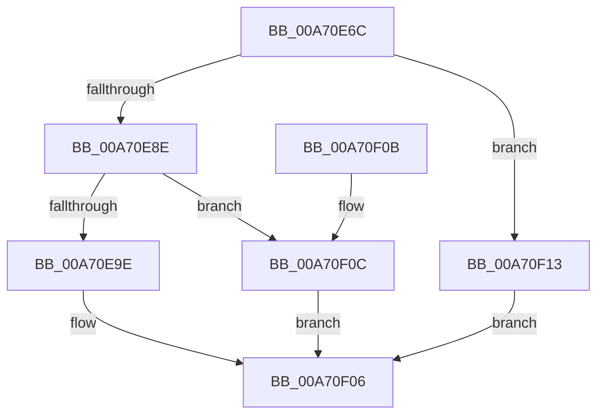

# PnpSetMappedPropertyDispatch

- RVA: `0x00A70E6C`–`0x00A70F1A` (길이 `174` bytes)
- VA: `0x0000000140A70E6C`
- 실행 섹션: `PAGE`
- PDB 이름 있음: `예`; PDB Function 태그: `아니요`
- unwind 정보 RVA: `0x000B5208`
- 디코드: `38`개 명령, `174/174` bytes 표시
- 미해석 바이트: `0` (있으면 어셈블리에 `.byte`로 보존)

> 이 문서는 커널 이미지의 기계어와 PDB 기호를 분석해 생성했습니다. 4번과 5번은 함수 원형과 자료형을 바이너리 사용 방식에서 추정한 C 해석이며 원본 소스 복구 결과는 아닙니다.

## 1. Dependencies

- 직접 호출 지점: **1**; 고유 호출 대상: **1**
- 직접 호출자로 확인된 함수: **1**
- RIP 상대 이미지 참조: **0**

### Outgoing calls
- `0x00A70F01` → [guard_dispatch_icall](../../text/6B/guard_dispatch_icall_function_006BAAD0.md) (function, `0x006BAAD0`)

### Direct callers
- [PnpSetObjectPropertyWorker](../8F/PnpSetObjectPropertyWorker_function_008F7438.md) at `0x008F74F7`

### Static image references
- 디코드된 RIP-relative 메모리 참조가 없습니다.

## 2. Other-region calls and transfers

- 다른 실행 섹션으로 향하는 call: **1**
  - `0x00A70F01` → [guard_dispatch_icall](../../text/6B/guard_dispatch_icall_function_006BAAD0.md) (`PAGE` → `.text`)
- 별도 외부 분기/꼬리 이동을 확인하지 못했습니다.

## 3. Assembly (complete function range)

```asm
00A70E6C  48 83 EC 78                     sub rsp, 0x78
00A70E70  83 64 24 4C 00                  and dword ptr [rsp + 0x4c], 0
00A70E75  41 8D 40 FF                     lea eax, [r8 - 1]
00A70E79  0F 57 C0                        xorps xmm0, xmm0
00A70E7C  4C 8B D9                        mov r11, rcx
00A70E7F  66 0F 7F 44 24 60               movdqa xmmword ptr [rsp + 0x60], xmm0
00A70E85  83 F8 0A                        cmp eax, 0xa
00A70E88  0F 87 85 00 00 00               ja 0x140a70f13
00A70E8E  49 63 C0                        movsxd rax, r8d
00A70E91  4C 8B 94 C1 28 01 00 00         mov r10, qword ptr [rcx + rax*8 + 0x128]
00A70E99  4D 85 D2                        test r10, r10
00A70E9C  74 6E                           je 0x140a70f0c
00A70E9E  48 8B 8C 24 B8 00 00 00         mov rcx, qword ptr [rsp + 0xb8]
00A70EA6  48 8B 84 24 A0 00 00 00         mov rax, qword ptr [rsp + 0xa0]
00A70EAE  48 89 44 24 38                  mov qword ptr [rsp + 0x38], rax
00A70EB3  48 8B 84 24 A8 00 00 00         mov rax, qword ptr [rsp + 0xa8]
00A70EBB  48 89 44 24 40                  mov qword ptr [rsp + 0x40], rax
00A70EC0  8B 84 24 B0 00 00 00            mov eax, dword ptr [rsp + 0xb0]
00A70EC7  48 89 4C 24 50                  mov qword ptr [rsp + 0x50], rcx
00A70ECC  8B 8C 24 C0 00 00 00            mov ecx, dword ptr [rsp + 0xc0]
00A70ED3  89 44 24 48                     mov dword ptr [rsp + 0x48], eax
00A70ED7  48 8D 44 24 30                  lea rax, [rsp + 0x30]
00A70EDC  89 4C 24 58                     mov dword ptr [rsp + 0x58], ecx
00A70EE0  8B 8C 24 C8 00 00 00            mov ecx, dword ptr [rsp + 0xc8]
00A70EE7  48 89 44 24 20                  mov qword ptr [rsp + 0x20], rax
00A70EEC  49 8B C2                        mov rax, r10
00A70EEF  4C 89 4C 24 30                  mov qword ptr [rsp + 0x30], r9
00A70EF4  41 B9 09 00 00 00               mov r9d, 9
00A70EFA  89 4C 24 5C                     mov dword ptr [rsp + 0x5c], ecx
00A70EFE  49 8B CB                        mov rcx, r11
00A70F01  E8 CA 9B C4 FF                  call 0x1406baad0
00A70F06  48 83 C4 78                     add rsp, 0x78
00A70F0A  C3                              ret
00A70F0B  CC                              int3
00A70F0C  B8 02 00 00 C0                  mov eax, 0xc0000002
00A70F11  EB F3                           jmp 0x140a70f06
00A70F13  B8 0D 00 00 C0                  mov eax, 0xc000000d
00A70F18  EB EC                           jmp 0x140a70f06
```

## 4. C-style interpretation (structured pseudocode)

```c
__int64 __fastcall PnpSetMappedPropertyDispatch(__int64 a1, __int64 a2, __int64 a3, __int64 a4, __int64 a5, __int64 a6, unsigned int a7, __int64 a8, unsigned int a9, unsigned int a10)
{
    __int64 result;
    __int64 v_rsp;
    unsigned __int64 v_stack_m18;
    unsigned int v_stack_m1C;
    unsigned int v_stack_m20;
    unsigned __int64 v_stack_m28;
    unsigned int v_stack_m2C;
    unsigned int v_stack_m30;
    unsigned __int64 v_stack_m38;
    unsigned __int64 v_stack_m40;
    unsigned __int64 v_stack_m48;
    unsigned __int64 v_stack_m58;

    v_rsp = (v_rsp) - (120);
    v_stack_m18 = v_xmm0;
    if (((unsigned int)(a3 - 1)) > 10) goto loc_00A70F13;
    if (*(unsigned __int64 *)(a1 + (int)((unsigned int)(a3)) * 8 + 296) == 0) goto loc_00A70F0C;
    v_stack_m40 = a5;
    v_stack_m38 = a6;
    v_stack_m28 = a8;
    v_stack_m30 = (unsigned int)((unsigned int)(a7));
    v_stack_m20 = (unsigned int)((unsigned int)(a9));
    v_stack_m58 = v_stack_m48;
    v_stack_m48 = a4;
    v_stack_m1C = (unsigned int)((unsigned int)(a10));
    result = guard_dispatch_icall(a1, a2, a3, 9);
loc_00A70F06:
    v_rsp = (v_rsp) + (120);
    return result;
loc_00A70F0C:
    goto loc_00A70F06;
loc_00A70F13:
    goto loc_00A70F06;
}
```

## 5. (Beta) C Style

```c
int64_t PnpSetMappedPropertyDispatch(void *Arg1, int64_t Arg2, void *Arg3, int64_t Arg4, int64_t Arg5, int64_t Arg6, uint32_t Arg7, int64_t Arg8, uint32_t Arg9, uint32_t Arg10)
{
    uint8_t *arg1 = (uint8_t *)Arg1;
    uint8_t *arg3 = (uint8_t *)Arg3;

    int64_t result;
    int64_t local_rsp;
    uint64_t v_stack_m18;
    uint32_t v_stack_m1C;
    uint32_t v_stack_m20;
    uint64_t v_stack_m28;
    uint32_t v_stack_m2C;
    uint32_t v_stack_m30;
    uint64_t v_stack_m38;
    uint64_t v_stack_m40;
    uint64_t v_stack_m48;
    uint64_t v_stack_m58;

    local_rsp = (local_rsp) - (120);
    v_stack_m18 = v_xmm0;
    if (((uint32_t)(Arg3 - 1)) > 10) goto loc_00A70F13;
    if (*(uint64_t *)(arg1 + (int32_t)((uint32_t)(arg3)) * 8 + 0x128) == 0) goto loc_00A70F0C;
    v_stack_m40 = Arg5;
    v_stack_m38 = Arg6;
    v_stack_m28 = Arg8;
    v_stack_m30 = (uint32_t)((uint32_t)(Arg7));
    v_stack_m20 = (uint32_t)((uint32_t)(Arg9));
    v_stack_m58 = v_stack_m48;
    v_stack_m48 = Arg4;
    v_stack_m1C = (uint32_t)((uint32_t)(Arg10));
    result = guard_dispatch_icall(Arg1, Arg2, Arg3, 9);
loc_00A70F06:
    local_rsp = (local_rsp) + (120);
    return result;
loc_00A70F0C:
    goto loc_00A70F06;
loc_00A70F13:
    goto loc_00A70F06;
}
```

### 관측된 메모리 오프셋

구조체 형식이 확인되지 않은 접근은 인자 기준의 오프셋으로만 기록했습니다.

| 기준 인자 | 오프셋 표현 | 폭 (bit) | 접근 |
|---|---:|---:|---|
| `Arg1` | `+ 0x128 + rax*8` | `64` | `R` |
| `Arg3` | `- 0x1` | `32` | `R` |

## 6. Execution-region graph

[열기: 2D/3D 그래프와 함수 탐색 컨트롤 패널](../../../control-panel.html?section=page&rva=0x00A70E6C&view=graph)

- 2D 그래프는 위에서 아래로 흐르고, 3D 그래프는 빈 공간을 드래그해 회전합니다. Shift+드래그는 이동, 휠은 확대·축소, 함수 노드 선택은 대상 보고서 이동입니다.

### Static fallback


