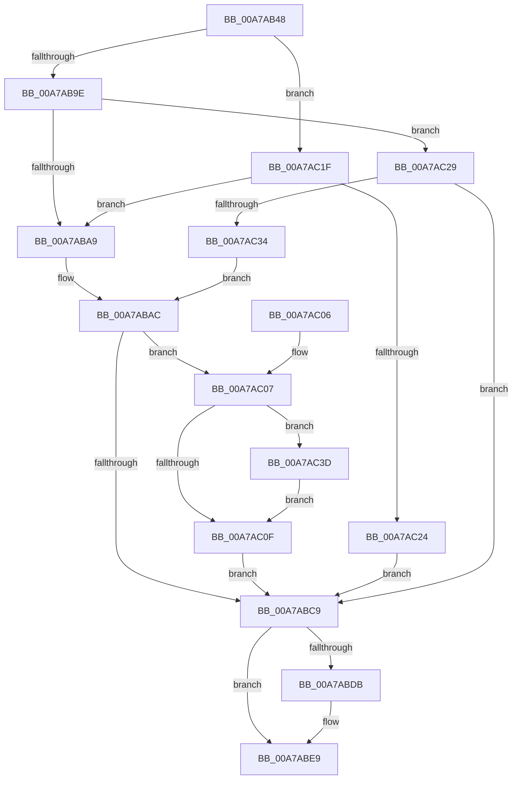

# PopAnsiStringToUnicodeString

- RVA: `0x00A7AB48`–`0x00A7AC46` (길이 `254` bytes)
- VA: `0x0000000140A7AB48`
- 실행 섹션: `PAGE`
- PDB 이름 있음: `예`; PDB Function 태그: `아니요`
- unwind 정보 RVA: `0x000B648C`
- 디코드: `79`개 명령, `254/254` bytes 표시
- 미해석 바이트: `0` (있으면 어셈블리에 `.byte`로 보존)

> 이 문서는 커널 이미지의 기계어와 PDB 기호를 분석해 생성했습니다. 4번과 5번은 함수 원형과 자료형을 바이너리 사용 방식에서 추정한 C 해석이며 원본 소스 복구 결과는 아닙니다.

## 1. Dependencies

- 직접 호출 지점: **4**; 고유 호출 대상: **4**
- 직접 호출자로 확인된 함수: **1**
- RIP 상대 이미지 참조: **0**

### Outgoing calls
- `0x00A7AB81` → [RtlMultiByteToUnicodeSize](../90/RtlMultiByteToUnicodeSize_function_0090CBC0.md) (function, `0x0090CBC0`)
- `0x00A7ABB9` → [ExAllocatePool2](../../poolcode/B8/ExAllocatePool2_function_00B820F0.md) (function, `0x00B820F0`)
- `0x00A7ABD2` → [RtlAnsiStringToUnicodeString](../90/RtlAnsiStringToUnicodeString_function_0090BEA0.md) (function, `0x0090BEA0`)
- `0x00A7AC3F` → [ExFreePoolWithTag](../../poolcode/B8/ExFreePoolWithTag_function_00B82870.md) (function, `0x00B82870`)

### Direct callers
- [PopPowerRequestStatsGetIdForRequest](../A2/PopPowerRequestStatsGetIdForRequest_function_00A2D784.md) at `0x00A2D89A`

### Static image references
- 디코드된 RIP-relative 메모리 참조가 없습니다.

## 2. Other-region calls and transfers

- 다른 실행 섹션으로 향하는 call: **2**
  - `0x00A7ABB9` → [ExAllocatePool2](../../poolcode/B8/ExAllocatePool2_function_00B820F0.md) (`PAGE` → `POOLCODE`)
  - `0x00A7AC3F` → [ExFreePoolWithTag](../../poolcode/B8/ExFreePoolWithTag_function_00B82870.md) (`PAGE` → `POOLCODE`)
- 별도 외부 분기/꼬리 이동을 확인하지 못했습니다.

## 3. Assembly (complete function range)

```asm
00A7AB48  48 8B C4                        mov rax, rsp
00A7AB4B  48 89 58 08                     mov qword ptr [rax + 8], rbx
00A7AB4F  48 89 68 10                     mov qword ptr [rax + 0x10], rbp
00A7AB53  48 89 70 18                     mov qword ptr [rax + 0x18], rsi
00A7AB57  44 89 48 20                     mov dword ptr [rax + 0x20], r9d
00A7AB5B  57                              push rdi
00A7AB5C  41 54                           push r12
00A7AB5E  41 55                           push r13
00A7AB60  41 56                           push r14
00A7AB62  41 57                           push r15
00A7AB64  48 83 EC 20                     sub rsp, 0x20
00A7AB68  44 0F B7 02                     movzx r8d, word ptr [rdx]
00A7AB6C  4C 8B EA                        mov r13, rdx
00A7AB6F  48 8B 52 08                     mov rdx, qword ptr [rdx + 8]
00A7AB73  48 8B F9                        mov rdi, rcx
00A7AB76  45 33 E4                        xor r12d, r12d
00A7AB79  48 8D 48 20                     lea rcx, [rax + 0x20]
00A7AB7D  44 89 60 20                     mov dword ptr [rax + 0x20], r12d
00A7AB81  E8 3A 20 E9 FF                  call 0x14090cbc0
00A7AB86  8B 4C 24 68                     mov ecx, dword ptr [rsp + 0x68]
00A7AB8A  48 8D 5F 08                     lea rbx, [rdi + 8]
00A7AB8E  83 C1 02                        add ecx, 2
00A7AB91  BD FF FF 00 00                  mov ebp, 0xffff
00A7AB96  3B CD                           cmp ecx, ebp
00A7AB98  0F 87 81 00 00 00               ja 0x140a7ac1f
00A7AB9E  8B E9                           mov ebp, ecx
00A7ABA0  4C 39 23                        cmp qword ptr [rbx], r12
00A7ABA3  0F 85 80 00 00 00               jne 0x140a7ac29
00A7ABA9  4C 8B F3                        mov r14, rbx
00A7ABAC  8B D5                           mov edx, ebp
00A7ABAE  B9 00 01 00 00                  mov ecx, 0x100
00A7ABB3  41 B8 50 57 51 54               mov r8d, 0x54515750
00A7ABB9  E8 32 75 10 00                  call 0x140b820f0
00A7ABBE  4C 8B F8                        mov r15, rax
00A7ABC1  48 8B F3                        mov rsi, rbx
00A7ABC4  48 85 C0                        test rax, rax
00A7ABC7  75 3E                           jne 0x140a7ac07
00A7ABC9  45 33 C0                        xor r8d, r8d
00A7ABCC  49 8B D5                        mov rdx, r13
00A7ABCF  48 8B CF                        mov rcx, rdi
00A7ABD2  E8 C9 12 E9 FF                  call 0x14090bea0
00A7ABD7  85 C0                           test eax, eax
00A7ABD9  78 0E                           js 0x140a7abe9
00A7ABDB  0F B7 17                        movzx edx, word ptr [rdi]
00A7ABDE  48 8B 0E                        mov rcx, qword ptr [rsi]
00A7ABE1  48 D1 EA                        shr rdx, 1
00A7ABE4  66 44 89 24 51                  mov word ptr [rcx + rdx*2], r12w
00A7ABE9  48 8B 5C 24 50                  mov rbx, qword ptr [rsp + 0x50]
00A7ABEE  48 8B 6C 24 58                  mov rbp, qword ptr [rsp + 0x58]
00A7ABF3  48 8B 74 24 60                  mov rsi, qword ptr [rsp + 0x60]
00A7ABF8  48 83 C4 20                     add rsp, 0x20
00A7ABFC  41 5F                           pop r15
00A7ABFE  41 5E                           pop r14
00A7AC00  41 5D                           pop r13
00A7AC02  41 5C                           pop r12
00A7AC04  5F                              pop rdi
00A7AC05  C3                              ret
00A7AC06  CC                              int3
00A7AC07  48 8B 0B                        mov rcx, qword ptr [rbx]
00A7AC0A  48 85 C9                        test rcx, rcx
00A7AC0D  75 2E                           jne 0x140a7ac3d
00A7AC0F  4C 89 3B                        mov qword ptr [rbx], r15
00A7AC12  49 8B F6                        mov rsi, r14
00A7AC15  66 44 89 27                     mov word ptr [rdi], r12w
00A7AC19  66 89 6F 02                     mov word ptr [rdi + 2], bp
00A7AC1D  EB AA                           jmp 0x140a7abc9
00A7AC1F  4C 39 23                        cmp qword ptr [rbx], r12
00A7AC22  74 85                           je 0x140a7aba9
00A7AC24  48 8B F3                        mov rsi, rbx
00A7AC27  EB A0                           jmp 0x140a7abc9
00A7AC29  0F B7 47 02                     movzx eax, word ptr [rdi + 2]
00A7AC2D  48 8B F3                        mov rsi, rbx
00A7AC30  3B C1                           cmp eax, ecx
00A7AC32  73 95                           jae 0x140a7abc9
00A7AC34  4C 8D 77 08                     lea r14, [rdi + 8]
00A7AC38  E9 6F FF FF FF                  jmp 0x140a7abac
00A7AC3D  33 D2                           xor edx, edx
00A7AC3F  E8 2C 7C 10 00                  call 0x140b82870
00A7AC44  EB C9                           jmp 0x140a7ac0f
```

## 4. C-style interpretation (structured pseudocode)

```c
__int64 __fastcall PopAnsiStringToUnicodeString(__int64 a1, __int64 a2, __int64 a3, int a4)
{
    __int64 result;
    __int64 v_r12;
    __int64 v_rsp;
    unsigned __int64 v_stack_p10;
    unsigned __int64 v_stack_p18;
    unsigned int v_stack_p20;
    unsigned __int64 v_stack_p8;

    *(unsigned __int64 *)(v_rsp + 8) = v_rbx;
    *(unsigned __int64 *)(v_rsp + 16) = v_rbp;
    *(unsigned __int64 *)(v_rsp + 24) = v_rsi;
    *(unsigned int *)(v_rsp + 32) = a4;
    v_rsp = (v_rsp) - (32);
    v_r12 = 0;
    *(unsigned int *)(v_rsp + 32) = 0;
    result = RtlMultiByteToUnicodeSize(v_rsp + 32, *(unsigned __int64 *)(a2 + 8), *(unsigned __int16 *)(a2), a4);
    a1 = (unsigned int)(((unsigned int)(v_stack_p20)) + (2));
    if (((unsigned int)(a1)) > ((unsigned int)((unsigned int)(0xFFFFULL)))) goto loc_00A7AC1F;
    if ((*(unsigned __int64 *)(a1 + 8)) != 0) goto loc_00A7AC29;
loc_00A7ABA9:
loc_00A7ABAC:
    result = ExAllocatePool2(256, (unsigned int)((unsigned int)((unsigned int)((unsigned int)(a1)))), (unsigned int)(0x54515750ULL), a4);
    if (result != 0) goto loc_00A7AC07;
loc_00A7ABC9:
    a3 = 0;
    result = RtlAnsiStringToUnicodeString(a1, a2, a3, a4);
    if (!(sign_flag)) {
        a2 = *(unsigned __int16 *)(a1);
        a1 = *(unsigned __int64 *)(a1 + 8);
        a2 = (a2) >> (1);
        *(unsigned __int16 *)(a1 + a2 * 2) = 0;
    }
    v_rsp = (v_rsp) + (32);
    return result;
loc_00A7AC07:
    if (*(unsigned __int64 *)(v_stack_p8) != 0) goto loc_00A7AC3D;
loc_00A7AC0F:
    *(unsigned __int64 *)(v_stack_p8) = result;
    *(unsigned __int16 *)(a1) = 0;
    *(unsigned __int16 *)(a1 + 2) = (unsigned __int16)(v_stack_p10);
    goto loc_00A7ABC9;
loc_00A7AC1F:
    if ((*(unsigned __int64 *)(v_stack_p8)) == 0) goto loc_00A7ABA9;
    goto loc_00A7ABC9;
loc_00A7AC29:
    if (((unsigned int)(*(unsigned __int16 *)(a1 + 2))) >= ((unsigned int)(*(unsigned __int64 *)(v_stack_p8)))) goto loc_00A7ABC9;
    goto loc_00A7ABAC;
loc_00A7AC3D:
    a2 = 0;
    result = ExFreePoolWithTag(*(unsigned __int64 *)(v_stack_p8), a2, a3, a4);
    goto loc_00A7AC0F;
}
```

## 5. (Beta) C Style

```c
int64_t PopAnsiStringToUnicodeString(void *Arg1, void *Arg2, int64_t Arg3, int32_t Arg4)
{
    uint8_t *arg1 = (uint8_t *)Arg1;
    uint8_t *arg2 = (uint8_t *)Arg2;

    int64_t result;
    int64_t local_r12;
    int64_t local_rsp;
    uint64_t v_stack_p10;
    uint64_t v_stack_p18;
    uint32_t v_stack_p20;
    uint64_t v_stack_p8;

    *(uint64_t *)(local_rsp + 0x8) = local_rbx;
    *(uint64_t *)(local_rsp + 0x10) = local_rbp;
    *(uint64_t *)(local_rsp + 0x18) = local_rsi;
    *(uint32_t *)(local_rsp + 0x20) = Arg4;
    local_rsp = (local_rsp) - (32);
    local_r12 = 0;
    *(uint32_t *)(local_rsp + 0x20) = 0;
    result = RtlMultiByteToUnicodeSize(local_rsp + 32, *(uint64_t *)(arg2 + 0x8), *(uint16_t *)(arg2), Arg4);
    Arg1 = (uint32_t)(((uint32_t)(v_stack_p20)) + (2));
    if (((uint32_t)(Arg1)) > ((uint32_t)((uint32_t)(0xFFFFULL)))) goto loc_00A7AC1F;
    if ((*(uint64_t *)(arg1 + 0x8)) != 0) goto loc_00A7AC29;
loc_00A7ABA9:
loc_00A7ABAC:
    result = ExAllocatePool2(256, (uint32_t)((uint32_t)((uint32_t)((uint32_t)(Arg1)))), (uint32_t)(0x54515750ULL), Arg4);
    if (result != 0) goto loc_00A7AC07;
loc_00A7ABC9:
    Arg3 = 0;
    result = RtlAnsiStringToUnicodeString(Arg1, Arg2, Arg3, Arg4);
    if (!(sign_flag)) {
        Arg2 = *(uint16_t *)(arg1);
        Arg1 = *(uint64_t *)(arg1 + 0x8);
        Arg2 = (Arg2) >> (1);
        *(uint16_t *)(arg1 + arg2 * 2) = 0;
    }
    local_rsp = (local_rsp) + (32);
    return result;
loc_00A7AC07:
    if (*(uint64_t *)(v_stack_p8) != 0) goto loc_00A7AC3D;
loc_00A7AC0F:
    *(uint64_t *)(v_stack_p8) = result;
    *(uint16_t *)(arg1) = 0;
    *(uint16_t *)(arg1 + 0x2) = (uint16_t)(v_stack_p10);
    goto loc_00A7ABC9;
loc_00A7AC1F:
    if ((*(uint64_t *)(v_stack_p8)) == 0) goto loc_00A7ABA9;
    goto loc_00A7ABC9;
loc_00A7AC29:
    if (((uint32_t)(*(uint16_t *)(arg1 + 0x2))) >= ((uint32_t)(*(uint64_t *)(v_stack_p8)))) goto loc_00A7ABC9;
    goto loc_00A7ABAC;
loc_00A7AC3D:
    Arg2 = 0;
    result = ExFreePoolWithTag(*(uint64_t *)(v_stack_p8), Arg2, Arg3, Arg4);
    goto loc_00A7AC0F;
}
```

### 관측된 메모리 오프셋

구조체 형식이 확인되지 않은 접근은 인자 기준의 오프셋으로만 기록했습니다.

| 기준 인자 | 오프셋 표현 | 폭 (bit) | 접근 |
|---|---:|---:|---|
| `Arg1` | `+ 0x0` | `16` | `R` |
| `Arg1` | `+ 0x0` | `16` | `W` |
| `Arg1` | `+ 0x0` | `64` | `R` |
| `Arg1` | `+ 0x0` | `64` | `W` |
| `Arg1` | `+ 0x2` | `16` | `R` |
| `Arg1` | `+ 0x2` | `16` | `W` |
| `Arg1` | `+ 0x8` | `64` | `R` |
| `Arg2` | `+ 0x0` | `16` | `R` |
| `Arg2` | `+ 0x8` | `64` | `R` |

## 6. Execution-region graph

[열기: 2D/3D 그래프와 함수 탐색 컨트롤 패널](../../../control-panel.html?section=page&rva=0x00A7AB48&view=graph)

- 2D 그래프는 위에서 아래로 흐르고, 3D 그래프는 빈 공간을 드래그해 회전합니다. Shift+드래그는 이동, 휠은 확대·축소, 함수 노드 선택은 대상 보고서 이동입니다.

### Static fallback


