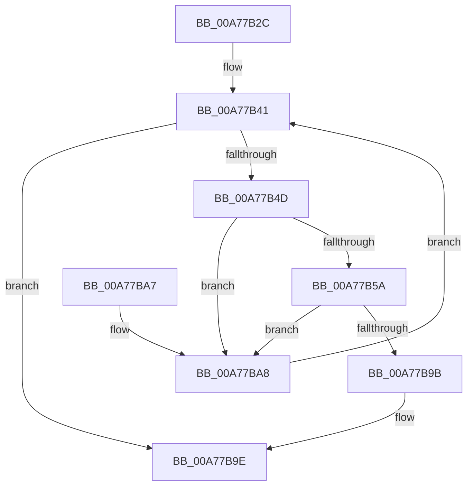

# PopBatteryCheckTriggerAllBatteries

- RVA: `0x00A77B2C`–`0x00A77BAD` (길이 `129` bytes)
- VA: `0x0000000140A77B2C`
- 실행 섹션: `PAGE`
- PDB 이름 있음: `예`; PDB Function 태그: `아니요`
- unwind 정보 RVA: `0x000AE424`
- 디코드: `39`개 명령, `129/129` bytes 표시
- 미해석 바이트: `0` (있으면 어셈블리에 `.byte`로 보존)

> 이 문서는 커널 이미지의 기계어와 PDB 기호를 분석해 생성했습니다. 4번과 5번은 함수 원형과 자료형을 바이너리 사용 방식에서 추정한 C 해석이며 원본 소스 복구 결과는 아닙니다.

## 1. Dependencies

- 직접 호출 지점: **0**; 고유 호출 대상: **0**
- 직접 호출자로 확인된 함수: **2**
- RIP 상대 이미지 참조: **1**

### Outgoing calls
- 직접 디코드된 call 명령이 없습니다.

### Direct callers
- [PopBatteryCheckTrigger](PopBatteryCheckTrigger_function_00A77AF4.md) at `0x00A77B06`
- [PopBatteryApplyCompositeState](../AE/PopBatteryApplyCompositeState_function_00AE0CD0.md) at `0x00AE10F7`

### Static image references
- `0x00A77B31` → RVA `0x00F0C050` (`.data`; read)

## 2. Other-region calls and transfers

- 다른 실행 섹션으로 향하는 call: **0**
- 별도 외부 분기/꼬리 이동을 확인하지 못했습니다.

## 3. Assembly (complete function range)

```asm
00A77B2C  48 89 5C 24 08                  mov qword ptr [rsp + 8], rbx
00A77B31  4C 8B 05 18 45 49 00            mov r8, qword ptr [rip + 0x494518]
00A77B38  44 8B DA                        mov r11d, edx
00A77B3B  48 8B D9                        mov rbx, rcx
00A77B3E  41 B1 01                        mov r9b, 1
00A77B41  48 8D 05 08 45 49 00            lea rax, [rip + 0x494508]
00A77B48  4C 3B C0                        cmp r8, rax
00A77B4B  74 51                           je 0x140a77b9e
00A77B4D  45 8B 50 40                     mov r10d, dword ptr [r8 + 0x40]
00A77B51  41 8D 42 FF                     lea eax, [r10 - 1]
00A77B55  83 F8 FD                        cmp eax, -3
00A77B58  77 4E                           ja 0x140a77ba8
00A77B5A  41 8B CA                        mov ecx, r10d
00A77B5D  B8 1F 85 EB 51                  mov eax, 0x51eb851f
00A77B62  0F AF 4B 18                     imul ecx, dword ptr [rbx + 0x18]
00A77B66  F7 E1                           mul ecx
00A77B68  B8 1F 85 EB 51                  mov eax, 0x51eb851f
00A77B6D  8B CA                           mov ecx, edx
00A77B6F  41 F7 E2                        mul r10d
00A77B72  C1 E9 05                        shr ecx, 5
00A77B75  C1 EA 06                        shr edx, 6
00A77B78  8D 04 11                        lea eax, [rcx + rdx]
00A77B7B  41 8B 48 44                     mov ecx, dword ptr [r8 + 0x44]
00A77B7F  3B C8                           cmp ecx, eax
00A77B81  0F 46 C8                        cmovbe ecx, eax
00A77B84  45 0F AF D3                     imul r10d, r11d
00A77B88  B8 1F 85 EB 51                  mov eax, 0x51eb851f
00A77B8D  41 F7 E2                        mul r10d
00A77B90  C1 EA 05                        shr edx, 5
00A77B93  03 CA                           add ecx, edx
00A77B95  41 39 48 68                     cmp dword ptr [r8 + 0x68], ecx
00A77B99  76 0D                           jbe 0x140a77ba8
00A77B9B  45 32 C9                        xor r9b, r9b
00A77B9E  48 8B 5C 24 08                  mov rbx, qword ptr [rsp + 8]
00A77BA3  41 8A C1                        mov al, r9b
00A77BA6  C3                              ret
00A77BA7  CC                              int3
00A77BA8  4D 8B 00                        mov r8, qword ptr [r8]
00A77BAB  EB 94                           jmp 0x140a77b41
```

## 4. C-style interpretation (structured pseudocode)

```c
__int64 __fastcall PopBatteryCheckTriggerAllBatteries(__int64 a1, int a2)
{
    __int64 v_r10;
    unsigned __int64 v_stack_p8;

    v_stack_p8 = v_rbx;
loc_00A77B41:
    if ((*(unsigned __int64 *)(v_rip + 4801816)) == (v_rip + 4801800)) goto loc_00A77B9E;
    if (((unsigned int)((unsigned int)(*(unsigned int *)(*(unsigned __int64 *)(v_rip + 4801816) + 64)) - 1)) > -3) goto loc_00A77BA8;
    a1 = (unsigned int)(((unsigned int)((unsigned int)((unsigned int)(*(unsigned int *)(*(unsigned __int64 *)(v_rip + 4801816) + 64))))) * (*(unsigned int *)(a1 + 24)));
    a1 = (unsigned int)(((unsigned int)(a2)) >> (5));
    a2 = (unsigned int)((a2) >> (6));
    a1 = (unsigned int)(*(unsigned int *)(*(unsigned __int64 *)(v_rip + 4801816) + 68));
    if (((unsigned int)((unsigned int)(*(unsigned int *)(*(unsigned __int64 *)(v_rip + 4801816) + 68)))) <= ((unsigned int)(a1 + a2 * 1))) { a1 = (unsigned int)(a1 + a2 * 1); }
    v_r10 = (unsigned int)(((unsigned int)(*(unsigned int *)(*(unsigned __int64 *)(v_rip + 4801816) + 64))) * ((unsigned int)((unsigned int)(a2))));
    a2 = (unsigned int)((a2) >> (5));
    a1 = (unsigned int)((a1) + (a2));
    if ((*(unsigned int *)(*(unsigned __int64 *)(v_rip + 4801816) + 104)) <= ((unsigned int)(a1))) goto loc_00A77BA8;
    a4 = 0;
loc_00A77B9E:
    return 0;
loc_00A77BA8:
    goto loc_00A77B41;
}
```

## 5. (Beta) C Style

```c
int64_t PopBatteryCheckTriggerAllBatteries(void *Arg1, int32_t Arg2)
{
    uint8_t *arg1 = (uint8_t *)Arg1;

    int64_t local_r10;
    uint64_t v_stack_p8;

    v_stack_p8 = local_rbx;
loc_00A77B41:
    if ((*(uint64_t *)(v_rip + 0x494518)) == (v_rip + 4801800)) goto loc_00A77B9E;
    if (((uint32_t)((uint32_t)(*(uint32_t *)(*(uint64_t *)(v_rip + 0x494518) + 0x40)) - 1)) > -3) goto loc_00A77BA8;
    Arg1 = (uint32_t)(((uint32_t)((uint32_t)((uint32_t)(*(uint32_t *)(*(uint64_t *)(v_rip + 0x494518) + 0x40))))) * (*(uint32_t *)(arg1 + 0x18)));
    Arg1 = (uint32_t)(((uint32_t)(Arg2)) >> (5));
    Arg2 = (uint32_t)((Arg2) >> (6));
    Arg1 = (uint32_t)(*(uint32_t *)(*(uint64_t *)(v_rip + 0x494518) + 0x44));
    if (((uint32_t)((uint32_t)(*(uint32_t *)(*(uint64_t *)(v_rip + 0x494518) + 0x44)))) <= ((uint32_t)(Arg1 + Arg2 * 1))) { Arg1 = (uint32_t)(Arg1 + Arg2 * 1); }
    local_r10 = (uint32_t)(((uint32_t)(*(uint32_t *)(*(uint64_t *)(v_rip + 0x494518) + 0x40))) * ((uint32_t)((uint32_t)(Arg2))));
    Arg2 = (uint32_t)((Arg2) >> (5));
    Arg1 = (uint32_t)((Arg1) + (Arg2));
    if ((*(uint32_t *)(*(uint64_t *)(v_rip + 0x494518) + 0x68)) <= ((uint32_t)(Arg1))) goto loc_00A77BA8;
    a4 = 0;
loc_00A77B9E:
    return 0;
loc_00A77BA8:
    goto loc_00A77B41;
}
```

### 관측된 메모리 오프셋

구조체 형식이 확인되지 않은 접근은 인자 기준의 오프셋으로만 기록했습니다.

| 기준 인자 | 오프셋 표현 | 폭 (bit) | 접근 |
|---|---:|---:|---|
| `Arg1` | `+ 0x18` | `32` | `R` |

## 6. Execution-region graph

[열기: 2D/3D 그래프와 함수 탐색 컨트롤 패널](../../../control-panel.html?section=page&rva=0x00A77B2C&view=graph)

- 2D 그래프는 위에서 아래로 흐르고, 3D 그래프는 빈 공간을 드래그해 회전합니다. Shift+드래그는 이동, 휠은 확대·축소, 함수 노드 선택은 대상 보고서 이동입니다.

### Static fallback


