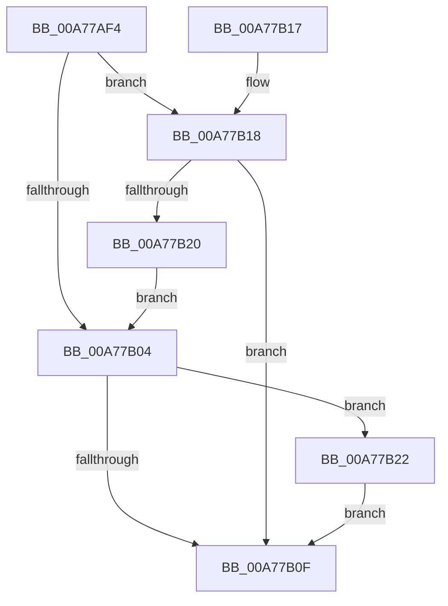

# PopBatteryCheckTrigger

- RVA: `0x00A77AF4`–`0x00A77B26` (길이 `50` bytes)
- VA: `0x0000000140A77AF4`
- 실행 섹션: `PAGE`
- PDB 이름 있음: `예`; PDB Function 태그: `아니요`
- unwind 정보 RVA: `0x000704F4`
- 디코드: `19`개 명령, `50/50` bytes 표시
- 미해석 바이트: `0` (있으면 어셈블리에 `.byte`로 보존)

> 이 문서는 커널 이미지의 기계어와 PDB 기호를 분석해 생성했습니다. 4번과 5번은 함수 원형과 자료형을 바이너리 사용 방식에서 추정한 C 해석이며 원본 소스 복구 결과는 아닙니다.

## 1. Dependencies

- 직접 호출 지점: **1**; 고유 호출 대상: **1**
- 직접 호출자로 확인된 함수: **2**
- RIP 상대 이미지 참조: **2**

### Outgoing calls
- `0x00A77B06` → [PopBatteryCheckTriggerAllBatteries](PopBatteryCheckTriggerAllBatteries_function_00A77B2C.md) (function, `0x00A77B2C`)

### Direct callers
- [PopBatteryApplyCompositeState](../AE/PopBatteryApplyCompositeState_function_00AE0CD0.md) at `0x00AE116A`
- [PopRecalculateCBTriggerLevels](../AE/PopRecalculateCBTriggerLevels_function_00AE3018.md) at `0x00AE30C3`

### Static image references
- `0x00A77AFC` → RVA `0x00F0C09C` (`.data`; read)
- `0x00A77B18` → RVA `0x00F0C0A0` (`.data`; read)

## 2. Other-region calls and transfers

- 다른 실행 섹션으로 향하는 call: **0**
- 별도 외부 분기/꼬리 이동을 확인하지 못했습니다.

## 3. Assembly (complete function range)

```asm
00A77AF4  40 53                           push rbx
00A77AF6  48 83 EC 20                     sub rsp, 0x20
00A77AFA  33 DB                           xor ebx, ebx
00A77AFC  39 1D 9A 45 49 00               cmp dword ptr [rip + 0x49459a], ebx
00A77B02  76 14                           jbe 0x140a77b18
00A77B04  33 D2                           xor edx, edx
00A77B06  E8 21 00 00 00                  call 0x140a77b2c
00A77B0B  84 C0                           test al, al
00A77B0D  75 13                           jne 0x140a77b22
00A77B0F  8A C3                           mov al, bl
00A77B11  48 83 C4 20                     add rsp, 0x20
00A77B15  5B                              pop rbx
00A77B16  C3                              ret
00A77B17  CC                              int3
00A77B18  39 1D 82 45 49 00               cmp dword ptr [rip + 0x494582], ebx
00A77B1E  76 EF                           jbe 0x140a77b0f
00A77B20  EB E2                           jmp 0x140a77b04
00A77B22  B3 01                           mov bl, 1
00A77B24  EB E9                           jmp 0x140a77b0f
```

## 4. C-style interpretation (structured pseudocode)

```c
__int64 __fastcall PopBatteryCheckTrigger(__int64 a1, int a2)
{
    __int64 result;
    __int64 v_rbx;
    __int64 v_rsp;

    v_rsp = (v_rsp) - (32);
    v_rbx = 0;
    if ((*(unsigned int *)(v_rip + 4801946)) <= 0) goto loc_00A77B18;
loc_00A77B04:
    a2 = 0;
    result = PopBatteryCheckTriggerAllBatteries(a1, a2, a3, a4);
    if ((unsigned __int8)(result) != 0) goto loc_00A77B22;
loc_00A77B0F:
    v_rsp = (v_rsp) + (32);
    return 0;
loc_00A77B18:
    if ((*(unsigned int *)(v_rip + 4801922)) <= 0) goto loc_00A77B0F;
    goto loc_00A77B04;
loc_00A77B22:
    goto loc_00A77B0F;
}
```

## 5. (Beta) C Style

```c
int64_t PopBatteryCheckTrigger(int64_t Arg1, int32_t Arg2)
{
    int64_t result;
    int64_t local_rbx;
    int64_t local_rsp;

    local_rsp = (local_rsp) - (32);
    local_rbx = 0;
    if ((*(uint32_t *)(v_rip + 0x49459A)) <= 0) goto loc_00A77B18;
loc_00A77B04:
    Arg2 = 0;
    result = PopBatteryCheckTriggerAllBatteries(Arg1, Arg2, a3, a4);
    if ((uint8_t)(result) != 0) goto loc_00A77B22;
loc_00A77B0F:
    local_rsp = (local_rsp) + (32);
    return 0;
loc_00A77B18:
    if ((*(uint32_t *)(v_rip + 0x494582)) <= 0) goto loc_00A77B0F;
    goto loc_00A77B04;
loc_00A77B22:
    goto loc_00A77B0F;
}
```

## 6. Execution-region graph

[열기: 2D/3D 그래프와 함수 탐색 컨트롤 패널](../../../control-panel.html?section=page&rva=0x00A77AF4&view=graph)

- 2D 그래프는 위에서 아래로 흐르고, 3D 그래프는 빈 공간을 드래그해 회전합니다. Shift+드래그는 이동, 휠은 확대·축소, 함수 노드 선택은 대상 보고서 이동입니다.

### Static fallback


