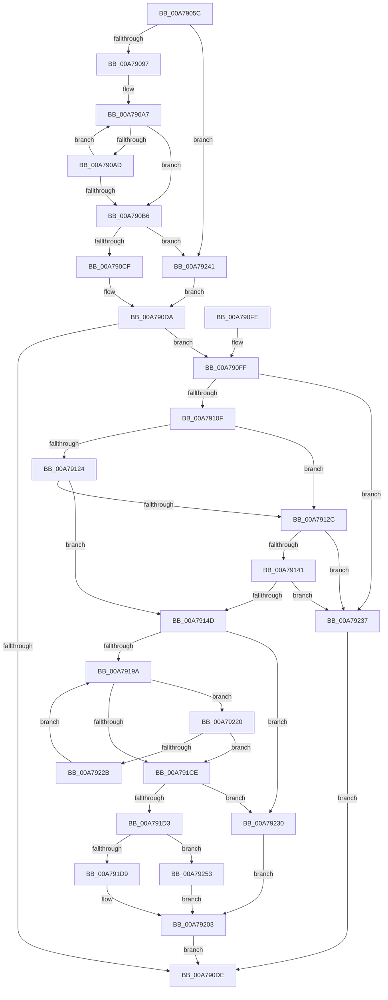

# PopBatteryDeviceState

- RVA: `0x00A7905C`–`0x00A7925A` (길이 `510` bytes)
- VA: `0x0000000140A7905C`
- 실행 섹션: `PAGE`
- PDB 이름 있음: `예`; PDB Function 태그: `아니요`
- unwind 정보 RVA: `0x000B6198`
- 디코드: `132`개 명령, `510/510` bytes 표시
- 미해석 바이트: `0` (있으면 어셈블리에 `.byte`로 보존)

> 이 문서는 커널 이미지의 기계어와 PDB 기호를 분석해 생성했습니다. 4번과 5번은 함수 원형과 자료형을 바이너리 사용 방식에서 추정한 C 해석이며 원본 소스 복구 결과는 아닙니다.

## 1. Dependencies

- 직접 호출 지점: **7**; 고유 호출 대상: **4**
- 직접 호출자로 확인된 함수: **1**
- RIP 상대 이미지 참조: **5**

### Outgoing calls
- `0x00A7910F` → [PsGetCurrentServerSiloGlobals](../../text/2F/PsGetCurrentServerSiloGlobals_function_002FE1F0.md) (function, `0x002FE1F0`)
- `0x00A7912C` → [PsGetCurrentServerSiloGlobals](../../text/2F/PsGetCurrentServerSiloGlobals_function_002FE1F0.md) (function, `0x002FE1F0`)
- `0x00A79172` → [PopAcquireRwLockShared](../../text/2D/PopAcquireRwLockShared_function_002D9A40.md) (function, `0x002D9A40`)
- `0x00A7917E` → [PopAcquireRwLockShared](../../text/2D/PopAcquireRwLockShared_function_002D9A40.md) (function, `0x002D9A40`)
- `0x00A791C5` → [RtlEqualUnicodeString](../93/RtlEqualUnicodeString_function_00932A20.md) (function, `0x00932A20`)
- `0x00A7920A` → [PopReleaseRwLock](../../text/2D/PopReleaseRwLock_function_002DFBBC.md) (function, `0x002DFBBC`)
- `0x00A79216` → [PopReleaseRwLock](../../text/2D/PopReleaseRwLock_function_002DFBBC.md) (function, `0x002DFBBC`)

### Direct callers
- [NtPowerInformation](../95/NtPowerInformation_function_00955D80.md) at `0x009579FB`

### Static image references
- `0x00A79114` → RVA `0x000036E0` (`.rdata`; read)
- `0x00A79131` → RVA `0x000036F0` (`.rdata`; read)
- `0x00A79153` → RVA `0x00F0C900` (`.data`; read)
- `0x00A79177` → RVA `0x00F0C020` (`.data`; read)
- `0x00A79183` → RVA `0x00F0C040` (`.data`; read)

## 2. Other-region calls and transfers

- 다른 실행 섹션으로 향하는 call: **6**
  - `0x00A7910F` → [PsGetCurrentServerSiloGlobals](../../text/2F/PsGetCurrentServerSiloGlobals_function_002FE1F0.md) (`PAGE` → `.text`)
  - `0x00A7912C` → [PsGetCurrentServerSiloGlobals](../../text/2F/PsGetCurrentServerSiloGlobals_function_002FE1F0.md) (`PAGE` → `.text`)
  - `0x00A79172` → [PopAcquireRwLockShared](../../text/2D/PopAcquireRwLockShared_function_002D9A40.md) (`PAGE` → `.text`)
  - `0x00A7917E` → [PopAcquireRwLockShared](../../text/2D/PopAcquireRwLockShared_function_002D9A40.md) (`PAGE` → `.text`)
  - `0x00A7920A` → [PopReleaseRwLock](../../text/2D/PopReleaseRwLock_function_002DFBBC.md) (`PAGE` → `.text`)
  - `0x00A79216` → [PopReleaseRwLock](../../text/2D/PopReleaseRwLock_function_002DFBBC.md) (`PAGE` → `.text`)
- 별도 외부 분기/꼬리 이동을 확인하지 못했습니다.

## 3. Assembly (complete function range)

```asm
00A7905C  48 89 5C 24 08                  mov qword ptr [rsp + 8], rbx
00A79061  48 89 74 24 10                  mov qword ptr [rsp + 0x10], rsi
00A79066  48 89 7C 24 18                  mov qword ptr [rsp + 0x18], rdi
00A7906B  55                              push rbp
00A7906C  41 54                           push r12
00A7906E  41 55                           push r13
00A79070  41 56                           push r14
00A79072  41 57                           push r15
00A79074  48 8B EC                        mov rbp, rsp
00A79077  48 83 EC 40                     sub rsp, 0x40
00A7907B  45 33 F6                        xor r14d, r14d
00A7907E  0F 57 C0                        xorps xmm0, xmm0
00A79081  48 8B F2                        mov rsi, rdx
00A79084  4C 8B C9                        mov r9, rcx
00A79087  41 8B DE                        mov ebx, r14d
00A7908A  0F 11 45 E0                     movups xmmword ptr [rbp - 0x20], xmm0
00A7908E  48 85 C9                        test rcx, rcx
00A79091  0F 84 AA 01 00 00               je 0x140a79241
00A79097  41 B8 FF 7F 00 00               mov r8d, 0x7fff
00A7909D  45 8D 56 02                     lea r10d, [r14 + 2]
00A790A1  41 8B C8                        mov ecx, r8d
00A790A4  49 8B C1                        mov rax, r9
00A790A7  66 44 39 30                     cmp word ptr [rax], r14w
00A790AB  74 09                           je 0x140a790b6
00A790AD  49 03 C2                        add rax, r10
00A790B0  48 83 E9 01                     sub rcx, 1
00A790B4  75 F1                           jne 0x140a790a7
00A790B6  48 8B C1                        mov rax, rcx
00A790B9  48 F7 D8                        neg rax
00A790BC  1B DB                           sbb ebx, ebx
00A790BE  F7 D3                           not ebx
00A790C0  81 E3 0D 00 00 C0               and ebx, 0xc000000d
00A790C6  48 85 C9                        test rcx, rcx
00A790C9  0F 84 72 01 00 00               je 0x140a79241
00A790CF  4C 2B C1                        sub r8, rcx
00A790D2  66 45 03 C0                     add r8w, r8w
00A790D6  43 8D 14 02                     lea edx, [r10 + r8]
00A790DA  85 DB                           test ebx, ebx
00A790DC  79 21                           jns 0x140a790ff
00A790DE  4C 8D 5C 24 40                  lea r11, [rsp + 0x40]
00A790E3  8B C3                           mov eax, ebx
00A790E5  49 8B 5B 30                     mov rbx, qword ptr [r11 + 0x30]
00A790E9  49 8B 73 38                     mov rsi, qword ptr [r11 + 0x38]
00A790ED  49 8B 7B 40                     mov rdi, qword ptr [r11 + 0x40]
00A790F1  49 8B E3                        mov rsp, r11
00A790F4  41 5F                           pop r15
00A790F6  41 5E                           pop r14
00A790F8  41 5D                           pop r13
00A790FA  41 5C                           pop r12
00A790FC  5D                              pop rbp
00A790FD  C3                              ret
00A790FE  CC                              int3
00A790FF  41 BF 08 00 00 00               mov r15d, 8
00A79105  66 45 3B C7                     cmp r8w, r15w
00A79109  0F 86 28 01 00 00               jbe 0x140a79237
00A7910F  E8 DC 50 88 FF                  call 0x1402fe1f0
00A79114  48 8B 0D C5 A5 58 FF            mov rcx, qword ptr [rip - 0xa75a3b]
00A7911B  45 0F B7 D0                     movzx r10d, r8w
00A7911F  45 3B D7                        cmp r10d, r15d
00A79122  72 08                           jb 0x140a7912c
00A79124  48 8B 09                        mov rcx, qword ptr [rcx]
00A79127  49 3B 09                        cmp rcx, qword ptr [r9]
00A7912A  74 21                           je 0x140a7914d
00A7912C  E8 BF 50 88 FF                  call 0x1402fe1f0
00A79131  48 8B 0D B8 A5 58 FF            mov rcx, qword ptr [rip - 0xa75a48]
00A79138  45 3B D7                        cmp r10d, r15d
00A7913B  0F 82 F6 00 00 00               jb 0x140a79237
00A79141  48 8B 09                        mov rcx, qword ptr [rcx]
00A79144  49 3B 09                        cmp rcx, qword ptr [r9]
00A79147  0F 85 EA 00 00 00               jne 0x140a79237
00A7914D  41 BC F8 FF 00 00               mov r12d, 0xfff8
00A79153  48 8D 0D A6 37 49 00            lea rcx, [rip + 0x4937a6]
00A7915A  66 45 03 C4                     add r8w, r12w
00A7915E  66 41 03 D4                     add dx, r12w
00A79162  4D 03 CF                        add r9, r15
00A79165  66 44 89 45 E0                  mov word ptr [rbp - 0x20], r8w
00A7916A  66 89 55 E2                     mov word ptr [rbp - 0x1e], dx
00A7916E  4C 89 4D E8                     mov qword ptr [rbp - 0x18], r9
00A79172  E8 C9 08 86 FF                  call 0x1402d9a40
00A79177  48 8D 0D A2 2E 49 00            lea rcx, [rip + 0x492ea2]
00A7917E  E8 BD 08 86 FF                  call 0x1402d9a40
00A79183  48 8B 3D B6 2E 49 00            mov rdi, qword ptr [rip + 0x492eb6]
00A7918A  4C 8D 2D AF 2E 49 00            lea r13, [rip + 0x492eaf]
00A79191  49 3B FD                        cmp rdi, r13
00A79194  0F 84 96 00 00 00               je 0x140a79230
00A7919A  0F 10 47 20                     movups xmm0, xmmword ptr [rdi + 0x20]
00A7919E  48 8B 47 28                     mov rax, qword ptr [rdi + 0x28]
00A791A2  48 8D 55 F0                     lea rdx, [rbp - 0x10]
00A791A6  49 03 C7                        add rax, r15
00A791A9  48 8D 4D E0                     lea rcx, [rbp - 0x20]
00A791AD  0F 11 45 F0                     movups xmmword ptr [rbp - 0x10], xmm0
00A791B1  66 44 01 65 F0                  add word ptr [rbp - 0x10], r12w
00A791B6  41 B0 01                        mov r8b, 1
00A791B9  66 44 01 65 F2                  add word ptr [rbp - 0xe], r12w
00A791BE  48 8B DF                        mov rbx, rdi
00A791C1  48 89 45 F8                     mov qword ptr [rbp - 8], rax
00A791C5  E8 56 98 EB FF                  call 0x140932a20
00A791CA  84 C0                           test al, al
00A791CC  74 52                           je 0x140a79220
00A791CE  48 85 DB                        test rbx, rbx
00A791D1  74 5D                           je 0x140a79230
00A791D3  83 7B 68 03                     cmp dword ptr [rbx + 0x68], 3
00A791D7  75 7A                           jne 0x140a79253
00A791D9  0F 10 43 70                     movups xmm0, xmmword ptr [rbx + 0x70]
00A791DD  0F 11 06                        movups xmmword ptr [rsi], xmm0
00A791E0  0F 10 8B 80 00 00 00            movups xmm1, xmmword ptr [rbx + 0x80]
00A791E7  0F 11 4E 10                     movups xmmword ptr [rsi + 0x10], xmm1
00A791EB  8B 83 90 00 00 00               mov eax, dword ptr [rbx + 0x90]
00A791F1  89 46 20                        mov dword ptr [rsi + 0x20], eax
00A791F4  0F 10 83 A4 00 00 00            movups xmm0, xmmword ptr [rbx + 0xa4]
00A791FB  41 8B DE                        mov ebx, r14d
00A791FE  F3 0F 7F 46 24                  movdqu xmmword ptr [rsi + 0x24], xmm0
00A79203  48 8D 0D 16 2E 49 00            lea rcx, [rip + 0x492e16]
00A7920A  E8 AD 69 86 FF                  call 0x1402dfbbc
00A7920F  48 8D 0D EA 36 49 00            lea rcx, [rip + 0x4936ea]
00A79216  E8 A1 69 86 FF                  call 0x1402dfbbc
00A7921B  E9 BE FE FF FF                  jmp 0x140a790de
00A79220  48 8B 3F                        mov rdi, qword ptr [rdi]
00A79223  49 8B DE                        mov rbx, r14
00A79226  49 3B FD                        cmp rdi, r13
00A79229  74 A3                           je 0x140a791ce
00A7922B  E9 6A FF FF FF                  jmp 0x140a7919a
00A79230  BB 34 00 00 C0                  mov ebx, 0xc0000034
00A79235  EB CC                           jmp 0x140a79203
00A79237  BB 33 00 00 C0                  mov ebx, 0xc0000033
00A7923C  E9 9D FE FF FF                  jmp 0x140a790de
00A79241  44 0F B7 45 E0                  movzx r8d, word ptr [rbp - 0x20]
00A79246  0F B7 55 E2                     movzx edx, word ptr [rbp - 0x1e]
00A7924A  4C 8B 4D E8                     mov r9, qword ptr [rbp - 0x18]
00A7924E  E9 87 FE FF FF                  jmp 0x140a790da
00A79253  BB A3 00 00 C0                  mov ebx, 0xc00000a3
00A79258  EB A9                           jmp 0x140a79203
```

## 4. C-style interpretation (structured pseudocode)

```c
__int64 __fastcall PopBatteryDeviceState(__int64 a1, __int64 a2)
{
    __int64 result;
    __int64 v_r14;
    __int64 v_rbx;
    __int64 v_rsp;
    unsigned __int64 v_stack_m28;
    unsigned __int64 v_stack_m30;
    unsigned __int16 v_stack_m36;
    unsigned __int64 v_stack_m38;
    unsigned __int64 v_stack_m40;
    unsigned __int16 v_stack_m46;
    unsigned __int64 v_stack_m48;
    unsigned __int64 v_stack_p10;
    unsigned __int64 v_stack_p18;
    unsigned __int64 v_stack_p8;

    v_stack_p8 = v_rbx;
    v_stack_p10 = v_rsi;
    v_stack_p18 = v_rdi;
    v_rsp = (v_rsp) - (64);
    v_r14 = 0;
    v_stack_m48 = v_xmm0;
    if (a1 == 0) goto loc_00A79241;
loc_00A790A7:
    if ((*(unsigned __int16 *)(a1)) == 0) goto loc_00A790B6;
    result = (a1) + (v_r14 + 2);
    a1 = ((unsigned int)((unsigned int)((unsigned int)(0x7FFFULL)))) - (1);
    if (condition_is_not_equal) goto loc_00A790A7;
loc_00A790B6:
    result = -(a1);
    v_rbx = (unsigned int)(~(0));
    v_rbx = (unsigned int)((v_rbx) & (0xC000000DULL));
    if (a1 == 0) goto loc_00A79241;
    a3 = ((unsigned int)(0x7FFFULL)) - (a1);
    a3 = (unsigned __int16)((a3) + ((unsigned __int16)(a3)));
loc_00A790DA:
    if (!sign_flag) goto loc_00A790FF;
loc_00A790DE:
    return (unsigned int)((unsigned int)(v_rbx));
loc_00A790FF:
    if (((unsigned __int16)(a3)) <= 8) goto loc_00A79237;
    result = PsGetCurrentServerSiloGlobals(a1, v_r14 + 2 + a3 * 1, a3, a1);
    if (((unsigned int)((unsigned __int16)(a3))) < 8) goto loc_00A7912C;
    if ((*(unsigned __int64 *)(*(unsigned __int64 *)(v_rip - 10967611))) == (*(unsigned __int64 *)(a1))) goto loc_00A7914D;
loc_00A7912C:
    result = PsGetCurrentServerSiloGlobals(*(unsigned __int64 *)(*(unsigned __int64 *)(v_rip - 10967611)), v_r14 + 2 + a3 * 1, a3, a1);
    if (((unsigned int)((unsigned __int16)(a3))) < 8) goto loc_00A79237;
    if ((*(unsigned __int64 *)(*(unsigned __int64 *)(v_rip - 10967624))) != (*(unsigned __int64 *)(a1))) goto loc_00A79237;
loc_00A7914D:
    a3 = (unsigned __int16)((a3) + ((unsigned __int16)((unsigned int)(0xFFF8ULL))));
    a2 = (unsigned __int16)((v_r14 + 2 + a3 * 1) + ((unsigned __int16)((unsigned int)(0xFFF8ULL))));
    a4 = (a1) + (8);
    v_stack_m48 = (unsigned __int16)(a3);
    v_stack_m46 = (unsigned __int16)(a2);
    v_stack_m40 = a4;
    result = PopAcquireRwLockShared(v_rip + 4798374, a2, a3, a4);
    result = PopAcquireRwLockShared(v_rip + 4796066, a2, a3, a4);
    if ((*(unsigned __int64 *)(v_rip + 4796086)) == (v_rip + 4796079)) goto loc_00A79230;
loc_00A7919A:
    result = (*(unsigned __int64 *)(*(unsigned __int64 *)(v_rip + 4796086) + 40)) + (8);
    v_stack_m38 = v_xmm0;
    v_stack_m30 = result;
    result = RtlEqualUnicodeString(v_stack_m48, v_stack_m38, 1, a4);
    if ((unsigned __int8)(result) == 0) goto loc_00A79220;
loc_00A791CE:
    if (*(unsigned __int64 *)(v_rip + 4796086) == 0) goto loc_00A79230;
    if ((*(unsigned int *)(*(unsigned __int64 *)(v_rip + 4796086) + 104)) != 3) goto loc_00A79253;
    *(unsigned __int64 *)(*(unsigned __int64 *)(v_stack_m28 + 56)) = v_xmm0;
    *(unsigned __int64 *)(*(unsigned __int64 *)(v_stack_m28 + 56) + 16) = v_xmm1;
    *(unsigned int *)(*(unsigned __int64 *)(v_stack_m28 + 56) + 32) = (unsigned int)((unsigned int)(*(unsigned int *)(*(unsigned __int64 *)(v_rip + 4796086) + 144)));
    *(unsigned __int64 *)(*(unsigned __int64 *)(v_stack_m28 + 56) + 36) = v_xmm0;
loc_00A79203:
    result = PopReleaseRwLock(v_rip + 4795926, v_stack_m38, 1, a4);
    result = PopReleaseRwLock(v_rip + 4798186, v_stack_m38, 1, a4);
    goto loc_00A790DE;
loc_00A79220:
    if ((*(unsigned __int64 *)(*(unsigned __int64 *)(v_rip + 4796086))) == (v_rip + 4796079)) goto loc_00A791CE;
    goto loc_00A7919A;
loc_00A79230:
    goto loc_00A79203;
loc_00A79237:
    goto loc_00A790DE;
loc_00A79241:
    goto loc_00A790DA;
loc_00A79253:
    goto loc_00A79203;
}
```

## 5. (Beta) C Style

```c
int64_t PopBatteryDeviceState(void *Arg1, void *Arg2)
{
    uint8_t *arg1 = (uint8_t *)Arg1;
    uint8_t *arg2 = (uint8_t *)Arg2;

    int64_t result;
    int64_t local_r14;
    int64_t local_rbx;
    int64_t local_rsp;
    uint64_t v_stack_m28;
    uint64_t v_stack_m30;
    uint16_t v_stack_m36;
    uint64_t v_stack_m38;
    uint64_t v_stack_m40;
    uint16_t v_stack_m46;
    uint64_t v_stack_m48;
    uint64_t v_stack_p10;
    uint64_t v_stack_p18;
    uint64_t v_stack_p8;

    v_stack_p8 = local_rbx;
    v_stack_p10 = local_rsi;
    v_stack_p18 = local_rdi;
    local_rsp = (local_rsp) - (64);
    local_r14 = 0;
    v_stack_m48 = v_xmm0;
    if (Arg1 == NULL) goto loc_00A79241;
loc_00A790A7:
    if ((*(uint16_t *)(arg1)) == 0) goto loc_00A790B6;
    result = (Arg1) + (local_r14 + 2);
    Arg1 = ((uint32_t)((uint32_t)((uint32_t)(0x7FFFULL)))) - (1);
    if (condition_is_not_equal) goto loc_00A790A7;
loc_00A790B6:
    result = -(Arg1);
    local_rbx = (uint32_t)(~(0));
    local_rbx = (uint32_t)((local_rbx) & (0xC000000DULL));
    if (Arg1 == NULL) goto loc_00A79241;
    a3 = ((uint32_t)(0x7FFFULL)) - (Arg1);
    a3 = (uint16_t)((a3) + ((uint16_t)(a3)));
loc_00A790DA:
    if (!sign_flag) goto loc_00A790FF;
loc_00A790DE:
    return (uint32_t)((uint32_t)(local_rbx));
loc_00A790FF:
    if (((uint16_t)(a3)) <= 8) goto loc_00A79237;
    result = PsGetCurrentServerSiloGlobals(Arg1, local_r14 + 2 + a3 * 1, a3, Arg1);
    if (((uint32_t)((uint16_t)(a3))) < 8) goto loc_00A7912C;
    if ((*(uint64_t *)(*(uint64_t *)(v_rip - 0xA75A3B))) == (*(uint64_t *)(arg1))) goto loc_00A7914D;
loc_00A7912C:
    result = PsGetCurrentServerSiloGlobals(*(uint64_t *)(*(uint64_t *)(v_rip - 0xA75A3B)), local_r14 + 2 + a3 * 1, a3, Arg1);
    if (((uint32_t)((uint16_t)(a3))) < 8) goto loc_00A79237;
    if ((*(uint64_t *)(*(uint64_t *)(v_rip - 0xA75A48))) != (*(uint64_t *)(arg1))) goto loc_00A79237;
loc_00A7914D:
    a3 = (uint16_t)((a3) + ((uint16_t)((uint32_t)(0xFFF8ULL))));
    Arg2 = (uint16_t)((local_r14 + 2 + a3 * 1) + ((uint16_t)((uint32_t)(0xFFF8ULL))));
    a4 = (Arg1) + (8);
    v_stack_m48 = (uint16_t)(a3);
    v_stack_m46 = (uint16_t)(Arg2);
    v_stack_m40 = a4;
    result = PopAcquireRwLockShared(v_rip + 4798374, Arg2, a3, a4);
    result = PopAcquireRwLockShared(v_rip + 4796066, Arg2, a3, a4);
    if ((*(uint64_t *)(v_rip + 0x492EB6)) == (v_rip + 4796079)) goto loc_00A79230;
loc_00A7919A:
    result = (*(uint64_t *)(*(uint64_t *)(v_rip + 0x492EB6) + 0x28)) + (8);
    v_stack_m38 = v_xmm0;
    v_stack_m30 = result;
    result = RtlEqualUnicodeString(v_stack_m48, v_stack_m38, 1, a4);
    if ((uint8_t)(result) == 0) goto loc_00A79220;
loc_00A791CE:
    if (*(uint64_t *)(v_rip + 0x492EB6) == 0) goto loc_00A79230;
    if ((*(uint32_t *)(*(uint64_t *)(v_rip + 0x492EB6) + 0x68)) != 3) goto loc_00A79253;
    *(uint64_t *)(*(uint64_t *)(v_stack_m28 + 0x38)) = v_xmm0;
    *(uint64_t *)(*(uint64_t *)(v_stack_m28 + 0x38) + 0x10) = v_xmm1;
    *(uint32_t *)(*(uint64_t *)(v_stack_m28 + 0x38) + 0x20) = (uint32_t)((uint32_t)(*(uint32_t *)(*(uint64_t *)(v_rip + 0x492EB6) + 0x90)));
    *(uint64_t *)(*(uint64_t *)(v_stack_m28 + 0x38) + 0x24) = v_xmm0;
loc_00A79203:
    result = PopReleaseRwLock(v_rip + 4795926, v_stack_m38, 1, a4);
    result = PopReleaseRwLock(v_rip + 4798186, v_stack_m38, 1, a4);
    goto loc_00A790DE;
loc_00A79220:
    if ((*(uint64_t *)(*(uint64_t *)(v_rip + 0x492EB6))) == (v_rip + 4796079)) goto loc_00A791CE;
    goto loc_00A7919A;
loc_00A79230:
    goto loc_00A79203;
loc_00A79237:
    goto loc_00A790DE;
loc_00A79241:
    goto loc_00A790DA;
loc_00A79253:
    goto loc_00A79203;
}
```

### 관측된 메모리 오프셋

구조체 형식이 확인되지 않은 접근은 인자 기준의 오프셋으로만 기록했습니다.

| 기준 인자 | 오프셋 표현 | 폭 (bit) | 접근 |
|---|---:|---:|---|
| `Arg1` | `+ 0x0` | `16` | `R` |
| `Arg2` | `+ 0x0` | `128` | `R` |
| `Arg2` | `+ 0x10` | `128` | `R` |
| `Arg2` | `+ 0x20` | `32` | `W` |
| `Arg2` | `+ 0x24` | `128` | `W` |

## 6. Execution-region graph

[열기: 2D/3D 그래프와 함수 탐색 컨트롤 패널](../../../control-panel.html?section=page&rva=0x00A7905C&view=graph)

- 2D 그래프는 위에서 아래로 흐르고, 3D 그래프는 빈 공간을 드래그해 회전합니다. Shift+드래그는 이동, 휠은 확대·축소, 함수 노드 선택은 대상 보고서 이동입니다.

### Static fallback


