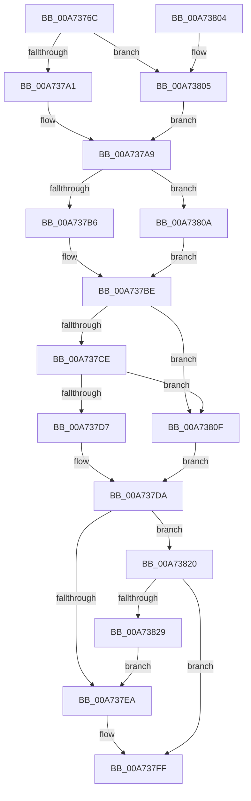

# PopComputeDerivedHiberStats

- RVA: `0x00A7376C`–`0x00A7382B` (길이 `191` bytes)
- VA: `0x0000000140A7376C`
- 실행 섹션: `PAGE`
- PDB 이름 있음: `예`; PDB Function 태그: `아니요`
- unwind 정보 RVA: `0x000DB714`
- 디코드: `55`개 명령, `191/191` bytes 표시
- 미해석 바이트: `0` (있으면 어셈블리에 `.byte`로 보존)

> 이 문서는 커널 이미지의 기계어와 PDB 기호를 분석해 생성했습니다. 4번과 5번은 함수 원형과 자료형을 바이너리 사용 방식에서 추정한 C 해석이며 원본 소스 복구 결과는 아닙니다.

## 1. Dependencies

- 직접 호출 지점: **0**; 고유 호출 대상: **0**
- 직접 호출자로 확인된 함수: **3**
- RIP 상대 이미지 참조: **0**

### Outgoing calls
- 직접 디코드된 call 명령이 없습니다.

### Direct callers
- [PopDiagTraceHiberStats](PopDiagTraceHiberStats_function_00A72FB4.md) at `0x00A73092`
- [PopDiagTracePerfTrackData](PopDiagTracePerfTrackData_function_00A733CC.md) at `0x00A73594`
- [sub_00B4042A](../B4/Unknown_function_00B4042A.md) at `0x00B4052E`

### Static image references
- 디코드된 RIP-relative 메모리 참조가 없습니다.

## 2. Other-region calls and transfers

- 다른 실행 섹션으로 향하는 call: **0**
- 별도 외부 분기/꼬리 이동을 확인하지 못했습니다.

## 3. Assembly (complete function range)

```asm
00A7376C  0F 57 C0                        xorps xmm0, xmm0
00A7376F  4D 8B D0                        mov r10, r8
00A73772  41 0F 11 00                     movups xmmword ptr [r8], xmm0
00A73776  48 8B 81 D8 01 00 00            mov rax, qword ptr [rcx + 0x1d8]
00A7377D  4C 8B C9                        mov r9, rcx
00A73780  48 03 81 D0 01 00 00            add rax, qword ptr [rcx + 0x1d0]
00A73787  45 33 C0                        xor r8d, r8d
00A7378A  48 8B 09                        mov rcx, qword ptr [rcx]
00A7378D  48 0F AF C2                     imul rax, rdx
00A73791  4C 69 D8 E8 03 00 00            imul r11, rax, 0x3e8
00A73798  49 C1 EB 14                     shr r11, 0x14
00A7379C  48 85 C9                        test rcx, rcx
00A7379F  74 64                           je 0x140a73805
00A737A1  33 D2                           xor edx, edx
00A737A3  49 8B C3                        mov rax, r11
00A737A6  48 F7 F1                        div rcx
00A737A9  41 89 02                        mov dword ptr [r10], eax
00A737AC  49 8B 49 28                     mov rcx, qword ptr [r9 + 0x28]
00A737B0  49 03 49 20                     add rcx, qword ptr [r9 + 0x20]
00A737B4  74 54                           je 0x140a7380a
00A737B6  33 D2                           xor edx, edx
00A737B8  49 8B C3                        mov rax, r11
00A737BB  48 F7 F1                        div rcx
00A737BE  41 89 42 08                     mov dword ptr [r10 + 8], eax
00A737C2  49 8B 89 98 00 00 00            mov rcx, qword ptr [r9 + 0x98]
00A737C9  48 85 C9                        test rcx, rcx
00A737CC  75 41                           jne 0x140a7380f
00A737CE  4D 39 81 50 01 00 00            cmp qword ptr [r9 + 0x150], r8
00A737D5  75 38                           jne 0x140a7380f
00A737D7  41 8B C0                        mov eax, r8d
00A737DA  41 89 42 04                     mov dword ptr [r10 + 4], eax
00A737DE  49 8B 81 A0 00 00 00            mov rax, qword ptr [r9 + 0xa0]
00A737E5  48 85 C0                        test rax, rax
00A737E8  74 36                           je 0x140a73820
00A737EA  49 8B 89 48 01 00 00            mov rcx, qword ptr [r9 + 0x148]
00A737F1  33 D2                           xor edx, edx
00A737F3  48 03 C8                        add rcx, rax
00A737F6  49 8B C3                        mov rax, r11
00A737F9  48 F7 F1                        div rcx
00A737FC  44 8B C0                        mov r8d, eax
00A737FF  45 89 42 0C                     mov dword ptr [r10 + 0xc], r8d
00A73803  C3                              ret
00A73804  CC                              int3
00A73805  41 8B C0                        mov eax, r8d
00A73808  EB 9F                           jmp 0x140a737a9
00A7380A  41 8B C0                        mov eax, r8d
00A7380D  EB AF                           jmp 0x140a737be
00A7380F  49 03 89 50 01 00 00            add rcx, qword ptr [r9 + 0x150]
00A73816  33 D2                           xor edx, edx
00A73818  49 8B C3                        mov rax, r11
00A7381B  48 F7 F1                        div rcx
00A7381E  EB BA                           jmp 0x140a737da
00A73820  4D 39 81 48 01 00 00            cmp qword ptr [r9 + 0x148], r8
00A73827  74 D6                           je 0x140a737ff
00A73829  EB BF                           jmp 0x140a737ea
```

## 4. C-style interpretation (structured pseudocode)

```c
__int64 __fastcall PopComputeDerivedHiberStats(__int64 a1, __int64 a2, __int64 a3)
{
    __int64 result;
    __int64 v_r11;

    *(unsigned __int64 *)(a3) = v_xmm0;
    result = (*(unsigned __int64 *)(a1 + 472)) + (*(unsigned __int64 *)(a1 + 464));
    a3 = 0;
    result = (result) * (a2);
    v_r11 = (v_r11) * (result);
    v_r11 = (v_r11) >> (20);
    if (*(unsigned __int64 *)(a1) == 0) goto loc_00A73805;
    a2 = 0;
loc_00A737A9:
    *(unsigned int *)(a3) = (unsigned int)(v_r11);
    a1 = (*(unsigned __int64 *)(a1 + 40)) + (*(unsigned __int64 *)(a1 + 32));
    if (condition_is_equal) goto loc_00A7380A;
    a2 = 0;
loc_00A737BE:
    *(unsigned int *)(a3 + 8) = (unsigned int)(v_r11);
    if (*(unsigned __int64 *)(a1 + 152) != 0) goto loc_00A7380F;
    if ((*(unsigned __int64 *)(a1 + 336)) != 0) goto loc_00A7380F;
loc_00A737DA:
    *(unsigned int *)(a3 + 4) = 0;
    if (*(unsigned __int64 *)(a1 + 160) == 0) goto loc_00A73820;
loc_00A737EA:
    a2 = 0;
    a1 = (*(unsigned __int64 *)(a1 + 328)) + (*(unsigned __int64 *)(a1 + 160));
loc_00A737FF:
    *(unsigned int *)(a3 + 12) = (unsigned int)((unsigned int)((unsigned int)(v_r11)));
    return v_r11;
loc_00A73805:
    goto loc_00A737A9;
loc_00A7380A:
    goto loc_00A737BE;
loc_00A7380F:
    a1 = (a1) + (*(unsigned __int64 *)(a1 + 336));
    a2 = 0;
    goto loc_00A737DA;
loc_00A73820:
    if ((*(unsigned __int64 *)(a1 + 328)) == ((unsigned int)((unsigned int)(v_r11)))) goto loc_00A737FF;
    goto loc_00A737EA;
}
```

## 5. (Beta) C Style

```c
int64_t PopComputeDerivedHiberStats(void *Arg1, int64_t Arg2, void *Arg3)
{
    uint8_t *arg1 = (uint8_t *)Arg1;
    uint8_t *arg3 = (uint8_t *)Arg3;

    int64_t result;
    int64_t local_r11;

    *(uint64_t *)(arg3) = v_xmm0;
    result = (*(uint64_t *)(arg1 + 0x1D8)) + (*(uint64_t *)(arg1 + 0x1D0));
    Arg3 = 0;
    result = (result) * (Arg2);
    local_r11 = (local_r11) * (result);
    local_r11 = (local_r11) >> (20);
    if (*(uint64_t *)(arg1) == 0) goto loc_00A73805;
    Arg2 = 0;
loc_00A737A9:
    *(uint32_t *)(arg3) = (uint32_t)(local_r11);
    Arg1 = (*(uint64_t *)(arg1 + 0x28)) + (*(uint64_t *)(arg1 + 0x20));
    if (condition_is_equal) goto loc_00A7380A;
    Arg2 = 0;
loc_00A737BE:
    *(uint32_t *)(arg3 + 0x8) = (uint32_t)(local_r11);
    if (*(uint64_t *)(arg1 + 0x98) != 0) goto loc_00A7380F;
    if ((*(uint64_t *)(arg1 + 0x150)) != 0) goto loc_00A7380F;
loc_00A737DA:
    *(uint32_t *)(arg3 + 0x4) = 0;
    if (*(uint64_t *)(arg1 + 0xA0) == 0) goto loc_00A73820;
loc_00A737EA:
    Arg2 = 0;
    Arg1 = (*(uint64_t *)(arg1 + 0x148)) + (*(uint64_t *)(arg1 + 0xA0));
loc_00A737FF:
    *(uint32_t *)(arg3 + 0xC) = (uint32_t)((uint32_t)((uint32_t)(local_r11)));
    return local_r11;
loc_00A73805:
    goto loc_00A737A9;
loc_00A7380A:
    goto loc_00A737BE;
loc_00A7380F:
    Arg1 = (Arg1) + (*(uint64_t *)(arg1 + 0x150));
    Arg2 = 0;
    goto loc_00A737DA;
loc_00A73820:
    if ((*(uint64_t *)(arg1 + 0x148)) == ((uint32_t)((uint32_t)(local_r11)))) goto loc_00A737FF;
    goto loc_00A737EA;
}
```

### 관측된 메모리 오프셋

구조체 형식이 확인되지 않은 접근은 인자 기준의 오프셋으로만 기록했습니다.

| 기준 인자 | 오프셋 표현 | 폭 (bit) | 접근 |
|---|---:|---:|---|
| `Arg1` | `+ 0x0` | `64` | `R` |
| `Arg1` | `+ 0x20` | `64` | `R` |
| `Arg1` | `+ 0x28` | `64` | `R` |
| `Arg1` | `+ 0x98` | `64` | `R` |
| `Arg1` | `+ 0xA0` | `64` | `R` |
| `Arg1` | `+ 0x148` | `64` | `R` |
| `Arg1` | `+ 0x150` | `64` | `R` |
| `Arg1` | `+ 0x1D0` | `64` | `R` |
| `Arg1` | `+ 0x1D8` | `64` | `R` |
| `Arg3` | `+ 0x0` | `32` | `W` |
| `Arg3` | `+ 0x0` | `128` | `R` |
| `Arg3` | `+ 0x4` | `32` | `W` |
| `Arg3` | `+ 0x8` | `32` | `W` |
| `Arg3` | `+ 0xC` | `32` | `W` |

## 6. Execution-region graph

[열기: 2D/3D 그래프와 함수 탐색 컨트롤 패널](../../../control-panel.html?section=page&rva=0x00A7376C&view=graph)

- 2D 그래프는 위에서 아래로 흐르고, 3D 그래프는 빈 공간을 드래그해 회전합니다. Shift+드래그는 이동, 휠은 확대·축소, 함수 노드 선택은 대상 보고서 이동입니다.

### Static fallback


