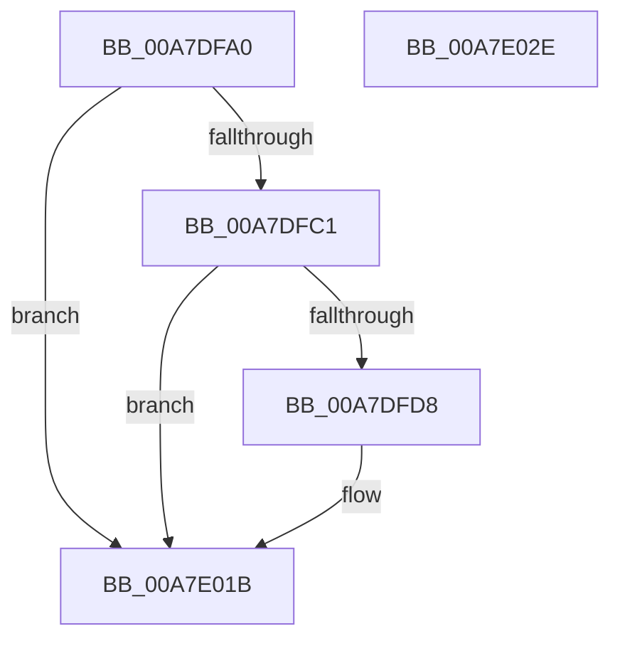

# PopDiagTraceAppPowerMessageEnd

- RVA: `0x00A7DFA0`–`0x00A7E02F` (길이 `143` bytes)
- VA: `0x0000000140A7DFA0`
- 실행 섹션: `PAGE`
- PDB 이름 있음: `예`; PDB Function 태그: `아니요`
- unwind 정보 RVA: `0x000A06A8`
- 디코드: `33`개 명령, `143/143` bytes 표시
- 미해석 바이트: `0` (있으면 어셈블리에 `.byte`로 보존)

> 이 문서는 커널 이미지의 기계어와 PDB 기호를 분석해 생성했습니다. 4번과 5번은 함수 원형과 자료형을 바이너리 사용 방식에서 추정한 C 해석이며 원본 소스 복구 결과는 아닙니다.

## 1. Dependencies

- 직접 호출 지점: **3**; 고유 호출 대상: **3**
- 직접 호출자로 확인된 함수: **1**
- RIP 상대 이미지 참조: **4**

### Outgoing calls
- `0x00A7DFCF` → [EtwEventEnabled](../../text/39/EtwEventEnabled_function_00392450.md) (function, `0x00392450`)
- `0x00A7E016` → [EtwWrite](../../text/41/EtwWrite_function_0041C720.md) (function, `0x0041C720`)
- `0x00A7E023` → [_security_check_cookie](../../text/6A/_security_check_cookie_function_006AC640.md) (function, `0x006AC640`)

### Direct callers
- [NtPowerInformation](../95/NtPowerInformation_function_00955D80.md) at `0x0095695D`

### Static image references
- `0x00A7DFA6` → RVA `0x00E0A740` (`.data`; read)
- `0x00A7DFB5` → RVA `0x00E67858` (`.data`; read)
- `0x00A7DFC1` → RVA `0x00F0B408` (`.data`; read)
- `0x00A7DFC8` → RVA `0x0001BB18` (`.rdata`; read)

## 2. Other-region calls and transfers

- 다른 실행 섹션으로 향하는 call: **3**
  - `0x00A7DFCF` → [EtwEventEnabled](../../text/39/EtwEventEnabled_function_00392450.md) (`PAGE` → `.text`)
  - `0x00A7E016` → [EtwWrite](../../text/41/EtwWrite_function_0041C720.md) (`PAGE` → `.text`)
  - `0x00A7E023` → [_security_check_cookie](../../text/6A/_security_check_cookie_function_006AC640.md) (`PAGE` → `.text`)
- 별도 외부 분기/꼬리 이동을 확인하지 못했습니다.

## 3. Assembly (complete function range)

```asm
00A7DFA0  40 53                           push rbx
00A7DFA2  48 83 EC 50                     sub rsp, 0x50
00A7DFA6  48 8B 05 93 C7 38 00            mov rax, qword ptr [rip + 0x38c793]
00A7DFAD  48 33 C4                        xor rax, rsp
00A7DFB0  48 89 44 24 48                  mov qword ptr [rsp + 0x48], rax
00A7DFB5  80 3D 9C 98 3E 00 00            cmp byte ptr [rip + 0x3e989c], 0
00A7DFBC  48 8B D9                        mov rbx, rcx
00A7DFBF  74 5A                           je 0x140a7e01b
00A7DFC1  48 8B 0D 40 D4 48 00            mov rcx, qword ptr [rip + 0x48d440]
00A7DFC8  48 8D 15 49 DB 59 FF            lea rdx, [rip - 0xa624b7]
00A7DFCF  E8 7C 44 91 FF                  call 0x140392450
00A7DFD4  84 C0                           test al, al
00A7DFD6  74 43                           je 0x140a7e01b
00A7DFD8  8B 03                           mov eax, dword ptr [rbx]
00A7DFDA  48 8D 15 37 DB 59 FF            lea rdx, [rip - 0xa624c9]
00A7DFE1  83 64 24 44 00                  and dword ptr [rsp + 0x44], 0
00A7DFE6  41 B9 01 00 00 00               mov r9d, 1
00A7DFEC  48 8B 0D 15 D4 48 00            mov rcx, qword ptr [rip + 0x48d415]
00A7DFF3  45 33 C0                        xor r8d, r8d
00A7DFF6  89 44 24 30                     mov dword ptr [rsp + 0x30], eax
00A7DFFA  48 8D 44 24 30                  lea rax, [rsp + 0x30]
00A7DFFF  48 89 44 24 38                  mov qword ptr [rsp + 0x38], rax
00A7E004  48 8D 44 24 38                  lea rax, [rsp + 0x38]
00A7E009  48 89 44 24 20                  mov qword ptr [rsp + 0x20], rax
00A7E00E  C7 44 24 40 04 00 00 00         mov dword ptr [rsp + 0x40], 4
00A7E016  E8 05 E7 99 FF                  call 0x14041c720
00A7E01B  48 8B 4C 24 48                  mov rcx, qword ptr [rsp + 0x48]
00A7E020  48 33 CC                        xor rcx, rsp
00A7E023  E8 18 E6 C2 FF                  call 0x1406ac640
00A7E028  48 83 C4 50                     add rsp, 0x50
00A7E02C  5B                              pop rbx
00A7E02D  C3                              ret
00A7E02E  CC                              int3
```

## 4. C-style interpretation (structured pseudocode)

```c
__int64 __fastcall PopDiagTraceAppPowerMessageEnd(__int64 a1, __int64 a2, int a3)
{
    __int64 result;
    __int64 v_rsp;
    unsigned __int64 v_stack_m10;
    unsigned int v_stack_m14;
    unsigned int v_stack_m18;
    unsigned __int64 v_stack_m20;
    unsigned int v_stack_m28;
    unsigned __int64 v_stack_m38;

    v_rsp = (v_rsp) - (80);
    result = (*(unsigned __int64 *)(v_rip + 3721107)) ^ (v_rsp);
    v_stack_m10 = result;
    if ((*(unsigned __int8 *)(v_rip + 4102300)) == 0) goto loc_00A7E01B;
    result = EtwEventEnabled(*(unsigned __int64 *)(v_rip + 4772928), v_rip - 10888375, a3, a4);
    if ((unsigned __int8)(result) != 0) {
        result = *(unsigned int *)(a1);
        a2 = v_rip - 10888393;
        a4 = 1;
        a1 = *(unsigned __int64 *)(v_rip + 4772885);
        a3 = 0;
        v_stack_m28 = (unsigned int)(result);
        result = v_stack_m28;
        v_stack_m20 = result;
        result = v_stack_m20;
        v_stack_m38 = result;
        v_stack_m18 = 4;
        result = EtwWrite(a1, a2, a3, a4);
    }
    a1 = (v_stack_m10) ^ (v_rsp);
    result = _security_check_cookie(a1, a2, a3, a4);
    v_rsp = (v_rsp) + (80);
    return result;
}
```

## 5. (Beta) C Style

```c
int64_t PopDiagTraceAppPowerMessageEnd(void *Arg1, int64_t Arg2, int32_t Arg3)
{
    uint8_t *arg1 = (uint8_t *)Arg1;

    int64_t result;
    int64_t local_rsp;
    uint64_t v_stack_m10;
    uint32_t v_stack_m14;
    uint32_t v_stack_m18;
    uint64_t v_stack_m20;
    uint32_t v_stack_m28;
    uint64_t v_stack_m38;

    local_rsp = (local_rsp) - (80);
    result = (*(uint64_t *)(v_rip + 0x38C793)) ^ (local_rsp);
    v_stack_m10 = result;
    if ((*(uint8_t *)(v_rip + 0x3E989C)) == 0) goto loc_00A7E01B;
    result = EtwEventEnabled(*(uint64_t *)(v_rip + 0x48D440), v_rip - 10888375, Arg3, a4);
    if ((uint8_t)(result) != 0) {
        result = *(uint32_t *)(arg1);
        Arg2 = v_rip - 10888393;
        a4 = 1;
        Arg1 = *(uint64_t *)(v_rip + 0x48D415);
        Arg3 = 0;
        v_stack_m28 = (uint32_t)(result);
        result = v_stack_m28;
        v_stack_m20 = result;
        result = v_stack_m20;
        v_stack_m38 = result;
        v_stack_m18 = 4;
        result = EtwWrite(Arg1, Arg2, Arg3, a4);
    }
    Arg1 = (v_stack_m10) ^ (local_rsp);
    result = _security_check_cookie(Arg1, Arg2, Arg3, a4);
    local_rsp = (local_rsp) + (80);
    return result;
}
```

### 관측된 메모리 오프셋

구조체 형식이 확인되지 않은 접근은 인자 기준의 오프셋으로만 기록했습니다.

| 기준 인자 | 오프셋 표현 | 폭 (bit) | 접근 |
|---|---:|---:|---|
| `Arg1` | `+ 0x0` | `32` | `R` |

## 6. Execution-region graph

[열기: 2D/3D 그래프와 함수 탐색 컨트롤 패널](../../../control-panel.html?section=page&rva=0x00A7DFA0&view=graph)

- 2D 그래프는 위에서 아래로 흐르고, 3D 그래프는 빈 공간을 드래그해 회전합니다. Shift+드래그는 이동, 휠은 확대·축소, 함수 노드 선택은 대상 보고서 이동입니다.

### Static fallback


