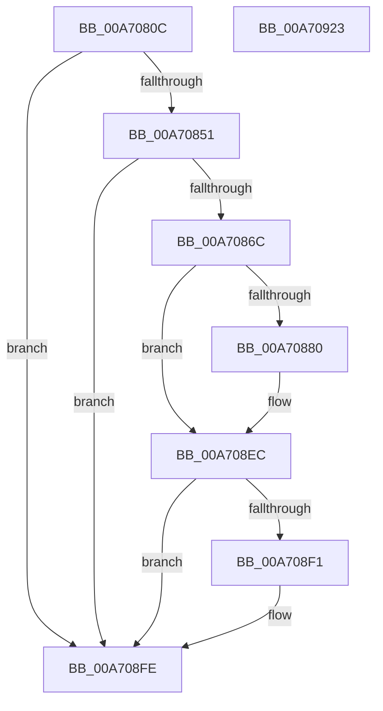

# PopDiagTraceAppPowerMessage

- RVA: `0x00A7080C`–`0x00A70924` (길이 `280` bytes)
- VA: `0x0000000140A7080C`
- 실행 섹션: `PAGE`
- PDB 이름 있음: `예`; PDB Function 태그: `아니요`
- unwind 정보 RVA: `0x000B50AC`
- 디코드: `67`개 명령, `280/280` bytes 표시
- 미해석 바이트: `0` (있으면 어셈블리에 `.byte`로 보존)

> 이 문서는 커널 이미지의 기계어와 PDB 기호를 분석해 생성했습니다. 4번과 5번은 함수 원형과 자료형을 바이너리 사용 방식에서 추정한 C 해석이며 원본 소스 복구 결과는 아닙니다.

## 1. Dependencies

- 직접 호출 지점: **5**; 고유 호출 대상: **5**
- 직접 호출자로 확인된 함수: **1**
- RIP 상대 이미지 참조: **4**

### Outgoing calls
- `0x00A7085F` → [EtwEventEnabled](../../text/39/EtwEventEnabled_function_00392450.md) (function, `0x00392450`)
- `0x00A70873` → [PsLookupProcessByProcessId](../8A/PsLookupProcessByProcessId_function_008A2AA0.md) (function, `0x008A2AA0`)
- `0x00A708E7` → [EtwWrite](../../text/41/EtwWrite_function_0041C720.md) (function, `0x0041C720`)
- `0x00A708F9` → [ObfDereferenceObjectWithTag](../../text/2F/ObfDereferenceObjectWithTag_function_002F78E0.md) (function, `0x002F78E0`)
- `0x00A70905` → [_security_check_cookie](../../text/6A/_security_check_cookie_function_006AC640.md) (function, `0x006AC640`)

### Direct callers
- [NtPowerInformation](../95/NtPowerInformation_function_00955D80.md) at `0x00956953`

### Static image references
- `0x00A70826` → RVA `0x00E0A740` (`.data`; read)
- `0x00A70839` → RVA `0x00E67858` (`.data`; read)
- `0x00A70851` → RVA `0x00F0B408` (`.data`; read)
- `0x00A70858` → RVA `0x0001AC00` (`.rdata`; read)

## 2. Other-region calls and transfers

- 다른 실행 섹션으로 향하는 call: **4**
  - `0x00A7085F` → [EtwEventEnabled](../../text/39/EtwEventEnabled_function_00392450.md) (`PAGE` → `.text`)
  - `0x00A708E7` → [EtwWrite](../../text/41/EtwWrite_function_0041C720.md) (`PAGE` → `.text`)
  - `0x00A708F9` → [ObfDereferenceObjectWithTag](../../text/2F/ObfDereferenceObjectWithTag_function_002F78E0.md) (`PAGE` → `.text`)
  - `0x00A70905` → [_security_check_cookie](../../text/6A/_security_check_cookie_function_006AC640.md) (`PAGE` → `.text`)
- 별도 외부 분기/꼬리 이동을 확인하지 못했습니다.

## 3. Assembly (complete function range)

```asm
00A7080C  48 89 5C 24 10                  mov qword ptr [rsp + 0x10], rbx
00A70811  48 89 74 24 18                  mov qword ptr [rsp + 0x18], rsi
00A70816  48 89 7C 24 20                  mov qword ptr [rsp + 0x20], rdi
00A7081B  55                              push rbp
00A7081C  48 8B EC                        mov rbp, rsp
00A7081F  48 81 EC 80 00 00 00            sub rsp, 0x80
00A70826  48 8B 05 13 9F 39 00            mov rax, qword ptr [rip + 0x399f13]
00A7082D  48 33 C4                        xor rax, rsp
00A70830  48 89 45 F0                     mov qword ptr [rbp - 0x10], rax
00A70834  33 F6                           xor esi, esi
00A70836  48 8B F9                        mov rdi, rcx
00A70839  40 38 35 18 70 3F 00            cmp byte ptr [rip + 0x3f7018], sil
00A70840  66 89 75 B0                     mov word ptr [rbp - 0x50], si
00A70844  89 75 B4                        mov dword ptr [rbp - 0x4c], esi
00A70847  48 89 75 B8                     mov qword ptr [rbp - 0x48], rsi
00A7084B  0F 84 AD 00 00 00               je 0x140a708fe
00A70851  48 8B 0D B0 AB 49 00            mov rcx, qword ptr [rip + 0x49abb0]
00A70858  48 8D 15 A1 A3 5A FF            lea rdx, [rip - 0xa55c5f]
00A7085F  E8 EC 1B 92 FF                  call 0x140392450
00A70864  84 C0                           test al, al
00A70866  0F 84 92 00 00 00               je 0x140a708fe
00A7086C  48 8B 0F                        mov rcx, qword ptr [rdi]
00A7086F  48 8D 55 B8                     lea rdx, [rbp - 0x48]
00A70873  E8 28 22 E3 FF                  call 0x1408a2aa0
00A70878  48 8B 5D B8                     mov rbx, qword ptr [rbp - 0x48]
00A7087C  85 C0                           test eax, eax
00A7087E  78 6C                           js 0x140a708ec
00A70880  4C 8B 83 50 03 00 00            mov r8, qword ptr [rbx + 0x350]
00A70887  44 8D 4E 03                     lea r9d, [rsi + 3]
00A7088B  8B 07                           mov eax, dword ptr [rdi]
00A7088D  48 8D 15 6C A3 5A FF            lea rdx, [rip - 0xa55c94]
00A70894  89 45 B4                        mov dword ptr [rbp - 0x4c], eax
00A70897  41 0F B7 00                     movzx eax, word ptr [r8]
00A7089B  66 D1 E8                        shr ax, 1
00A7089E  66 89 45 B0                     mov word ptr [rbp - 0x50], ax
00A708A2  48 8D 45 B4                     lea rax, [rbp - 0x4c]
00A708A6  48 89 45 C0                     mov qword ptr [rbp - 0x40], rax
00A708AA  48 8D 45 B0                     lea rax, [rbp - 0x50]
00A708AE  48 89 45 D0                     mov qword ptr [rbp - 0x30], rax
00A708B2  48 C7 45 C8 04 00 00 00         mov qword ptr [rbp - 0x38], 4
00A708BA  48 C7 45 D8 02 00 00 00         mov qword ptr [rbp - 0x28], 2
00A708C2  49 8B 40 08                     mov rax, qword ptr [r8 + 8]
00A708C6  41 0F B7 08                     movzx ecx, word ptr [r8]
00A708CA  45 33 C0                        xor r8d, r8d
00A708CD  48 89 45 E0                     mov qword ptr [rbp - 0x20], rax
00A708D1  48 8D 45 C0                     lea rax, [rbp - 0x40]
00A708D5  89 4D E8                        mov dword ptr [rbp - 0x18], ecx
00A708D8  48 8B 0D 29 AB 49 00            mov rcx, qword ptr [rip + 0x49ab29]
00A708DF  48 89 44 24 20                  mov qword ptr [rsp + 0x20], rax
00A708E4  89 75 EC                        mov dword ptr [rbp - 0x14], esi
00A708E7  E8 34 BE 9A FF                  call 0x14041c720
00A708EC  48 85 DB                        test rbx, rbx
00A708EF  74 0D                           je 0x140a708fe
00A708F1  BA 44 66 6C 74                  mov edx, 0x746c6644
00A708F6  48 8B CB                        mov rcx, rbx
00A708F9  E8 E2 6F 88 FF                  call 0x1402f78e0
00A708FE  48 8B 4D F0                     mov rcx, qword ptr [rbp - 0x10]
00A70902  48 33 CC                        xor rcx, rsp
00A70905  E8 36 BD C3 FF                  call 0x1406ac640
00A7090A  4C 8D 9C 24 80 00 00 00         lea r11, [rsp + 0x80]
00A70912  49 8B 5B 18                     mov rbx, qword ptr [r11 + 0x18]
00A70916  49 8B 73 20                     mov rsi, qword ptr [r11 + 0x20]
00A7091A  49 8B 7B 28                     mov rdi, qword ptr [r11 + 0x28]
00A7091E  49 8B E3                        mov rsp, r11
00A70921  5D                              pop rbp
00A70922  C3                              ret
00A70923  CC                              int3
```

## 4. C-style interpretation (structured pseudocode)

```c
__int64 __fastcall PopDiagTraceAppPowerMessage(__int64 a1)
{
    __int64 result;
    __int64 v_rsi;
    __int64 v_rsp;
    unsigned __int64 v_stack_m18;
    unsigned int v_stack_m1C;
    unsigned int v_stack_m20;
    unsigned __int64 v_stack_m28;
    unsigned __int64 v_stack_m30;
    unsigned __int64 v_stack_m38;
    unsigned __int64 v_stack_m40;
    unsigned __int64 v_stack_m48;
    unsigned __int64 v_stack_m50;
    unsigned int v_stack_m54;
    unsigned __int16 v_stack_m58;
    unsigned __int64 v_stack_m68;
    unsigned __int64 v_stack_m8;
    unsigned __int64 v_stack_p10;
    unsigned __int64 v_stack_p18;
    unsigned __int64 v_stack_p20;

    v_stack_p10 = v_rbx;
    v_stack_p18 = v_rsi;
    v_stack_p20 = v_rdi;
    v_rsp = (v_rsp) - (128);
    result = (*(unsigned __int64 *)(v_rip + 3776275)) ^ (v_rsp);
    v_stack_m18 = result;
    v_rsi = 0;
    v_stack_m58 = 0;
    v_stack_m54 = 0;
    v_stack_m50 = 0;
    if ((*(unsigned __int8 *)(v_rip + 4157464)) == 0) goto loc_00A708FE;
    result = EtwEventEnabled(*(unsigned __int64 *)(v_rip + 4828080), v_rip - 10837087, a3, a4);
    if ((unsigned __int8)(result) == 0) goto loc_00A708FE;
    result = PsLookupProcessByProcessId(*(unsigned __int64 *)(a1), v_stack_m50, a3, a4);
    if (!(sign_flag)) {
        a3 = *(unsigned __int64 *)(v_stack_m50 + 848);
        a4 = v_rsi + 3;
        result = *(unsigned int *)(a1);
        a2 = v_rip - 10837140;
        v_stack_m54 = (unsigned int)(result);
        result = *(unsigned __int16 *)(a3);
        result = (unsigned __int16)((result) >> (1));
        v_stack_m58 = (unsigned __int16)(result);
        result = v_stack_m54;
        v_stack_m48 = result;
        result = v_stack_m58;
        v_stack_m38 = result;
        v_stack_m40 = 4;
        v_stack_m30 = 2;
        result = *(unsigned __int64 *)(a3 + 8);
        a1 = *(unsigned __int16 *)(a3);
        a3 = 0;
        v_stack_m28 = result;
        result = v_stack_m48;
        v_stack_m20 = (unsigned int)(a1);
        a1 = *(unsigned __int64 *)(v_rip + 4827945);
        v_stack_m68 = result;
        v_stack_m1C = 0;
        result = EtwWrite(a1, a2, a3, a4);
    }
    if (v_stack_m50 != 0) {
        a2 = 0x746C6644ULL;
        a1 = v_stack_m50;
        result = ObfDereferenceObjectWithTag(a1, a2, a3, a4);
    }
    a1 = (v_stack_m18) ^ (v_rsp);
    result = _security_check_cookie(a1, a2, a3, a4);
    return result;
}
```

## 5. (Beta) C Style

```c
int64_t PopDiagTraceAppPowerMessage(void *Arg1)
{
    uint8_t *arg1 = (uint8_t *)Arg1;

    int64_t result;
    int64_t local_rsi;
    int64_t local_rsp;
    uint64_t v_stack_m18;
    uint32_t v_stack_m1C;
    uint32_t v_stack_m20;
    uint64_t v_stack_m28;
    uint64_t v_stack_m30;
    uint64_t v_stack_m38;
    uint64_t v_stack_m40;
    uint64_t v_stack_m48;
    uint64_t v_stack_m50;
    uint32_t v_stack_m54;
    uint16_t v_stack_m58;
    uint64_t v_stack_m68;
    uint64_t v_stack_m8;
    uint64_t v_stack_p10;
    uint64_t v_stack_p18;
    uint64_t v_stack_p20;

    v_stack_p10 = local_rbx;
    v_stack_p18 = local_rsi;
    v_stack_p20 = local_rdi;
    local_rsp = (local_rsp) - (128);
    result = (*(uint64_t *)(v_rip + 0x399F13)) ^ (local_rsp);
    v_stack_m18 = result;
    local_rsi = 0;
    v_stack_m58 = 0;
    v_stack_m54 = 0;
    v_stack_m50 = 0;
    if ((*(uint8_t *)(v_rip + 0x3F7018)) == 0) goto loc_00A708FE;
    result = EtwEventEnabled(*(uint64_t *)(v_rip + 0x49ABB0), v_rip - 10837087, a3, a4);
    if ((uint8_t)(result) == 0) goto loc_00A708FE;
    result = PsLookupProcessByProcessId(*(uint64_t *)(arg1), v_stack_m50, a3, a4);
    if (!(sign_flag)) {
        a3 = *(uint64_t *)(v_stack_m50 + 0x350);
        a4 = local_rsi + 3;
        result = *(uint32_t *)(arg1);
        a2 = v_rip - 10837140;
        v_stack_m54 = (uint32_t)(result);
        result = *(uint16_t *)(a3);
        result = (uint16_t)((result) >> (1));
        v_stack_m58 = (uint16_t)(result);
        result = v_stack_m54;
        v_stack_m48 = result;
        result = v_stack_m58;
        v_stack_m38 = result;
        v_stack_m40 = 4;
        v_stack_m30 = 2;
        result = *(uint64_t *)(a3 + 0x8);
        Arg1 = *(uint16_t *)(a3);
        a3 = 0;
        v_stack_m28 = result;
        result = v_stack_m48;
        v_stack_m20 = (uint32_t)(Arg1);
        Arg1 = *(uint64_t *)(v_rip + 0x49AB29);
        v_stack_m68 = result;
        v_stack_m1C = 0;
        result = EtwWrite(Arg1, a2, a3, a4);
    }
    if (v_stack_m50 != 0) {
        a2 = 0x746C6644ULL;
        Arg1 = v_stack_m50;
        result = ObfDereferenceObjectWithTag(Arg1, a2, a3, a4);
    }
    Arg1 = (v_stack_m18) ^ (local_rsp);
    result = _security_check_cookie(Arg1, a2, a3, a4);
    return result;
}
```

### 관측된 메모리 오프셋

구조체 형식이 확인되지 않은 접근은 인자 기준의 오프셋으로만 기록했습니다.

| 기준 인자 | 오프셋 표현 | 폭 (bit) | 접근 |
|---|---:|---:|---|
| `Arg1` | `+ 0x0` | `32` | `R` |
| `Arg1` | `+ 0x0` | `64` | `R` |

## 6. Execution-region graph

[열기: 2D/3D 그래프와 함수 탐색 컨트롤 패널](../../../control-panel.html?section=page&rva=0x00A7080C&view=graph)

- 2D 그래프는 위에서 아래로 흐르고, 3D 그래프는 빈 공간을 드래그해 회전합니다. Shift+드래그는 이동, 휠은 확대·축소, 함수 노드 선택은 대상 보고서 이동입니다.

### Static fallback


