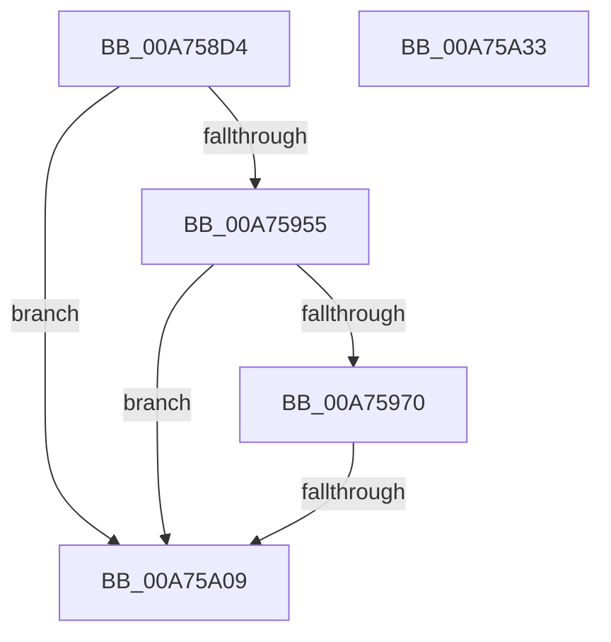

# PopDiagTraceFxComponentAccounting

- RVA: `0x00A758D4`–`0x00A75A34` (길이 `352` bytes)
- VA: `0x0000000140A758D4`
- 실행 섹션: `PAGE`
- PDB 이름 있음: `예`; PDB Function 태그: `예`
- unwind 정보 RVA: `0x000B59DC`
- 디코드: `76`개 명령, `352/352` bytes 표시
- 미해석 바이트: `0` (있으면 어셈블리에 `.byte`로 보존)

> 이 문서는 커널 이미지의 기계어와 PDB 기호를 분석해 생성했습니다. 4번과 5번은 함수 원형과 자료형을 바이너리 사용 방식에서 추정한 C 해석이며 원본 소스 복구 결과는 아닙니다.

## 1. Dependencies

- 직접 호출 지점: **5**; 고유 호출 대상: **4**
- 직접 호출자로 확인된 함수: **1**
- RIP 상대 이미지 참조: **6**

### Outgoing calls
- `0x00A7592F` → [RtlInitUnicodeString](../../text/42/RtlInitUnicodeString_function_0042A780.md) (function, `0x0042A780`)
- `0x00A75940` → [RtlInitUnicodeString](../../text/42/RtlInitUnicodeString_function_0042A780.md) (function, `0x0042A780`)
- `0x00A75963` → [EtwEventEnabled](../../text/39/EtwEventEnabled_function_00392450.md) (function, `0x00392450`)
- `0x00A759F7` → [EtwWrite](../../text/41/EtwWrite_function_0041C720.md) (function, `0x0041C720`)
- `0x00A75A13` → [_security_check_cookie](../../text/6A/_security_check_cookie_function_006AC640.md) (function, `0x006AC640`)

### Direct callers
- [PopFxStopDeviceAccounting](../../text/42/PopFxStopDeviceAccounting_function_004261D8.md) at `0x004264D9`

### Static image references
- `0x00A758F7` → RVA `0x00E0A740` (`.data`; read)
- `0x00A7590D` → RVA `0x00AFCAD0` (` ?? ::NNGAKEGL::`string'`; read)
- `0x00A75948` → RVA `0x00E67859` (`.data`; read)
- `0x00A75955` → RVA `0x00F0B6B8` (`.data`; read)
- `0x00A7595C` → RVA `0x0001BA58` (`.rdata`; read)
- `0x00A75970` → RVA `0x00F0B6B0` (`.data`; read)

## 2. Other-region calls and transfers

- 다른 실행 섹션으로 향하는 call: **5**
  - `0x00A7592F` → [RtlInitUnicodeString](../../text/42/RtlInitUnicodeString_function_0042A780.md) (`PAGE` → `.text`)
  - `0x00A75940` → [RtlInitUnicodeString](../../text/42/RtlInitUnicodeString_function_0042A780.md) (`PAGE` → `.text`)
  - `0x00A75963` → [EtwEventEnabled](../../text/39/EtwEventEnabled_function_00392450.md) (`PAGE` → `.text`)
  - `0x00A759F7` → [EtwWrite](../../text/41/EtwWrite_function_0041C720.md) (`PAGE` → `.text`)
  - `0x00A75A13` → [_security_check_cookie](../../text/6A/_security_check_cookie_function_006AC640.md) (`PAGE` → `.text`)
- call이 아닌 외부 분기/꼬리 이동: **1**
  - `0x00A75A03` → [sub_00B41088](../B4/Unknown_function_00B41088.md) (`tail-transfer`)

## 3. Assembly (complete function range)

```asm
00A758D4  48 89 5C 24 18                  mov qword ptr [rsp + 0x18], rbx
00A758D9  89 54 24 10                     mov dword ptr [rsp + 0x10], edx
00A758DD  55                              push rbp
00A758DE  56                              push rsi
00A758DF  57                              push rdi
00A758E0  41 54                           push r12
00A758E2  41 55                           push r13
00A758E4  41 56                           push r14
00A758E6  41 57                           push r15
00A758E8  48 8D AC 24 10 FF FF FF         lea rbp, [rsp - 0xf0]
00A758F0  48 81 EC F0 01 00 00            sub rsp, 0x1f0
00A758F7  48 8B 05 42 4E 39 00            mov rax, qword ptr [rip + 0x394e42]
00A758FE  48 33 C4                        xor rax, rsp
00A75901  48 89 85 E0 00 00 00            mov qword ptr [rbp + 0xe0], rax
00A75908  48 89 4C 24 38                  mov qword ptr [rsp + 0x38], rcx
00A7590D  48 8D 15 BC 71 08 00            lea rdx, [rip + 0x871bc]
00A75914  0F 57 C0                        xorps xmm0, xmm0
00A75917  48 8D 4C 24 40                  lea rcx, [rsp + 0x40]
00A7591C  0F 57 C9                        xorps xmm1, xmm1
00A7591F  4D 8B E9                        mov r13, r9
00A75922  0F 11 44 24 40                  movups xmmword ptr [rsp + 0x40], xmm0
00A75927  4D 8B F8                        mov r15, r8
00A7592A  0F 11 4C 24 50                  movups xmmword ptr [rsp + 0x50], xmm1
00A7592F  E8 4C 4E 9B FF                  call 0x14042a780
00A75934  48 8D 15 95 71 08 00            lea rdx, [rip + 0x87195]
00A7593B  48 8D 4C 24 50                  lea rcx, [rsp + 0x50]
00A75940  E8 3B 4E 9B FF                  call 0x14042a780
00A75945  45 33 E4                        xor r12d, r12d
00A75948  44 38 25 0A 1F 3F 00            cmp byte ptr [rip + 0x3f1f0a], r12b
00A7594F  0F 84 B4 00 00 00               je 0x140a75a09
00A75955  48 8B 0D 5C 5D 49 00            mov rcx, qword ptr [rip + 0x495d5c]
00A7595C  48 8D 15 F5 60 5A FF            lea rdx, [rip - 0xa59f0b]
00A75963  E8 E8 CA 91 FF                  call 0x140392450
00A75968  84 C0                           test al, al
00A7596A  0F 84 99 00 00 00               je 0x140a75a09
00A75970  8A 05 3A 5D 49 00               mov al, byte ptr [rip + 0x495d3a]
00A75976  41 8D 7C 24 05                  lea edi, [r12 + 5]
00A7597B  48 8B 0D 36 5D 49 00            mov rcx, qword ptr [rip + 0x495d36]
00A75982  48 8D 15 CF 60 5A FF            lea rdx, [rip - 0xa59f31]
00A75989  88 44 24 30                     mov byte ptr [rsp + 0x30], al
00A7598D  44 8B CF                        mov r9d, edi
00A75990  48 8D 44 24 30                  lea rax, [rsp + 0x30]
00A75995  48 C7 45 88 01 00 00 00         mov qword ptr [rbp - 0x78], 1
00A7599D  48 89 45 80                     mov qword ptr [rbp - 0x80], rax
00A759A1  45 33 C0                        xor r8d, r8d
00A759A4  48 8D 44 24 38                  lea rax, [rsp + 0x38]
00A759A9  48 C7 45 98 08 00 00 00         mov qword ptr [rbp - 0x68], 8
00A759B1  48 89 45 90                     mov qword ptr [rbp - 0x70], rax
00A759B5  48 8D 85 38 01 00 00            lea rax, [rbp + 0x138]
00A759BC  48 89 45 A0                     mov qword ptr [rbp - 0x60], rax
00A759C0  48 8D 85 50 01 00 00            lea rax, [rbp + 0x150]
00A759C7  48 89 45 B0                     mov qword ptr [rbp - 0x50], rax
00A759CB  48 8D 05 DE 5C 49 00            lea rax, [rip + 0x495cde]
00A759D2  48 89 45 C0                     mov qword ptr [rbp - 0x40], rax
00A759D6  48 8D 45 80                     lea rax, [rbp - 0x80]
00A759DA  48 89 44 24 20                  mov qword ptr [rsp + 0x20], rax
00A759DF  48 C7 45 A8 04 00 00 00         mov qword ptr [rbp - 0x58], 4
00A759E7  48 C7 45 B8 08 00 00 00         mov qword ptr [rbp - 0x48], 8
00A759EF  48 C7 45 C8 08 00 00 00         mov qword ptr [rbp - 0x38], 8
00A759F7  E8 24 6D 9A FF                  call 0x14041c720
00A759FC  44 38 A5 58 01 00 00            cmp byte ptr [rbp + 0x158], r12b
00A75A03  0F 85 7F B6 0C 00               jne 0x140b41088
00A75A09  48 8B 8D E0 00 00 00            mov rcx, qword ptr [rbp + 0xe0]
00A75A10  48 33 CC                        xor rcx, rsp
00A75A13  E8 28 6C C3 FF                  call 0x1406ac640
00A75A18  48 8B 9C 24 40 02 00 00         mov rbx, qword ptr [rsp + 0x240]
00A75A20  48 81 C4 F0 01 00 00            add rsp, 0x1f0
00A75A27  41 5F                           pop r15
00A75A29  41 5E                           pop r14
00A75A2B  41 5D                           pop r13
00A75A2D  41 5C                           pop r12
00A75A2F  5F                              pop rdi
00A75A30  5E                              pop rsi
00A75A31  5D                              pop rbp
00A75A32  C3                              ret
00A75A33  CC                              int3
```

## 4. C-style interpretation (structured pseudocode)

```c
__int64 __fastcall PopDiagTraceFxComponentAccounting(__int64 a1, int a2, __int64 a3, __int64 a4, __int64 a5, unsigned __int8 a6)
{
    __int64 result;
    __int64 v_r12;
    __int64 v_rsp;
    unsigned __int64 v_stack_m128;
    unsigned __int64 v_stack_m160;
    unsigned __int64 v_stack_m168;
    unsigned __int64 v_stack_m170;
    unsigned __int64 v_stack_m178;
    unsigned __int64 v_stack_m180;
    unsigned __int64 v_stack_m188;
    unsigned __int64 v_stack_m190;
    unsigned __int64 v_stack_m198;
    unsigned __int64 v_stack_m1A0;
    unsigned __int64 v_stack_m1A8;
    unsigned __int64 v_stack_m1D8;
    unsigned __int64 v_stack_m1E8;
    unsigned __int64 v_stack_m1F0;
    unsigned __int8 v_stack_m1F8;
    unsigned __int64 v_stack_m208;
    unsigned __int64 v_stack_m48;
    unsigned int v_stack_p10;
    unsigned __int64 v_stack_p18;

    v_stack_p18 = v_rbx;
    v_stack_p10 = a2;
    v_rsp = (v_rsp) - (496);
    result = (*(unsigned __int64 *)(v_rip + 3755586)) ^ (v_rsp);
    v_stack_m48 = result;
    v_stack_m1F0 = a1;
    v_stack_m1E8 = v_xmm0;
    v_stack_m1D8 = v_xmm1;
    result = RtlInitUnicodeString(v_stack_m1E8, v_rip + 553404, a3, a4);
    result = RtlInitUnicodeString(v_stack_m1D8, v_rip + 553365, a3, a4);
    v_r12 = 0;
    if ((*(unsigned __int8 *)(v_rip + 4136714)) == 0) goto loc_00A75A09;
    result = EtwEventEnabled(*(unsigned __int64 *)(v_rip + 4808028), v_rip - 10854155, a3, a4);
    if ((unsigned __int8)(result) == 0) goto loc_00A75A09;
    v_stack_m1F8 = (unsigned __int8)(*(unsigned __int8 *)(v_rip + 4807994));
    v_stack_m1A0 = 1;
    v_stack_m1A8 = v_stack_m1F8;
    a3 = 0;
    v_stack_m190 = 8;
    v_stack_m198 = v_stack_m1F0;
    v_stack_m188 = v_stack_p10;
    v_stack_m178 = a5;
    v_stack_m168 = v_rip + 4807902;
    v_stack_m208 = v_stack_m1A8;
    v_stack_m180 = 4;
    v_stack_m170 = 8;
    v_stack_m160 = 8;
    result = EtwWrite(*(unsigned __int64 *)(v_rip + 4807990), v_rip - 10854193, a3, (unsigned int)((unsigned int)(v_r12 + 5)));
loc_00A75A09:
    a1 = (v_stack_m48) ^ (v_rsp);
    result = _security_check_cookie(a1, v_rip - 10854193, a3, (unsigned int)((unsigned int)(v_r12 + 5)));
    v_rsp = (v_rsp) + (496);
    return result;
}
```

## 5. (Beta) C Style

```c
int64_t PopDiagTraceFxComponentAccounting(int64_t Arg1, int32_t Arg2, int64_t Arg3, int64_t Arg4, int64_t Arg5, uint8_t Arg6)
{
    int64_t result;
    int64_t local_r12;
    int64_t local_rsp;
    uint64_t v_stack_m128;
    uint64_t v_stack_m160;
    uint64_t v_stack_m168;
    uint64_t v_stack_m170;
    uint64_t v_stack_m178;
    uint64_t v_stack_m180;
    uint64_t v_stack_m188;
    uint64_t v_stack_m190;
    uint64_t v_stack_m198;
    uint64_t v_stack_m1A0;
    uint64_t v_stack_m1A8;
    uint64_t v_stack_m1D8;
    uint64_t v_stack_m1E8;
    uint64_t v_stack_m1F0;
    uint8_t v_stack_m1F8;
    uint64_t v_stack_m208;
    uint64_t v_stack_m48;
    uint32_t v_stack_p10;
    uint64_t v_stack_p18;

    v_stack_p18 = local_rbx;
    v_stack_p10 = Arg2;
    local_rsp = (local_rsp) - (496);
    result = (*(uint64_t *)(v_rip + 0x394E42)) ^ (local_rsp);
    v_stack_m48 = result;
    v_stack_m1F0 = Arg1;
    v_stack_m1E8 = v_xmm0;
    v_stack_m1D8 = v_xmm1;
    result = RtlInitUnicodeString(v_stack_m1E8, v_rip + 553404, Arg3, Arg4);
    result = RtlInitUnicodeString(v_stack_m1D8, v_rip + 553365, Arg3, Arg4);
    local_r12 = 0;
    if ((*(uint8_t *)(v_rip + 0x3F1F0A)) == 0) goto loc_00A75A09;
    result = EtwEventEnabled(*(uint64_t *)(v_rip + 0x495D5C), v_rip - 10854155, Arg3, Arg4);
    if ((uint8_t)(result) == 0) goto loc_00A75A09;
    v_stack_m1F8 = (uint8_t)(*(uint8_t *)(v_rip + 0x495D3A));
    v_stack_m1A0 = 1;
    v_stack_m1A8 = v_stack_m1F8;
    Arg3 = 0;
    v_stack_m190 = 8;
    v_stack_m198 = v_stack_m1F0;
    v_stack_m188 = v_stack_p10;
    v_stack_m178 = Arg5;
    v_stack_m168 = v_rip + 4807902;
    v_stack_m208 = v_stack_m1A8;
    v_stack_m180 = 4;
    v_stack_m170 = 8;
    v_stack_m160 = 8;
    result = EtwWrite(*(uint64_t *)(v_rip + 0x495D36), v_rip - 10854193, Arg3, (uint32_t)((uint32_t)(local_r12 + 5)));
loc_00A75A09:
    Arg1 = (v_stack_m48) ^ (local_rsp);
    result = _security_check_cookie(Arg1, v_rip - 10854193, Arg3, (uint32_t)((uint32_t)(local_r12 + 5)));
    local_rsp = (local_rsp) + (496);
    return result;
}
```

## 6. Execution-region graph

[열기: 2D/3D 그래프와 함수 탐색 컨트롤 패널](../../../control-panel.html?section=page&rva=0x00A758D4&view=graph)

- 2D 그래프는 위에서 아래로 흐르고, 3D 그래프는 빈 공간을 드래그해 회전합니다. Shift+드래그는 이동, 휠은 확대·축소, 함수 노드 선택은 대상 보고서 이동입니다.

### Static fallback


