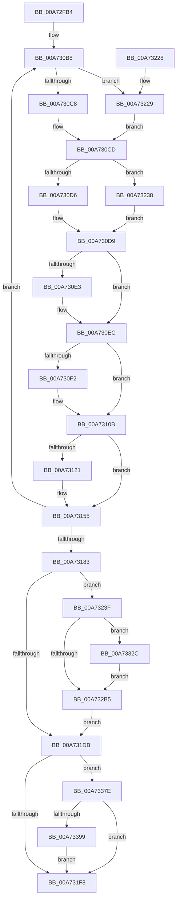

# PopDiagTraceHiberStats

- RVA: `0x00A72FB4`–`0x00A733C6` (길이 `1,042` bytes)
- VA: `0x0000000140A72FB4`
- 실행 섹션: `PAGE`
- PDB 이름 있음: `예`; PDB Function 태그: `아니요`
- unwind 정보 RVA: `0x000B5620`
- 디코드: `226`개 명령, `1,042/1,042` bytes 표시
- 미해석 바이트: `0` (있으면 어셈블리에 `.byte`로 보존)

> 이 문서는 커널 이미지의 기계어와 PDB 기호를 분석해 생성했습니다. 4번과 5번은 함수 원형과 자료형을 바이너리 사용 방식에서 추정한 C 해석이며 원본 소스 복구 결과는 아닙니다.

## 1. Dependencies

- 직접 호출 지점: **22**; 고유 호출 대상: **12**
- 직접 호출자로 확인된 함수: **1**
- RIP 상대 이미지 참조: **38**

### Outgoing calls
- `0x00A73008` → [PopOpenPowerKey](../../text/4B/PopOpenPowerKey_function_004B4314.md) (function, `0x004B4314`)
- `0x00A7301D` → [PopSstDiagQueryResumeTimestamp](../../pagelk/B7/PopSstDiagQueryResumeTimestamp_function_00B7C328.md) (function, `0x00B7C328`)
- `0x00A7305B` → [PopQpcTimeInMs](../../pagelk/B7/PopQpcTimeInMs_function_00B79780.md) (function, `0x00B79780`)
- `0x00A73074` → [PopQpcTimeInMs](../../pagelk/B7/PopQpcTimeInMs_function_00B79780.md) (function, `0x00B79780`)
- `0x00A73092` → [PopComputeDerivedHiberStats](PopComputeDerivedHiberStats_function_00A7376C.md) (function, `0x00A7376C`)
- `0x00A73102` → [PpmConvertTime](../../text/44/PpmConvertTime_function_00447530.md) (function, `0x00447530`)
- `0x00A7312A` → [RtlInitUnicodeString](../../text/42/RtlInitUnicodeString_function_0042A780.md) (function, `0x0042A780`)
- `0x00A73150` → [ZwSetValueKey](../../text/6A/ZwSetValueKey_function_006ADCD0.md) (function, `0x006ADCD0`)
- `0x00A731E6` → [PopPotsLogHibernatePerformance](PopPotsLogHibernatePerformance_function_00A73834.md) (function, `0x00A73834`)
- `0x00A73202` → [_security_check_cookie](../../text/6A/_security_check_cookie_function_006AC640.md) (function, `0x006AC640`)
- `0x00A7324B` → [RtlInitUnicodeString](../../text/42/RtlInitUnicodeString_function_0042A780.md) (function, `0x0042A780`)
- `0x00A73273` → [ZwSetValueKey](../../text/6A/ZwSetValueKey_function_006ADCD0.md) (function, `0x006ADCD0`)
- `0x00A73284` → [RtlInitUnicodeString](../../text/42/RtlInitUnicodeString_function_0042A780.md) (function, `0x0042A780`)
- `0x00A732A7` → [ZwSetValueKey](../../text/6A/ZwSetValueKey_function_006ADCD0.md) (function, `0x006ADCD0`)
- `0x00A732EC` → [RtlInitUnicodeString](../../text/42/RtlInitUnicodeString_function_0042A780.md) (function, `0x0042A780`)
- `0x00A73318` → [ZwSetValueKey](../../text/6A/ZwSetValueKey_function_006ADCD0.md) (function, `0x006ADCD0`)
- `0x00A73322` → [ZwClose](../../text/6A/ZwClose_function_006AD2B0.md) (function, `0x006AD2B0`)
- `0x00A7333A` → [PopQpcTimeInMs](../../pagelk/B7/PopQpcTimeInMs_function_00B79780.md) (function, `0x00B79780`)
- `0x00A73351` → [RtlInitUnicodeString](../../text/42/RtlInitUnicodeString_function_0042A780.md) (function, `0x0042A780`)
- `0x00A73374` → [ZwSetValueKey](../../text/6A/ZwSetValueKey_function_006ADCD0.md) (function, `0x006ADCD0`)
- `0x00A7338C` → [EtwEventEnabled](../../text/39/EtwEventEnabled_function_00392450.md) (function, `0x00392450`)
- `0x00A733BC` → [EtwWrite](../../text/41/EtwWrite_function_0041C720.md) (function, `0x0041C720`)

### Direct callers
- [PopIssueActionRequest](../A9/PopIssueActionRequest_function_00A9CE54.md) at `0x00A9D28B`

### Static image references
- `0x00A72FDA` → RVA `0x00E0A740` (`.data`; read)
- `0x00A73022` → RVA `0x00F0C470` (`.data`; read)
- `0x00A73029` → RVA `0x00F0C340` (`.data`; read)
- `0x00A73030` → RVA `0x00F0C478` (`.data`; write)
- `0x00A73037` → RVA `0x00F0C338` (`.data`; read)
- `0x00A7303E` → RVA `0x00F0BF64` (`.data`; read)
- `0x00A73044` → RVA `0x00F0C57C` (`.data`; write)
- `0x00A7304A` → RVA `0x00F0BFF8` (`.data`; read)
- `0x00A73050` → RVA `0x00F0C578` (`.data`; write)
- `0x00A73060` → RVA `0x00F0C3C8` (`.data`; read)
- `0x00A73067` → RVA `0x00F0C528` (`.data`; write)
- `0x00A7306D` → RVA `0x00F0C308` (`.data`; read)
- `0x00A73084` → RVA `0x00F0C3C0` (`.data`; write)
- `0x00A7308B` → RVA `0x00F0C378` (`.data`; read)
- `0x00A730B1` → RVA `0x00003160` (`.rdata`; read)
- `0x00A730F2` → RVA `0x00FC6BE0` (`ALMOSTRO`; read)
- `0x00A73183` → RVA `0x00F0C4F0` (`.data`; read)
- `0x00A7318C` → RVA `0x00F0C3D0` (`.data`; read)
- `0x00A73197` → RVA `0x00F0C4F0` (`.data`; write)
- `0x00A7319E` → RVA `0x00F0C380` (`.data`; read)
- `0x00A731AA` → RVA `0x00F0C380` (`.data`; write)
- `0x00A731B1` → RVA `0x00F0C478` (`.data`; read)
- `0x00A731C6` → RVA `0x00F0C3D8` (`.data`; read)
- `0x00A731CF` → RVA `0x00F0C580` (`.data`; write)
- `0x00A731EB` → RVA `0x00E67858` (`.data`; read)
- `0x00A7323F` → RVA `0x00B02080` (` ?? ::NNGAKEGL::`string'`; read)
- `0x00A73278` → RVA `0x00B020B0` (` ?? ::NNGAKEGL::`string'`; read)
- `0x00A732AC` → RVA `0x00F0C518` (`.data`; read)
- `0x00A732DE` → RVA `0x00F0C588` (`.data`; write)
- `0x00A732E5` → RVA `0x00B02220` (` ?? ::NNGAKEGL::`string'`; read)
- `0x00A732F6` → RVA `0x00F0C588` (`.data`; read)
- `0x00A7332C` → RVA `0x00F0C520` (`.data`; read)
- `0x00A73333` → RVA `0x00F0C328` (`.data`; read)
- `0x00A7333F` → RVA `0x00F0BF44` (`.data`; read/write)
- `0x00A73345` → RVA `0x00B01E90` (` ?? ::NNGAKEGL::`string'`; read)
- `0x00A73356` → RVA `0x00F0BF44` (`.data`; read)
- `0x00A7337E` → RVA `0x00F0B408` (`.data`; read)
- `0x00A73385` → RVA `0x00020FA8` (`.rdata`; read)

## 2. Other-region calls and transfers

- 다른 실행 섹션으로 향하는 call: **20**
  - `0x00A73008` → [PopOpenPowerKey](../../text/4B/PopOpenPowerKey_function_004B4314.md) (`PAGE` → `.text`)
  - `0x00A7301D` → [PopSstDiagQueryResumeTimestamp](../../pagelk/B7/PopSstDiagQueryResumeTimestamp_function_00B7C328.md) (`PAGE` → `PAGELK`)
  - `0x00A7305B` → [PopQpcTimeInMs](../../pagelk/B7/PopQpcTimeInMs_function_00B79780.md) (`PAGE` → `PAGELK`)
  - `0x00A73074` → [PopQpcTimeInMs](../../pagelk/B7/PopQpcTimeInMs_function_00B79780.md) (`PAGE` → `PAGELK`)
  - `0x00A73102` → [PpmConvertTime](../../text/44/PpmConvertTime_function_00447530.md) (`PAGE` → `.text`)
  - `0x00A7312A` → [RtlInitUnicodeString](../../text/42/RtlInitUnicodeString_function_0042A780.md) (`PAGE` → `.text`)
  - `0x00A73150` → [ZwSetValueKey](../../text/6A/ZwSetValueKey_function_006ADCD0.md) (`PAGE` → `.text`)
  - `0x00A73202` → [_security_check_cookie](../../text/6A/_security_check_cookie_function_006AC640.md) (`PAGE` → `.text`)
  - `0x00A7324B` → [RtlInitUnicodeString](../../text/42/RtlInitUnicodeString_function_0042A780.md) (`PAGE` → `.text`)
  - `0x00A73273` → [ZwSetValueKey](../../text/6A/ZwSetValueKey_function_006ADCD0.md) (`PAGE` → `.text`)
  - `0x00A73284` → [RtlInitUnicodeString](../../text/42/RtlInitUnicodeString_function_0042A780.md) (`PAGE` → `.text`)
  - `0x00A732A7` → [ZwSetValueKey](../../text/6A/ZwSetValueKey_function_006ADCD0.md) (`PAGE` → `.text`)
  - `0x00A732EC` → [RtlInitUnicodeString](../../text/42/RtlInitUnicodeString_function_0042A780.md) (`PAGE` → `.text`)
  - `0x00A73318` → [ZwSetValueKey](../../text/6A/ZwSetValueKey_function_006ADCD0.md) (`PAGE` → `.text`)
  - `0x00A73322` → [ZwClose](../../text/6A/ZwClose_function_006AD2B0.md) (`PAGE` → `.text`)
  - `0x00A7333A` → [PopQpcTimeInMs](../../pagelk/B7/PopQpcTimeInMs_function_00B79780.md) (`PAGE` → `PAGELK`)
  - `0x00A73351` → [RtlInitUnicodeString](../../text/42/RtlInitUnicodeString_function_0042A780.md) (`PAGE` → `.text`)
  - `0x00A73374` → [ZwSetValueKey](../../text/6A/ZwSetValueKey_function_006ADCD0.md) (`PAGE` → `.text`)
  - `0x00A7338C` → [EtwEventEnabled](../../text/39/EtwEventEnabled_function_00392450.md) (`PAGE` → `.text`)
  - `0x00A733BC` → [EtwWrite](../../text/41/EtwWrite_function_0041C720.md) (`PAGE` → `.text`)
- 별도 외부 분기/꼬리 이동을 확인하지 못했습니다.

## 3. Assembly (complete function range)

```asm
00A72FB4  48 8B C4                        mov rax, rsp
00A72FB7  48 89 58 10                     mov qword ptr [rax + 0x10], rbx
00A72FBB  48 89 70 18                     mov qword ptr [rax + 0x18], rsi
00A72FBF  48 89 78 20                     mov qword ptr [rax + 0x20], rdi
00A72FC3  55                              push rbp
00A72FC4  41 54                           push r12
00A72FC6  41 55                           push r13
00A72FC8  41 56                           push r14
00A72FCA  41 57                           push r15
00A72FCC  48 8D A8 C8 FA FF FF            lea rbp, [rax - 0x538]
00A72FD3  48 81 EC 10 06 00 00            sub rsp, 0x610
00A72FDA  48 8B 05 5F 77 39 00            mov rax, qword ptr [rip + 0x39775f]
00A72FE1  48 33 C4                        xor rax, rsp
00A72FE4  48 89 85 00 05 00 00            mov qword ptr [rbp + 0x500], rax
00A72FEB  0F 57 C0                        xorps xmm0, xmm0
00A72FEE  89 4C 24 48                     mov dword ptr [rsp + 0x48], ecx
00A72FF2  33 F6                           xor esi, esi
00A72FF4  48 8D 4C 24 30                  lea rcx, [rsp + 0x30]
00A72FF9  0F 11 44 24 60                  movups xmmword ptr [rsp + 0x60], xmm0
00A72FFE  48 89 74 24 30                  mov qword ptr [rsp + 0x30], rsi
00A73003  0F 11 44 24 38                  movups xmmword ptr [rsp + 0x38], xmm0
00A73008  E8 07 13 A4 FF                  call 0x1404b4314
00A7300D  4C 8B 74 24 30                  mov r14, qword ptr [rsp + 0x30]
00A73012  85 C0                           test eax, eax
00A73014  4C 0F 48 F6                     cmovs r14, rsi
00A73018  4C 89 74 24 30                  mov qword ptr [rsp + 0x30], r14
00A7301D  E8 06 93 10 00                  call 0x140b7c328
00A73022  48 8B 1D 47 94 49 00            mov rbx, qword ptr [rip + 0x499447]
00A73029  48 8D 15 10 93 49 00            lea rdx, [rip + 0x499310]
00A73030  48 89 05 41 94 49 00            mov qword ptr [rip + 0x499441], rax
00A73037  48 8D 0D FA 92 49 00            lea rcx, [rip + 0x4992fa]
00A7303E  8B 05 20 8F 49 00               mov eax, dword ptr [rip + 0x498f20]
00A73044  89 05 32 95 49 00               mov dword ptr [rip + 0x499532], eax
00A7304A  8B 05 A8 8F 49 00               mov eax, dword ptr [rip + 0x498fa8]
00A73050  89 05 22 95 49 00               mov dword ptr [rip + 0x499522], eax
00A73056  48 89 5C 24 58                  mov qword ptr [rsp + 0x58], rbx
00A7305B  E8 20 67 10 00                  call 0x140b79780
00A73060  48 8D 15 61 93 49 00            lea rdx, [rip + 0x499361]
00A73067  89 05 BB 94 49 00               mov dword ptr [rip + 0x4994bb], eax
00A7306D  48 8D 0D 94 92 49 00            lea rcx, [rip + 0x499294]
00A73074  E8 07 67 10 00                  call 0x140b79780
00A73079  44 8B D0                        mov r10d, eax
00A7307C  4C 8D 44 24 60                  lea r8, [rsp + 0x60]
00A73081  48 8B D3                        mov rdx, rbx
00A73084  4C 89 15 35 93 49 00            mov qword ptr [rip + 0x499335], r10
00A7308B  48 8D 0D E6 92 49 00            lea rcx, [rip + 0x4992e6]
00A73092  E8 D5 06 00 00                  call 0x140a7376c
00A73097  4C 8D 64 24 70                  lea r12, [rsp + 0x70]
00A7309C  48 C7 44 24 50 3B 00 00 00      mov qword ptr [rsp + 0x50], 0x3b
00A730A5  4C 8D BD 5C 01 00 00            lea r15, [rbp + 0x15c]
00A730AC  4C 8D 6C 24 70                  lea r13, [rsp + 0x70]
00A730B1  48 8D 3D A8 00 59 FF            lea rdi, [rip - 0xa6ff58]
00A730B8  8B 0F                           mov ecx, dword ptr [rdi]
00A730BA  48 8B 47 F8                     mov rax, qword ptr [rdi - 8]
00A730BE  0F BA E1 1E                     bt ecx, 0x1e
00A730C2  0F 83 61 01 00 00               jae 0x140a73229
00A730C8  48 8D 44 04 60                  lea rax, [rsp + rax + 0x60]
00A730CD  F6 C1 02                        test cl, 2
00A730D0  0F 84 62 01 00 00               je 0x140a73238
00A730D6  48 8B 00                        mov rax, qword ptr [rax]
00A730D9  49 89 04 24                     mov qword ptr [r12], rax
00A730DD  8B 0F                           mov ecx, dword ptr [rdi]
00A730DF  85 C9                           test ecx, ecx
00A730E1  79 09                           jns 0x140a730ec
00A730E3  33 D2                           xor edx, edx
00A730E5  48 F7 F3                        div rbx
00A730E8  49 89 04 24                     mov qword ptr [r12], rax
00A730EC  0F BA E1 1C                     bt ecx, 0x1c
00A730F0  73 19                           jae 0x140a7310b
00A730F2  48 8B 15 E7 3A 55 00            mov rdx, qword ptr [rip + 0x553ae7]
00A730F9  41 B8 E8 03 00 00               mov r8d, 0x3e8
00A730FF  48 8B C8                        mov rcx, rax
00A73102  E8 29 44 9D FF                  call 0x140447530
00A73107  49 89 04 24                     mov qword ptr [r12], rax
00A7310B  8B 37                           mov esi, dword ptr [rdi]
00A7310D  83 E6 20                        and esi, 0x20
00A73110  8B C6                           mov eax, esi
00A73112  F7 D8                           neg eax
00A73114  1B DB                           sbb ebx, ebx
00A73116  83 E3 04                        and ebx, 4
00A73119  83 C3 04                        add ebx, 4
00A7311C  4D 85 F6                        test r14, r14
00A7311F  74 34                           je 0x140a73155
00A73121  48 8B 57 F0                     mov rdx, qword ptr [rdi - 0x10]
00A73125  48 8D 4C 24 38                  lea rcx, [rsp + 0x38]
00A7312A  E8 51 76 9B FF                  call 0x14042a780
00A7312F  F7 DE                           neg esi
00A73131  89 5C 24 28                     mov dword ptr [rsp + 0x28], ebx
00A73135  48 8D 54 24 38                  lea rdx, [rsp + 0x38]
00A7313A  4C 89 6C 24 20                  mov qword ptr [rsp + 0x20], r13
00A7313F  45 1B C9                        sbb r9d, r9d
00A73142  49 8B CE                        mov rcx, r14
00A73145  41 83 E1 07                     and r9d, 7
00A73149  45 33 C0                        xor r8d, r8d
00A7314C  41 83 C1 04                     add r9d, 4
00A73150  E8 7B AB C3 FF                  call 0x1406adcd0
00A73155  33 F6                           xor esi, esi
00A73157  4D 89 6F F4                     mov qword ptr [r15 - 0xc], r13
00A7315B  41 89 5F FC                     mov dword ptr [r15 - 4], ebx
00A7315F  49 83 C5 08                     add r13, 8
00A73163  48 8B 5C 24 58                  mov rbx, qword ptr [rsp + 0x58]
00A73168  48 83 C7 18                     add rdi, 0x18
00A7316C  41 89 37                        mov dword ptr [r15], esi
00A7316F  49 83 C4 08                     add r12, 8
00A73173  49 83 C7 10                     add r15, 0x10
00A73177  48 83 6C 24 50 01               sub qword ptr [rsp + 0x50], 1
00A7317D  0F 85 35 FF FF FF               jne 0x140a730b8
00A73183  48 8B 05 66 93 49 00            mov rax, qword ptr [rip + 0x499366]
00A7318A  33 D2                           xor edx, edx
00A7318C  8B 0D 3E 92 49 00               mov ecx, dword ptr [rip + 0x49923e]
00A73192  48 F7 F3                        div rbx
00A73195  33 D2                           xor edx, edx
00A73197  48 89 05 52 93 49 00            mov qword ptr [rip + 0x499352], rax
00A7319E  48 8B 05 DB 91 49 00            mov rax, qword ptr [rip + 0x4991db]
00A731A5  48 F7 F3                        div rbx
00A731A8  33 D2                           xor edx, edx
00A731AA  48 89 05 CF 91 49 00            mov qword ptr [rip + 0x4991cf], rax
00A731B1  48 69 05 BC 92 49 00 E8 03 00 00  imul rax, qword ptr [rip + 0x4992bc], 0x3e8
00A731BC  48 F7 35 1D 3A 55 00            div qword ptr [rip + 0x553a1d]
00A731C3  48 2B C1                        sub rax, rcx
00A731C6  8B 0D 0C 92 49 00               mov ecx, dword ptr [rip + 0x49920c]
00A731CC  48 2B C1                        sub rax, rcx
00A731CF  48 89 05 AA 93 49 00            mov qword ptr [rip + 0x4993aa], rax
00A731D6  4D 85 F6                        test r14, r14
00A731D9  75 64                           jne 0x140a7323f
00A731DB  8B 54 24 48                     mov edx, dword ptr [rsp + 0x48]
00A731DF  48 8D 0D 92 91 49 00            lea rcx, [rip + 0x499192]
00A731E6  E8 49 06 00 00                  call 0x140a73834
00A731EB  40 38 35 66 46 3F 00            cmp byte ptr [rip + 0x3f4666], sil
00A731F2  0F 85 86 01 00 00               jne 0x140a7337e
00A731F8  48 8B 8D 00 05 00 00            mov rcx, qword ptr [rbp + 0x500]
00A731FF  48 33 CC                        xor rcx, rsp
00A73202  E8 39 94 C3 FF                  call 0x1406ac640
00A73207  4C 8D 9C 24 10 06 00 00         lea r11, [rsp + 0x610]
00A7320F  49 8B 5B 38                     mov rbx, qword ptr [r11 + 0x38]
00A73213  49 8B 73 40                     mov rsi, qword ptr [r11 + 0x40]
00A73217  49 8B 7B 48                     mov rdi, qword ptr [r11 + 0x48]
00A7321B  49 8B E3                        mov rsp, r11
00A7321E  41 5F                           pop r15
00A73220  41 5E                           pop r14
00A73222  41 5D                           pop r13
00A73224  41 5C                           pop r12
00A73226  5D                              pop rbp
00A73227  C3                              ret
00A73228  CC                              int3
00A73229  48 8D 15 48 91 49 00            lea rdx, [rip + 0x499148]
00A73230  48 03 C2                        add rax, rdx
00A73233  E9 95 FE FF FF                  jmp 0x140a730cd
00A73238  8B 00                           mov eax, dword ptr [rax]
00A7323A  E9 9A FE FF FF                  jmp 0x140a730d9
00A7323F  48 8D 15 3A EE 08 00            lea rdx, [rip + 0x8ee3a]
00A73246  48 8D 4C 24 38                  lea rcx, [rsp + 0x38]
00A7324B  E8 30 75 9B FF                  call 0x14042a780
00A73250  BB 04 00 00 00                  mov ebx, 4
00A73255  48 8D 05 94 92 49 00            lea rax, [rip + 0x499294]
00A7325C  89 5C 24 28                     mov dword ptr [rsp + 0x28], ebx
00A73260  48 8D 54 24 38                  lea rdx, [rsp + 0x38]
00A73265  44 8B CB                        mov r9d, ebx
00A73268  48 89 44 24 20                  mov qword ptr [rsp + 0x20], rax
00A7326D  45 33 C0                        xor r8d, r8d
00A73270  49 8B CE                        mov rcx, r14
00A73273  E8 58 AA C3 FF                  call 0x1406adcd0
00A73278  48 8D 15 31 EE 08 00            lea rdx, [rip + 0x8ee31]
00A7327F  48 8D 4C 24 38                  lea rcx, [rsp + 0x38]
00A73284  E8 F7 74 9B FF                  call 0x14042a780
00A73289  48 8D 05 F0 90 49 00            lea rax, [rip + 0x4990f0]
00A73290  89 5C 24 28                     mov dword ptr [rsp + 0x28], ebx
00A73294  44 8B CB                        mov r9d, ebx
00A73297  48 89 44 24 20                  mov qword ptr [rsp + 0x20], rax
00A7329C  45 33 C0                        xor r8d, r8d
00A7329F  48 8D 54 24 38                  lea rdx, [rsp + 0x38]
00A732A4  49 8B CE                        mov rcx, r14
00A732A7  E8 24 AA C3 FF                  call 0x1406adcd0
00A732AC  48 39 35 65 92 49 00            cmp qword ptr [rip + 0x499265], rsi
00A732B3  75 77                           jne 0x140a7332c
00A732B5  48 B8 04 00 00 00 80 F7 FF FF   movabs rax, 0xfffff78000000004
00A732BF  8B 08                           mov ecx, dword ptr [rax]
00A732C1  48 B8 20 03 00 00 80 F7 FF FF   movabs rax, 0xfffff78000000320
00A732CB  48 C1 E1 20                     shl rcx, 0x20
00A732CF  48 8B 00                        mov rax, qword ptr [rax]
00A732D2  48 C1 E0 08                     shl rax, 8
00A732D6  48 F7 E1                        mul rcx
00A732D9  48 8D 4C 24 38                  lea rcx, [rsp + 0x38]
00A732DE  48 89 15 A3 92 49 00            mov qword ptr [rip + 0x4992a3], rdx
00A732E5  48 8D 15 34 EF 08 00            lea rdx, [rip + 0x8ef34]
00A732EC  E8 8F 74 9B FF                  call 0x14042a780
00A732F1  48 8B 4C 24 30                  mov rcx, qword ptr [rsp + 0x30]
00A732F6  48 8D 05 8B 92 49 00            lea rax, [rip + 0x49928b]
00A732FD  C7 44 24 28 08 00 00 00         mov dword ptr [rsp + 0x28], 8
00A73305  48 8D 54 24 38                  lea rdx, [rsp + 0x38]
00A7330A  41 B9 0B 00 00 00               mov r9d, 0xb
00A73310  48 89 44 24 20                  mov qword ptr [rsp + 0x20], rax
00A73315  45 33 C0                        xor r8d, r8d
00A73318  E8 B3 A9 C3 FF                  call 0x1406adcd0
00A7331D  48 8B 4C 24 30                  mov rcx, qword ptr [rsp + 0x30]
00A73322  E8 89 9F C3 FF                  call 0x1406ad2b0
00A73327  E9 AF FE FF FF                  jmp 0x140a731db
00A7332C  48 8D 15 ED 91 49 00            lea rdx, [rip + 0x4991ed]
00A73333  48 8D 0D EE 8F 49 00            lea rcx, [rip + 0x498fee]
00A7333A  E8 41 64 10 00                  call 0x140b79780
00A7333F  01 05 FF 8B 49 00               add dword ptr [rip + 0x498bff], eax
00A73345  48 8D 15 44 EB 08 00            lea rdx, [rip + 0x8eb44]
00A7334C  48 8D 4C 24 38                  lea rcx, [rsp + 0x38]
00A73351  E8 2A 74 9B FF                  call 0x14042a780
00A73356  48 8D 05 E7 8B 49 00            lea rax, [rip + 0x498be7]
00A7335D  89 5C 24 28                     mov dword ptr [rsp + 0x28], ebx
00A73361  44 8B CB                        mov r9d, ebx
00A73364  48 89 44 24 20                  mov qword ptr [rsp + 0x20], rax
00A73369  45 33 C0                        xor r8d, r8d
00A7336C  48 8D 54 24 38                  lea rdx, [rsp + 0x38]
00A73371  49 8B CE                        mov rcx, r14
00A73374  E8 57 A9 C3 FF                  call 0x1406adcd0
00A73379  E9 37 FF FF FF                  jmp 0x140a732b5
00A7337E  48 8B 0D 83 80 49 00            mov rcx, qword ptr [rip + 0x498083]
00A73385  48 8D 15 1C DC 5A FF            lea rdx, [rip - 0xa523e4]
00A7338C  E8 BF F0 91 FF                  call 0x140392450
00A73391  84 C0                           test al, al
00A73393  0F 84 5F FE FF FF               je 0x140a731f8
00A73399  48 8B 0D 68 80 49 00            mov rcx, qword ptr [rip + 0x498068]
00A733A0  48 8D 85 50 01 00 00            lea rax, [rbp + 0x150]
00A733A7  41 B9 3B 00 00 00               mov r9d, 0x3b
00A733AD  48 89 44 24 20                  mov qword ptr [rsp + 0x20], rax
00A733B2  45 33 C0                        xor r8d, r8d
00A733B5  48 8D 15 EC DB 5A FF            lea rdx, [rip - 0xa52414]
00A733BC  E8 5F 93 9A FF                  call 0x14041c720
00A733C1  E9 32 FE FF FF                  jmp 0x140a731f8
```

## 4. C-style interpretation (structured pseudocode)

```c
__int64 __fastcall PopDiagTraceHiberStats(int a1, __int64 a2, __int64 a3, int a4)
{
    __int64 result;
    __int64 v_r12;
    __int64 v_r13;
    __int64 v_r14;
    __int64 v_r15;
    __int64 v_rbx;
    __int64 v_rdi;
    __int64 v_rsi;
    __int64 v_rsp;
    unsigned __int64 v_stack_m28;
    unsigned __int64 v_stack_m5C8;
    unsigned __int64 v_stack_m5D8;
    unsigned __int64 v_stack_m5E0;
    unsigned __int64 v_stack_m5E8;
    unsigned int v_stack_m5F0;
    unsigned __int64 v_stack_m600;
    unsigned __int64 v_stack_m608;
    unsigned int v_stack_m610;
    unsigned __int64 v_stack_m618;

    *(unsigned __int64 *)(v_rsp + 16) = v_rbx;
    *(unsigned __int64 *)(v_rsp + 24) = v_rsi;
    *(unsigned __int64 *)(v_rsp + 32) = v_rdi;
    v_rsp = (v_rsp) - (0x610ULL);
    result = (*(unsigned __int64 *)(v_rip + 3766111)) ^ (v_rsp);
    *(unsigned __int64 *)(v_rsp - 1336 + 1280) = result;
    v_stack_m5F0 = a1;
    v_rsi = 0;
    v_stack_m5D8 = v_xmm0;
    v_stack_m608 = 0;
    v_stack_m600 = v_xmm0;
    result = PopOpenPowerKey(v_stack_m608, a2, a3, a4);
    v_r14 = v_stack_m608;
    if (sign_flag) { v_r14 = 0; }
    v_stack_m608 = v_r14;
    result = PopSstDiagQueryResumeTimestamp(v_stack_m608, a2, a3, a4);
    *(unsigned __int64 *)(v_rip + 4822081) = result;
    *(unsigned int *)(v_rip + 4822322) = (unsigned int)((unsigned int)(*(unsigned int *)(v_rip + 4820768)));
    *(unsigned int *)(v_rip + 4822306) = (unsigned int)((unsigned int)(*(unsigned int *)(v_rip + 4820904)));
    v_stack_m5E0 = *(unsigned __int64 *)(v_rip + 4822087);
    result = PopQpcTimeInMs(v_rip + 4821754, v_rip + 4821776, a3, a4);
    *(unsigned int *)(v_rip + 4822203) = (unsigned int)(result);
    result = PopQpcTimeInMs(v_rip + 4821652, v_rip + 4821857, a3, a4);
    *(unsigned __int64 *)(v_rip + 4821813) = (unsigned int)((unsigned int)(result));
    result = PopComputeDerivedHiberStats(v_rip + 4821734, *(unsigned __int64 *)(v_rip + 4822087), v_stack_m5D8, a4);
    v_stack_m5E8 = 59;
loc_00A730B8:
    if (condition_is_above_or_equal) goto loc_00A73229;
loc_00A730CD:
    if ((((unsigned __int8)((unsigned int)(*(unsigned int *)(v_rip - 10944344)))) & (2)) == 0) goto loc_00A73238;
loc_00A730D9:
    *(unsigned __int64 *)(v_stack_m5C8) = *(unsigned __int64 *)(v_rsp + *(unsigned __int64 *)(v_rip - 10944344 - 8) * 1 + 96);
    if (sign_flag) {
        a2 = 0;
        *(unsigned __int64 *)(v_stack_m5C8) = *(unsigned __int64 *)(v_rsp + *(unsigned __int64 *)(v_rip - 10944344 - 8) * 1 + 96);
    }
    result = *(unsigned __int64 *)(v_rsp + *(unsigned __int64 *)(v_rip - 10944344 - 8) * 1 + 96);
    if (!(condition_is_above_or_equal)) {
        a2 = *(unsigned __int64 *)(v_rip + 5585639);
        a3 = 1000;
        a1 = *(unsigned __int64 *)(v_rsp + *(unsigned __int64 *)(v_rip - 10944344 - 8) * 1 + 96);
        result = PpmConvertTime(a1, a2, a3, a4);
        *(unsigned __int64 *)(v_stack_m5C8) = result;
    }
    v_rsi = (unsigned int)(((unsigned int)(*(unsigned int *)(v_rip - 10944344))) & (32));
    result = (unsigned int)(-((unsigned int)((unsigned int)(v_rsi))));
    v_rbx = (unsigned int)((*(unsigned __int64 *)(v_rip + 4822087)) & (4));
    v_rbx = (unsigned int)((v_rbx) + (4));
    if (v_r14 != 0) {
        a2 = *(unsigned __int64 *)(v_rip - 10944344 - 16);
        a1 = v_stack_m600;
        result = RtlInitUnicodeString(a1, a2, a3, a4);
        v_rsi = (unsigned int)(-(v_rsi));
        v_stack_m610 = (unsigned int)(v_rbx);
        a2 = v_stack_m600;
        v_stack_m618 = v_stack_m5C8;
        a1 = v_r14;
        a4 = (unsigned int)((a4) & (7));
        a3 = 0;
        a4 = (unsigned int)((a4) + (4));
        result = ZwSetValueKey(a1, a2, a3, a4);
    }
    v_rsi = 0;
    *(unsigned __int64 *)(v_rsp - 1336 + 348 - 12) = v_stack_m5C8;
    *(unsigned int *)(v_rsp - 1336 + 348 - 4) = (unsigned int)(v_rbx);
    v_r13 = (v_stack_m5C8) + (8);
    v_rdi = (v_rip - 10944344) + (24);
    *(unsigned int *)(v_rsp - 1336 + 348) = 0;
    v_r12 = (v_stack_m5C8) + (8);
    v_r15 = (v_rsp - 1336 + 348) + (16);
    if (condition_is_not_equal) goto loc_00A730B8;
    a2 = 0;
    a2 = 0;
    *(unsigned __int64 *)(v_rip + 4821842) = *(unsigned __int64 *)(v_rip + 4821862);
    a2 = 0;
    *(unsigned __int64 *)(v_rip + 4821455) = *(unsigned __int64 *)(v_rip + 4821467);
    result = (*(unsigned __int64 *)(v_rip + 4821467)) * (*(unsigned __int64 *)(v_rip + 4821692));
    result = (result) - ((unsigned int)(*(unsigned int *)(v_rip + 4821566)));
    result = (result) - ((unsigned int)(*(unsigned int *)(v_rip + 4821516)));
    *(unsigned __int64 *)(v_rip + 4821930) = result;
    if (v_r14 != 0) goto loc_00A7323F;
loc_00A731DB:
    result = PopPotsLogHibernatePerformance(v_rip + 4821394, (unsigned int)(v_stack_m5F0), a3, a4);
    if ((*(unsigned __int8 *)(v_rip + 4146790)) != 0) goto loc_00A7337E;
loc_00A731F8:
    a1 = (*(unsigned __int64 *)(v_rsp - 1336 + 1280)) ^ (v_rsp);
    result = _security_check_cookie(a1, (unsigned int)(v_stack_m5F0), a3, a4);
    return result;
loc_00A73229:
    result = (result) + (v_rip + 4821320);
    goto loc_00A730CD;
loc_00A73238:
    goto loc_00A730D9;
loc_00A7323F:
    result = RtlInitUnicodeString(v_stack_m5D8, v_rip + 585274, a3, a4);
    v_stack_m5E8 = 4;
    v_stack_m5F0 = v_rip + 4821652;
    a3 = 0;
    result = ZwSetValueKey(v_r14, v_stack_m5D8, a3, 4);
    result = RtlInitUnicodeString(v_stack_m5D8, v_rip + 585265, a3, 4);
    v_stack_m5E8 = 4;
    v_stack_m5F0 = v_rip + 4821232;
    a3 = 0;
    result = ZwSetValueKey(v_r14, v_stack_m5D8, a3, 4);
    if ((*(unsigned __int64 *)(v_rip + 4821605)) != (*(unsigned __int64 *)(v_stack_m28 + 64))) goto loc_00A7332C;
loc_00A732B5:
    a1 = ((unsigned int)(*(unsigned int *)(result))) << (32);
    result = (*(unsigned __int64 *)(result)) << (8);
    *(unsigned __int64 *)(v_rip + 4821667) = v_stack_m5D8;
    result = RtlInitUnicodeString(v_stack_m5D8, v_rip + 585524, a3, 4);
    v_stack_m5E8 = 8;
    v_stack_m5F0 = v_rip + 4821643;
    a3 = 0;
    result = ZwSetValueKey(v_stack_m5E0, v_stack_m5D8, a3, 11);
    result = ZwClose(v_stack_m5E0, v_stack_m5D8, a3, 11);
    goto loc_00A731DB;
loc_00A7332C:
    result = PopQpcTimeInMs(v_rip + 4820974, v_rip + 4821485, a3, 11);
    result = RtlInitUnicodeString(v_stack_m5D8, v_rip + 584516, a3, 11);
    v_stack_m5E8 = 4;
    v_stack_m5F0 = v_rip + 4819943;
    a3 = 0;
    result = ZwSetValueKey(v_r14, v_stack_m5D8, a3, 4);
    goto loc_00A732B5;
loc_00A7337E:
    result = EtwEventEnabled(*(unsigned __int64 *)(v_rip + 4817027), v_rip - 10822628, a3, 4);
    if ((unsigned __int8)(result) == 0) goto loc_00A731F8;
    v_stack_m5F0 = v_rsp - 1336 + 336;
    a3 = 0;
    result = EtwWrite(*(unsigned __int64 *)(v_rip + 4817000), v_rip - 10822676, a3, 59);
    goto loc_00A731F8;
}
```

## 5. (Beta) C Style

```c
int64_t PopDiagTraceHiberStats(int32_t Arg1, int64_t Arg2, int64_t Arg3, int32_t Arg4)
{
    int64_t result;
    int64_t local_r12;
    int64_t local_r13;
    int64_t local_r14;
    int64_t local_r15;
    int64_t local_rbx;
    int64_t local_rdi;
    int64_t local_rsi;
    int64_t local_rsp;
    uint64_t v_stack_m28;
    uint64_t v_stack_m5C8;
    uint64_t v_stack_m5D8;
    uint64_t v_stack_m5E0;
    uint64_t v_stack_m5E8;
    uint32_t v_stack_m5F0;
    uint64_t v_stack_m600;
    uint64_t v_stack_m608;
    uint32_t v_stack_m610;
    uint64_t v_stack_m618;

    *(uint64_t *)(local_rsp + 0x10) = local_rbx;
    *(uint64_t *)(local_rsp + 0x18) = local_rsi;
    *(uint64_t *)(local_rsp + 0x20) = local_rdi;
    local_rsp = (local_rsp) - (0x610ULL);
    result = (*(uint64_t *)(v_rip + 0x39775F)) ^ (local_rsp);
    *(uint64_t *)(local_rsp - 0x538 + 0x500) = result;
    v_stack_m5F0 = Arg1;
    local_rsi = 0;
    v_stack_m5D8 = v_xmm0;
    v_stack_m608 = 0;
    v_stack_m600 = v_xmm0;
    result = PopOpenPowerKey(v_stack_m608, Arg2, Arg3, Arg4);
    local_r14 = v_stack_m608;
    if (sign_flag) { local_r14 = 0; }
    v_stack_m608 = local_r14;
    result = PopSstDiagQueryResumeTimestamp(v_stack_m608, Arg2, Arg3, Arg4);
    *(uint64_t *)(v_rip + 0x499441) = result;
    *(uint32_t *)(v_rip + 0x499532) = (uint32_t)((uint32_t)(*(uint32_t *)(v_rip + 0x498F20)));
    *(uint32_t *)(v_rip + 0x499522) = (uint32_t)((uint32_t)(*(uint32_t *)(v_rip + 0x498FA8)));
    v_stack_m5E0 = *(uint64_t *)(v_rip + 0x499447);
    result = PopQpcTimeInMs(v_rip + 4821754, v_rip + 4821776, Arg3, Arg4);
    *(uint32_t *)(v_rip + 0x4994BB) = (uint32_t)(result);
    result = PopQpcTimeInMs(v_rip + 4821652, v_rip + 4821857, Arg3, Arg4);
    *(uint64_t *)(v_rip + 0x499335) = (uint32_t)((uint32_t)(result));
    result = PopComputeDerivedHiberStats(v_rip + 4821734, *(uint64_t *)(v_rip + 0x499447), v_stack_m5D8, Arg4);
    v_stack_m5E8 = 59;
loc_00A730B8:
    if (condition_is_above_or_equal) goto loc_00A73229;
loc_00A730CD:
    if ((((uint8_t)((uint32_t)(*(uint32_t *)(v_rip - 0xA6FF58)))) & (2)) == 0) goto loc_00A73238;
loc_00A730D9:
    *(uint64_t *)(v_stack_m5C8) = *(uint64_t *)(local_rsp + *(uint64_t *)(v_rip - 0xA6FF58 - 0x8) * 1 + 0x60);
    if (sign_flag) {
        Arg2 = 0;
        *(uint64_t *)(v_stack_m5C8) = *(uint64_t *)(local_rsp + *(uint64_t *)(v_rip - 0xA6FF58 - 0x8) * 1 + 0x60);
    }
    result = *(uint64_t *)(local_rsp + *(uint64_t *)(v_rip - 0xA6FF58 - 0x8) * 1 + 0x60);
    if (!(condition_is_above_or_equal)) {
        Arg2 = *(uint64_t *)(v_rip + 0x553AE7);
        Arg3 = 1000;
        Arg1 = *(uint64_t *)(local_rsp + *(uint64_t *)(v_rip - 0xA6FF58 - 0x8) * 1 + 0x60);
        result = PpmConvertTime(Arg1, Arg2, Arg3, Arg4);
        *(uint64_t *)(v_stack_m5C8) = result;
    }
    local_rsi = (uint32_t)(((uint32_t)(*(uint32_t *)(v_rip - 0xA6FF58))) & (32));
    result = (uint32_t)(-((uint32_t)((uint32_t)(local_rsi))));
    local_rbx = (uint32_t)((*(uint64_t *)(v_rip + 0x499447)) & (4));
    local_rbx = (uint32_t)((local_rbx) + (4));
    if (local_r14 != 0) {
        Arg2 = *(uint64_t *)(v_rip - 0xA6FF58 - 0x10);
        Arg1 = v_stack_m600;
        result = RtlInitUnicodeString(Arg1, Arg2, Arg3, Arg4);
        local_rsi = (uint32_t)(-(local_rsi));
        v_stack_m610 = (uint32_t)(local_rbx);
        Arg2 = v_stack_m600;
        v_stack_m618 = v_stack_m5C8;
        Arg1 = local_r14;
        Arg4 = (uint32_t)((Arg4) & (7));
        Arg3 = 0;
        Arg4 = (uint32_t)((Arg4) + (4));
        result = ZwSetValueKey(Arg1, Arg2, Arg3, Arg4);
    }
    local_rsi = 0;
    *(uint64_t *)(local_rsp - 0x538 + 0x15C - 0xC) = v_stack_m5C8;
    *(uint32_t *)(local_rsp - 0x538 + 0x15C - 0x4) = (uint32_t)(local_rbx);
    local_r13 = (v_stack_m5C8) + (8);
    local_rdi = (v_rip - 10944344) + (24);
    *(uint32_t *)(local_rsp - 0x538 + 0x15C) = 0;
    local_r12 = (v_stack_m5C8) + (8);
    local_r15 = (local_rsp - 1336 + 348) + (16);
    if (condition_is_not_equal) goto loc_00A730B8;
    Arg2 = 0;
    Arg2 = 0;
    *(uint64_t *)(v_rip + 0x499352) = *(uint64_t *)(v_rip + 0x499366);
    Arg2 = 0;
    *(uint64_t *)(v_rip + 0x4991CF) = *(uint64_t *)(v_rip + 0x4991DB);
    result = (*(uint64_t *)(v_rip + 0x4991DB)) * (*(uint64_t *)(v_rip + 0x4992BC));
    result = (result) - ((uint32_t)(*(uint32_t *)(v_rip + 0x49923E)));
    result = (result) - ((uint32_t)(*(uint32_t *)(v_rip + 0x49920C)));
    *(uint64_t *)(v_rip + 0x4993AA) = result;
    if (local_r14 != 0) goto loc_00A7323F;
loc_00A731DB:
    result = PopPotsLogHibernatePerformance(v_rip + 4821394, (uint32_t)(v_stack_m5F0), Arg3, Arg4);
    if ((*(uint8_t *)(v_rip + 0x3F4666)) != 0) goto loc_00A7337E;
loc_00A731F8:
    Arg1 = (*(uint64_t *)(local_rsp - 0x538 + 0x500)) ^ (local_rsp);
    result = _security_check_cookie(Arg1, (uint32_t)(v_stack_m5F0), Arg3, Arg4);
    return result;
loc_00A73229:
    result = (result) + (v_rip + 4821320);
    goto loc_00A730CD;
loc_00A73238:
    goto loc_00A730D9;
loc_00A7323F:
    result = RtlInitUnicodeString(v_stack_m5D8, v_rip + 585274, Arg3, Arg4);
    v_stack_m5E8 = 4;
    v_stack_m5F0 = v_rip + 4821652;
    Arg3 = 0;
    result = ZwSetValueKey(local_r14, v_stack_m5D8, Arg3, 4);
    result = RtlInitUnicodeString(v_stack_m5D8, v_rip + 585265, Arg3, 4);
    v_stack_m5E8 = 4;
    v_stack_m5F0 = v_rip + 4821232;
    Arg3 = 0;
    result = ZwSetValueKey(local_r14, v_stack_m5D8, Arg3, 4);
    if ((*(uint64_t *)(v_rip + 0x499265)) != (*(uint64_t *)(v_stack_m28 + 0x40))) goto loc_00A7332C;
loc_00A732B5:
    Arg1 = ((uint32_t)(*(uint32_t *)(result))) << (32);
    result = (*(uint64_t *)(result)) << (8);
    *(uint64_t *)(v_rip + 0x4992A3) = v_stack_m5D8;
    result = RtlInitUnicodeString(v_stack_m5D8, v_rip + 585524, Arg3, 4);
    v_stack_m5E8 = 8;
    v_stack_m5F0 = v_rip + 4821643;
    Arg3 = 0;
    result = ZwSetValueKey(v_stack_m5E0, v_stack_m5D8, Arg3, 11);
    result = ZwClose(v_stack_m5E0, v_stack_m5D8, Arg3, 11);
    goto loc_00A731DB;
loc_00A7332C:
    result = PopQpcTimeInMs(v_rip + 4820974, v_rip + 4821485, Arg3, 11);
    result = RtlInitUnicodeString(v_stack_m5D8, v_rip + 584516, Arg3, 11);
    v_stack_m5E8 = 4;
    v_stack_m5F0 = v_rip + 4819943;
    Arg3 = 0;
    result = ZwSetValueKey(local_r14, v_stack_m5D8, Arg3, 4);
    goto loc_00A732B5;
loc_00A7337E:
    result = EtwEventEnabled(*(uint64_t *)(v_rip + 0x498083), v_rip - 10822628, Arg3, 4);
    if ((uint8_t)(result) == 0) goto loc_00A731F8;
    v_stack_m5F0 = local_rsp - 1336 + 336;
    Arg3 = 0;
    result = EtwWrite(*(uint64_t *)(v_rip + 0x498068), v_rip - 10822676, Arg3, 59);
    goto loc_00A731F8;
}
```

## 6. Execution-region graph

[열기: 2D/3D 그래프와 함수 탐색 컨트롤 패널](../../../control-panel.html?section=page&rva=0x00A72FB4&view=graph)

- 2D 그래프는 위에서 아래로 흐르고, 3D 그래프는 빈 공간을 드래그해 회전합니다. Shift+드래그는 이동, 휠은 확대·축소, 함수 노드 선택은 대상 보고서 이동입니다.

### Static fallback


