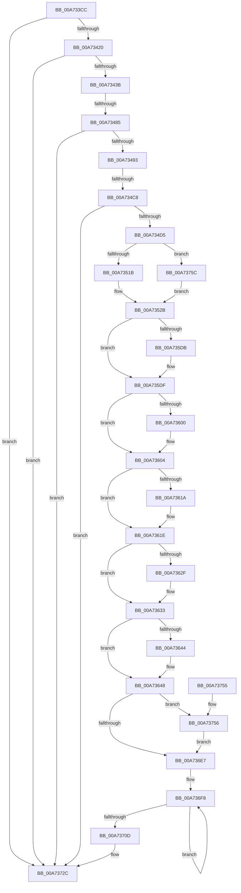

# PopDiagTracePerfTrackData

- RVA: `0x00A733CC`–`0x00A73764` (길이 `920` bytes)
- VA: `0x0000000140A733CC`
- 실행 섹션: `PAGE`
- PDB 이름 있음: `예`; PDB Function 태그: `예`
- unwind 정보 RVA: `0x000B564C`
- 디코드: `214`개 명령, `920/920` bytes 표시
- 미해석 바이트: `0` (있으면 어셈블리에 `.byte`로 보존)

> 이 문서는 커널 이미지의 기계어와 PDB 기호를 분석해 생성했습니다. 4번과 5번은 함수 원형과 자료형을 바이너리 사용 방식에서 추정한 C 해석이며 원본 소스 복구 결과는 아닙니다.

## 1. Dependencies

- 직접 호출 지점: **11**; 고유 호출 대상: **7**
- 직접 호출자로 확인된 함수: **1**
- RIP 상대 이미지 참조: **32**

### Outgoing calls
- `0x00A7342E` → [EtwEventEnabled](../../text/39/EtwEventEnabled_function_00392450.md) (function, `0x00392450`)
- `0x00A7343D` → [KeGetPrcb](../../text/2D/KeGetPrcb_function_002D85D0.md) (function, `0x002D85D0`)
- `0x00A7345A` → [PopQpcTimeInMs](../../pagelk/B7/PopQpcTimeInMs_function_00B79780.md) (function, `0x00B79780`)
- `0x00A73470` → [PopQpcTimeInMs](../../pagelk/B7/PopQpcTimeInMs_function_00B79780.md) (function, `0x00B79780`)
- `0x00A734E7` → [PopQpcTimeInMs](../../pagelk/B7/PopQpcTimeInMs_function_00B79780.md) (function, `0x00B79780`)
- `0x00A7350E` → [PopReadRegKeyValue](../../text/4B/PopReadRegKeyValue_function_004B5F64.md) (function, `0x004B5F64`)
- `0x00A73526` → [PopQpcTimeInMs](../../pagelk/B7/PopQpcTimeInMs_function_00B79780.md) (function, `0x00B79780`)
- `0x00A73581` → [EtwWrite](../../text/41/EtwWrite_function_0041C720.md) (function, `0x0041C720`)
- `0x00A73594` → [PopComputeDerivedHiberStats](PopComputeDerivedHiberStats_function_00A7376C.md) (function, `0x00A7376C`)
- `0x00A73727` → [EtwWrite](../../text/41/EtwWrite_function_0041C720.md) (function, `0x0041C720`)
- `0x00A73733` → [_security_check_cookie](../../text/6A/_security_check_cookie_function_006AC640.md) (function, `0x006AC640`)

### Direct callers
- [PopIssueActionRequest](../A9/PopIssueActionRequest_function_00A9CE54.md) at `0x00A9D298`

### Static image references
- `0x00A733EB` → RVA `0x00E0A740` (`.data`; read)
- `0x00A733FE` → RVA `0x00E67858` (`.data`; read)
- `0x00A73420` → RVA `0x00F0B408` (`.data`; read)
- `0x00A73427` → RVA `0x0001C620` (`.rdata`; read)
- `0x00A73442` → RVA `0x00F0C368` (`.data`; read)
- `0x00A73453` → RVA `0x00F0C360` (`.data`; read)
- `0x00A7345F` → RVA `0x00F0C358` (`.data`; read)
- `0x00A73469` → RVA `0x00F0C350` (`.data`; read)
- `0x00A73475` → RVA `0x00F0C348` (`.data`; read)
- `0x00A73485` → RVA `0x00F0C570` (`.data`; read)
- `0x00A73493` → RVA `0x00F0C3C0` (`.data`; read)
- `0x00A734A4` → RVA `0x00F0C390` (`.data`; read)
- `0x00A734B4` → RVA `0x00F0C580` (`.data`; read)
- `0x00A734C8` → RVA `0x00F0E790` (`.data`; read)
- `0x00A734D9` → RVA `0x00F0C308` (`.data`; read)
- `0x00A734FB` → RVA `0x00B023B0` (` ?? ::NNGAKEGL::`string'`; read)
- `0x00A73507` → RVA `0x00B023F0` (` ?? ::NNGAKEGL::`string'`; read)
- `0x00A7351B` → RVA `0x00F0C3C8` (`.data`; read)
- `0x00A73532` → RVA `0x0001AFC8` (`.rdata`; read)
- `0x00A7358D` → RVA `0x00F0C378` (`.data`; read)
- `0x00A735AC` → RVA `0x00F0C558` (`.data`; read)
- `0x00A735CB` → RVA `0x00F0C560` (`.data`; read)
- `0x00A735DF` → RVA `0x00F0C3E0` (`.data`; read)
- `0x00A735EA` → RVA `0x00FC6BE0` (`ALMOSTRO`; read)
- `0x00A73604` → RVA `0x00F0C4E8` (`.data`; read)
- `0x00A7361E` → RVA `0x00F0C3D0` (`.data`; read)
- `0x00A73633` → RVA `0x00F0C528` (`.data`; read)
- `0x00A73676` → RVA `0x00F0C478` (`.data`; read)
- `0x00A7367D` → RVA `0x00F0C4B0` (`.data`; read)
- `0x00A736BD` → RVA `0x00F0C538` (`.data`; read)
- `0x00A736D7` → RVA `0x00F0C540` (`.data`; read)
- `0x00A7370D` → RVA `0x0001AFD8` (`.rdata`; read)

## 2. Other-region calls and transfers

- 다른 실행 섹션으로 향하는 call: **10**
  - `0x00A7342E` → [EtwEventEnabled](../../text/39/EtwEventEnabled_function_00392450.md) (`PAGE` → `.text`)
  - `0x00A7343D` → [KeGetPrcb](../../text/2D/KeGetPrcb_function_002D85D0.md) (`PAGE` → `.text`)
  - `0x00A7345A` → [PopQpcTimeInMs](../../pagelk/B7/PopQpcTimeInMs_function_00B79780.md) (`PAGE` → `PAGELK`)
  - `0x00A73470` → [PopQpcTimeInMs](../../pagelk/B7/PopQpcTimeInMs_function_00B79780.md) (`PAGE` → `PAGELK`)
  - `0x00A734E7` → [PopQpcTimeInMs](../../pagelk/B7/PopQpcTimeInMs_function_00B79780.md) (`PAGE` → `PAGELK`)
  - `0x00A7350E` → [PopReadRegKeyValue](../../text/4B/PopReadRegKeyValue_function_004B5F64.md) (`PAGE` → `.text`)
  - `0x00A73526` → [PopQpcTimeInMs](../../pagelk/B7/PopQpcTimeInMs_function_00B79780.md) (`PAGE` → `PAGELK`)
  - `0x00A73581` → [EtwWrite](../../text/41/EtwWrite_function_0041C720.md) (`PAGE` → `.text`)
  - `0x00A73727` → [EtwWrite](../../text/41/EtwWrite_function_0041C720.md) (`PAGE` → `.text`)
  - `0x00A73733` → [_security_check_cookie](../../text/6A/_security_check_cookie_function_006AC640.md) (`PAGE` → `.text`)
- call이 아닌 외부 분기/꼬리 이동: **2**
  - `0x00A7347F` → [sub_00B4042A](../B4/Unknown_function_00B4042A.md) (`tail-transfer`)
  - `0x00A734C2` → [sub_00B4042A + 0x9A](../B4/Unknown_function_00B4042A.md) (`tail-transfer`)

## 3. Assembly (complete function range)

```asm
00A733CC  48 8B C4                        mov rax, rsp
00A733CF  48 89 58 08                     mov qword ptr [rax + 8], rbx
00A733D3  48 89 70 10                     mov qword ptr [rax + 0x10], rsi
00A733D7  48 89 78 18                     mov qword ptr [rax + 0x18], rdi
00A733DB  55                              push rbp
00A733DC  41 56                           push r14
00A733DE  41 57                           push r15
00A733E0  48 8D 68 A1                     lea rbp, [rax - 0x5f]
00A733E4  48 81 EC 00 01 00 00            sub rsp, 0x100
00A733EB  48 8B 05 4E 73 39 00            mov rax, qword ptr [rip + 0x39734e]
00A733F2  48 33 C4                        xor rax, rsp
00A733F5  48 89 45 37                     mov qword ptr [rbp + 0x37], rax
00A733F9  45 33 FF                        xor r15d, r15d
00A733FC  33 C0                           xor eax, eax
00A733FE  44 38 3D 53 44 3F 00            cmp byte ptr [rip + 0x3f4453], r15b
00A73405  0F 57 C0                        xorps xmm0, xmm0
00A73408  8B F9                           mov edi, ecx
00A7340A  4C 89 7D 8F                     mov qword ptr [rbp - 0x71], r15
00A7340E  0F 11 45 A7                     movups xmmword ptr [rbp - 0x59], xmm0
00A73412  48 89 45 C7                     mov qword ptr [rbp - 0x39], rax
00A73416  0F 11 45 B7                     movups xmmword ptr [rbp - 0x49], xmm0
00A7341A  0F 84 0C 03 00 00               je 0x140a7372c
00A73420  48 8B 0D E1 7F 49 00            mov rcx, qword ptr [rip + 0x497fe1]
00A73427  48 8D 15 F2 91 5A FF            lea rdx, [rip - 0xa56e0e]
00A7342E  E8 1D F0 91 FF                  call 0x140392450
00A73433  84 C0                           test al, al
00A73435  0F 84 F1 02 00 00               je 0x140a7372c
00A7343B  33 C9                           xor ecx, ecx
00A7343D  E8 8E 51 86 FF                  call 0x1402d85d0
00A73442  48 8D 15 1F 8F 49 00            lea rdx, [rip + 0x498f1f]
00A73449  8B 48 44                        mov ecx, dword ptr [rax + 0x44]
00A7344C  48 69 F1 E8 03 00 00            imul rsi, rcx, 0x3e8
00A73453  48 8D 0D 06 8F 49 00            lea rcx, [rip + 0x498f06]
00A7345A  E8 21 63 10 00                  call 0x140b79780
00A7345F  48 8D 15 F2 8E 49 00            lea rdx, [rip + 0x498ef2]
00A73466  89 45 9B                        mov dword ptr [rbp - 0x65], eax
00A73469  48 8D 0D E0 8E 49 00            lea rcx, [rip + 0x498ee0]
00A73470  E8 0B 63 10 00                  call 0x140b79780
00A73475  4C 39 3D CC 8E 49 00            cmp qword ptr [rip + 0x498ecc], r15
00A7347C  89 45 97                        mov dword ptr [rbp - 0x69], eax
00A7347F  0F 85 A5 CF 0C 00               jne 0x140b4042a
00A73485  8B 05 E5 90 49 00               mov eax, dword ptr [rip + 0x4990e5]
00A7348B  85 C0                           test eax, eax
00A7348D  0F 84 99 02 00 00               je 0x140a7372c
00A73493  8B 0D 27 8F 49 00               mov ecx, dword ptr [rip + 0x498f27]
00A73499  33 D2                           xor edx, edx
00A7349B  C1 E0 0C                        shl eax, 0xc
00A7349E  C1 E8 0A                        shr eax, 0xa
00A734A1  89 45 83                        mov dword ptr [rbp - 0x7d], eax
00A734A4  48 8B 05 E5 8E 49 00            mov rax, qword ptr [rip + 0x498ee5]
00A734AB  48 F7 F6                        div rsi
00A734AE  89 4D A3                        mov dword ptr [rbp - 0x5d], ecx
00A734B1  89 45 87                        mov dword ptr [rbp - 0x79], eax
00A734B4  8B 05 C6 90 49 00               mov eax, dword ptr [rip + 0x4990c6]
00A734BA  89 44 24 30                     mov dword ptr [rsp + 0x30], eax
00A734BE  40 F6 C7 08                     test dil, 8
00A734C2  0F 84 FC CF 0C 00               je 0x140b404c4
00A734C8  4C 39 3D C1 B2 49 00            cmp qword ptr [rip + 0x49b2c1], r15
00A734CF  0F 84 57 02 00 00               je 0x140a7372c
00A734D5  89 4C 24 34                     mov dword ptr [rsp + 0x34], ecx
00A734D9  48 8D 15 28 8E 49 00            lea rdx, [rip + 0x498e28]
00A734E0  48 8D 0D A9 B2 49 00            lea rcx, [rip + 0x49b2a9]
00A734E7  E8 94 62 10 00                  call 0x140b79780
00A734EC  01 44 24 34                     add dword ptr [rsp + 0x34], eax
00A734F0  45 8D 47 08                     lea r8d, [r15 + 8]
00A734F4  48 8D 45 8F                     lea rax, [rbp - 0x71]
00A734F8  45 33 C9                        xor r9d, r9d
00A734FB  48 8D 15 AE EE 08 00            lea rdx, [rip + 0x8eeae]
00A73502  48 89 44 24 20                  mov qword ptr [rsp + 0x20], rax
00A73507  48 8D 0D E2 EE 08 00            lea rcx, [rip + 0x8eee2]
00A7350E  E8 51 2A A4 FF                  call 0x1404b5f64
00A73513  85 C0                           test eax, eax
00A73515  0F 88 41 02 00 00               js 0x140a7375c
00A7351B  48 8D 15 A6 8E 49 00            lea rdx, [rip + 0x498ea6]
00A73522  48 8D 4D 8F                     lea rcx, [rbp - 0x71]
00A73526  E8 55 62 10 00                  call 0x140b79780
00A7352B  48 8B 0D D6 7E 49 00            mov rcx, qword ptr [rip + 0x497ed6]
00A73532  48 8D 15 8F 7A 5A FF            lea rdx, [rip - 0xa58571]
00A73539  89 45 9F                        mov dword ptr [rbp - 0x61], eax
00A7353C  BB 04 00 00 00                  mov ebx, 4
00A73541  48 8D 45 83                     lea rax, [rbp - 0x7d]
00A73545  48 89 5D DF                     mov qword ptr [rbp - 0x21], rbx
00A73549  48 89 45 D7                     mov qword ptr [rbp - 0x29], rax
00A7354D  44 8B CB                        mov r9d, ebx
00A73550  48 8D 44 24 34                  lea rax, [rsp + 0x34]
00A73555  48 89 5D EF                     mov qword ptr [rbp - 0x11], rbx
00A73559  48 89 45 E7                     mov qword ptr [rbp - 0x19], rax
00A7355D  45 33 C0                        xor r8d, r8d
00A73560  48 8D 45 87                     lea rax, [rbp - 0x79]
00A73564  48 89 5D FF                     mov qword ptr [rbp - 1], rbx
00A73568  48 89 45 F7                     mov qword ptr [rbp - 9], rax
00A7356C  48 8D 45 9F                     lea rax, [rbp - 0x61]
00A73570  48 89 45 07                     mov qword ptr [rbp + 7], rax
00A73574  48 8D 45 D7                     lea rax, [rbp - 0x29]
00A73578  48 89 44 24 20                  mov qword ptr [rsp + 0x20], rax
00A7357D  48 89 5D 0F                     mov qword ptr [rbp + 0xf], rbx
00A73581  E8 9A 91 9A FF                  call 0x14041c720
00A73586  4C 8D 45 A7                     lea r8, [rbp - 0x59]
00A7358A  48 8B D6                        mov rdx, rsi
00A7358D  48 8D 0D E4 8D 49 00            lea rcx, [rip + 0x498de4]
00A73594  E8 D3 01 00 00                  call 0x140a7376c
00A73599  8B 44 24 30                     mov eax, dword ptr [rsp + 0x30]
00A7359D  41 BA FF 7F 00 00               mov r10d, 0x7fff
00A735A3  89 45 B7                        mov dword ptr [rbp - 0x49], eax
00A735A6  41 B9 FF FF 00 00               mov r9d, 0xffff
00A735AC  48 8B 05 A5 8F 49 00            mov rax, qword ptr [rip + 0x498fa5]
00A735B3  48 C1 E8 08                     shr rax, 8
00A735B7  49 3B C2                        cmp rax, r10
00A735BA  66 44 89 4D BD                  mov word ptr [rbp - 0x43], r9w
00A735BF  49 0F 47 C2                     cmova rax, r10
00A735C3  66 41 23 C2                     and ax, r10w
00A735C7  66 89 45 BB                     mov word ptr [rbp - 0x45], ax
00A735CB  48 8B 05 8E 8F 49 00            mov rax, qword ptr [rip + 0x498f8e]
00A735D2  48 C1 E8 08                     shr rax, 8
00A735D6  49 3B C1                        cmp rax, r9
00A735D9  77 04                           ja 0x140a735df
00A735DB  66 89 45 BD                     mov word ptr [rbp - 0x43], ax
00A735DF  48 69 05 F6 8D 49 00 E8 03 00 00  imul rax, qword ptr [rip + 0x498df6], 0x3e8
00A735EA  4C 8B 1D EF 35 55 00            mov r11, qword ptr [rip + 0x5535ef]
00A735F1  33 D2                           xor edx, edx
00A735F3  49 F7 F3                        div r11
00A735F6  66 44 89 4D BF                  mov word ptr [rbp - 0x41], r9w
00A735FB  49 3B C1                        cmp rax, r9
00A735FE  77 04                           ja 0x140a73604
00A73600  66 89 45 BF                     mov word ptr [rbp - 0x41], ax
00A73604  48 8B 05 DD 8E 49 00            mov rax, qword ptr [rip + 0x498edd]
00A7360B  33 D2                           xor edx, edx
00A7360D  48 F7 F6                        div rsi
00A73610  66 44 89 4D C1                  mov word ptr [rbp - 0x3f], r9w
00A73615  49 3B C1                        cmp rax, r9
00A73618  77 04                           ja 0x140a7361e
00A7361A  66 89 45 C1                     mov word ptr [rbp - 0x3f], ax
00A7361E  48 8B 05 AB 8D 49 00            mov rax, qword ptr [rip + 0x498dab]
00A73625  66 44 89 4D C3                  mov word ptr [rbp - 0x3d], r9w
00A7362A  41 3B C1                        cmp eax, r9d
00A7362D  77 04                           ja 0x140a73633
00A7362F  66 89 45 C3                     mov word ptr [rbp - 0x3d], ax
00A73633  48 8B 05 EE 8E 49 00            mov rax, qword ptr [rip + 0x498eee]
00A7363A  66 44 89 4D C5                  mov word ptr [rbp - 0x3b], r9w
00A7363F  41 3B C1                        cmp eax, r9d
00A73642  77 04                           ja 0x140a73648
00A73644  66 89 45 C5                     mov word ptr [rbp - 0x3b], ax
00A73648  8B 4D AB                        mov ecx, dword ptr [rbp - 0x55]
00A7364B  B8 FF 03 00 00                  mov eax, 0x3ff
00A73650  44 8B 45 B3                     mov r8d, dword ptr [rbp - 0x4d]
00A73654  3B C8                           cmp ecx, eax
00A73656  66 44 89 4D CD                  mov word ptr [rbp - 0x33], r9w
00A7365B  0F 47 C8                        cmova ecx, eax
00A7365E  23 C8                           and ecx, eax
00A73660  8B 45 C7                        mov eax, dword ptr [rbp - 0x39]
00A73663  25 00 FC FF FF                  and eax, 0xfffffc00
00A73668  0B C8                           or ecx, eax
00A7366A  B8 FF 01 00 00                  mov eax, 0x1ff
00A7366F  44 3B C0                        cmp r8d, eax
00A73672  44 0F 47 C0                     cmova r8d, eax
00A73676  48 8B 05 FB 8D 49 00            mov rax, qword ptr [rip + 0x498dfb]
00A7367D  48 2B 05 2C 8E 49 00            sub rax, qword ptr [rip + 0x498e2c]
00A73684  33 D2                           xor edx, edx
00A73686  48 69 C0 E8 03 00 00            imul rax, rax, 0x3e8
00A7368D  41 C1 E0 0A                     shl r8d, 0xa
00A73691  49 F7 F3                        div r11
00A73694  44 33 C1                        xor r8d, ecx
00A73697  41 81 E0 00 FC 07 00            and r8d, 0x7fc00
00A7369E  44 33 C1                        xor r8d, ecx
00A736A1  B9 FF 1F 00 00                  mov ecx, 0x1fff
00A736A6  48 3B C1                        cmp rax, rcx
00A736A9  48 0F 47 C1                     cmova rax, rcx
00A736AD  41 81 E0 FF FF 07 00            and r8d, 0x7ffff
00A736B4  C1 E0 13                        shl eax, 0x13
00A736B7  41 0B C0                        or eax, r8d
00A736BA  89 45 C7                        mov dword ptr [rbp - 0x39], eax
00A736BD  48 8B 05 74 8E 49 00            mov rax, qword ptr [rip + 0x498e74]
00A736C4  48 C1 E8 08                     shr rax, 8
00A736C8  49 3B C2                        cmp rax, r10
00A736CB  49 0F 47 C2                     cmova rax, r10
00A736CF  66 41 23 C2                     and ax, r10w
00A736D3  66 89 45 CB                     mov word ptr [rbp - 0x35], ax
00A736D7  48 8B 05 62 8E 49 00            mov rax, qword ptr [rip + 0x498e62]
00A736DE  48 C1 E8 08                     shr rax, 8
00A736E2  49 3B C1                        cmp rax, r9
00A736E5  76 6F                           jbe 0x140a73756
00A736E7  41 B9 06 00 00 00               mov r9d, 6
00A736ED  48 8D 45 E3                     lea rax, [rbp - 0x1d]
00A736F1  41 8B D1                        mov edx, r9d
00A736F4  48 8D 4D B7                     lea rcx, [rbp - 0x49]
00A736F8  48 89 48 F4                     mov qword ptr [rax - 0xc], rcx
00A736FC  48 03 CB                        add rcx, rbx
00A736FF  48 89 58 FC                     mov qword ptr [rax - 4], rbx
00A73703  48 8D 40 10                     lea rax, [rax + 0x10]
00A73707  48 83 EA 01                     sub rdx, 1
00A7370B  75 EB                           jne 0x140a736f8
00A7370D  48 8D 15 C4 78 5A FF            lea rdx, [rip - 0xa5873c]
00A73714  48 8B 0D ED 7C 49 00            mov rcx, qword ptr [rip + 0x497ced]
00A7371B  48 8D 45 D7                     lea rax, [rbp - 0x29]
00A7371F  45 33 C0                        xor r8d, r8d
00A73722  48 89 44 24 20                  mov qword ptr [rsp + 0x20], rax
00A73727  E8 F4 8F 9A FF                  call 0x14041c720
00A7372C  48 8B 4D 37                     mov rcx, qword ptr [rbp + 0x37]
00A73730  48 33 CC                        xor rcx, rsp
00A73733  E8 08 8F C3 FF                  call 0x1406ac640
00A73738  4C 8D 9C 24 00 01 00 00         lea r11, [rsp + 0x100]
00A73740  49 8B 5B 20                     mov rbx, qword ptr [r11 + 0x20]
00A73744  49 8B 73 28                     mov rsi, qword ptr [r11 + 0x28]
00A73748  49 8B 7B 30                     mov rdi, qword ptr [r11 + 0x30]
00A7374C  49 8B E3                        mov rsp, r11
00A7374F  41 5F                           pop r15
00A73751  41 5E                           pop r14
00A73753  5D                              pop rbp
00A73754  C3                              ret
00A73755  CC                              int3
00A73756  66 89 45 CD                     mov word ptr [rbp - 0x33], ax
00A7375A  EB 8B                           jmp 0x140a736e7
00A7375C  41 8B C7                        mov eax, r15d
00A7375F  E9 C7 FD FF FF                  jmp 0x140a7352b
```

## 4. C-style interpretation (structured pseudocode)

```c
__int64 __fastcall PopDiagTracePerfTrackData(int a1, __int64 a2, __int64 a3, int a4)
{
    __int64 result;
    __int64 v_r15;
    __int64 v_rsi;
    __int64 v_rsp;
    unsigned __int64 v_stack_m18;
    unsigned int v_stack_mE4;
    unsigned int v_stack_mE8;
    unsigned __int64 v_stack_mF8;

    *(unsigned __int64 *)(v_rsp + 8) = v_rbx;
    *(unsigned __int64 *)(v_rsp + 16) = v_rsi;
    *(unsigned __int64 *)(v_rsp + 24) = v_rdi;
    v_rsp = (v_rsp) - (256);
    result = (*(unsigned __int64 *)(v_rip + 3765070)) ^ (v_rsp);
    *(unsigned __int64 *)(v_rsp - 95 + 55) = result;
    v_r15 = 0;
    result = 0;
    *(unsigned __int64 *)(v_rsp - 95 - 113) = 0;
    *(unsigned __int64 *)(v_rsp - 95 - 89) = v_xmm0;
    *(unsigned __int64 *)(v_rsp - 95 - 57) = 0;
    *(unsigned __int64 *)(v_rsp - 95 - 73) = v_xmm0;
    if ((*(unsigned __int8 *)(v_rip + 4146259)) == 0) goto loc_00A7372C;
    result = EtwEventEnabled(*(unsigned __int64 *)(v_rip + 4816865), v_rip - 10841614, a3, a4);
    if ((unsigned __int8)(result) == 0) goto loc_00A7372C;
    a1 = 0;
    result = KeGetPrcb(a1, v_rip - 10841614, a3, a4);
    v_rsi = (v_rsi) * ((unsigned int)(*(unsigned int *)(result + 68)));
    result = PopQpcTimeInMs(v_rip + 4820742, v_rip + 4820767, a3, a4);
    *(unsigned int *)(v_rsp - 95 - 101) = (unsigned int)(result);
    result = PopQpcTimeInMs(v_rip + 4820704, v_rip + 4820722, a3, a4);
    *(unsigned int *)(v_rsp - 95 - 105) = (unsigned int)(result);
    if ((unsigned int)((unsigned int)(*(unsigned int *)(v_rip + 4821221))) == 0) goto loc_00A7372C;
    a2 = 0;
    result = (unsigned int)(((unsigned int)(*(unsigned int *)(v_rip + 4821221))) << (12));
    result = (unsigned int)((result) >> (10));
    *(unsigned int *)(v_rsp - 95 - 125) = (unsigned int)(result);
    *(unsigned int *)(v_rsp - 95 - 93) = (unsigned int)((unsigned int)(*(unsigned int *)(v_rip + 4820775)));
    *(unsigned int *)(v_rsp - 95 - 121) = (unsigned int)(*(unsigned __int64 *)(v_rip + 4820709));
    v_stack_mE8 = (unsigned int)((unsigned int)(*(unsigned int *)(v_rip + 4821190)));
    if ((*(unsigned __int64 *)(v_rip + 4829889)) == 0) goto loc_00A7372C;
    v_stack_mE4 = (unsigned int)((unsigned int)(*(unsigned int *)(v_rip + 4820775)));
    result = PopQpcTimeInMs(v_rip + 4829865, v_rip + 4820520, a3, a4);
    a4 = 0;
    v_stack_mF8 = v_rsp - 95 - 113;
    result = PopReadRegKeyValue(v_rip + 585442, v_rip + 585390, v_r15 + 8, a4);
    if (sign_flag) goto loc_00A7375C;
    result = PopQpcTimeInMs(v_rsp - 95 - 113, v_rip + 4820646, v_r15 + 8, a4);
loc_00A7352B:
    *(unsigned int *)(v_rsp - 95 - 97) = (unsigned int)(result);
    *(unsigned __int64 *)(v_rsp - 95 - 33) = 4;
    *(unsigned __int64 *)(v_rsp - 95 - 41) = v_rsp - 95 - 125;
    *(unsigned __int64 *)(v_rsp - 95 - 17) = 4;
    *(unsigned __int64 *)(v_rsp - 95 - 25) = v_stack_mE4;
    a3 = 0;
    *(unsigned __int64 *)(v_rsp - 95 - 1) = 4;
    *(unsigned __int64 *)(v_rsp - 95 - 9) = v_rsp - 95 - 121;
    *(unsigned __int64 *)(v_rsp - 95 + 7) = v_rsp - 95 - 97;
    v_stack_mF8 = v_rsp - 95 - 41;
    *(unsigned __int64 *)(v_rsp - 95 + 15) = 4;
    result = EtwWrite(*(unsigned __int64 *)(v_rip + 4816598), v_rip - 10847601, a3, 4);
    result = PopComputeDerivedHiberStats(v_rip + 4820452, v_rsi, v_rsp - 95 - 89, 4);
    *(unsigned int *)(v_rsp - 95 - 73) = (unsigned int)((unsigned int)(v_stack_mE8));
    result = (*(unsigned __int64 *)(v_rip + 4820901)) >> (8);
    *(unsigned __int16 *)(v_rsp - 95 - 67) = (unsigned __int16)((unsigned int)(0xFFFFULL));
    if (result > ((unsigned int)(0x7FFFULL))) { result = (unsigned int)(0x7FFFULL); }
    result = (unsigned __int16)((result) & ((unsigned __int16)((unsigned int)(0x7FFFULL))));
    *(unsigned __int16 *)(v_rsp - 95 - 69) = (unsigned __int16)(result);
    result = (*(unsigned __int64 *)(v_rip + 4820878)) >> (8);
    if (result <= ((unsigned int)(0xFFFFULL))) {
        *(unsigned __int16 *)(v_rsp - 95 - 67) = (unsigned __int16)(result);
    }
    result = (result) * (*(unsigned __int64 *)(v_rip + 4820470));
    a2 = 0;
    *(unsigned __int16 *)(v_rsp - 95 - 65) = (unsigned __int16)((unsigned int)(0xFFFFULL));
    if (result <= ((unsigned int)(0xFFFFULL))) {
        *(unsigned __int16 *)(v_rsp - 95 - 65) = (unsigned __int16)(result);
    }
    a2 = 0;
    *(unsigned __int16 *)(v_rsp - 95 - 63) = (unsigned __int16)((unsigned int)(0xFFFFULL));
    if ((*(unsigned __int64 *)(v_rip + 4820701)) <= ((unsigned int)(0xFFFFULL))) {
        *(unsigned __int16 *)(v_rsp - 95 - 63) = (unsigned __int16)(*(unsigned __int64 *)(v_rip + 4820701));
    }
    *(unsigned __int16 *)(v_rsp - 95 - 61) = (unsigned __int16)((unsigned int)(0xFFFFULL));
    if (((unsigned int)(*(unsigned __int64 *)(v_rip + 4820395))) <= ((unsigned int)((unsigned int)(0xFFFFULL)))) {
        *(unsigned __int16 *)(v_rsp - 95 - 61) = (unsigned __int16)(*(unsigned __int64 *)(v_rip + 4820395));
    }
    *(unsigned __int16 *)(v_rsp - 95 - 59) = (unsigned __int16)((unsigned int)(0xFFFFULL));
    if (((unsigned int)(*(unsigned __int64 *)(v_rip + 4820718))) <= ((unsigned int)((unsigned int)(0xFFFFULL)))) {
        *(unsigned __int16 *)(v_rsp - 95 - 59) = (unsigned __int16)(*(unsigned __int64 *)(v_rip + 4820718));
    }
    *(unsigned __int16 *)(v_rsp - 95 - 51) = (unsigned __int16)((unsigned int)(0xFFFFULL));
    a1 = (unsigned int)(*(unsigned int *)(v_rsp - 95 - 85));
    if (((unsigned int)((unsigned int)(*(unsigned int *)(v_rsp - 95 - 85)))) > ((unsigned int)((unsigned int)(0x3FFULL)))) { a1 = (unsigned int)((unsigned int)(0x3FFULL)); }
    a1 = (unsigned int)((a1) & ((unsigned int)((unsigned int)(0x3FFULL))));
    result = (unsigned int)(((unsigned int)(*(unsigned int *)(v_rsp - 95 - 57))) & (0xFFFFFC00ULL));
    a1 = (unsigned int)((a1) | ((unsigned int)(result)));
    a3 = (unsigned int)(*(unsigned int *)(v_rsp - 95 - 77));
    if (((unsigned int)((unsigned int)(*(unsigned int *)(v_rsp - 95 - 77)))) > 511) { a3 = 511; }
    result = (*(unsigned __int64 *)(v_rip + 4820475)) - (*(unsigned __int64 *)(v_rip + 4820524));
    a2 = 0;
    result = (result) * (result);
    a3 = (unsigned int)((a3) << (10));
    a3 = (unsigned int)((a3) ^ (a1));
    a3 = (unsigned int)((a3) & (0x7FC00ULL));
    a3 = (unsigned int)((a3) ^ (a1));
    if (result > ((unsigned int)(0x1FFFULL))) { result = (unsigned int)(0x1FFFULL); }
    a3 = (unsigned int)((a3) & (0x7FFFFULL));
    result = (unsigned int)((result) << (19));
    result = (unsigned int)((result) | ((unsigned int)(a3)));
    *(unsigned int *)(v_rsp - 95 - 57) = (unsigned int)(result);
    result = (*(unsigned __int64 *)(v_rip + 4820596)) >> (8);
    if (result > ((unsigned int)(0x7FFFULL))) { result = (unsigned int)(0x7FFFULL); }
    result = (unsigned __int16)((result) & ((unsigned __int16)((unsigned int)(0x7FFFULL))));
    *(unsigned __int16 *)(v_rsp - 95 - 53) = (unsigned __int16)(result);
    result = (*(unsigned __int64 *)(v_rip + 4820578)) >> (8);
    if (result <= ((unsigned int)(0xFFFFULL))) goto loc_00A73756;
loc_00A736E7:
loc_00A736F8:
    *(unsigned __int64 *)(v_rsp - 95 - 29 - 12) = v_rsp - 95 - 73;
    a1 = (v_rsp - 95 - 73) + (4);
    *(unsigned __int64 *)(v_rsp - 95 - 29 - 4) = 4;
    a2 = (6) - (1);
    if (condition_is_not_equal) goto loc_00A736F8;
    a3 = 0;
    v_stack_mF8 = v_rsp - 95 - 41;
    result = EtwWrite(*(unsigned __int64 *)(v_rip + 4816109), v_rip - 10848060, a3, 6);
loc_00A7372C:
    a1 = (*(unsigned __int64 *)(v_rsp - 95 + 55)) ^ (v_rsp);
    result = _security_check_cookie(a1, v_rip - 10848060, a3, 6);
    return result;
loc_00A73756:
    *(unsigned __int16 *)(v_rsp - 95 - 51) = (unsigned __int16)(result);
    goto loc_00A736E7;
loc_00A7375C:
    goto loc_00A7352B;
}
```

## 5. (Beta) C Style

```c
int64_t PopDiagTracePerfTrackData(int32_t Arg1, int64_t Arg2, int64_t Arg3, int32_t Arg4)
{
    int64_t result;
    int64_t local_r15;
    int64_t local_rsi;
    int64_t local_rsp;
    uint64_t v_stack_m18;
    uint32_t v_stack_mE4;
    uint32_t v_stack_mE8;
    uint64_t v_stack_mF8;

    *(uint64_t *)(local_rsp + 0x8) = local_rbx;
    *(uint64_t *)(local_rsp + 0x10) = local_rsi;
    *(uint64_t *)(local_rsp + 0x18) = local_rdi;
    local_rsp = (local_rsp) - (256);
    result = (*(uint64_t *)(v_rip + 0x39734E)) ^ (local_rsp);
    *(uint64_t *)(local_rsp - 0x5F + 0x37) = result;
    local_r15 = 0;
    result = 0;
    *(uint64_t *)(local_rsp - 0x5F - 0x71) = 0;
    *(uint64_t *)(local_rsp - 0x5F - 0x59) = v_xmm0;
    *(uint64_t *)(local_rsp - 0x5F - 0x39) = 0;
    *(uint64_t *)(local_rsp - 0x5F - 0x49) = v_xmm0;
    if ((*(uint8_t *)(v_rip + 0x3F4453)) == 0) goto loc_00A7372C;
    result = EtwEventEnabled(*(uint64_t *)(v_rip + 0x497FE1), v_rip - 10841614, Arg3, Arg4);
    if ((uint8_t)(result) == 0) goto loc_00A7372C;
    Arg1 = 0;
    result = KeGetPrcb(Arg1, v_rip - 10841614, Arg3, Arg4);
    local_rsi = (local_rsi) * ((uint32_t)(*(uint32_t *)(result + 0x44)));
    result = PopQpcTimeInMs(v_rip + 4820742, v_rip + 4820767, Arg3, Arg4);
    *(uint32_t *)(local_rsp - 0x5F - 0x65) = (uint32_t)(result);
    result = PopQpcTimeInMs(v_rip + 4820704, v_rip + 4820722, Arg3, Arg4);
    *(uint32_t *)(local_rsp - 0x5F - 0x69) = (uint32_t)(result);
    if ((uint32_t)((uint32_t)(*(uint32_t *)(v_rip + 0x4990E5))) == 0) goto loc_00A7372C;
    Arg2 = 0;
    result = (uint32_t)(((uint32_t)(*(uint32_t *)(v_rip + 0x4990E5))) << (12));
    result = (uint32_t)((result) >> (10));
    *(uint32_t *)(local_rsp - 0x5F - 0x7D) = (uint32_t)(result);
    *(uint32_t *)(local_rsp - 0x5F - 0x5D) = (uint32_t)((uint32_t)(*(uint32_t *)(v_rip + 0x498F27)));
    *(uint32_t *)(local_rsp - 0x5F - 0x79) = (uint32_t)(*(uint64_t *)(v_rip + 0x498EE5));
    v_stack_mE8 = (uint32_t)((uint32_t)(*(uint32_t *)(v_rip + 0x4990C6)));
    if ((*(uint64_t *)(v_rip + 0x49B2C1)) == 0) goto loc_00A7372C;
    v_stack_mE4 = (uint32_t)((uint32_t)(*(uint32_t *)(v_rip + 0x498F27)));
    result = PopQpcTimeInMs(v_rip + 4829865, v_rip + 4820520, Arg3, Arg4);
    Arg4 = 0;
    v_stack_mF8 = local_rsp - 95 - 113;
    result = PopReadRegKeyValue(v_rip + 585442, v_rip + 585390, local_r15 + 8, Arg4);
    if (sign_flag) goto loc_00A7375C;
    result = PopQpcTimeInMs(local_rsp - 95 - 113, v_rip + 4820646, local_r15 + 8, Arg4);
loc_00A7352B:
    *(uint32_t *)(local_rsp - 0x5F - 0x61) = (uint32_t)(result);
    *(uint64_t *)(local_rsp - 0x5F - 0x21) = 4;
    *(uint64_t *)(local_rsp - 0x5F - 0x29) = local_rsp - 95 - 125;
    *(uint64_t *)(local_rsp - 0x5F - 0x11) = 4;
    *(uint64_t *)(local_rsp - 0x5F - 0x19) = v_stack_mE4;
    Arg3 = 0;
    *(uint64_t *)(local_rsp - 0x5F - 0x1) = 4;
    *(uint64_t *)(local_rsp - 0x5F - 0x9) = local_rsp - 95 - 121;
    *(uint64_t *)(local_rsp - 0x5F + 0x7) = local_rsp - 95 - 97;
    v_stack_mF8 = local_rsp - 95 - 41;
    *(uint64_t *)(local_rsp - 0x5F + 0xF) = 4;
    result = EtwWrite(*(uint64_t *)(v_rip + 0x497ED6), v_rip - 10847601, Arg3, 4);
    result = PopComputeDerivedHiberStats(v_rip + 4820452, local_rsi, local_rsp - 95 - 89, 4);
    *(uint32_t *)(local_rsp - 0x5F - 0x49) = (uint32_t)((uint32_t)(v_stack_mE8));
    result = (*(uint64_t *)(v_rip + 0x498FA5)) >> (8);
    *(uint16_t *)(local_rsp - 0x5F - 0x43) = (uint16_t)((uint32_t)(0xFFFFULL));
    if (result > ((uint32_t)(0x7FFFULL))) { result = (uint32_t)(0x7FFFULL); }
    result = (uint16_t)((result) & ((uint16_t)((uint32_t)(0x7FFFULL))));
    *(uint16_t *)(local_rsp - 0x5F - 0x45) = (uint16_t)(result);
    result = (*(uint64_t *)(v_rip + 0x498F8E)) >> (8);
    if (result <= ((uint32_t)(0xFFFFULL))) {
        *(uint16_t *)(local_rsp - 0x5F - 0x43) = (uint16_t)(result);
    }
    result = (result) * (*(uint64_t *)(v_rip + 0x498DF6));
    Arg2 = 0;
    *(uint16_t *)(local_rsp - 0x5F - 0x41) = (uint16_t)((uint32_t)(0xFFFFULL));
    if (result <= ((uint32_t)(0xFFFFULL))) {
        *(uint16_t *)(local_rsp - 0x5F - 0x41) = (uint16_t)(result);
    }
    Arg2 = 0;
    *(uint16_t *)(local_rsp - 0x5F - 0x3F) = (uint16_t)((uint32_t)(0xFFFFULL));
    if ((*(uint64_t *)(v_rip + 0x498EDD)) <= ((uint32_t)(0xFFFFULL))) {
        *(uint16_t *)(local_rsp - 0x5F - 0x3F) = (uint16_t)(*(uint64_t *)(v_rip + 0x498EDD));
    }
    *(uint16_t *)(local_rsp - 0x5F - 0x3D) = (uint16_t)((uint32_t)(0xFFFFULL));
    if (((uint32_t)(*(uint64_t *)(v_rip + 0x498DAB))) <= ((uint32_t)((uint32_t)(0xFFFFULL)))) {
        *(uint16_t *)(local_rsp - 0x5F - 0x3D) = (uint16_t)(*(uint64_t *)(v_rip + 0x498DAB));
    }
    *(uint16_t *)(local_rsp - 0x5F - 0x3B) = (uint16_t)((uint32_t)(0xFFFFULL));
    if (((uint32_t)(*(uint64_t *)(v_rip + 0x498EEE))) <= ((uint32_t)((uint32_t)(0xFFFFULL)))) {
        *(uint16_t *)(local_rsp - 0x5F - 0x3B) = (uint16_t)(*(uint64_t *)(v_rip + 0x498EEE));
    }
    *(uint16_t *)(local_rsp - 0x5F - 0x33) = (uint16_t)((uint32_t)(0xFFFFULL));
    Arg1 = (uint32_t)(*(uint32_t *)(local_rsp - 0x5F - 0x55));
    if (((uint32_t)((uint32_t)(*(uint32_t *)(local_rsp - 0x5F - 0x55)))) > ((uint32_t)((uint32_t)(0x3FFULL)))) { Arg1 = (uint32_t)((uint32_t)(0x3FFULL)); }
    Arg1 = (uint32_t)((Arg1) & ((uint32_t)((uint32_t)(0x3FFULL))));
    result = (uint32_t)(((uint32_t)(*(uint32_t *)(local_rsp - 0x5F - 0x39))) & (0xFFFFFC00ULL));
    Arg1 = (uint32_t)((Arg1) | ((uint32_t)(result)));
    Arg3 = (uint32_t)(*(uint32_t *)(local_rsp - 0x5F - 0x4D));
    if (((uint32_t)((uint32_t)(*(uint32_t *)(local_rsp - 0x5F - 0x4D)))) > 511) { Arg3 = 511; }
    result = (*(uint64_t *)(v_rip + 0x498DFB)) - (*(uint64_t *)(v_rip + 0x498E2C));
    Arg2 = 0;
    result = (result) * (result);
    Arg3 = (uint32_t)((Arg3) << (10));
    Arg3 = (uint32_t)((Arg3) ^ (Arg1));
    Arg3 = (uint32_t)((Arg3) & (0x7FC00ULL));
    Arg3 = (uint32_t)((Arg3) ^ (Arg1));
    if (result > ((uint32_t)(0x1FFFULL))) { result = (uint32_t)(0x1FFFULL); }
    Arg3 = (uint32_t)((Arg3) & (0x7FFFFULL));
    result = (uint32_t)((result) << (19));
    result = (uint32_t)((result) | ((uint32_t)(Arg3)));
    *(uint32_t *)(local_rsp - 0x5F - 0x39) = (uint32_t)(result);
    result = (*(uint64_t *)(v_rip + 0x498E74)) >> (8);
    if (result > ((uint32_t)(0x7FFFULL))) { result = (uint32_t)(0x7FFFULL); }
    result = (uint16_t)((result) & ((uint16_t)((uint32_t)(0x7FFFULL))));
    *(uint16_t *)(local_rsp - 0x5F - 0x35) = (uint16_t)(result);
    result = (*(uint64_t *)(v_rip + 0x498E62)) >> (8);
    if (result <= ((uint32_t)(0xFFFFULL))) goto loc_00A73756;
loc_00A736E7:
loc_00A736F8:
    *(uint64_t *)(local_rsp - 0x5F - 0x1D - 0xC) = local_rsp - 95 - 73;
    Arg1 = (local_rsp - 95 - 73) + (4);
    *(uint64_t *)(local_rsp - 0x5F - 0x1D - 0x4) = 4;
    Arg2 = (6) - (1);
    if (condition_is_not_equal) goto loc_00A736F8;
    Arg3 = 0;
    v_stack_mF8 = local_rsp - 95 - 41;
    result = EtwWrite(*(uint64_t *)(v_rip + 0x497CED), v_rip - 10848060, Arg3, 6);
loc_00A7372C:
    Arg1 = (*(uint64_t *)(local_rsp - 0x5F + 0x37)) ^ (local_rsp);
    result = _security_check_cookie(Arg1, v_rip - 10848060, Arg3, 6);
    return result;
loc_00A73756:
    *(uint16_t *)(local_rsp - 0x5F - 0x33) = (uint16_t)(result);
    goto loc_00A736E7;
loc_00A7375C:
    goto loc_00A7352B;
}
```

## 6. Execution-region graph

[열기: 2D/3D 그래프와 함수 탐색 컨트롤 패널](../../../control-panel.html?section=page&rva=0x00A733CC&view=graph)

- 2D 그래프는 위에서 아래로 흐르고, 3D 그래프는 빈 공간을 드래그해 회전합니다. Shift+드래그는 이동, 휠은 확대·축소, 함수 노드 선택은 대상 보고서 이동입니다.

### Static fallback


