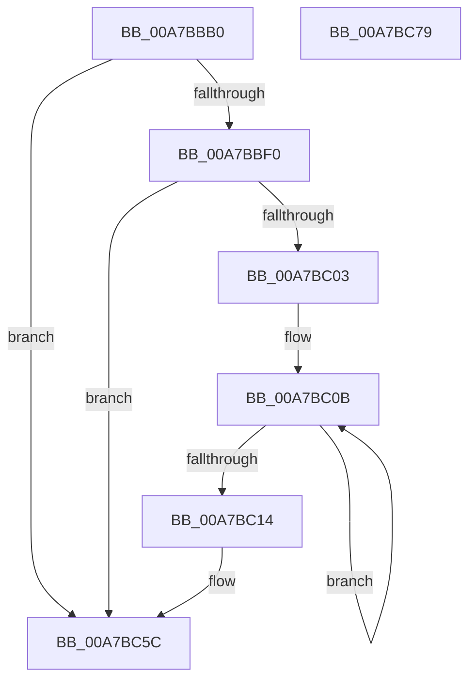

# PopDiagTraceServiceNotification

- RVA: `0x00A7BBB0`–`0x00A7BC7A` (길이 `202` bytes)
- VA: `0x0000000140A7BBB0`
- 실행 섹션: `PAGE`
- PDB 이름 있음: `예`; PDB Function 태그: `아니요`
- unwind 정보 RVA: `0x000B6754`
- 디코드: `50`개 명령, `202/202` bytes 표시
- 미해석 바이트: `0` (있으면 어셈블리에 `.byte`로 보존)

> 이 문서는 커널 이미지의 기계어와 PDB 기호를 분석해 생성했습니다. 4번과 5번은 함수 원형과 자료형을 바이너리 사용 방식에서 추정한 C 해석이며 원본 소스 복구 결과는 아닙니다.

## 1. Dependencies

- 직접 호출 지점: **3**; 고유 호출 대상: **3**
- 직접 호출자로 확인된 함수: **1**
- RIP 상대 이미지 참조: **5**

### Outgoing calls
- `0x00A7BBFA` → [EtwEventEnabled](../../text/39/EtwEventEnabled_function_00392450.md) (function, `0x00392450`)
- `0x00A7BC57` → [EtwWrite](../../text/41/EtwWrite_function_0041C720.md) (function, `0x0041C720`)
- `0x00A7BC64` → [_security_check_cookie](../../text/6A/_security_check_cookie_function_006AC640.md) (function, `0x006AC640`)

### Direct callers
- [NtPowerInformation](../95/NtPowerInformation_function_00955D80.md) at `0x00956B2E`

### Static image references
- `0x00A7BBBF` → RVA `0x00E0A740` (`.data`; read)
- `0x00A7BBD1` → RVA `0x0001BAE8` (`.rdata`; read)
- `0x00A7BBDA` → RVA `0x0001BAF8` (`.rdata`; read)
- `0x00A7BBE7` → RVA `0x00E67858` (`.data`; read)
- `0x00A7BBF0` → RVA `0x00F0B408` (`.data`; read)

## 2. Other-region calls and transfers

- 다른 실행 섹션으로 향하는 call: **3**
  - `0x00A7BBFA` → [EtwEventEnabled](../../text/39/EtwEventEnabled_function_00392450.md) (`PAGE` → `.text`)
  - `0x00A7BC57` → [EtwWrite](../../text/41/EtwWrite_function_0041C720.md) (`PAGE` → `.text`)
  - `0x00A7BC64` → [_security_check_cookie](../../text/6A/_security_check_cookie_function_006AC640.md) (`PAGE` → `.text`)
- 별도 외부 분기/꼬리 이동을 확인하지 못했습니다.

## 3. Assembly (complete function range)

```asm
00A7BBB0  48 89 5C 24 08                  mov qword ptr [rsp + 8], rbx
00A7BBB5  48 89 74 24 10                  mov qword ptr [rsp + 0x10], rsi
00A7BBBA  57                              push rdi
00A7BBBB  48 83 EC 60                     sub rsp, 0x60
00A7BBBF  48 8B 05 7A EB 38 00            mov rax, qword ptr [rip + 0x38eb7a]
00A7BBC6  48 33 C4                        xor rax, rsp
00A7BBC9  48 89 44 24 58                  mov qword ptr [rsp + 0x58], rax
00A7BBCE  48 8B F9                        mov rdi, rcx
00A7BBD1  48 8D 1D 10 FF 59 FF            lea rbx, [rip - 0xa600f0]
00A7BBD8  33 F6                           xor esi, esi
00A7BBDA  48 8D 0D 17 FF 59 FF            lea rcx, [rip - 0xa600e9]
00A7BBE1  39 37                           cmp dword ptr [rdi], esi
00A7BBE3  48 0F 45 D9                     cmovne rbx, rcx
00A7BBE7  40 38 35 6A BC 3E 00            cmp byte ptr [rip + 0x3ebc6a], sil
00A7BBEE  74 6C                           je 0x140a7bc5c
00A7BBF0  48 8B 0D 11 F8 48 00            mov rcx, qword ptr [rip + 0x48f811]
00A7BBF7  48 8B D3                        mov rdx, rbx
00A7BBFA  E8 51 68 91 FF                  call 0x140392450
00A7BBFF  84 C0                           test al, al
00A7BC01  74 59                           je 0x140a7bc5c
00A7BC03  48 83 C7 04                     add rdi, 4
00A7BC07  48 83 C8 FF                     or rax, 0xffffffffffffffff
00A7BC0B  48 FF C0                        inc rax
00A7BC0E  66 39 34 47                     cmp word ptr [rdi + rax*2], si
00A7BC12  75 F7                           jne 0x140a7bc0b
00A7BC14  66 89 44 24 30                  mov word ptr [rsp + 0x30], ax
00A7BC19  48 8D 4C 24 30                  lea rcx, [rsp + 0x30]
00A7BC1E  0F B7 C0                        movzx eax, ax
00A7BC21  41 B9 02 00 00 00               mov r9d, 2
00A7BC27  03 C0                           add eax, eax
00A7BC29  48 89 4C 24 38                  mov qword ptr [rsp + 0x38], rcx
00A7BC2E  48 8B 0D D3 F7 48 00            mov rcx, qword ptr [rip + 0x48f7d3]
00A7BC35  45 33 C0                        xor r8d, r8d
00A7BC38  89 44 24 50                     mov dword ptr [rsp + 0x50], eax
00A7BC3C  48 8B D3                        mov rdx, rbx
00A7BC3F  48 8D 44 24 38                  lea rax, [rsp + 0x38]
00A7BC44  4C 89 4C 24 40                  mov qword ptr [rsp + 0x40], r9
00A7BC49  48 89 44 24 20                  mov qword ptr [rsp + 0x20], rax
00A7BC4E  48 89 7C 24 48                  mov qword ptr [rsp + 0x48], rdi
00A7BC53  89 74 24 54                     mov dword ptr [rsp + 0x54], esi
00A7BC57  E8 C4 0A 9A FF                  call 0x14041c720
00A7BC5C  48 8B 4C 24 58                  mov rcx, qword ptr [rsp + 0x58]
00A7BC61  48 33 CC                        xor rcx, rsp
00A7BC64  E8 D7 09 C3 FF                  call 0x1406ac640
00A7BC69  48 8B 5C 24 70                  mov rbx, qword ptr [rsp + 0x70]
00A7BC6E  48 8B 74 24 78                  mov rsi, qword ptr [rsp + 0x78]
00A7BC73  48 83 C4 60                     add rsp, 0x60
00A7BC77  5F                              pop rdi
00A7BC78  C3                              ret
00A7BC79  CC                              int3
```

## 4. C-style interpretation (structured pseudocode)

```c
__int64 __fastcall PopDiagTraceServiceNotification(__int64 a1, __int64 a2, int a3)
{
    __int64 result;
    __int64 v_rbx;
    __int64 v_rdi;
    __int64 v_rsi;
    __int64 v_rsp;
    unsigned __int64 v_stack_m10;
    unsigned int v_stack_m14;
    unsigned int v_stack_m18;
    unsigned __int64 v_stack_m20;
    unsigned __int64 v_stack_m28;
    unsigned __int64 v_stack_m30;
    unsigned __int16 v_stack_m38;
    unsigned __int64 v_stack_m48;
    unsigned __int64 v_stack_p10;
    unsigned __int64 v_stack_p8;

    v_stack_p8 = v_rbx;
    v_stack_p10 = v_rsi;
    v_rsp = (v_rsp) - (96);
    result = (*(unsigned __int64 *)(v_rip + 3730298)) ^ (v_rsp);
    v_stack_m10 = result;
    v_rsi = 0;
    v_rbx = v_rip - 10879216;
    if ((*(unsigned int *)(a1)) != 0) { v_rbx = v_rip - 10879209; }
    if ((*(unsigned __int8 *)(v_rip + 4111466)) == 0) goto loc_00A7BC5C;
    result = EtwEventEnabled(*(unsigned __int64 *)(v_rip + 4782097), v_rbx, a3, a4);
    if ((unsigned __int8)(result) == 0) goto loc_00A7BC5C;
    v_rdi = (a1) + (4);
    result = (result) | (-1);
loc_00A7BC0B:
    result = (result) + 1;
    if ((*(unsigned __int16 *)(v_rdi + result * 2)) != 0) goto loc_00A7BC0B;
    v_stack_m38 = (unsigned __int16)(result);
    result = (unsigned int)(((unsigned __int16)(result)) + ((unsigned int)((unsigned __int16)(result))));
    v_stack_m30 = v_stack_m38;
    a3 = 0;
    v_stack_m18 = (unsigned int)(result);
    v_stack_m28 = 2;
    v_stack_m48 = v_stack_m30;
    v_stack_m20 = v_rdi;
    v_stack_m14 = 0;
    result = EtwWrite(*(unsigned __int64 *)(v_rip + 4782035), v_rbx, a3, 2);
loc_00A7BC5C:
    a1 = (v_stack_m10) ^ (v_rsp);
    result = _security_check_cookie(a1, v_rbx, a3, 2);
    v_rsp = (v_rsp) + (96);
    return result;
}
```

## 5. (Beta) C Style

```c
int64_t PopDiagTraceServiceNotification(void *Arg1, int64_t Arg2, int32_t Arg3)
{
    uint8_t *arg1 = (uint8_t *)Arg1;

    int64_t result;
    int64_t local_rbx;
    int64_t local_rdi;
    int64_t local_rsi;
    int64_t local_rsp;
    uint64_t v_stack_m10;
    uint32_t v_stack_m14;
    uint32_t v_stack_m18;
    uint64_t v_stack_m20;
    uint64_t v_stack_m28;
    uint64_t v_stack_m30;
    uint16_t v_stack_m38;
    uint64_t v_stack_m48;
    uint64_t v_stack_p10;
    uint64_t v_stack_p8;

    v_stack_p8 = local_rbx;
    v_stack_p10 = local_rsi;
    local_rsp = (local_rsp) - (96);
    result = (*(uint64_t *)(v_rip + 0x38EB7A)) ^ (local_rsp);
    v_stack_m10 = result;
    local_rsi = 0;
    local_rbx = v_rip - 10879216;
    if ((*(uint32_t *)(arg1)) != 0) { local_rbx = v_rip - 10879209; }
    if ((*(uint8_t *)(v_rip + 0x3EBC6A)) == 0) goto loc_00A7BC5C;
    result = EtwEventEnabled(*(uint64_t *)(v_rip + 0x48F811), local_rbx, Arg3, a4);
    if ((uint8_t)(result) == 0) goto loc_00A7BC5C;
    local_rdi = (Arg1) + (4);
    result = (result) | (-1);
loc_00A7BC0B:
    result = (result) + 1;
    if ((*(uint16_t *)(local_rdi + result * 2)) != 0) goto loc_00A7BC0B;
    v_stack_m38 = (uint16_t)(result);
    result = (uint32_t)(((uint16_t)(result)) + ((uint32_t)((uint16_t)(result))));
    v_stack_m30 = v_stack_m38;
    Arg3 = 0;
    v_stack_m18 = (uint32_t)(result);
    v_stack_m28 = 2;
    v_stack_m48 = v_stack_m30;
    v_stack_m20 = local_rdi;
    v_stack_m14 = 0;
    result = EtwWrite(*(uint64_t *)(v_rip + 0x48F7D3), local_rbx, Arg3, 2);
loc_00A7BC5C:
    Arg1 = (v_stack_m10) ^ (local_rsp);
    result = _security_check_cookie(Arg1, local_rbx, Arg3, 2);
    local_rsp = (local_rsp) + (96);
    return result;
}
```

### 관측된 메모리 오프셋

구조체 형식이 확인되지 않은 접근은 인자 기준의 오프셋으로만 기록했습니다.

| 기준 인자 | 오프셋 표현 | 폭 (bit) | 접근 |
|---|---:|---:|---|
| `Arg1` | `+ 0x0` | `32` | `R` |
| `Arg1` | `+ 0x0 + rax*2` | `16` | `R` |

## 6. Execution-region graph

[열기: 2D/3D 그래프와 함수 탐색 컨트롤 패널](../../../control-panel.html?section=page&rva=0x00A7BBB0&view=graph)

- 2D 그래프는 위에서 아래로 흐르고, 3D 그래프는 빈 공간을 드래그해 회전합니다. Shift+드래그는 이동, 휠은 확대·축소, 함수 노드 선택은 대상 보고서 이동입니다.

### Static fallback


