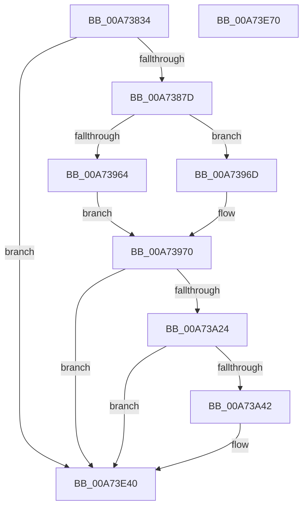

# PopPotsLogHibernatePerformance

- RVA: `0x00A73834`–`0x00A73E71` (길이 `1,597` bytes)
- VA: `0x0000000140A73834`
- 실행 섹션: `PAGE`
- PDB 이름 있음: `예`; PDB Function 태그: `아니요`
- unwind 정보 RVA: `0x00096678`
- 디코드: `296`개 명령, `1,597/1,597` bytes 표시
- 미해석 바이트: `0` (있으면 어셈블리에 `.byte`로 보존)

> 이 문서는 커널 이미지의 기계어와 PDB 기호를 분석해 생성했습니다. 4번과 5번은 함수 원형과 자료형을 바이너리 사용 방식에서 추정한 C 해석이며 원본 소스 복구 결과는 아닙니다.

## 1. Dependencies

- 직접 호출 지점: **8**; 고유 호출 대상: **4**
- 직접 호출자로 확인된 함수: **1**
- RIP 상대 이미지 참조: **5**

### Outgoing calls
- `0x00A7389E` → [PpmConvertTime](../../text/44/PpmConvertTime_function_00447530.md) (function, `0x00447530`)
- `0x00A73929` → [PpmConvertTime](../../text/44/PpmConvertTime_function_00447530.md) (function, `0x00447530`)
- `0x00A73947` → [PpmConvertTime](../../text/44/PpmConvertTime_function_00447530.md) (function, `0x00447530`)
- `0x00A73976` → [PpmConvertTime](../../text/44/PpmConvertTime_function_00447530.md) (function, `0x00447530`)
- `0x00A73A0F` → [PpmConvertTime](../../text/44/PpmConvertTime_function_00447530.md) (function, `0x00447530`)
- `0x00A73A35` → [tlgKeywordOn](../../text/42/tlgKeywordOn_function_0042EAA0.md) (function, `0x0042EAA0`)
- `0x00A73E3B` → [tlgWriteTransfer_EtwWriteTransfer](../../text/42/tlgWriteTransfer_EtwWriteTransfer_function_004260E0.md) (function, `0x004260E0`)
- `0x00A73E4A` → [_security_check_cookie](../../text/6A/_security_check_cookie_function_006AC640.md) (function, `0x006AC640`)

### Direct callers
- [PopDiagTraceHiberStats](PopDiagTraceHiberStats_function_00A72FB4.md) at `0x00A731E6`

### Static image references
- `0x00A7385A` → RVA `0x00E0A740` (`.data`; read)
- `0x00A7386B` → RVA `0x00F070B8` (`.data`; read)
- `0x00A7388A` → RVA `0x00FC6BE0` (`ALMOSTRO`; read)
- `0x00A73A14` → RVA `0x00E08390` (`.data`; read)
- `0x00A73C40` → RVA `0x00050A46` (`.rdata`; read)

## 2. Other-region calls and transfers

- 다른 실행 섹션으로 향하는 call: **8**
  - `0x00A7389E` → [PpmConvertTime](../../text/44/PpmConvertTime_function_00447530.md) (`PAGE` → `.text`)
  - `0x00A73929` → [PpmConvertTime](../../text/44/PpmConvertTime_function_00447530.md) (`PAGE` → `.text`)
  - `0x00A73947` → [PpmConvertTime](../../text/44/PpmConvertTime_function_00447530.md) (`PAGE` → `.text`)
  - `0x00A73976` → [PpmConvertTime](../../text/44/PpmConvertTime_function_00447530.md) (`PAGE` → `.text`)
  - `0x00A73A0F` → [PpmConvertTime](../../text/44/PpmConvertTime_function_00447530.md) (`PAGE` → `.text`)
  - `0x00A73A35` → [tlgKeywordOn](../../text/42/tlgKeywordOn_function_0042EAA0.md) (`PAGE` → `.text`)
  - `0x00A73E3B` → [tlgWriteTransfer_EtwWriteTransfer](../../text/42/tlgWriteTransfer_EtwWriteTransfer_function_004260E0.md) (`PAGE` → `.text`)
  - `0x00A73E4A` → [_security_check_cookie](../../text/6A/_security_check_cookie_function_006AC640.md) (`PAGE` → `.text`)
- 별도 외부 분기/꼬리 이동을 확인하지 못했습니다.

## 3. Assembly (complete function range)

```asm
00A73834  48 8B C4                        mov rax, rsp
00A73837  48 89 58 10                     mov qword ptr [rax + 0x10], rbx
00A7383B  48 89 70 18                     mov qword ptr [rax + 0x18], rsi
00A7383F  48 89 78 20                     mov qword ptr [rax + 0x20], rdi
00A73843  55                              push rbp
00A73844  41 54                           push r12
00A73846  41 55                           push r13
00A73848  41 56                           push r14
00A7384A  41 57                           push r15
00A7384C  48 8D A8 68 FD FF FF            lea rbp, [rax - 0x298]
00A73853  48 81 EC 70 03 00 00            sub rsp, 0x370
00A7385A  48 8B 05 DF 6E 39 00            mov rax, qword ptr [rip + 0x396edf]
00A73861  48 33 C4                        xor rax, rsp
00A73864  48 89 85 60 02 00 00            mov qword ptr [rbp + 0x260], rax
00A7386B  80 3D 46 38 49 00 00            cmp byte ptr [rip + 0x493846], 0
00A73872  8B FA                           mov edi, edx
00A73874  4C 8B D9                        mov r11, rcx
00A73877  0F 84 C3 05 00 00               je 0x140a73e40
00A7387D  48 8B 99 F8 00 00 00            mov rbx, qword ptr [rcx + 0xf8]
00A73884  41 BF E8 03 00 00               mov r15d, 0x3e8
00A7388A  48 8B 35 4F 33 55 00            mov rsi, qword ptr [rip + 0x55334f]
00A73891  45 8B C7                        mov r8d, r15d
00A73894  48 8B 89 00 01 00 00            mov rcx, qword ptr [rcx + 0x100]
00A7389B  48 8B D6                        mov rdx, rsi
00A7389E  E8 8D 3C 9D FF                  call 0x140447530
00A738A3  48 89 45 90                     mov qword ptr [rbp - 0x70], rax
00A738A7  33 D2                           xor edx, edx
00A738A9  49 8B 83 D8 01 00 00            mov rax, qword ptr [r11 + 0x1d8]
00A738B0  45 8B C7                        mov r8d, r15d
00A738B3  48 89 44 24 48                  mov qword ptr [rsp + 0x48], rax
00A738B8  49 8B 83 50 01 00 00            mov rax, qword ptr [r11 + 0x150]
00A738BF  48 F7 F3                        div rbx
00A738C2  33 D2                           xor edx, edx
00A738C4  49 8B 8B 18 02 00 00            mov rcx, qword ptr [r11 + 0x218]
00A738CB  48 89 44 24 50                  mov qword ptr [rsp + 0x50], rax
00A738D0  49 8B 83 D8 02 00 00            mov rax, qword ptr [r11 + 0x2d8]
00A738D7  48 F7 F3                        div rbx
00A738DA  4D 8B B3 E0 01 00 00            mov r14, qword ptr [r11 + 0x1e0]
00A738E1  33 D2                           xor edx, edx
00A738E3  49 2B 4B 70                     sub rcx, qword ptr [r11 + 0x70]
00A738E7  48 89 45 80                     mov qword ptr [rbp - 0x80], rax
00A738EB  49 8B 83 98 00 00 00            mov rax, qword ptr [r11 + 0x98]
00A738F2  48 F7 F3                        div rbx
00A738F5  33 D2                           xor edx, edx
00A738F7  C1 EF 03                        shr edi, 3
00A738FA  48 89 44 24 60                  mov qword ptr [rsp + 0x60], rax
00A738FF  40 80 E7 01                     and dil, 1
00A73903  49 8B 83 D0 02 00 00            mov rax, qword ptr [r11 + 0x2d0]
00A7390A  48 F7 F3                        div rbx
00A7390D  33 D2                           xor edx, edx
00A7390F  49 C1 E6 0C                     shl r14, 0xc
00A73913  48 89 44 24 78                  mov qword ptr [rsp + 0x78], rax
00A73918  49 8B 83 E0 02 00 00            mov rax, qword ptr [r11 + 0x2e0]
00A7391F  48 F7 F3                        div rbx
00A73922  48 8B D6                        mov rdx, rsi
00A73925  48 89 45 88                     mov qword ptr [rbp - 0x78], rax
00A73929  E8 02 3C 9D FF                  call 0x140447530
00A7392E  49 8B 8B 28 02 00 00            mov rcx, qword ptr [r11 + 0x228]
00A73935  45 8B C7                        mov r8d, r15d
00A73938  49 2B 8B 20 02 00 00            sub rcx, qword ptr [r11 + 0x220]
00A7393F  48 8B D6                        mov rdx, rsi
00A73942  48 89 44 24 38                  mov qword ptr [rsp + 0x38], rax
00A73947  E8 E4 3B 9D FF                  call 0x140447530
00A7394C  49 8B 93 28 02 00 00            mov rdx, qword ptr [r11 + 0x228]
00A73953  49 8B 8B F0 00 00 00            mov rcx, qword ptr [r11 + 0xf0]
00A7395A  48 89 44 24 40                  mov qword ptr [rsp + 0x40], rax
00A7395F  48 85 D2                        test rdx, rdx
00A73962  75 09                           jne 0x140a7396d
00A73964  49 2B 8B 18 02 00 00            sub rcx, qword ptr [r11 + 0x218]
00A7396B  EB 03                           jmp 0x140a73970
00A7396D  48 2B CA                        sub rcx, rdx
00A73970  4D 8B C7                        mov r8, r15
00A73973  48 8B D6                        mov rdx, rsi
00A73976  E8 B5 3B 9D FF                  call 0x140447530
00A7397B  4C 8B F8                        mov r15, rax
00A7397E  49 8B 8B 00 01 00 00            mov rcx, qword ptr [r11 + 0x100]
00A73985  49 8B 43 20                     mov rax, qword ptr [r11 + 0x20]
00A73989  33 D2                           xor edx, edx
00A7398B  48 F7 F3                        div rbx
00A7398E  33 D2                           xor edx, edx
00A73990  49 2B 8B 38 01 00 00            sub rcx, qword ptr [r11 + 0x138]
00A73997  4C 8B E0                        mov r12, rax
00A7399A  41 B8 E8 03 00 00               mov r8d, 0x3e8
00A739A0  49 8B 43 28                     mov rax, qword ptr [r11 + 0x28]
00A739A4  48 F7 F3                        div rbx
00A739A7  33 D2                           xor edx, edx
00A739A9  4C 8B E8                        mov r13, rax
00A739AC  49 8B 83 48 01 00 00            mov rax, qword ptr [r11 + 0x148]
00A739B3  48 F7 F3                        div rbx
00A739B6  33 D2                           xor edx, edx
00A739B8  48 89 44 24 58                  mov qword ptr [rsp + 0x58], rax
00A739BD  49 8B 83 A0 00 00 00            mov rax, qword ptr [r11 + 0xa0]
00A739C4  48 F7 F3                        div rbx
00A739C7  33 D2                           xor edx, edx
00A739C9  48 89 44 24 68                  mov qword ptr [rsp + 0x68], rax
00A739CE  49 8B 83 70 02 00 00            mov rax, qword ptr [r11 + 0x270]
00A739D5  48 F7 F3                        div rbx
00A739D8  33 D2                           xor edx, edx
00A739DA  48 89 44 24 70                  mov qword ptr [rsp + 0x70], rax
00A739DF  49 8B 83 E8 02 00 00            mov rax, qword ptr [r11 + 0x2e8]
00A739E6  48 F7 F3                        div rbx
00A739E9  33 D2                           xor edx, edx
00A739EB  48 89 45 98                     mov qword ptr [rbp - 0x68], rax
00A739EF  49 8B 83 F0 02 00 00            mov rax, qword ptr [r11 + 0x2f0]
00A739F6  48 F7 F3                        div rbx
00A739F9  33 D2                           xor edx, edx
00A739FB  48 89 45 A0                     mov qword ptr [rbp - 0x60], rax
00A739FF  49 8B 83 F8 02 00 00            mov rax, qword ptr [r11 + 0x2f8]
00A73A06  48 F7 F3                        div rbx
00A73A09  48 8B D6                        mov rdx, rsi
00A73A0C  48 8B D8                        mov rbx, rax
00A73A0F  E8 1C 3B 9D FF                  call 0x140447530
00A73A14  83 3D 75 49 39 00 05            cmp dword ptr [rip + 0x394975], 5
00A73A1B  4C 8B C0                        mov r8, rax
00A73A1E  0F 86 1C 04 00 00               jbe 0x140a73e40
00A73A24  48 BA 00 00 00 00 00 40 00 00   movabs rdx, 0x400000000000
00A73A2E  48 8D 0D 5B 49 39 00            lea rcx, [rip + 0x39495b]
00A73A35  E8 66 B0 9B FF                  call 0x14042eaa0
00A73A3A  84 C0                           test al, al
00A73A3C  0F 84 FE 03 00 00               je 0x140a73e40
00A73A42  49 8B 8B 18 01 00 00            mov rcx, qword ptr [r11 + 0x118]
00A73A49  48 8D 45 A8                     lea rax, [rbp - 0x58]
00A73A4D  48 89 45 50                     mov qword ptr [rbp + 0x50], rax
00A73A51  41 8B 83 20 01 00 00            mov eax, dword ptr [r11 + 0x120]
00A73A58  48 89 45 B0                     mov qword ptr [rbp - 0x50], rax
00A73A5C  48 8D 45 B0                     lea rax, [rbp - 0x50]
00A73A60  48 89 45 60                     mov qword ptr [rbp + 0x60], rax
00A73A64  41 8B 43 58                     mov eax, dword ptr [r11 + 0x58]
00A73A68  48 89 45 B8                     mov qword ptr [rbp - 0x48], rax
00A73A6C  48 8D 45 B8                     lea rax, [rbp - 0x48]
00A73A70  48 89 45 70                     mov qword ptr [rbp + 0x70], rax
00A73A74  41 8B 43 5C                     mov eax, dword ptr [r11 + 0x5c]
00A73A78  48 89 45 C0                     mov qword ptr [rbp - 0x40], rax
00A73A7C  48 8D 45 C0                     lea rax, [rbp - 0x40]
00A73A80  48 89 85 80 00 00 00            mov qword ptr [rbp + 0x80], rax
00A73A87  48 8B 44 24 38                  mov rax, qword ptr [rsp + 0x38]
00A73A8C  48 89 45 C8                     mov qword ptr [rbp - 0x38], rax
00A73A90  48 8D 45 C8                     lea rax, [rbp - 0x38]
00A73A94  48 89 85 90 00 00 00            mov qword ptr [rbp + 0x90], rax
00A73A9B  48 8B 44 24 40                  mov rax, qword ptr [rsp + 0x40]
00A73AA0  48 89 44 24 40                  mov qword ptr [rsp + 0x40], rax
00A73AA5  48 8D 44 24 40                  lea rax, [rsp + 0x40]
00A73AAA  48 89 85 A0 00 00 00            mov qword ptr [rbp + 0xa0], rax
00A73AB1  48 8D 45 D0                     lea rax, [rbp - 0x30]
00A73AB5  48 89 85 B0 00 00 00            mov qword ptr [rbp + 0xb0], rax
00A73ABC  49 8B 83 C8 01 00 00            mov rax, qword ptr [r11 + 0x1c8]
00A73AC3  48 89 45 D8                     mov qword ptr [rbp - 0x28], rax
00A73AC7  48 8D 45 D8                     lea rax, [rbp - 0x28]
00A73ACB  48 89 85 C0 00 00 00            mov qword ptr [rbp + 0xc0], rax
00A73AD2  49 8B 83 C0 01 00 00            mov rax, qword ptr [r11 + 0x1c0]
00A73AD9  48 89 45 E0                     mov qword ptr [rbp - 0x20], rax
00A73ADD  48 8D 45 E0                     lea rax, [rbp - 0x20]
00A73AE1  48 89 85 D0 00 00 00            mov qword ptr [rbp + 0xd0], rax
00A73AE8  49 8B 83 B8 01 00 00            mov rax, qword ptr [r11 + 0x1b8]
00A73AEF  48 89 45 E8                     mov qword ptr [rbp - 0x18], rax
00A73AF3  48 8D 45 E8                     lea rax, [rbp - 0x18]
00A73AF7  48 89 85 E0 00 00 00            mov qword ptr [rbp + 0xe0], rax
00A73AFE  48 8B 44 24 48                  mov rax, qword ptr [rsp + 0x48]
00A73B03  48 89 44 24 48                  mov qword ptr [rsp + 0x48], rax
00A73B08  48 8D 44 24 48                  lea rax, [rsp + 0x48]
00A73B0D  48 89 85 F0 00 00 00            mov qword ptr [rbp + 0xf0], rax
00A73B14  48 8B 44 24 50                  mov rax, qword ptr [rsp + 0x50]
00A73B19  48 89 44 24 50                  mov qword ptr [rsp + 0x50], rax
00A73B1E  48 8D 44 24 50                  lea rax, [rsp + 0x50]
00A73B23  48 89 85 00 01 00 00            mov qword ptr [rbp + 0x100], rax
00A73B2A  48 8B 44 24 58                  mov rax, qword ptr [rsp + 0x58]
00A73B2F  48 89 44 24 58                  mov qword ptr [rsp + 0x58], rax
00A73B34  48 8D 44 24 58                  lea rax, [rsp + 0x58]
00A73B39  48 89 85 10 01 00 00            mov qword ptr [rbp + 0x110], rax
00A73B40  48 8D 45 F0                     lea rax, [rbp - 0x10]
00A73B44  48 89 85 20 01 00 00            mov qword ptr [rbp + 0x120], rax
00A73B4B  48 8B 44 24 60                  mov rax, qword ptr [rsp + 0x60]
00A73B50  48 89 44 24 60                  mov qword ptr [rsp + 0x60], rax
00A73B55  48 8D 44 24 60                  lea rax, [rsp + 0x60]
00A73B5A  48 89 85 30 01 00 00            mov qword ptr [rbp + 0x130], rax
00A73B61  48 8B 44 24 68                  mov rax, qword ptr [rsp + 0x68]
00A73B66  48 89 44 24 68                  mov qword ptr [rsp + 0x68], rax
00A73B6B  48 8D 44 24 68                  lea rax, [rsp + 0x68]
00A73B70  48 89 85 40 01 00 00            mov qword ptr [rbp + 0x140], rax
00A73B77  48 8B 44 24 70                  mov rax, qword ptr [rsp + 0x70]
00A73B7C  48 89 44 24 70                  mov qword ptr [rsp + 0x70], rax
00A73B81  48 8D 44 24 70                  lea rax, [rsp + 0x70]
00A73B86  48 89 4D A8                     mov qword ptr [rbp - 0x58], rcx
00A73B8A  48 C7 45 58 08 00 00 00         mov qword ptr [rbp + 0x58], 8
00A73B92  48 C7 45 68 08 00 00 00         mov qword ptr [rbp + 0x68], 8
00A73B9A  48 C7 45 78 08 00 00 00         mov qword ptr [rbp + 0x78], 8
00A73BA2  48 C7 85 88 00 00 00 08 00 00 00  mov qword ptr [rbp + 0x88], 8
00A73BAD  48 C7 85 98 00 00 00 08 00 00 00  mov qword ptr [rbp + 0x98], 8
00A73BB8  48 C7 85 A8 00 00 00 08 00 00 00  mov qword ptr [rbp + 0xa8], 8
00A73BC3  4C 89 7D D0                     mov qword ptr [rbp - 0x30], r15
00A73BC7  48 C7 85 B8 00 00 00 08 00 00 00  mov qword ptr [rbp + 0xb8], 8
00A73BD2  48 C7 85 C8 00 00 00 08 00 00 00  mov qword ptr [rbp + 0xc8], 8
00A73BDD  48 C7 85 D8 00 00 00 08 00 00 00  mov qword ptr [rbp + 0xd8], 8
00A73BE8  48 C7 85 E8 00 00 00 08 00 00 00  mov qword ptr [rbp + 0xe8], 8
00A73BF3  48 C7 85 F8 00 00 00 08 00 00 00  mov qword ptr [rbp + 0xf8], 8
00A73BFE  48 C7 85 08 01 00 00 08 00 00 00  mov qword ptr [rbp + 0x108], 8
00A73C09  48 C7 85 18 01 00 00 08 00 00 00  mov qword ptr [rbp + 0x118], 8
00A73C14  4C 89 75 F0                     mov qword ptr [rbp - 0x10], r14
00A73C18  48 C7 85 28 01 00 00 08 00 00 00  mov qword ptr [rbp + 0x128], 8
00A73C23  48 C7 85 38 01 00 00 08 00 00 00  mov qword ptr [rbp + 0x138], 8
00A73C2E  48 C7 85 48 01 00 00 08 00 00 00  mov qword ptr [rbp + 0x148], 8
00A73C39  48 89 85 50 01 00 00            mov qword ptr [rbp + 0x150], rax
00A73C40  48 8D 15 FF CD 5D FF            lea rdx, [rip - 0xa23201]
00A73C47  48 8D 45 F8                     lea rax, [rbp - 8]
00A73C4B  4C 89 45 10                     mov qword ptr [rbp + 0x10], r8
00A73C4F  48 89 85 60 01 00 00            mov qword ptr [rbp + 0x160], rax
00A73C56  48 8D 0D 33 47 39 00            lea rcx, [rip + 0x394733]
00A73C5D  48 8D 45 00                     lea rax, [rbp]
00A73C61  48 C7 85 58 01 00 00 08 00 00 00  mov qword ptr [rbp + 0x158], 8
00A73C6C  48 89 85 70 01 00 00            mov qword ptr [rbp + 0x170], rax
00A73C73  45 33 C9                        xor r9d, r9d
00A73C76  48 8B 44 24 78                  mov rax, qword ptr [rsp + 0x78]
00A73C7B  45 33 C0                        xor r8d, r8d
00A73C7E  48 89 44 24 78                  mov qword ptr [rsp + 0x78], rax
00A73C83  48 8D 44 24 78                  lea rax, [rsp + 0x78]
00A73C88  48 89 85 80 01 00 00            mov qword ptr [rbp + 0x180], rax
00A73C8F  48 8B 45 80                     mov rax, qword ptr [rbp - 0x80]
00A73C93  48 89 45 80                     mov qword ptr [rbp - 0x80], rax
00A73C97  48 8D 45 80                     lea rax, [rbp - 0x80]
00A73C9B  48 89 85 90 01 00 00            mov qword ptr [rbp + 0x190], rax
00A73CA2  48 8B 45 88                     mov rax, qword ptr [rbp - 0x78]
00A73CA6  48 89 45 88                     mov qword ptr [rbp - 0x78], rax
00A73CAA  48 8D 45 88                     lea rax, [rbp - 0x78]
00A73CAE  48 89 85 A0 01 00 00            mov qword ptr [rbp + 0x1a0], rax
00A73CB5  49 8D 83 80 02 00 00            lea rax, [r11 + 0x280]
00A73CBC  48 89 85 B0 01 00 00            mov qword ptr [rbp + 0x1b0], rax
00A73CC3  49 8D 83 A8 02 00 00            lea rax, [r11 + 0x2a8]
00A73CCA  48 89 85 C0 01 00 00            mov qword ptr [rbp + 0x1c0], rax
00A73CD1  48 8B 45 90                     mov rax, qword ptr [rbp - 0x70]
00A73CD5  48 89 45 90                     mov qword ptr [rbp - 0x70], rax
00A73CD9  48 8D 45 90                     lea rax, [rbp - 0x70]
00A73CDD  48 89 85 D0 01 00 00            mov qword ptr [rbp + 0x1d0], rax
00A73CE4  48 8B 45 98                     mov rax, qword ptr [rbp - 0x68]
00A73CE8  48 89 45 98                     mov qword ptr [rbp - 0x68], rax
00A73CEC  48 8D 45 98                     lea rax, [rbp - 0x68]
00A73CF0  48 89 85 E0 01 00 00            mov qword ptr [rbp + 0x1e0], rax
00A73CF7  48 8B 45 A0                     mov rax, qword ptr [rbp - 0x60]
00A73CFB  48 89 45 A0                     mov qword ptr [rbp - 0x60], rax
00A73CFF  48 8D 45 A0                     lea rax, [rbp - 0x60]
00A73D03  48 89 85 F0 01 00 00            mov qword ptr [rbp + 0x1f0], rax
00A73D0A  48 8D 45 08                     lea rax, [rbp + 8]
00A73D0E  48 89 85 00 02 00 00            mov qword ptr [rbp + 0x200], rax
00A73D15  48 8D 44 24 30                  lea rax, [rsp + 0x30]
00A73D1A  48 89 85 10 02 00 00            mov qword ptr [rbp + 0x210], rax
00A73D21  41 8B 83 B0 01 00 00            mov eax, dword ptr [r11 + 0x1b0]
00A73D28  89 44 24 38                     mov dword ptr [rsp + 0x38], eax
00A73D2C  48 8D 44 24 38                  lea rax, [rsp + 0x38]
00A73D31  48 89 85 20 02 00 00            mov qword ptr [rbp + 0x220], rax
00A73D38  48 8D 45 10                     lea rax, [rbp + 0x10]
00A73D3C  48 89 85 30 02 00 00            mov qword ptr [rbp + 0x230], rax
00A73D43  41 8B 43 60                     mov eax, dword ptr [r11 + 0x60]
00A73D47  48 89 45 18                     mov qword ptr [rbp + 0x18], rax
00A73D4B  48 8D 45 18                     lea rax, [rbp + 0x18]
00A73D4F  48 89 85 40 02 00 00            mov qword ptr [rbp + 0x240], rax
00A73D56  48 8D 45 20                     lea rax, [rbp + 0x20]
00A73D5A  48 89 85 50 02 00 00            mov qword ptr [rbp + 0x250], rax
00A73D61  48 8D 45 30                     lea rax, [rbp + 0x30]
00A73D65  48 89 44 24 28                  mov qword ptr [rsp + 0x28], rax
00A73D6A  C7 44 24 20 23 00 00 00         mov dword ptr [rsp + 0x20], 0x23
00A73D72  4C 89 65 F8                     mov qword ptr [rbp - 8], r12
00A73D76  48 C7 85 68 01 00 00 08 00 00 00  mov qword ptr [rbp + 0x168], 8
00A73D81  4C 89 6D 00                     mov qword ptr [rbp], r13
00A73D85  48 C7 85 78 01 00 00 08 00 00 00  mov qword ptr [rbp + 0x178], 8
00A73D90  48 C7 85 88 01 00 00 08 00 00 00  mov qword ptr [rbp + 0x188], 8
00A73D9B  48 C7 85 98 01 00 00 08 00 00 00  mov qword ptr [rbp + 0x198], 8
00A73DA6  48 C7 85 A8 01 00 00 08 00 00 00  mov qword ptr [rbp + 0x1a8], 8
00A73DB1  48 C7 85 B8 01 00 00 28 00 00 00  mov qword ptr [rbp + 0x1b8], 0x28
00A73DBC  48 C7 85 C8 01 00 00 28 00 00 00  mov qword ptr [rbp + 0x1c8], 0x28
00A73DC7  48 C7 85 D8 01 00 00 08 00 00 00  mov qword ptr [rbp + 0x1d8], 8
00A73DD2  48 C7 85 E8 01 00 00 08 00 00 00  mov qword ptr [rbp + 0x1e8], 8
00A73DDD  48 C7 85 F8 01 00 00 08 00 00 00  mov qword ptr [rbp + 0x1f8], 8
00A73DE8  48 89 5D 08                     mov qword ptr [rbp + 8], rbx
00A73DEC  48 C7 85 08 02 00 00 08 00 00 00  mov qword ptr [rbp + 0x208], 8
00A73DF7  40 88 7C 24 30                  mov byte ptr [rsp + 0x30], dil
00A73DFC  48 C7 85 18 02 00 00 01 00 00 00  mov qword ptr [rbp + 0x218], 1
00A73E07  48 C7 85 28 02 00 00 04 00 00 00  mov qword ptr [rbp + 0x228], 4
00A73E12  48 C7 85 38 02 00 00 08 00 00 00  mov qword ptr [rbp + 0x238], 8
00A73E1D  48 C7 85 48 02 00 00 08 00 00 00  mov qword ptr [rbp + 0x248], 8
00A73E28  48 C7 45 20 00 00 00 01         mov qword ptr [rbp + 0x20], 0x1000000
00A73E30  48 C7 85 58 02 00 00 08 00 00 00  mov qword ptr [rbp + 0x258], 8
00A73E3B  E8 A0 22 9B FF                  call 0x1404260e0
00A73E40  48 8B 8D 60 02 00 00            mov rcx, qword ptr [rbp + 0x260]
00A73E47  48 33 CC                        xor rcx, rsp
00A73E4A  E8 F1 87 C3 FF                  call 0x1406ac640
00A73E4F  4C 8D 9C 24 70 03 00 00         lea r11, [rsp + 0x370]
00A73E57  49 8B 5B 38                     mov rbx, qword ptr [r11 + 0x38]
00A73E5B  49 8B 73 40                     mov rsi, qword ptr [r11 + 0x40]
00A73E5F  49 8B 7B 48                     mov rdi, qword ptr [r11 + 0x48]
00A73E63  49 8B E3                        mov rsp, r11
00A73E66  41 5F                           pop r15
00A73E68  41 5E                           pop r14
00A73E6A  41 5D                           pop r13
00A73E6C  41 5C                           pop r12
00A73E6E  5D                              pop rbp
00A73E6F  C3                              ret
00A73E70  CC                              int3
```

## 4. C-style interpretation (structured pseudocode)

```c
__int64 __fastcall PopPotsLogHibernatePerformance(__int64 a1, int a2, __int64 a3, int a4)
{
    __int64 result;
    __int64 v_r14;
    __int64 v_rdi;
    __int64 v_rsp;
    unsigned __int64 v_stack_m28;
    unsigned __int64 v_stack_m320;
    unsigned __int64 v_stack_m328;
    unsigned __int64 v_stack_m330;
    unsigned __int64 v_stack_m338;
    unsigned __int64 v_stack_m340;
    unsigned __int64 v_stack_m348;
    unsigned __int64 v_stack_m350;
    unsigned __int64 v_stack_m358;
    unsigned __int64 v_stack_m360;
    unsigned __int64 v_stack_m368;
    unsigned __int64 v_stack_m370;
    unsigned int v_stack_m378;

    *(unsigned __int64 *)(v_rsp + 16) = v_rbx;
    *(unsigned __int64 *)(v_rsp + 24) = v_rsi;
    *(unsigned __int64 *)(v_rsp + 32) = v_rdi;
    v_rsp = (v_rsp) - (880);
    result = (*(unsigned __int64 *)(v_rip + 3763935)) ^ (v_rsp);
    *(unsigned __int64 *)(v_rsp - 664 + 608) = result;
    if ((*(unsigned __int8 *)(v_rip + 4798534)) == 0) goto loc_00A73E40;
    result = PpmConvertTime(*(unsigned __int64 *)(a1 + 256), *(unsigned __int64 *)(v_rip + 5583695), 1000, a4);
    *(unsigned __int64 *)(v_rsp - 664 - 112) = result;
    a2 = 0;
    v_stack_m350 = *(unsigned __int64 *)(a1 + 472);
    a2 = 0;
    v_stack_m348 = *(unsigned __int64 *)(a1 + 336);
    a2 = 0;
    a1 = (*(unsigned __int64 *)(a1 + 536)) - (*(unsigned __int64 *)(a1 + 112));
    *(unsigned __int64 *)(v_rsp - 664 - 128) = *(unsigned __int64 *)(a1 + 728);
    a2 = 0;
    v_rdi = (unsigned int)(((unsigned int)(a2)) >> (3));
    v_stack_m338 = *(unsigned __int64 *)(a1 + 152);
    v_rdi = (unsigned __int8)((v_rdi) & (1));
    a2 = 0;
    v_r14 = (*(unsigned __int64 *)(a1 + 480)) << (12);
    v_stack_m320 = *(unsigned __int64 *)(a1 + 720);
    *(unsigned __int64 *)(v_rsp - 664 - 120) = *(unsigned __int64 *)(a1 + 736);
    result = PpmConvertTime(a1, *(unsigned __int64 *)(v_rip + 5583695), 1000, a4);
    a1 = (*(unsigned __int64 *)(a1 + 552)) - (*(unsigned __int64 *)(a1 + 544));
    v_stack_m360 = result;
    result = PpmConvertTime(a1, *(unsigned __int64 *)(v_rip + 5583695), 1000, a4);
    v_stack_m358 = result;
    if (*(unsigned __int64 *)(a1 + 552) != 0) goto loc_00A7396D;
    a1 = (*(unsigned __int64 *)(a1 + 240)) - (*(unsigned __int64 *)(a1 + 536));
    goto loc_00A73970;
loc_00A7396D:
    a1 = (a1) - (*(unsigned __int64 *)(a1 + 552));
loc_00A73970:
    result = PpmConvertTime(a1, *(unsigned __int64 *)(v_rip + 5583695), 1000, a4);
    a2 = 0;
    a2 = 0;
    a1 = (*(unsigned __int64 *)(a1 + 256)) - (*(unsigned __int64 *)(a1 + 312));
    a2 = 0;
    a2 = 0;
    v_stack_m340 = *(unsigned __int64 *)(a1 + 328);
    a2 = 0;
    v_stack_m330 = *(unsigned __int64 *)(a1 + 160);
    a2 = 0;
    v_stack_m328 = *(unsigned __int64 *)(a1 + 624);
    a2 = 0;
    *(unsigned __int64 *)(v_rsp - 664 - 104) = *(unsigned __int64 *)(a1 + 744);
    a2 = 0;
    *(unsigned __int64 *)(v_rsp - 664 - 96) = *(unsigned __int64 *)(a1 + 752);
    result = PpmConvertTime(a1, *(unsigned __int64 *)(v_rip + 5583695), 1000, a4);
    if ((*(unsigned int *)(v_rip + 3754357)) <= 5) goto loc_00A73E40;
    result = tlgKeywordOn(v_rip + 3754331, *(unsigned __int64 *)(v_rip + 5583695), result, a4);
    if ((unsigned __int8)(result) != 0) {
        a1 = *(unsigned __int64 *)(a1 + 280);
        result = v_rsp - 664 - 88;
        *(unsigned __int64 *)(v_rsp - 664 + 80) = result;
        result = *(unsigned int *)(a1 + 288);
        *(unsigned __int64 *)(v_rsp - 664 - 80) = result;
        result = v_rsp - 664 - 80;
        *(unsigned __int64 *)(v_rsp - 664 + 96) = result;
        result = *(unsigned int *)(a1 + 88);
        *(unsigned __int64 *)(v_rsp - 664 - 72) = result;
        result = v_rsp - 664 - 72;
        *(unsigned __int64 *)(v_rsp - 664 + 112) = result;
        result = *(unsigned int *)(a1 + 92);
        *(unsigned __int64 *)(v_rsp - 664 - 64) = result;
        result = v_rsp - 664 - 64;
        *(unsigned __int64 *)(v_rsp - 664 + 128) = result;
        result = v_stack_m360;
        *(unsigned __int64 *)(v_rsp - 664 - 56) = result;
        result = v_rsp - 664 - 56;
        *(unsigned __int64 *)(v_rsp - 664 + 144) = result;
        result = v_stack_m358;
        v_stack_m358 = result;
        result = v_stack_m358;
        *(unsigned __int64 *)(v_rsp - 664 + 160) = result;
        result = v_rsp - 664 - 48;
        *(unsigned __int64 *)(v_rsp - 664 + 176) = result;
        result = *(unsigned __int64 *)(a1 + 456);
        *(unsigned __int64 *)(v_rsp - 664 - 40) = result;
        result = v_rsp - 664 - 40;
        *(unsigned __int64 *)(v_rsp - 664 + 192) = result;
        result = *(unsigned __int64 *)(a1 + 448);
        *(unsigned __int64 *)(v_rsp - 664 - 32) = result;
        result = v_rsp - 664 - 32;
        *(unsigned __int64 *)(v_rsp - 664 + 208) = result;
        result = *(unsigned __int64 *)(a1 + 440);
        *(unsigned __int64 *)(v_rsp - 664 - 24) = result;
        result = v_rsp - 664 - 24;
        *(unsigned __int64 *)(v_rsp - 664 + 224) = result;
        result = v_stack_m350;
        v_stack_m350 = result;
        result = v_stack_m350;
        *(unsigned __int64 *)(v_rsp - 664 + 240) = result;
        result = v_stack_m348;
        v_stack_m348 = result;
        result = v_stack_m348;
        *(unsigned __int64 *)(v_rsp - 664 + 256) = result;
        result = v_stack_m340;
        v_stack_m340 = result;
        result = v_stack_m340;
        *(unsigned __int64 *)(v_rsp - 664 + 272) = result;
        result = v_rsp - 664 - 16;
        *(unsigned __int64 *)(v_rsp - 664 + 288) = result;
        result = v_stack_m338;
        v_stack_m338 = result;
        result = v_stack_m338;
        *(unsigned __int64 *)(v_rsp - 664 + 304) = result;
        result = v_stack_m330;
        v_stack_m330 = result;
        result = v_stack_m330;
        *(unsigned __int64 *)(v_rsp - 664 + 320) = result;
        result = v_stack_m328;
        v_stack_m328 = result;
        result = v_stack_m328;
        *(unsigned __int64 *)(v_rsp - 664 - 88) = a1;
        *(unsigned __int64 *)(v_rsp - 664 + 88) = 8;
        *(unsigned __int64 *)(v_rsp - 664 + 104) = 8;
        *(unsigned __int64 *)(v_rsp - 664 + 120) = 8;
        *(unsigned __int64 *)(v_rsp - 664 + 136) = 8;
        *(unsigned __int64 *)(v_rsp - 664 + 152) = 8;
        *(unsigned __int64 *)(v_rsp - 664 + 168) = 8;
        *(unsigned __int64 *)(v_rsp - 664 - 48) = result;
        *(unsigned __int64 *)(v_rsp - 664 + 184) = 8;
        *(unsigned __int64 *)(v_rsp - 664 + 200) = 8;
        *(unsigned __int64 *)(v_rsp - 664 + 216) = 8;
        *(unsigned __int64 *)(v_rsp - 664 + 232) = 8;
        *(unsigned __int64 *)(v_rsp - 664 + 248) = 8;
        *(unsigned __int64 *)(v_rsp - 664 + 264) = 8;
        *(unsigned __int64 *)(v_rsp - 664 + 280) = 8;
        *(unsigned __int64 *)(v_rsp - 664 - 16) = v_r14;
        *(unsigned __int64 *)(v_rsp - 664 + 296) = 8;
        *(unsigned __int64 *)(v_rsp - 664 + 312) = 8;
        *(unsigned __int64 *)(v_rsp - 664 + 328) = 8;
        *(unsigned __int64 *)(v_rsp - 664 + 336) = result;
        a2 = v_rip - 10629633;
        result = v_rsp - 664 - 8;
        *(unsigned __int64 *)(v_rsp - 664 + 16) = result;
        *(unsigned __int64 *)(v_rsp - 664 + 352) = result;
        a1 = v_rip + 3753779;
        result = v_rsp - 664;
        *(unsigned __int64 *)(v_rsp - 664 + 344) = 8;
        *(unsigned __int64 *)(v_rsp - 664 + 368) = result;
        a4 = 0;
        result = v_stack_m320;
        a3 = 0;
        v_stack_m320 = result;
        result = v_stack_m320;
        *(unsigned __int64 *)(v_rsp - 664 + 384) = result;
        result = *(unsigned __int64 *)(v_rsp - 664 - 128);
        *(unsigned __int64 *)(v_rsp - 664 - 128) = result;
        result = v_rsp - 664 - 128;
        *(unsigned __int64 *)(v_rsp - 664 + 400) = result;
        result = *(unsigned __int64 *)(v_rsp - 664 - 120);
        *(unsigned __int64 *)(v_rsp - 664 - 120) = result;
        result = v_rsp - 664 - 120;
        *(unsigned __int64 *)(v_rsp - 664 + 416) = result;
        result = a1 + 640;
        *(unsigned __int64 *)(v_rsp - 664 + 432) = result;
        result = a1 + 680;
        *(unsigned __int64 *)(v_rsp - 664 + 448) = result;
        result = *(unsigned __int64 *)(v_rsp - 664 - 112);
        *(unsigned __int64 *)(v_rsp - 664 - 112) = result;
        result = v_rsp - 664 - 112;
        *(unsigned __int64 *)(v_rsp - 664 + 464) = result;
        result = *(unsigned __int64 *)(v_rsp - 664 - 104);
        *(unsigned __int64 *)(v_rsp - 664 - 104) = result;
        result = v_rsp - 664 - 104;
        *(unsigned __int64 *)(v_rsp - 664 + 480) = result;
        result = *(unsigned __int64 *)(v_rsp - 664 - 96);
        *(unsigned __int64 *)(v_rsp - 664 - 96) = result;
        result = v_rsp - 664 - 96;
        *(unsigned __int64 *)(v_rsp - 664 + 496) = result;
        result = v_rsp - 664 + 8;
        *(unsigned __int64 *)(v_rsp - 664 + 512) = result;
        result = v_stack_m368;
        *(unsigned __int64 *)(v_rsp - 664 + 528) = result;
        result = *(unsigned int *)(a1 + 432);
        v_stack_m360 = (unsigned int)(result);
        result = v_stack_m360;
        *(unsigned __int64 *)(v_rsp - 664 + 544) = result;
        result = v_rsp - 664 + 16;
        *(unsigned __int64 *)(v_rsp - 664 + 560) = result;
        result = *(unsigned int *)(a1 + 96);
        *(unsigned __int64 *)(v_rsp - 664 + 24) = result;
        result = v_rsp - 664 + 24;
        *(unsigned __int64 *)(v_rsp - 664 + 576) = result;
        result = v_rsp - 664 + 32;
        *(unsigned __int64 *)(v_rsp - 664 + 592) = result;
        result = v_rsp - 664 + 48;
        v_stack_m370 = result;
        v_stack_m378 = 35;
        *(unsigned __int64 *)(v_rsp - 664 - 8) = *(unsigned __int64 *)(a1 + 32);
        *(unsigned __int64 *)(v_rsp - 664 + 360) = 8;
        *(unsigned __int64 *)(v_rsp - 664) = *(unsigned __int64 *)(a1 + 40);
        *(unsigned __int64 *)(v_rsp - 664 + 376) = 8;
        *(unsigned __int64 *)(v_rsp - 664 + 392) = 8;
        *(unsigned __int64 *)(v_rsp - 664 + 408) = 8;
        *(unsigned __int64 *)(v_rsp - 664 + 424) = 8;
        *(unsigned __int64 *)(v_rsp - 664 + 440) = 40;
        *(unsigned __int64 *)(v_rsp - 664 + 456) = 40;
        *(unsigned __int64 *)(v_rsp - 664 + 472) = 8;
        *(unsigned __int64 *)(v_rsp - 664 + 488) = 8;
        *(unsigned __int64 *)(v_rsp - 664 + 504) = 8;
        *(unsigned __int64 *)(v_rsp - 664 + 8) = *(unsigned __int64 *)(a1 + 760);
        *(unsigned __int64 *)(v_rsp - 664 + 520) = 8;
        v_stack_m368 = (unsigned __int8)(v_rdi);
        *(unsigned __int64 *)(v_rsp - 664 + 536) = 1;
        *(unsigned __int64 *)(v_rsp - 664 + 552) = 4;
        *(unsigned __int64 *)(v_rsp - 664 + 568) = 8;
        *(unsigned __int64 *)(v_rsp - 664 + 584) = 8;
        *(unsigned __int64 *)(v_rsp - 664 + 32) = 0x1000000ULL;
        *(unsigned __int64 *)(v_rsp - 664 + 600) = 8;
        result = tlgWriteTransfer_EtwWriteTransfer(a1, a2, a3, a4);
    }
    a1 = (*(unsigned __int64 *)(v_rsp - 664 + 608)) ^ (v_rsp);
    result = _security_check_cookie(a1, a2, a3, a4);
    return result;
}
```

## 5. (Beta) C Style

```c
int64_t PopPotsLogHibernatePerformance(void *Arg1, int32_t Arg2, int64_t Arg3, int32_t Arg4)
{
    uint8_t *arg1 = (uint8_t *)Arg1;

    int64_t result;
    int64_t local_r14;
    int64_t local_rdi;
    int64_t local_rsp;
    uint64_t v_stack_m28;
    uint64_t v_stack_m320;
    uint64_t v_stack_m328;
    uint64_t v_stack_m330;
    uint64_t v_stack_m338;
    uint64_t v_stack_m340;
    uint64_t v_stack_m348;
    uint64_t v_stack_m350;
    uint64_t v_stack_m358;
    uint64_t v_stack_m360;
    uint64_t v_stack_m368;
    uint64_t v_stack_m370;
    uint32_t v_stack_m378;

    *(uint64_t *)(local_rsp + 0x10) = local_rbx;
    *(uint64_t *)(local_rsp + 0x18) = local_rsi;
    *(uint64_t *)(local_rsp + 0x20) = local_rdi;
    local_rsp = (local_rsp) - (880);
    result = (*(uint64_t *)(v_rip + 0x396EDF)) ^ (local_rsp);
    *(uint64_t *)(local_rsp - 0x298 + 0x260) = result;
    if ((*(uint8_t *)(v_rip + 0x493846)) == 0) goto loc_00A73E40;
    result = PpmConvertTime(*(uint64_t *)(arg1 + 0x100), *(uint64_t *)(v_rip + 0x55334F), 1000, Arg4);
    *(uint64_t *)(local_rsp - 0x298 - 0x70) = result;
    Arg2 = 0;
    v_stack_m350 = *(uint64_t *)(arg1 + 0x1D8);
    Arg2 = 0;
    v_stack_m348 = *(uint64_t *)(arg1 + 0x150);
    Arg2 = 0;
    Arg1 = (*(uint64_t *)(arg1 + 0x218)) - (*(uint64_t *)(arg1 + 0x70));
    *(uint64_t *)(local_rsp - 0x298 - 0x80) = *(uint64_t *)(arg1 + 0x2D8);
    Arg2 = 0;
    local_rdi = (uint32_t)(((uint32_t)(Arg2)) >> (3));
    v_stack_m338 = *(uint64_t *)(arg1 + 0x98);
    local_rdi = (uint8_t)((local_rdi) & (1));
    Arg2 = 0;
    local_r14 = (*(uint64_t *)(arg1 + 0x1E0)) << (12);
    v_stack_m320 = *(uint64_t *)(arg1 + 0x2D0);
    *(uint64_t *)(local_rsp - 0x298 - 0x78) = *(uint64_t *)(arg1 + 0x2E0);
    result = PpmConvertTime(Arg1, *(uint64_t *)(v_rip + 0x55334F), 1000, Arg4);
    Arg1 = (*(uint64_t *)(arg1 + 0x228)) - (*(uint64_t *)(arg1 + 0x220));
    v_stack_m360 = result;
    result = PpmConvertTime(Arg1, *(uint64_t *)(v_rip + 0x55334F), 1000, Arg4);
    v_stack_m358 = result;
    if (*(uint64_t *)(arg1 + 0x228) != 0) goto loc_00A7396D;
    Arg1 = (*(uint64_t *)(arg1 + 0xF0)) - (*(uint64_t *)(arg1 + 0x218));
    goto loc_00A73970;
loc_00A7396D:
    Arg1 = (Arg1) - (*(uint64_t *)(arg1 + 0x228));
loc_00A73970:
    result = PpmConvertTime(Arg1, *(uint64_t *)(v_rip + 0x55334F), 1000, Arg4);
    Arg2 = 0;
    Arg2 = 0;
    Arg1 = (*(uint64_t *)(arg1 + 0x100)) - (*(uint64_t *)(arg1 + 0x138));
    Arg2 = 0;
    Arg2 = 0;
    v_stack_m340 = *(uint64_t *)(arg1 + 0x148);
    Arg2 = 0;
    v_stack_m330 = *(uint64_t *)(arg1 + 0xA0);
    Arg2 = 0;
    v_stack_m328 = *(uint64_t *)(arg1 + 0x270);
    Arg2 = 0;
    *(uint64_t *)(local_rsp - 0x298 - 0x68) = *(uint64_t *)(arg1 + 0x2E8);
    Arg2 = 0;
    *(uint64_t *)(local_rsp - 0x298 - 0x60) = *(uint64_t *)(arg1 + 0x2F0);
    result = PpmConvertTime(Arg1, *(uint64_t *)(v_rip + 0x55334F), 1000, Arg4);
    if ((*(uint32_t *)(v_rip + 0x394975)) <= 5) goto loc_00A73E40;
    result = tlgKeywordOn(v_rip + 3754331, *(uint64_t *)(v_rip + 0x55334F), result, Arg4);
    if ((uint8_t)(result) != 0) {
        Arg1 = *(uint64_t *)(arg1 + 0x118);
        result = local_rsp - 664 - 88;
        *(uint64_t *)(local_rsp - 0x298 + 0x50) = result;
        result = *(uint32_t *)(arg1 + 0x120);
        *(uint64_t *)(local_rsp - 0x298 - 0x50) = result;
        result = local_rsp - 664 - 80;
        *(uint64_t *)(local_rsp - 0x298 + 0x60) = result;
        result = *(uint32_t *)(arg1 + 0x58);
        *(uint64_t *)(local_rsp - 0x298 - 0x48) = result;
        result = local_rsp - 664 - 72;
        *(uint64_t *)(local_rsp - 0x298 + 0x70) = result;
        result = *(uint32_t *)(arg1 + 0x5C);
        *(uint64_t *)(local_rsp - 0x298 - 0x40) = result;
        result = local_rsp - 664 - 64;
        *(uint64_t *)(local_rsp - 0x298 + 0x80) = result;
        result = v_stack_m360;
        *(uint64_t *)(local_rsp - 0x298 - 0x38) = result;
        result = local_rsp - 664 - 56;
        *(uint64_t *)(local_rsp - 0x298 + 0x90) = result;
        result = v_stack_m358;
        v_stack_m358 = result;
        result = v_stack_m358;
        *(uint64_t *)(local_rsp - 0x298 + 0xA0) = result;
        result = local_rsp - 664 - 48;
        *(uint64_t *)(local_rsp - 0x298 + 0xB0) = result;
        result = *(uint64_t *)(arg1 + 0x1C8);
        *(uint64_t *)(local_rsp - 0x298 - 0x28) = result;
        result = local_rsp - 664 - 40;
        *(uint64_t *)(local_rsp - 0x298 + 0xC0) = result;
        result = *(uint64_t *)(arg1 + 0x1C0);
        *(uint64_t *)(local_rsp - 0x298 - 0x20) = result;
        result = local_rsp - 664 - 32;
        *(uint64_t *)(local_rsp - 0x298 + 0xD0) = result;
        result = *(uint64_t *)(arg1 + 0x1B8);
        *(uint64_t *)(local_rsp - 0x298 - 0x18) = result;
        result = local_rsp - 664 - 24;
        *(uint64_t *)(local_rsp - 0x298 + 0xE0) = result;
        result = v_stack_m350;
        v_stack_m350 = result;
        result = v_stack_m350;
        *(uint64_t *)(local_rsp - 0x298 + 0xF0) = result;
        result = v_stack_m348;
        v_stack_m348 = result;
        result = v_stack_m348;
        *(uint64_t *)(local_rsp - 0x298 + 0x100) = result;
        result = v_stack_m340;
        v_stack_m340 = result;
        result = v_stack_m340;
        *(uint64_t *)(local_rsp - 0x298 + 0x110) = result;
        result = local_rsp - 664 - 16;
        *(uint64_t *)(local_rsp - 0x298 + 0x120) = result;
        result = v_stack_m338;
        v_stack_m338 = result;
        result = v_stack_m338;
        *(uint64_t *)(local_rsp - 0x298 + 0x130) = result;
        result = v_stack_m330;
        v_stack_m330 = result;
        result = v_stack_m330;
        *(uint64_t *)(local_rsp - 0x298 + 0x140) = result;
        result = v_stack_m328;
        v_stack_m328 = result;
        result = v_stack_m328;
        *(void **)(local_rsp - 0x298 - 0x58) = Arg1;
        *(uint64_t *)(local_rsp - 0x298 + 0x58) = 8;
        *(uint64_t *)(local_rsp - 0x298 + 0x68) = 8;
        *(uint64_t *)(local_rsp - 0x298 + 0x78) = 8;
        *(uint64_t *)(local_rsp - 0x298 + 0x88) = 8;
        *(uint64_t *)(local_rsp - 0x298 + 0x98) = 8;
        *(uint64_t *)(local_rsp - 0x298 + 0xA8) = 8;
        *(uint64_t *)(local_rsp - 0x298 - 0x30) = result;
        *(uint64_t *)(local_rsp - 0x298 + 0xB8) = 8;
        *(uint64_t *)(local_rsp - 0x298 + 0xC8) = 8;
        *(uint64_t *)(local_rsp - 0x298 + 0xD8) = 8;
        *(uint64_t *)(local_rsp - 0x298 + 0xE8) = 8;
        *(uint64_t *)(local_rsp - 0x298 + 0xF8) = 8;
        *(uint64_t *)(local_rsp - 0x298 + 0x108) = 8;
        *(uint64_t *)(local_rsp - 0x298 + 0x118) = 8;
        *(uint64_t *)(local_rsp - 0x298 - 0x10) = local_r14;
        *(uint64_t *)(local_rsp - 0x298 + 0x128) = 8;
        *(uint64_t *)(local_rsp - 0x298 + 0x138) = 8;
        *(uint64_t *)(local_rsp - 0x298 + 0x148) = 8;
        *(uint64_t *)(local_rsp - 0x298 + 0x150) = result;
        Arg2 = v_rip - 10629633;
        result = local_rsp - 664 - 8;
        *(uint64_t *)(local_rsp - 0x298 + 0x10) = result;
        *(uint64_t *)(local_rsp - 0x298 + 0x160) = result;
        Arg1 = v_rip + 3753779;
        result = local_rsp - 664;
        *(uint64_t *)(local_rsp - 0x298 + 0x158) = 8;
        *(uint64_t *)(local_rsp - 0x298 + 0x170) = result;
        Arg4 = 0;
        result = v_stack_m320;
        Arg3 = 0;
        v_stack_m320 = result;
        result = v_stack_m320;
        *(uint64_t *)(local_rsp - 0x298 + 0x180) = result;
        result = *(uint64_t *)(local_rsp - 0x298 - 0x80);
        *(uint64_t *)(local_rsp - 0x298 - 0x80) = result;
        result = local_rsp - 664 - 128;
        *(uint64_t *)(local_rsp - 0x298 + 0x190) = result;
        result = *(uint64_t *)(local_rsp - 0x298 - 0x78);
        *(uint64_t *)(local_rsp - 0x298 - 0x78) = result;
        result = local_rsp - 664 - 120;
        *(uint64_t *)(local_rsp - 0x298 + 0x1A0) = result;
        result = Arg1 + 640;
        *(uint64_t *)(local_rsp - 0x298 + 0x1B0) = result;
        result = Arg1 + 680;
        *(uint64_t *)(local_rsp - 0x298 + 0x1C0) = result;
        result = *(uint64_t *)(local_rsp - 0x298 - 0x70);
        *(uint64_t *)(local_rsp - 0x298 - 0x70) = result;
        result = local_rsp - 664 - 112;
        *(uint64_t *)(local_rsp - 0x298 + 0x1D0) = result;
        result = *(uint64_t *)(local_rsp - 0x298 - 0x68);
        *(uint64_t *)(local_rsp - 0x298 - 0x68) = result;
        result = local_rsp - 664 - 104;
        *(uint64_t *)(local_rsp - 0x298 + 0x1E0) = result;
        result = *(uint64_t *)(local_rsp - 0x298 - 0x60);
        *(uint64_t *)(local_rsp - 0x298 - 0x60) = result;
        result = local_rsp - 664 - 96;
        *(uint64_t *)(local_rsp - 0x298 + 0x1F0) = result;
        result = local_rsp - 664 + 8;
        *(uint64_t *)(local_rsp - 0x298 + 0x200) = result;
        result = v_stack_m368;
        *(uint64_t *)(local_rsp - 0x298 + 0x210) = result;
        result = *(uint32_t *)(arg1 + 0x1B0);
        v_stack_m360 = (uint32_t)(result);
        result = v_stack_m360;
        *(uint64_t *)(local_rsp - 0x298 + 0x220) = result;
        result = local_rsp - 664 + 16;
        *(uint64_t *)(local_rsp - 0x298 + 0x230) = result;
        result = *(uint32_t *)(arg1 + 0x60);
        *(uint64_t *)(local_rsp - 0x298 + 0x18) = result;
        result = local_rsp - 664 + 24;
        *(uint64_t *)(local_rsp - 0x298 + 0x240) = result;
        result = local_rsp - 664 + 32;
        *(uint64_t *)(local_rsp - 0x298 + 0x250) = result;
        result = local_rsp - 664 + 48;
        v_stack_m370 = result;
        v_stack_m378 = 35;
        *(uint64_t *)(local_rsp - 0x298 - 0x8) = *(uint64_t *)(arg1 + 0x20);
        *(uint64_t *)(local_rsp - 0x298 + 0x168) = 8;
        *(uint64_t *)(local_rsp - 0x298) = *(uint64_t *)(arg1 + 0x28);
        *(uint64_t *)(local_rsp - 0x298 + 0x178) = 8;
        *(uint64_t *)(local_rsp - 0x298 + 0x188) = 8;
        *(uint64_t *)(local_rsp - 0x298 + 0x198) = 8;
        *(uint64_t *)(local_rsp - 0x298 + 0x1A8) = 8;
        *(uint64_t *)(local_rsp - 0x298 + 0x1B8) = 40;
        *(uint64_t *)(local_rsp - 0x298 + 0x1C8) = 40;
        *(uint64_t *)(local_rsp - 0x298 + 0x1D8) = 8;
        *(uint64_t *)(local_rsp - 0x298 + 0x1E8) = 8;
        *(uint64_t *)(local_rsp - 0x298 + 0x1F8) = 8;
        *(uint64_t *)(local_rsp - 0x298 + 0x8) = *(uint64_t *)(arg1 + 0x2F8);
        *(uint64_t *)(local_rsp - 0x298 + 0x208) = 8;
        v_stack_m368 = (uint8_t)(local_rdi);
        *(uint64_t *)(local_rsp - 0x298 + 0x218) = 1;
        *(uint64_t *)(local_rsp - 0x298 + 0x228) = 4;
        *(uint64_t *)(local_rsp - 0x298 + 0x238) = 8;
        *(uint64_t *)(local_rsp - 0x298 + 0x248) = 8;
        *(uint64_t *)(local_rsp - 0x298 + 0x20) = 0x1000000ULL;
        *(uint64_t *)(local_rsp - 0x298 + 0x258) = 8;
        result = tlgWriteTransfer_EtwWriteTransfer(Arg1, Arg2, Arg3, Arg4);
    }
    Arg1 = (*(uint64_t *)(local_rsp - 0x298 + 0x260)) ^ (local_rsp);
    result = _security_check_cookie(Arg1, Arg2, Arg3, Arg4);
    return result;
}
```

### 관측된 메모리 오프셋

구조체 형식이 확인되지 않은 접근은 인자 기준의 오프셋으로만 기록했습니다.

| 기준 인자 | 오프셋 표현 | 폭 (bit) | 접근 |
|---|---:|---:|---|
| `Arg1` | `+ 0xF8` | `64` | `R` |
| `Arg1` | `+ 0x100` | `64` | `R` |

## 6. Execution-region graph

[열기: 2D/3D 그래프와 함수 탐색 컨트롤 패널](../../../control-panel.html?section=page&rva=0x00A73834&view=graph)

- 2D 그래프는 위에서 아래로 흐르고, 3D 그래프는 빈 공간을 드래그해 회전합니다. Shift+드래그는 이동, 휠은 확대·축소, 함수 노드 선택은 대상 보고서 이동입니다.

### Static fallback


