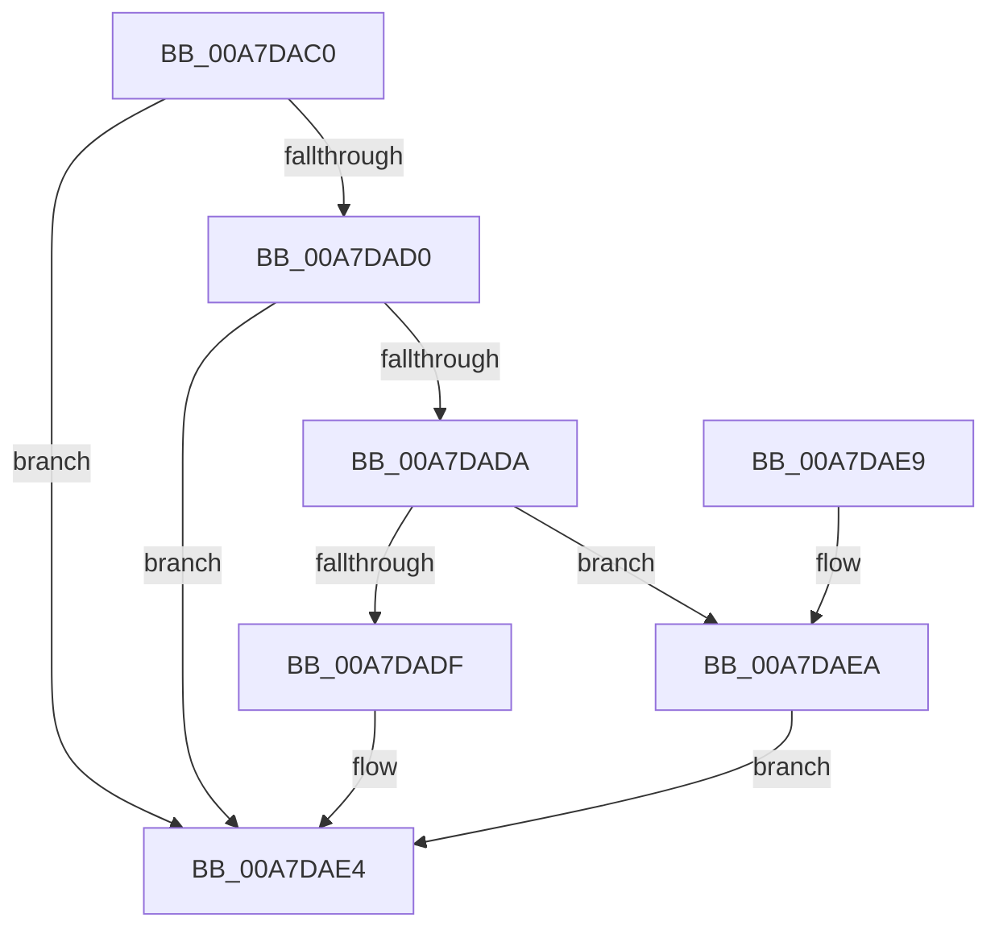

# PopPowerRequestStatsSetActive

- RVA: `0x00A7DAC0`–`0x00A7DAF1` (길이 `49` bytes)
- VA: `0x0000000140A7DAC0`
- 실행 섹션: `PAGE`
- PDB 이름 있음: `예`; PDB Function 태그: `아니요`
- unwind 정보 RVA: `0x0005CEE8`
- 디코드: `15`개 명령, `49/49` bytes 표시
- 미해석 바이트: `0` (있으면 어셈블리에 `.byte`로 보존)

> 이 문서는 커널 이미지의 기계어와 PDB 기호를 분석해 생성했습니다. 4번과 5번은 함수 원형과 자료형을 바이너리 사용 방식에서 추정한 C 해석이며 원본 소스 복구 결과는 아닙니다.

## 1. Dependencies

- 직접 호출 지점: **2**; 고유 호출 대상: **2**
- 직접 호출자로 확인된 함수: **1**
- RIP 상대 이미지 참조: **0**

### Outgoing calls
- `0x00A7DADF` → [SleepstudyHelperBlockerActiveDereference](../../text/45/SleepstudyHelperBlockerActiveDereference_function_00453830.md) (function, `0x00453830`)
- `0x00A7DAEA` → [SleepstudyHelperBlockerActiveReference](../../text/45/SleepstudyHelperBlockerActiveReference_function_004538D0.md) (function, `0x004538D0`)

### Direct callers
- [PopPowerRequestCallbackWorker](../../text/47/PopPowerRequestCallbackWorker_function_00477AD0.md) at `0x00477BCC`

### Static image references
- 디코드된 RIP-relative 메모리 참조가 없습니다.

## 2. Other-region calls and transfers

- 다른 실행 섹션으로 향하는 call: **2**
  - `0x00A7DADF` → [SleepstudyHelperBlockerActiveDereference](../../text/45/SleepstudyHelperBlockerActiveDereference_function_00453830.md) (`PAGE` → `.text`)
  - `0x00A7DAEA` → [SleepstudyHelperBlockerActiveReference](../../text/45/SleepstudyHelperBlockerActiveReference_function_004538D0.md) (`PAGE` → `.text`)
- 별도 외부 분기/꼬리 이동을 확인하지 못했습니다.

## 3. Assembly (complete function range)

```asm
00A7DAC0  48 83 EC 28                     sub rsp, 0x28
00A7DAC4  48 8B 89 A0 00 00 00            mov rcx, qword ptr [rcx + 0xa0]
00A7DACB  48 85 C9                        test rcx, rcx
00A7DACE  74 14                           je 0x140a7dae4
00A7DAD0  8D 42 FF                        lea eax, [rdx - 1]
00A7DAD3  A9 FD FF FF FF                  test eax, 0xfffffffd
00A7DAD8  75 0A                           jne 0x140a7dae4
00A7DADA  45 84 C0                        test r8b, r8b
00A7DADD  75 0B                           jne 0x140a7daea
00A7DADF  E8 4C 5D 9D FF                  call 0x140453830
00A7DAE4  48 83 C4 28                     add rsp, 0x28
00A7DAE8  C3                              ret
00A7DAE9  CC                              int3
00A7DAEA  E8 E1 5D 9D FF                  call 0x1404538d0
00A7DAEF  EB F3                           jmp 0x140a7dae4
```

## 4. C-style interpretation (structured pseudocode)

```c
__int64 __fastcall PopPowerRequestStatsSetActive(__int64 a1, __int64 a2, unsigned __int8 a3)
{
    __int64 result;
    __int64 v_rsp;

    v_rsp = (v_rsp) - (40);
    if (*(unsigned __int64 *)(a1 + 160) == 0) goto loc_00A7DAE4;
    if ((((unsigned int)(a2 - 1)) & (0xFFFFFFFDULL)) != 0) goto loc_00A7DAE4;
    if (a3 != 0) goto loc_00A7DAEA;
    result = SleepstudyHelperBlockerActiveDereference(*(unsigned __int64 *)(a1 + 160), a2, a3, a4);
loc_00A7DAE4:
    v_rsp = (v_rsp) + (40);
    return result;
loc_00A7DAEA:
    result = SleepstudyHelperBlockerActiveReference(*(unsigned __int64 *)(a1 + 160), a2, a3, a4);
    goto loc_00A7DAE4;
}
```

## 5. (Beta) C Style

```c
int64_t PopPowerRequestStatsSetActive(void *Arg1, void *Arg2, uint8_t Arg3)
{
    uint8_t *arg1 = (uint8_t *)Arg1;
    uint8_t *arg2 = (uint8_t *)Arg2;

    int64_t result;
    int64_t local_rsp;

    local_rsp = (local_rsp) - (40);
    if (*(uint64_t *)(arg1 + 0xA0) == 0) goto loc_00A7DAE4;
    if ((((uint32_t)(Arg2 - 1)) & (0xFFFFFFFDULL)) != 0) goto loc_00A7DAE4;
    if (Arg3 != 0) goto loc_00A7DAEA;
    result = SleepstudyHelperBlockerActiveDereference(*(uint64_t *)(arg1 + 0xA0), Arg2, Arg3, a4);
loc_00A7DAE4:
    local_rsp = (local_rsp) + (40);
    return result;
loc_00A7DAEA:
    result = SleepstudyHelperBlockerActiveReference(*(uint64_t *)(arg1 + 0xA0), Arg2, Arg3, a4);
    goto loc_00A7DAE4;
}
```

### 관측된 메모리 오프셋

구조체 형식이 확인되지 않은 접근은 인자 기준의 오프셋으로만 기록했습니다.

| 기준 인자 | 오프셋 표현 | 폭 (bit) | 접근 |
|---|---:|---:|---|
| `Arg1` | `+ 0xA0` | `64` | `R` |
| `Arg2` | `- 0x1` | `32` | `R` |

## 6. Execution-region graph

[열기: 2D/3D 그래프와 함수 탐색 컨트롤 패널](../../../control-panel.html?section=page&rva=0x00A7DAC0&view=graph)

- 2D 그래프는 위에서 아래로 흐르고, 3D 그래프는 빈 공간을 드래그해 회전합니다. Shift+드래그는 이동, 휠은 확대·축소, 함수 노드 선택은 대상 보고서 이동입니다.

### Static fallback


