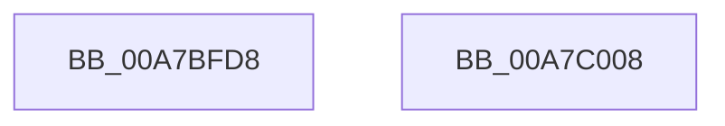

# PopPowerRequestTableInsertEntry

- RVA: `0x00A7BFD8`–`0x00A7C009` (길이 `49` bytes)
- VA: `0x0000000140A7BFD8`
- 실행 섹션: `PAGE`
- PDB 이름 있음: `예`; PDB Function 태그: `아니요`
- unwind 정보 RVA: `0x00097934`
- 디코드: `13`개 명령, `49/49` bytes 표시
- 미해석 바이트: `0` (있으면 어셈블리에 `.byte`로 보존)

> 이 문서는 커널 이미지의 기계어와 PDB 기호를 분석해 생성했습니다. 4번과 5번은 함수 원형과 자료형을 바이너리 사용 방식에서 추정한 C 해석이며 원본 소스 복구 결과는 아닙니다.

## 1. Dependencies

- 직접 호출 지점: **1**; 고유 호출 대상: **1**
- 직접 호출자로 확인된 함수: **1**
- RIP 상대 이미지 참조: **1**

### Outgoing calls
- `0x00A7BFFE` → [RtlInsertElementGenericTableAvl](../../text/3E/RtlInsertElementGenericTableAvl_function_003EE510.md) (function, `0x003EE510`)

### Direct callers
- [PopPowerRequestCreateCommon](../../text/23/PopPowerRequestCreateCommon_function_00230150.md) at `0x002301B5`

### Static image references
- `0x00A7BFF1` → RVA `0x00F0EDC0` (`.data`; read)

## 2. Other-region calls and transfers

- 다른 실행 섹션으로 향하는 call: **1**
  - `0x00A7BFFE` → [RtlInsertElementGenericTableAvl](../../text/3E/RtlInsertElementGenericTableAvl_function_003EE510.md) (`PAGE` → `.text`)
- 별도 외부 분기/꼬리 이동을 확인하지 못했습니다.

## 3. Assembly (complete function range)

```asm
00A7BFD8  48 8B C4                        mov rax, rsp
00A7BFDB  48 83 EC 38                     sub rsp, 0x38
00A7BFDF  0F 57 C0                        xorps xmm0, xmm0
00A7BFE2  4C 8D 48 08                     lea r9, [rax + 8]
00A7BFE6  0F 11 40 E8                     movups xmmword ptr [rax - 0x18], xmm0
00A7BFEA  89 48 F0                        mov dword ptr [rax - 0x10], ecx
00A7BFED  48 8D 50 E8                     lea rdx, [rax - 0x18]
00A7BFF1  48 8D 0D C8 2D 49 00            lea rcx, [rip + 0x492dc8]
00A7BFF8  41 B8 10 00 00 00               mov r8d, 0x10
00A7BFFE  E8 0D 25 97 FF                  call 0x1403ee510
00A7C003  48 83 C4 38                     add rsp, 0x38
00A7C007  C3                              ret
00A7C008  CC                              int3
```

## 4. C-style interpretation (structured pseudocode)

```c
__int64 __fastcall PopPowerRequestTableInsertEntry(int a1)
{
    __int64 result;
    __int64 v_rsp;

    v_rsp = (v_rsp) - (56);
    *(unsigned __int64 *)(v_rsp - 24) = v_xmm0;
    *(unsigned int *)(v_rsp - 16) = a1;
    result = RtlInsertElementGenericTableAvl(v_rip + 4795848, v_rsp - 24, 16, v_rsp + 8);
    v_rsp = (v_rsp) + (56);
    return result;
}
```

## 5. (Beta) C Style

```c
int64_t PopPowerRequestTableInsertEntry(int32_t Arg1)
{
    int64_t result;
    int64_t local_rsp;

    local_rsp = (local_rsp) - (56);
    *(uint64_t *)(local_rsp - 0x18) = v_xmm0;
    *(uint32_t *)(local_rsp - 0x10) = Arg1;
    result = RtlInsertElementGenericTableAvl(v_rip + 4795848, local_rsp - 24, 16, local_rsp + 8);
    local_rsp = (local_rsp) + (56);
    return result;
}
```

## 6. Execution-region graph

[열기: 2D/3D 그래프와 함수 탐색 컨트롤 패널](../../../control-panel.html?section=page&rva=0x00A7BFD8&view=graph)

- 2D 그래프는 위에서 아래로 흐르고, 3D 그래프는 빈 공간을 드래그해 회전합니다. Shift+드래그는 이동, 휠은 확대·축소, 함수 노드 선택은 대상 보고서 이동입니다.

### Static fallback


