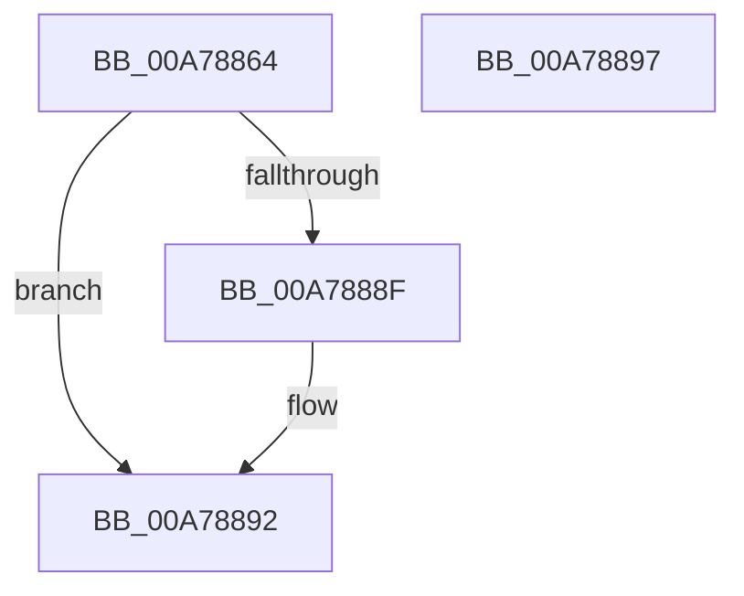

# PopPowerRequestTableLookupEntry

- RVA: `0x00A78864`–`0x00A78898` (길이 `52` bytes)
- VA: `0x0000000140A78864`
- 실행 섹션: `PAGE`
- PDB 이름 있음: `예`; PDB Function 태그: `아니요`
- unwind 정보 RVA: `0x0005D2F4`
- 디코드: `15`개 명령, `52/52` bytes 표시
- 미해석 바이트: `0` (있으면 어셈블리에 `.byte`로 보존)

> 이 문서는 커널 이미지의 기계어와 PDB 기호를 분석해 생성했습니다. 4번과 5번은 함수 원형과 자료형을 바이너리 사용 방식에서 추정한 C 해석이며 원본 소스 복구 결과는 아닙니다.

## 1. Dependencies

- 직접 호출 지점: **1**; 고유 호출 대상: **1**
- 직접 호출자로 확인된 함수: **1**
- RIP 상대 이미지 참조: **1**

### Outgoing calls
- `0x00A78880` → [RtlLookupElementGenericTableAvl](../../text/3F/RtlLookupElementGenericTableAvl_function_003FEFB0.md) (function, `0x003FEFB0`)

### Direct callers
- [PopPowerRequestHandleRequestOverrideQueryResponse](../../text/47/PopPowerRequestHandleRequestOverrideQueryResponse_function_004777FC.md) at `0x00477821`

### Static image references
- `0x00A78879` → RVA `0x00F0EDC0` (`.data`; read)

## 2. Other-region calls and transfers

- 다른 실행 섹션으로 향하는 call: **1**
  - `0x00A78880` → [RtlLookupElementGenericTableAvl](../../text/3F/RtlLookupElementGenericTableAvl_function_003FEFB0.md) (`PAGE` → `.text`)
- 별도 외부 분기/꼬리 이동을 확인하지 못했습니다.

## 3. Assembly (complete function range)

```asm
00A78864  48 83 EC 38                     sub rsp, 0x38
00A78868  0F 57 C0                        xorps xmm0, xmm0
00A7886B  48 8D 54 24 20                  lea rdx, [rsp + 0x20]
00A78870  0F 11 44 24 20                  movups xmmword ptr [rsp + 0x20], xmm0
00A78875  89 4C 24 28                     mov dword ptr [rsp + 0x28], ecx
00A78879  48 8D 0D 40 65 49 00            lea rcx, [rip + 0x496540]
00A78880  E8 2B 67 98 FF                  call 0x1403fefb0
00A78885  48 8B C8                        mov rcx, rax
00A78888  33 C0                           xor eax, eax
00A7888A  48 85 C9                        test rcx, rcx
00A7888D  74 03                           je 0x140a78892
00A7888F  48 8B 01                        mov rax, qword ptr [rcx]
00A78892  48 83 C4 38                     add rsp, 0x38
00A78896  C3                              ret
00A78897  CC                              int3
```

## 4. C-style interpretation (structured pseudocode)

```c
__int64 __fastcall PopPowerRequestTableLookupEntry(int a1)
{
    __int64 result;
    __int64 v_rsp;
    unsigned int v_stack_m10;
    unsigned __int64 v_stack_m18;

    v_rsp = (v_rsp) - (56);
    v_stack_m18 = v_xmm0;
    v_stack_m10 = a1;
    result = RtlLookupElementGenericTableAvl(v_rip + 4810048, v_stack_m18, a3, a4);
    result = 0;
    if (0 != 0) {
        result = *(unsigned __int64 *)(result);
    }
    v_rsp = (v_rsp) + (56);
    return result;
}
```

## 5. (Beta) C Style

```c
int64_t PopPowerRequestTableLookupEntry(int32_t Arg1)
{
    int64_t result;
    int64_t local_rsp;
    uint32_t v_stack_m10;
    uint64_t v_stack_m18;

    local_rsp = (local_rsp) - (56);
    v_stack_m18 = v_xmm0;
    v_stack_m10 = Arg1;
    result = RtlLookupElementGenericTableAvl(v_rip + 4810048, v_stack_m18, a3, a4);
    result = 0;
    if (0 != 0) {
        result = *(uint64_t *)(result);
    }
    local_rsp = (local_rsp) + (56);
    return result;
}
```

## 6. Execution-region graph

[열기: 2D/3D 그래프와 함수 탐색 컨트롤 패널](../../../control-panel.html?section=page&rva=0x00A78864&view=graph)

- 2D 그래프는 위에서 아래로 흐르고, 3D 그래프는 빈 공간을 드래그해 회전합니다. Shift+드래그는 이동, 휠은 확대·축소, 함수 노드 선택은 대상 보고서 이동입니다.

### Static fallback


