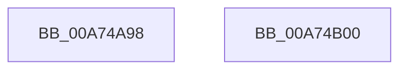

# PopPrepareIoctl

- RVA: `0x00A74A98`–`0x00A74B01` (길이 `105` bytes)
- VA: `0x0000000140A74A98`
- 실행 섹션: `PAGE`
- PDB 이름 있음: `예`; PDB Function 태그: `아니요`
- unwind 정보 RVA: `0x0005C954`
- 디코드: `29`개 명령, `105/105` bytes 표시
- 미해석 바이트: `0` (있으면 어셈블리에 `.byte`로 보존)

> 이 문서는 커널 이미지의 기계어와 PDB 기호를 분석해 생성했습니다. 4번과 5번은 함수 원형과 자료형을 바이너리 사용 방식에서 추정한 C 해석이며 원본 소스 복구 결과는 아닙니다.

## 1. Dependencies

- 직접 호출 지점: **1**; 고유 호출 대상: **1**
- 직접 호출자로 확인된 함수: **10**
- RIP 상대 이미지 참조: **0**

### Outgoing calls
- `0x00A74ABC` → [IoReuseIrp](../../text/24/IoReuseIrp_function_0024DD70.md) (function, `0x0024DD70`)

### Direct callers
- [PopBatterySetChargeLimitControl](../../text/5D/PopBatterySetChargeLimitControl_function_005D94D8.md) at `0x005D951E`
- [PopBatteryAdd](../76/PopBatteryAdd_function_00766580.md) at `0x00766603`
- [PopBatteryInitialize](../76/PopBatteryInitialize_function_00766834.md) at `0x007668A7`
- [PopBatteryInitialize](../76/PopBatteryInitialize_function_00766834.md) at `0x00766924`
- [PopPowerAdapterAdd](../76/PopPowerAdapterAdd_function_00767430.md) at `0x007674BF`
- [PopPowerAdapterQueryStatus](../76/PopPowerAdapterQueryStatus_function_00767C44.md) at `0x00767CA6`
- [PopPowerAdapterReinitialize](../76/PopPowerAdapterReinitialize_function_00767E48.md) at `0x00767EB4`
- [PopBatteryQueryStatus](../AE/PopBatteryQueryStatus_function_00AE1450.md) at `0x00AE15AE`
- [PopBatteryWorker](../AE/PopBatteryWorker_function_00AE1650.md) at `0x00AE1BAE`
- [sub_00B3BE18](../B3/Unknown_function_00B3BE18.md) at `0x00B3BFE4`
- [sub_00B48194](../B4/Unknown_function_00B48194.md) at `0x00B4848E`

### Static image references
- 디코드된 RIP-relative 메모리 참조가 없습니다.

## 2. Other-region calls and transfers

- 다른 실행 섹션으로 향하는 call: **1**
  - `0x00A74ABC` → [IoReuseIrp](../../text/24/IoReuseIrp_function_0024DD70.md) (`PAGE` → `.text`)
- 별도 외부 분기/꼬리 이동을 확인하지 못했습니다.

## 3. Assembly (complete function range)

```asm
00A74A98  48 89 5C 24 08                  mov qword ptr [rsp + 8], rbx
00A74A9D  48 89 6C 24 10                  mov qword ptr [rsp + 0x10], rbp
00A74AA2  48 89 74 24 18                  mov qword ptr [rsp + 0x18], rsi
00A74AA7  57                              push rdi
00A74AA8  48 83 EC 20                     sub rsp, 0x20
00A74AAC  8B FA                           mov edi, edx
00A74AAE  49 8B E9                        mov rbp, r9
00A74AB1  BA BB 00 00 C0                  mov edx, 0xc00000bb
00A74AB6  41 8A D8                        mov bl, r8b
00A74AB9  48 8B F1                        mov rsi, rcx
00A74ABC  E8 AF 92 7D FF                  call 0x14024dd70
00A74AC1  4C 8B 86 B8 00 00 00            mov r8, qword ptr [rsi + 0xb8]
00A74AC8  84 DB                           test bl, bl
00A74ACA  0F 95 C0                        setne al
00A74ACD  04 0E                           add al, 0xe
00A74ACF  41 88 40 B8                     mov byte ptr [r8 - 0x48], al
00A74AD3  8B 44 24 50                     mov eax, dword ptr [rsp + 0x50]
00A74AD7  48 8B 5C 24 30                  mov rbx, qword ptr [rsp + 0x30]
00A74ADC  41 89 40 C8                     mov dword ptr [r8 - 0x38], eax
00A74AE0  8B 44 24 58                     mov eax, dword ptr [rsp + 0x58]
00A74AE4  41 89 40 C0                     mov dword ptr [r8 - 0x40], eax
00A74AE8  41 89 78 D0                     mov dword ptr [r8 - 0x30], edi
00A74AEC  48 89 6E 18                     mov qword ptr [rsi + 0x18], rbp
00A74AF0  48 8B 6C 24 38                  mov rbp, qword ptr [rsp + 0x38]
00A74AF5  48 8B 74 24 40                  mov rsi, qword ptr [rsp + 0x40]
00A74AFA  48 83 C4 20                     add rsp, 0x20
00A74AFE  5F                              pop rdi
00A74AFF  C3                              ret
00A74B00  CC                              int3
```

## 4. C-style interpretation (structured pseudocode)

```c
__int64 __fastcall PopPrepareIoctl(__int64 a1, int a2, unsigned __int8 a3, __int64 a4, unsigned int a5, unsigned int a6)
{
    __int64 result;
    __int64 v_rsp;
    unsigned __int64 v_stack_p10;
    unsigned __int64 v_stack_p18;
    unsigned __int64 v_stack_p8;

    v_stack_p8 = v_rbx;
    v_stack_p10 = v_rbp;
    v_stack_p18 = v_rsi;
    v_rsp = (v_rsp) - (32);
    result = IoReuseIrp(a1, (unsigned int)(0xC00000BBULL), a3, a4);
    result = (a3 != 0) ? 1 : 0;
    result = (unsigned __int8)((result) + (14));
    *(unsigned __int8 *)(*(unsigned __int64 *)(a1 + 184) - 72) = (unsigned __int8)(result);
    *(unsigned int *)(*(unsigned __int64 *)(a1 + 184) - 56) = (unsigned int)((unsigned int)(a5));
    *(unsigned int *)(*(unsigned __int64 *)(a1 + 184) - 64) = (unsigned int)((unsigned int)(a6));
    *(unsigned int *)(*(unsigned __int64 *)(a1 + 184) - 48) = (unsigned int)((unsigned int)(a2));
    *(unsigned __int64 *)(a1 + 24) = a4;
    v_rsp = (v_rsp) + (32);
    return (unsigned int)(a6);
}
```

## 5. (Beta) C Style

```c
int64_t PopPrepareIoctl(void *Arg1, int32_t Arg2, uint8_t Arg3, int64_t Arg4, uint32_t Arg5, uint32_t Arg6)
{
    uint8_t *arg1 = (uint8_t *)Arg1;

    int64_t result;
    int64_t local_rsp;
    uint64_t v_stack_p10;
    uint64_t v_stack_p18;
    uint64_t v_stack_p8;

    v_stack_p8 = local_rbx;
    v_stack_p10 = local_rbp;
    v_stack_p18 = local_rsi;
    local_rsp = (local_rsp) - (32);
    result = IoReuseIrp(Arg1, (uint32_t)(0xC00000BBULL), Arg3, Arg4);
    result = (Arg3 != 0) ? 1 : 0;
    result = (uint8_t)((result) + (14));
    *(uint8_t *)(*(uint64_t *)(arg1 + 0xB8) - 0x48) = (uint8_t)(result);
    *(uint32_t *)(*(uint64_t *)(arg1 + 0xB8) - 0x38) = (uint32_t)((uint32_t)(Arg5));
    *(uint32_t *)(*(uint64_t *)(arg1 + 0xB8) - 0x40) = (uint32_t)((uint32_t)(Arg6));
    *(uint32_t *)(*(uint64_t *)(arg1 + 0xB8) - 0x30) = (uint32_t)((uint32_t)(Arg2));
    *(uint64_t *)(arg1 + 0x18) = Arg4;
    local_rsp = (local_rsp) + (32);
    return (uint32_t)(Arg6);
}
```

### 관측된 메모리 오프셋

구조체 형식이 확인되지 않은 접근은 인자 기준의 오프셋으로만 기록했습니다.

| 기준 인자 | 오프셋 표현 | 폭 (bit) | 접근 |
|---|---:|---:|---|
| `Arg1` | `+ 0x18` | `64` | `W` |
| `Arg1` | `+ 0xB8` | `64` | `R` |

## 6. Execution-region graph

[열기: 2D/3D 그래프와 함수 탐색 컨트롤 패널](../../../control-panel.html?section=page&rva=0x00A74A98&view=graph)

- 2D 그래프는 위에서 아래로 흐르고, 3D 그래프는 빈 공간을 드래그해 회전합니다. Shift+드래그는 이동, 휠은 확대·축소, 함수 노드 선택은 대상 보고서 이동입니다.

### Static fallback


