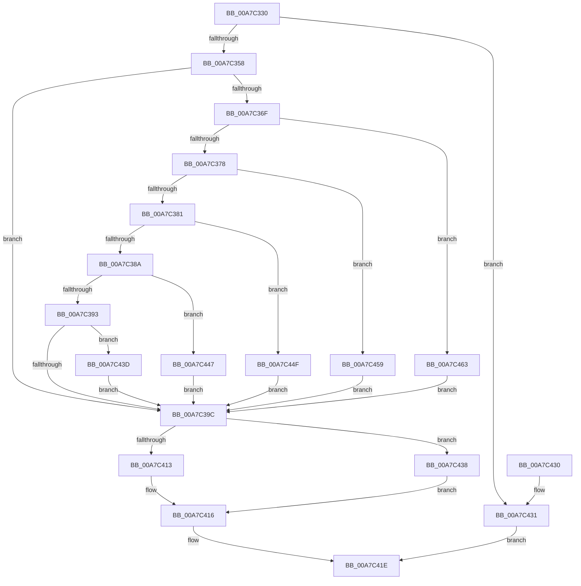

# PopS0LowPowerIdleInfo

- RVA: `0x00A7C330`–`0x00A7C46B` (길이 `315` bytes)
- VA: `0x0000000140A7C330`
- 실행 섹션: `PAGE`
- PDB 이름 있음: `예`; PDB Function 태그: `아니요`
- unwind 정보 RVA: `0x000ACEF4`
- 디코드: `88`개 명령, `315/315` bytes 표시
- 미해석 바이트: `0` (있으면 어셈블리에 `.byte`로 보존)

> 이 문서는 커널 이미지의 기계어와 PDB 기호를 분석해 생성했습니다. 4번과 5번은 함수 원형과 자료형을 바이너리 사용 방식에서 추정한 C 해석이며 원본 소스 복구 결과는 아닙니다.

## 1. Dependencies

- 직접 호출 지점: **3**; 고유 호출 대상: **3**
- 직접 호출자로 확인된 함수: **1**
- RIP 상대 이미지 참조: **6**

### Outgoing calls
- `0x00A7C34B` → [PopIsPlatformAoAcCapable](../../text/49/PopIsPlatformAoAcCapable_function_0049BF40.md) (function, `0x0049BF40`)
- `0x00A7C358` → [PopAcquirePolicyLock](../../pagelk/B7/PopAcquirePolicyLock_function_00B783C0.md) (function, `0x00B783C0`)
- `0x00A7C419` → [PopReleasePolicyLock](../../pagelk/B7/PopReleasePolicyLock_function_00B78410.md) (function, `0x00B78410`)

### Direct callers
- [PopPowerInformationInternal](../A8/PopPowerInformationInternal_function_00A8B7C0.md) at `0x00A8BBD4`

### Static image references
- `0x00A7C35D` → RVA `0x00E678E0` (`.data`; read)
- `0x00A7C39C` → RVA `0x00E678DC` (`.data`; read)
- `0x00A7C3AB` → RVA `0x00E679C0` (`.data`; read)
- `0x00A7C3BD` → RVA `0x00E679C4` (`.data`; read)
- `0x00A7C3D5` → RVA `0x00E679C8` (`.data`; read)
- `0x00A7C3EC` → RVA `0x00E679D0` (`.data`; read)

## 2. Other-region calls and transfers

- 다른 실행 섹션으로 향하는 call: **3**
  - `0x00A7C34B` → [PopIsPlatformAoAcCapable](../../text/49/PopIsPlatformAoAcCapable_function_0049BF40.md) (`PAGE` → `.text`)
  - `0x00A7C358` → [PopAcquirePolicyLock](../../pagelk/B7/PopAcquirePolicyLock_function_00B783C0.md) (`PAGE` → `PAGELK`)
  - `0x00A7C419` → [PopReleasePolicyLock](../../pagelk/B7/PopReleasePolicyLock_function_00B78410.md) (`PAGE` → `PAGELK`)
- 별도 외부 분기/꼬리 이동을 확인하지 못했습니다.

## 3. Assembly (complete function range)

```asm
00A7C330  48 89 5C 24 08                  mov qword ptr [rsp + 8], rbx
00A7C335  48 89 74 24 10                  mov qword ptr [rsp + 0x10], rsi
00A7C33A  57                              push rdi
00A7C33B  48 83 EC 20                     sub rsp, 0x20
00A7C33F  33 C0                           xor eax, eax
00A7C341  33 DB                           xor ebx, ebx
00A7C343  8B F3                           mov esi, ebx
00A7C345  48 89 01                        mov qword ptr [rcx], rax
00A7C348  48 8B F9                        mov rdi, rcx
00A7C34B  E8 F0 FB A1 FF                  call 0x14049bf40
00A7C350  84 C0                           test al, al
00A7C352  0F 84 D9 00 00 00               je 0x140a7c431
00A7C358  E8 63 C0 0F 00                  call 0x140b783c0
00A7C35D  8B 0D 7D B5 3E 00               mov ecx, dword ptr [rip + 0x3eb57d]
00A7C363  44 8D 4B 01                     lea r9d, [rbx + 1]
00A7C367  44 8D 43 02                     lea r8d, [rbx + 2]
00A7C36B  85 C9                           test ecx, ecx
00A7C36D  74 2D                           je 0x140a7c39c
00A7C36F  41 2B C9                        sub ecx, r9d
00A7C372  0F 84 EB 00 00 00               je 0x140a7c463
00A7C378  41 2B C9                        sub ecx, r9d
00A7C37B  0F 84 D8 00 00 00               je 0x140a7c459
00A7C381  41 2B C9                        sub ecx, r9d
00A7C384  0F 84 C5 00 00 00               je 0x140a7c44f
00A7C38A  83 E9 03                        sub ecx, 3
00A7C38D  0F 84 B4 00 00 00               je 0x140a7c447
00A7C393  41 3B C9                        cmp ecx, r9d
00A7C396  0F 84 A1 00 00 00               je 0x140a7c43d
00A7C39C  44 39 05 39 B5 3E 00            cmp dword ptr [rip + 0x3eb539], r8d
00A7C3A3  8A 4F 04                        mov cl, byte ptr [rdi + 4]
00A7C3A6  0F 94 C2                        sete dl
00A7C3A9  89 1F                           mov dword ptr [rdi], ebx
00A7C3AB  44 39 0D 0E B6 3E 00            cmp dword ptr [rip + 0x3eb60e], r9d
00A7C3B2  0F 94 C0                        sete al
00A7C3B5  80 E1 FE                        and cl, 0xfe
00A7C3B8  0A C8                           or cl, al
00A7C3BA  88 4F 04                        mov byte ptr [rdi + 4], cl
00A7C3BD  44 39 0D 00 B6 3E 00            cmp dword ptr [rip + 0x3eb600], r9d
00A7C3C4  0F 95 C0                        setne al
00A7C3C7  80 E1 FD                        and cl, 0xfd
00A7C3CA  41 2A C1                        sub al, r9b
00A7C3CD  41 22 C0                        and al, r8b
00A7C3D0  0A C8                           or cl, al
00A7C3D2  88 4F 04                        mov byte ptr [rdi + 4], cl
00A7C3D5  44 39 0D EC B5 3E 00            cmp dword ptr [rip + 0x3eb5ec], r9d
00A7C3DC  0F 95 C0                        setne al
00A7C3DF  80 E1 FB                        and cl, 0xfb
00A7C3E2  41 2A C1                        sub al, r9b
00A7C3E5  24 04                           and al, 4
00A7C3E7  0A C8                           or cl, al
00A7C3E9  88 4F 04                        mov byte ptr [rdi + 4], cl
00A7C3EC  44 39 0D DD B5 3E 00            cmp dword ptr [rip + 0x3eb5dd], r9d
00A7C3F3  0F 95 C0                        setne al
00A7C3F6  80 E1 F7                        and cl, 0xf7
00A7C3F9  41 2A C1                        sub al, r9b
00A7C3FC  24 08                           and al, 8
00A7C3FE  0A C8                           or cl, al
00A7C400  8D 43 FD                        lea eax, [rbx - 3]
00A7C403  88 4F 04                        mov byte ptr [rdi + 4], cl
00A7C406  8A 4F 05                        mov cl, byte ptr [rdi + 5]
00A7C409  80 E1 FE                        and cl, 0xfe
00A7C40C  0A CA                           or cl, dl
00A7C40E  41 3B C1                        cmp eax, r9d
00A7C411  77 25                           ja 0x140a7c438
00A7C413  41 0A C8                        or cl, r8b
00A7C416  88 4F 05                        mov byte ptr [rdi + 5], cl
00A7C419  E8 F2 BF 0F 00                  call 0x140b78410
00A7C41E  48 8B 5C 24 30                  mov rbx, qword ptr [rsp + 0x30]
00A7C423  8B C6                           mov eax, esi
00A7C425  48 8B 74 24 38                  mov rsi, qword ptr [rsp + 0x38]
00A7C42A  48 83 C4 20                     add rsp, 0x20
00A7C42E  5F                              pop rdi
00A7C42F  C3                              ret
00A7C430  CC                              int3
00A7C431  BE BB 00 00 C0                  mov esi, 0xc00000bb
00A7C436  EB E6                           jmp 0x140a7c41e
00A7C438  80 E1 FD                        and cl, 0xfd
00A7C43B  EB D9                           jmp 0x140a7c416
00A7C43D  BB 05 00 00 00                  mov ebx, 5
00A7C442  E9 55 FF FF FF                  jmp 0x140a7c39c
00A7C447  41 8B D9                        mov ebx, r9d
00A7C44A  E9 4D FF FF FF                  jmp 0x140a7c39c
00A7C44F  BB 04 00 00 00                  mov ebx, 4
00A7C454  E9 43 FF FF FF                  jmp 0x140a7c39c
00A7C459  BB 03 00 00 00                  mov ebx, 3
00A7C45E  E9 39 FF FF FF                  jmp 0x140a7c39c
00A7C463  41 8B D8                        mov ebx, r8d
00A7C466  E9 31 FF FF FF                  jmp 0x140a7c39c
```

## 4. C-style interpretation (structured pseudocode)

```c
__int64 __fastcall PopS0LowPowerIdleInfo(__int64 a1)
{
    __int64 result;
    __int64 v_rbx;
    __int64 v_rsp;
    unsigned __int64 v_stack_p10;
    unsigned __int64 v_stack_p8;

    v_stack_p8 = v_rbx;
    v_stack_p10 = v_rsi;
    v_rsp = (v_rsp) - (32);
    result = 0;
    v_rbx = 0;
    *(unsigned __int64 *)(a1) = 0;
    result = PopIsPlatformAoAcCapable(a1, a2, a3, a4);
    if ((unsigned __int8)(result) == 0) goto loc_00A7C431;
    result = PopAcquirePolicyLock(a1, a2, a3, a4);
    if ((unsigned int)((unsigned int)(*(unsigned int *)(v_rip + 4109693))) == 0) goto loc_00A7C39C;
    a1 = (unsigned int)(((unsigned int)(*(unsigned int *)(v_rip + 4109693))) - ((unsigned int)(v_rbx + 1)));
    if (condition_is_equal) goto loc_00A7C463;
    a1 = (unsigned int)((a1) - ((unsigned int)(v_rbx + 1)));
    if (condition_is_equal) goto loc_00A7C459;
    a1 = (unsigned int)((a1) - ((unsigned int)(v_rbx + 1)));
    if (condition_is_equal) goto loc_00A7C44F;
    a1 = (unsigned int)((a1) - (3));
    if (condition_is_equal) goto loc_00A7C447;
    if (((unsigned int)(a1)) == ((unsigned int)(v_rbx + 1))) goto loc_00A7C43D;
loc_00A7C39C:
    a2 = ((*(unsigned int *)(v_rip + 4109625)) == ((unsigned int)(v_rbx + 2))) ? 1 : 0;
    *(unsigned int *)(a1) = 0;
    result = ((*(unsigned int *)(v_rip + 4109838)) == ((unsigned int)(v_rbx + 1))) ? 1 : 0;
    a1 = (unsigned __int8)((*(unsigned __int8 *)(a1 + 4)) & (254));
    a1 = (unsigned __int8)((a1) | ((unsigned __int8)(result)));
    *(unsigned __int8 *)(a1 + 4) = (unsigned __int8)(a1);
    result = ((*(unsigned int *)(v_rip + 4109824)) != ((unsigned int)(v_rbx + 1))) ? 1 : 0;
    a1 = (unsigned __int8)((a1) & (253));
    result = (unsigned __int8)((result) - ((unsigned __int8)(v_rbx + 1)));
    result = (unsigned __int8)((result) & ((unsigned __int8)(v_rbx + 2)));
    a1 = (unsigned __int8)((a1) | ((unsigned __int8)(result)));
    *(unsigned __int8 *)(a1 + 4) = (unsigned __int8)(a1);
    result = ((*(unsigned int *)(v_rip + 4109804)) != ((unsigned int)(v_rbx + 1))) ? 1 : 0;
    a1 = (unsigned __int8)((a1) & (251));
    result = (unsigned __int8)((result) - ((unsigned __int8)(v_rbx + 1)));
    result = (unsigned __int8)((result) & (4));
    a1 = (unsigned __int8)((a1) | ((unsigned __int8)(result)));
    *(unsigned __int8 *)(a1 + 4) = (unsigned __int8)(a1);
    result = ((*(unsigned int *)(v_rip + 4109789)) != ((unsigned int)(v_rbx + 1))) ? 1 : 0;
    a1 = (unsigned __int8)((a1) & (247));
    result = (unsigned __int8)((result) - ((unsigned __int8)(v_rbx + 1)));
    result = (unsigned __int8)((result) & (8));
    a1 = (unsigned __int8)((a1) | ((unsigned __int8)(result)));
    *(unsigned __int8 *)(a1 + 4) = (unsigned __int8)(a1);
    a1 = (unsigned __int8)((*(unsigned __int8 *)(a1 + 5)) & (254));
    a1 = (unsigned __int8)((a1) | ((unsigned __int8)(a2)));
    if (((unsigned int)(v_rbx - 3)) > ((unsigned int)(v_rbx + 1))) goto loc_00A7C438;
    a1 = (unsigned __int8)((a1) | ((unsigned __int8)(v_rbx + 2)));
loc_00A7C416:
    *(unsigned __int8 *)(a1 + 5) = (unsigned __int8)(a1);
    result = PopReleasePolicyLock(a1, a2, v_rbx + 2, v_rbx + 1);
loc_00A7C41E:
    v_rsp = (v_rsp) + (32);
    return 0;
loc_00A7C431:
    goto loc_00A7C41E;
loc_00A7C438:
    a1 = (unsigned __int8)((a1) & (253));
    goto loc_00A7C416;
loc_00A7C43D:
    goto loc_00A7C39C;
loc_00A7C447:
    goto loc_00A7C39C;
loc_00A7C44F:
    goto loc_00A7C39C;
loc_00A7C459:
    goto loc_00A7C39C;
loc_00A7C463:
    goto loc_00A7C39C;
}
```

## 5. (Beta) C Style

```c
int64_t PopS0LowPowerIdleInfo(void *Arg1)
{
    uint8_t *arg1 = (uint8_t *)Arg1;

    int64_t result;
    int64_t local_rbx;
    int64_t local_rsp;
    uint64_t v_stack_p10;
    uint64_t v_stack_p8;

    v_stack_p8 = local_rbx;
    v_stack_p10 = local_rsi;
    local_rsp = (local_rsp) - (32);
    result = 0;
    local_rbx = 0;
    *(uint64_t *)(arg1) = 0;
    result = PopIsPlatformAoAcCapable(Arg1, a2, a3, a4);
    if ((uint8_t)(result) == 0) goto loc_00A7C431;
    result = PopAcquirePolicyLock(Arg1, a2, a3, a4);
    if ((uint32_t)((uint32_t)(*(uint32_t *)(v_rip + 0x3EB57D))) == 0) goto loc_00A7C39C;
    Arg1 = (uint32_t)(((uint32_t)(*(uint32_t *)(v_rip + 0x3EB57D))) - ((uint32_t)(local_rbx + 1)));
    if (condition_is_equal) goto loc_00A7C463;
    Arg1 = (uint32_t)((Arg1) - ((uint32_t)(local_rbx + 1)));
    if (condition_is_equal) goto loc_00A7C459;
    Arg1 = (uint32_t)((Arg1) - ((uint32_t)(local_rbx + 1)));
    if (condition_is_equal) goto loc_00A7C44F;
    Arg1 = (uint32_t)((Arg1) - (3));
    if (condition_is_equal) goto loc_00A7C447;
    if (((uint32_t)(Arg1)) == ((uint32_t)(local_rbx + 1))) goto loc_00A7C43D;
loc_00A7C39C:
    a2 = ((*(uint32_t *)(v_rip + 0x3EB539)) == ((uint32_t)(local_rbx + 2))) ? 1 : 0;
    *(uint32_t *)(arg1) = 0;
    result = ((*(uint32_t *)(v_rip + 0x3EB60E)) == ((uint32_t)(local_rbx + 1))) ? 1 : 0;
    Arg1 = (uint8_t)((*(uint8_t *)(arg1 + 0x4)) & (254));
    Arg1 = (uint8_t)((Arg1) | ((uint8_t)(result)));
    *(uint8_t *)(arg1 + 0x4) = (uint8_t)(Arg1);
    result = ((*(uint32_t *)(v_rip + 0x3EB600)) != ((uint32_t)(local_rbx + 1))) ? 1 : 0;
    Arg1 = (uint8_t)((Arg1) & (253));
    result = (uint8_t)((result) - ((uint8_t)(local_rbx + 1)));
    result = (uint8_t)((result) & ((uint8_t)(local_rbx + 2)));
    Arg1 = (uint8_t)((Arg1) | ((uint8_t)(result)));
    *(uint8_t *)(arg1 + 0x4) = (uint8_t)(Arg1);
    result = ((*(uint32_t *)(v_rip + 0x3EB5EC)) != ((uint32_t)(local_rbx + 1))) ? 1 : 0;
    Arg1 = (uint8_t)((Arg1) & (251));
    result = (uint8_t)((result) - ((uint8_t)(local_rbx + 1)));
    result = (uint8_t)((result) & (4));
    Arg1 = (uint8_t)((Arg1) | ((uint8_t)(result)));
    *(uint8_t *)(arg1 + 0x4) = (uint8_t)(Arg1);
    result = ((*(uint32_t *)(v_rip + 0x3EB5DD)) != ((uint32_t)(local_rbx + 1))) ? 1 : 0;
    Arg1 = (uint8_t)((Arg1) & (247));
    result = (uint8_t)((result) - ((uint8_t)(local_rbx + 1)));
    result = (uint8_t)((result) & (8));
    Arg1 = (uint8_t)((Arg1) | ((uint8_t)(result)));
    *(uint8_t *)(arg1 + 0x4) = (uint8_t)(Arg1);
    Arg1 = (uint8_t)((*(uint8_t *)(arg1 + 0x5)) & (254));
    Arg1 = (uint8_t)((Arg1) | ((uint8_t)(a2)));
    if (((uint32_t)(local_rbx - 3)) > ((uint32_t)(local_rbx + 1))) goto loc_00A7C438;
    Arg1 = (uint8_t)((Arg1) | ((uint8_t)(local_rbx + 2)));
loc_00A7C416:
    *(uint8_t *)(arg1 + 0x5) = (uint8_t)(Arg1);
    result = PopReleasePolicyLock(Arg1, a2, local_rbx + 2, local_rbx + 1);
loc_00A7C41E:
    local_rsp = (local_rsp) + (32);
    return 0;
loc_00A7C431:
    goto loc_00A7C41E;
loc_00A7C438:
    Arg1 = (uint8_t)((Arg1) & (253));
    goto loc_00A7C416;
loc_00A7C43D:
    goto loc_00A7C39C;
loc_00A7C447:
    goto loc_00A7C39C;
loc_00A7C44F:
    goto loc_00A7C39C;
loc_00A7C459:
    goto loc_00A7C39C;
loc_00A7C463:
    goto loc_00A7C39C;
}
```

### 관측된 메모리 오프셋

구조체 형식이 확인되지 않은 접근은 인자 기준의 오프셋으로만 기록했습니다.

| 기준 인자 | 오프셋 표현 | 폭 (bit) | 접근 |
|---|---:|---:|---|
| `Arg1` | `+ 0x0` | `32` | `W` |
| `Arg1` | `+ 0x0` | `64` | `W` |
| `Arg1` | `+ 0x4` | `8` | `R` |
| `Arg1` | `+ 0x4` | `8` | `W` |
| `Arg1` | `+ 0x5` | `8` | `R` |
| `Arg1` | `+ 0x5` | `8` | `W` |

## 6. Execution-region graph

[열기: 2D/3D 그래프와 함수 탐색 컨트롤 패널](../../../control-panel.html?section=page&rva=0x00A7C330&view=graph)

- 2D 그래프는 위에서 아래로 흐르고, 3D 그래프는 빈 공간을 드래그해 회전합니다. Shift+드래그는 이동, 휠은 확대·축소, 함수 노드 선택은 대상 보고서 이동입니다.

### Static fallback


