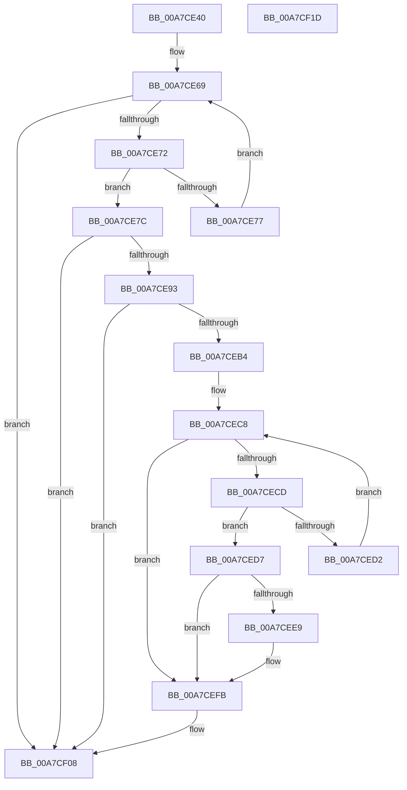

# PopUmpoSendPowerRequestCreate

- RVA: `0x00A7CE40`–`0x00A7CF1E` (길이 `222` bytes)
- VA: `0x0000000140A7CE40`
- 실행 섹션: `PAGE`
- PDB 이름 있음: `예`; PDB Function 태그: `아니요`
- unwind 정보 RVA: `0x000B6A1C`
- 디코드: `60`개 명령, `222/222` bytes 표시
- 미해석 바이트: `0` (있으면 어셈블리에 `.byte`로 보존)

> 이 문서는 커널 이미지의 기계어와 PDB 기호를 분석해 생성했습니다. 4번과 5번은 함수 원형과 자료형을 바이너리 사용 방식에서 추정한 C 해석이며 원본 소스 복구 결과는 아닙니다.

## 1. Dependencies

- 직접 호출 지점: **5**; 고유 호출 대상: **4**
- 직접 호출자로 확인된 함수: **2**
- RIP 상대 이미지 참조: **1**

### Outgoing calls
- `0x00A7CE87` → [PoStoreDiagnosticContext](../../text/23/PoStoreDiagnosticContext_function_0023009C.md) (function, `0x0023009C`)
- `0x00A7CEA7` → [ExAllocatePool2](../../poolcode/B8/ExAllocatePool2_function_00B820F0.md) (function, `0x00B820F0`)
- `0x00A7CEE0` → [PoStoreDiagnosticContext](../../text/23/PoStoreDiagnosticContext_function_0023009C.md) (function, `0x0023009C`)
- `0x00A7CEF6` → [PopUmpoSendPowerMessage](../../text/23/PopUmpoSendPowerMessage_function_00230730.md) (function, `0x00230730`)
- `0x00A7CF03` → [ExFreePoolWithTag](../../poolcode/B8/ExFreePoolWithTag_function_00B82870.md) (function, `0x00B82870`)

### Direct callers
- [PopPowerRequestCreateCommon](../../text/23/PopPowerRequestCreateCommon_function_00230150.md) at `0x00230364`
- [PopPowerRequestNotificationsBegin](../75/PopPowerRequestNotificationsBegin_function_00754B24.md) at `0x00754B5F`

### Static image references
- `0x00A7CE59` → RVA `0x00F0ED40` (`.data`; read)

## 2. Other-region calls and transfers

- 다른 실행 섹션으로 향하는 call: **5**
  - `0x00A7CE87` → [PoStoreDiagnosticContext](../../text/23/PoStoreDiagnosticContext_function_0023009C.md) (`PAGE` → `.text`)
  - `0x00A7CEA7` → [ExAllocatePool2](../../poolcode/B8/ExAllocatePool2_function_00B820F0.md) (`PAGE` → `POOLCODE`)
  - `0x00A7CEE0` → [PoStoreDiagnosticContext](../../text/23/PoStoreDiagnosticContext_function_0023009C.md) (`PAGE` → `.text`)
  - `0x00A7CEF6` → [PopUmpoSendPowerMessage](../../text/23/PopUmpoSendPowerMessage_function_00230730.md) (`PAGE` → `.text`)
  - `0x00A7CF03` → [ExFreePoolWithTag](../../poolcode/B8/ExFreePoolWithTag_function_00B82870.md) (`PAGE` → `POOLCODE`)
- 별도 외부 분기/꼬리 이동을 확인하지 못했습니다.

## 3. Assembly (complete function range)

```asm
00A7CE40  48 8B C4                        mov rax, rsp
00A7CE43  48 89 58 08                     mov qword ptr [rax + 8], rbx
00A7CE47  48 89 68 18                     mov qword ptr [rax + 0x18], rbp
00A7CE4B  48 89 70 20                     mov qword ptr [rax + 0x20], rsi
00A7CE4F  57                              push rdi
00A7CE50  48 83 EC 20                     sub rsp, 0x20
00A7CE54  48 83 60 10 00                  and qword ptr [rax + 0x10], 0
00A7CE59  48 8D 2D E0 1E 49 00            lea rbp, [rip + 0x491ee0]
00A7CE60  8B F9                           mov edi, ecx
00A7CE62  48 8B 0D D7 1E 49 00            mov rcx, qword ptr [rip + 0x491ed7]
00A7CE69  48 3B CD                        cmp rcx, rbp
00A7CE6C  0F 84 96 00 00 00               je 0x140a7cf08
00A7CE72  39 79 24                        cmp dword ptr [rcx + 0x24], edi
00A7CE75  74 05                           je 0x140a7ce7c
00A7CE77  48 8B 09                        mov rcx, qword ptr [rcx]
00A7CE7A  EB ED                           jmp 0x140a7ce69
00A7CE7C  48 8B 49 60                     mov rcx, qword ptr [rcx + 0x60]
00A7CE80  4C 8D 44 24 38                  lea r8, [rsp + 0x38]
00A7CE85  33 D2                           xor edx, edx
00A7CE87  E8 10 32 7B FF                  call 0x14023009c
00A7CE8C  3D 23 00 00 C0                  cmp eax, 0xc0000023
00A7CE91  75 75                           jne 0x140a7cf08
00A7CE93  48 8B 74 24 38                  mov rsi, qword ptr [rsp + 0x38]
00A7CE98  41 B8 55 6D 70 6F               mov r8d, 0x6f706d55
00A7CE9E  B9 00 01 00 00                  mov ecx, 0x100
00A7CEA3  48 8D 56 10                     lea rdx, [rsi + 0x10]
00A7CEA7  E8 44 52 10 00                  call 0x140b820f0
00A7CEAC  48 8B D8                        mov rbx, rax
00A7CEAF  48 85 C0                        test rax, rax
00A7CEB2  74 54                           je 0x140a7cf08
00A7CEB4  C7 00 0F 00 00 00               mov dword ptr [rax], 0xf
00A7CEBA  48 8D 50 10                     lea rdx, [rax + 0x10]
00A7CEBE  89 78 08                        mov dword ptr [rax + 8], edi
00A7CEC1  48 8B 0D 78 1E 49 00            mov rcx, qword ptr [rip + 0x491e78]
00A7CEC8  48 3B CD                        cmp rcx, rbp
00A7CECB  74 2E                           je 0x140a7cefb
00A7CECD  39 79 24                        cmp dword ptr [rcx + 0x24], edi
00A7CED0  74 05                           je 0x140a7ced7
00A7CED2  48 8B 09                        mov rcx, qword ptr [rcx]
00A7CED5  EB F1                           jmp 0x140a7cec8
00A7CED7  48 8B 49 60                     mov rcx, qword ptr [rcx + 0x60]
00A7CEDB  4C 8D 44 24 38                  lea r8, [rsp + 0x38]
00A7CEE0  E8 B7 31 7B FF                  call 0x14023009c
00A7CEE5  85 C0                           test eax, eax
00A7CEE7  78 12                           js 0x140a7cefb
00A7CEE9  45 33 C9                        xor r9d, r9d
00A7CEEC  48 8D 56 10                     lea rdx, [rsi + 0x10]
00A7CEF0  45 33 C0                        xor r8d, r8d
00A7CEF3  48 8B CB                        mov rcx, rbx
00A7CEF6  E8 35 38 7B FF                  call 0x140230730
00A7CEFB  BA 55 6D 70 6F                  mov edx, 0x6f706d55
00A7CF00  48 8B CB                        mov rcx, rbx
00A7CF03  E8 68 59 10 00                  call 0x140b82870
00A7CF08  48 8B 5C 24 30                  mov rbx, qword ptr [rsp + 0x30]
00A7CF0D  48 8B 6C 24 40                  mov rbp, qword ptr [rsp + 0x40]
00A7CF12  48 8B 74 24 48                  mov rsi, qword ptr [rsp + 0x48]
00A7CF17  48 83 C4 20                     add rsp, 0x20
00A7CF1B  5F                              pop rdi
00A7CF1C  C3                              ret
00A7CF1D  CC                              int3
```

## 4. C-style interpretation (structured pseudocode)

```c
__int64 __fastcall PopUmpoSendPowerRequestCreate(int a1, int a2, __int64 a3, int a4)
{
    __int64 result;
    __int64 v_rsp;
    unsigned __int64 v_stack_p10;
    unsigned __int64 v_stack_p18;
    unsigned __int64 v_stack_p20;
    unsigned __int64 v_stack_p8;

    *(unsigned __int64 *)(v_rsp + 8) = v_rbx;
    *(unsigned __int64 *)(v_rsp + 24) = v_rbp;
    *(unsigned __int64 *)(v_rsp + 32) = v_rsi;
    v_rsp = (v_rsp) - (32);
loc_00A7CE69:
    if ((*(unsigned __int64 *)(v_rip + 4792023)) == (v_rip + 4792032)) goto loc_00A7CF08;
    if ((*(unsigned int *)(*(unsigned __int64 *)(v_rip + 4792023) + 36)) == ((unsigned int)((unsigned int)(a1)))) goto loc_00A7CE7C;
    goto loc_00A7CE69;
loc_00A7CE7C:
    a2 = 0;
    result = PoStoreDiagnosticContext(*(unsigned __int64 *)(*(unsigned __int64 *)(*(unsigned __int64 *)(v_rip + 4792023)) + 96), a2, v_stack_p10, a4);
    if (((unsigned int)(result)) != 0xC0000023ULL) goto loc_00A7CF08;
    result = ExAllocatePool2(256, v_stack_p10 + 16, (unsigned int)(0x6F706D55ULL), a4);
    if (result == 0) goto loc_00A7CF08;
    *(unsigned int *)(result) = 15;
    *(unsigned int *)(result + 8) = (unsigned int)((unsigned int)(a1));
loc_00A7CEC8:
    if ((*(unsigned __int64 *)(v_rip + 4791928)) == (v_rip + 4792032)) goto loc_00A7CEFB;
    if ((*(unsigned int *)(*(unsigned __int64 *)(v_rip + 4791928) + 36)) == ((unsigned int)((unsigned int)(a1)))) goto loc_00A7CED7;
    goto loc_00A7CEC8;
loc_00A7CED7:
    result = PoStoreDiagnosticContext(*(unsigned __int64 *)(*(unsigned __int64 *)(*(unsigned __int64 *)(v_rip + 4791928)) + 96), result + 16, v_stack_p10, a4);
    if (!(sign_flag)) {
        a4 = 0;
        a2 = v_stack_p10 + 16;
        a3 = 0;
        a1 = result;
        result = PopUmpoSendPowerMessage(a1, a2, a3, a4);
    }
    result = ExFreePoolWithTag(result, (unsigned int)(0x6F706D55ULL), a3, a4);
loc_00A7CF08:
    v_rsp = (v_rsp) + (32);
    return result;
}
```

## 5. (Beta) C Style

```c
int64_t PopUmpoSendPowerRequestCreate(int32_t Arg1, int32_t Arg2, int64_t Arg3, int32_t Arg4)
{
    int64_t result;
    int64_t local_rsp;
    uint64_t v_stack_p10;
    uint64_t v_stack_p18;
    uint64_t v_stack_p20;
    uint64_t v_stack_p8;

    *(uint64_t *)(local_rsp + 0x8) = local_rbx;
    *(uint64_t *)(local_rsp + 0x18) = local_rbp;
    *(uint64_t *)(local_rsp + 0x20) = local_rsi;
    local_rsp = (local_rsp) - (32);
loc_00A7CE69:
    if ((*(uint64_t *)(v_rip + 0x491ED7)) == (v_rip + 4792032)) goto loc_00A7CF08;
    if ((*(uint32_t *)(*(uint64_t *)(v_rip + 0x491ED7) + 0x24)) == ((uint32_t)((uint32_t)(Arg1)))) goto loc_00A7CE7C;
    goto loc_00A7CE69;
loc_00A7CE7C:
    Arg2 = 0;
    result = PoStoreDiagnosticContext(*(uint64_t *)(*(uint64_t *)(*(uint64_t *)(v_rip + 0x491ED7)) + 0x60), Arg2, v_stack_p10, Arg4);
    if (((uint32_t)(result)) != 0xC0000023ULL) goto loc_00A7CF08;
    result = ExAllocatePool2(256, v_stack_p10 + 16, (uint32_t)(0x6F706D55ULL), Arg4);
    if (result == 0) goto loc_00A7CF08;
    *(uint32_t *)(result) = 15;
    *(uint32_t *)(result + 0x8) = (uint32_t)((uint32_t)(Arg1));
loc_00A7CEC8:
    if ((*(uint64_t *)(v_rip + 0x491E78)) == (v_rip + 4792032)) goto loc_00A7CEFB;
    if ((*(uint32_t *)(*(uint64_t *)(v_rip + 0x491E78) + 0x24)) == ((uint32_t)((uint32_t)(Arg1)))) goto loc_00A7CED7;
    goto loc_00A7CEC8;
loc_00A7CED7:
    result = PoStoreDiagnosticContext(*(uint64_t *)(*(uint64_t *)(*(uint64_t *)(v_rip + 0x491E78)) + 0x60), result + 16, v_stack_p10, Arg4);
    if (!(sign_flag)) {
        Arg4 = 0;
        Arg2 = v_stack_p10 + 16;
        Arg3 = 0;
        Arg1 = result;
        result = PopUmpoSendPowerMessage(Arg1, Arg2, Arg3, Arg4);
    }
    result = ExFreePoolWithTag(result, (uint32_t)(0x6F706D55ULL), Arg3, Arg4);
loc_00A7CF08:
    local_rsp = (local_rsp) + (32);
    return result;
}
```

## 6. Execution-region graph

[열기: 2D/3D 그래프와 함수 탐색 컨트롤 패널](../../../control-panel.html?section=page&rva=0x00A7CE40&view=graph)

- 2D 그래프는 위에서 아래로 흐르고, 3D 그래프는 빈 공간을 드래그해 회전합니다. Shift+드래그는 이동, 휠은 확대·축소, 함수 노드 선택은 대상 보고서 이동입니다.

### Static fallback


